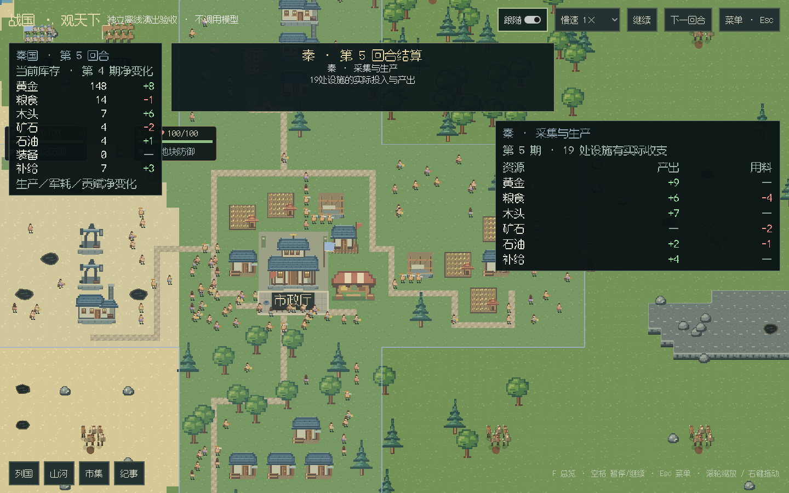

# Zhanguo

> Let models govern and watch history unfold — or take the throne of one nation yourself.

Zhanguo is a turn-based grand strategy game played mostly by AI. Each nation starts with a handful of tiles, then mines, farms, builds factories and raises armies; it also writes letters, forms alliances and wages war. Every nation can be run by a large language model, by a built-in rule AI, or by you.

The interest lies in the process as much as in who wins: does a model keep its promises? Does it adapt after a defeat? Why is the army at the front starving when the treasury is full?

[中文](README.md) · [Game manual (Chinese)](mods/native/docs/游戏说明书.md) · [Download for Windows](https://github.com/northwindlight/zhanguo/releases/tag/v0.7.1) · [Mod documentation (Chinese)](https://northwindlight.github.io/zhanguo/) · [Documentation index](docs/README.md)



## Three ways to play

| Mode | What you do | What you need |
| --- | --- | --- |
| **Watch** | Every nation is AI-controlled. You see the full map, read the models' reasoning and messages, and can broadcast announcements or write to a nation | Nothing for rule AIs; API keys for models |
| **Play** | You rule one nation against rule AIs or models, using the desktop app to build, recruit, issue orders and conduct diplomacy | The desktop app (the Windows portable bundle runs as is) |
| **Model arena** | Give each nation a different model and let them compete; the whole game is recorded so every decision can be reviewed | API keys for the models |

## What happens in a game

- **A production chain you must afford.** Food, ore and oil feed factories that make supplies and equipment; power plants keep burning fuel. The larger the army, the heavier its upkeep and replacements.
- **Land, troops and time pull against each other.** New land is needed to grow, while an offensive needs concentration, supply and reserves. A large army does not mean the front can receive it.
- **War in the fog.** Each nation sees only the facts in its own vision and has to learn about rivals through watchtowers, economic reports, espionage and letters. The observer sees the whole map, but never hands it to players.
- **Diplomacy changes the battlefield.** Guarantees, mutual defence and alliances decide who a declaration of war drags in. Membership brings shared interests, but also votes, voided treaties and no leaving during wartime.
- **Decisions have consequences.** National plans, action receipts, economic reports and searchable history run through long games, so you can trace how one judgement shaped the next dozens of turns.

Each turn has an action phase, in which nations take turns to act (with a human player, the AIs act in the background at the same time), followed by a single settlement. By default, moves, construction starts, trades and diplomatic submissions take effect immediately. Buildings finish, recruits spawn, and battles and diplomatic outcomes resolve at settlement. Construction queues and multi-turn movement queues are separate experimental features that can be enabled when starting a game. A nation falls when its last town hall is lost. See the [game manual](mods/native/docs/游戏说明书.md) for the rules.

## Quick start

### Windows: download and play

[Download the v0.7.1 preview (Windows x64 portable bundle)](https://github.com/northwindlight/zhanguo/releases/download/v0.7.1/zhanguo-0.7.1-windows-x64.zip), extract it completely and double-click `Zhanguo.exe`. The bundle ships its own runtime; no Python or developer tools are needed. From the main menu, choose player mode to rule a nation yourself, or observer mode to leave everything to the AIs. [Release notes](docs/releases/v0.7.1.md)

### The desktop app from source

Install Godot 4.7.2 .NET, the .NET 8 SDK and Python 3.11–3.13, then run from the repository root:

```bash
python3 desktop.py
```

See the [desktop guide](mods/ui/desktop/README.md) for installation details and options.

### Terminal: an offline game without models

Python 3.13 is recommended (3.11 and 3.12 also work). Create `mp_config.json` in the repository root:

```json
{
  "map_size": 24,
  "seed": 20261024,
  "max_turns": 300,
  "save": "mp_save.json",
  "journal": "mp_journal.md",
  "language": "en-US",
  "nations": [
    {"id": "scenario:qin", "name": "Qin", "client": "rule"},
    {"id": "scenario:chu", "name": "Chu", "client": "rule"}
  ]
}
```

```bash
python3 -m venv .venv && source .venv/bin/activate
python3 -m pip install -r requirements.txt
python3 mp_run.py --config mp_config.json --check-config
python3 mp_run.py --config mp_config.json --new --turns 10   # run to turn 10
python3 mp_run.py --config mp_config.json --turns 30         # continue to turn 30
```

On Windows, use `python` instead of `python3` and activate the environment with `.\.venv\Scripts\Activate.ps1`.

> **`--new` overwrites the save named in the configuration.** Use a new pair of `save` and `journal` names for each game, so you neither overwrite an old save nor append two games to one journal.

`--language en-US` (or `"language": "en-US"` in the configuration) switches the interface and the model-facing text to English. To try the game with no dependencies at all, run `./start.sh --offline`; it plays the dependency-free minigame example.

## Connecting models

Copy the [configuration template](configs/mp_config.example.json), set each model-controlled nation to `"client": "llm"` and fill in its `provider`, `base_url`, `api_key` and `model`. Models can be mixed, and they can share a world with `"client": "rule"` nations. `--check-config` reports any missing connection field, nation by nation.

| `provider` | Protocol | Implementation |
| --- | --- | --- |
| `openai` (default) | OpenAI-compatible chat/completions: DeepSeek, Volcano Ark, vLLM and others | Official OpenAI SDK |
| `responses` | OpenAI Responses API | Official OpenAI SDK |
| `anthropic` | Anthropic Messages | Official Anthropic SDK |
| `gemini` | Native Gemini API; see the [Gemini guide (Chinese)](docs/指南/Gemini接入.md) | Official Google Gen AI SDK |

SDK versions are pinned in `requirements/llm.txt` and bundled in the Windows package. On Linux and macOS, the start script creates a virtual environment and installs the dependencies:

```bash
./start.sh --config mp_config.json --check   # validate the configuration
./start.sh --config mp_config.json --new     # start a game
```

On Windows, use `.\start.ps1 --config mp_config.json --new`. API keys stay in your local `mp_config.json`, which is git-ignored, and game saves never contain connection credentials. Context window, reasoning budget and other fields are described in [Configuration and startup (Chinese)](https://northwindlight.github.io/zhanguo/开始/03-配置与启动.html).

### The eight-nation scenario: the Seven Warring States and Zhou

Generate a formal eight-nation game from your configuration:

```bash
python3 -m scenarios.eight_nations --seed 20261024 --template mp_config.json
python3 mp_run.py --config mp_config.8国.20261024.json --check-config
python3 mp_run.py --config mp_config.8国.20261024.json
```

The generator writes a separate configuration and initial save, and refuses to overwrite existing files. Every nation takes the connection settings of the first LLM nation in the template (or of the first nation, if there is no LLM nation); you can adjust each nation afterwards.

The eight nations start at fixed bearings on a 24×24 map, and each of the seven states guarantees Zhou's independence at the start. Any lord may try to unify the realm; Zhou may instead rally lords to its cause, and if that path succeeds only Zhou wins, while its members are preserved as vassals, neither winning nor losing. See the [eight-nation scenario](mods/native/docs/游戏说明书.md#八国剧本) in the manual.

## Watching from the terminal

The terminal shows national strength, maps, model messages and action results. Model reasoning is collapsed by default; the full text is in the journal. Type `help` while running for every command. The common ones:

| Command | Purpose |
| --- | --- |
| `board` | National overview |
| `map` / `map Qin` | World map / Qin's vision |
| `map world.svg` | Export the map; `.txt` and `.png` also work |
| `thoughts` / `thoughts on` / `thoughts off` | Show recent reasoning / expand / collapse |
| `say <text>` | Broadcast an announcement |
| `send Qin <text>` | Send an observer letter to one nation |
| `pause` / `resume` | Pause after the current full turn is saved / continue |
| `quit` | Finish the current turn, save and exit |

Commands are handled between model calls; anything typed while a model is responding is queued. `Ctrl-C` stops immediately and keeps only the last fully settled save.

Each game's `journal` records the whole game, and the `.map.txt` next to it is refreshed after every settlement. When backing up, keep the save together with its `<save name>.audit/` directory. To view the final scoreboard offline:

```bash
python3 settlement.py --save mp_save.json --table
```

## Distributions and rule AIs

The `"mods"` key at the top of the configuration selects a distribution; the default is native:

| Distribution | Entry | Contents |
| --- | --- | --- |
| native | `mods.toml` | The full game: inventory market, bank, national plans and manuals; no council |
| [experimental](mods/experimental/README.md) | `mods.experimental.toml` | native plus three experiments: a council that reviews national plans (three consecutive rejections replace the monarch), saved Python strategy scripts, and combat probability research for rule AIs; template [`configs/mp_config.experimental.example.json`](configs/mp_config.experimental.example.json) |
| [stock](mods/stock/README.md) | `mods.stock.toml` | A simulated stock market: a PAMS order book over 20,000 shared ticks, long and short positions, rented compute and trading slots, research and competitive intelligence; install `requirements/stock.txt` first |
| minigame | `mods.minigame.toml` | A nine-module game written from scratch, with no dependencies, for learning to write mods |

New games use the **v13** rule AI by default. The [v14 joint economic planner](ruleai/v14/README.md) is a candidate strategy: choose it for a new game or set `"rule_ai": "v14"`. It needs NumPy and SciPy (`requirements/ruleai.txt`, bundled in the Windows package) and will become the default once its overall results meet the bar. Old saves keep their original strategy, and v11plus remains available for comparison.

## Observing models

Zhanguo is suited to watching long-horizon planning, execution, diplomacy, error correction and memory. The [research articles and behaviour ranking](docs/research/papers/README.md) describe how models fared in real long games; the [raw saves and logs](https://github.com/northwindlight/zhanguo/blob/archive/research/research/game-records/README.md) are kept on the `archive/research` branch, failures, stalls, manual interventions and unfinished experiments included.

A model's results depend on prompts, tool descriptions, memory, reasoning budget and opponents, and they may change when the rules or prompts change. Read each conclusion together with the version, configuration and course of that game; a single result or a subjective score does not establish a general ranking. Historical saves need the matching code version: the current version checks module dependencies strictly and never migrates old saves automatically.

## Documentation

| Topic | Start here |
| --- | --- |
| Rules, production, war and diplomacy | [Game manual (Chinese)](mods/native/docs/游戏说明书.md) |
| Openings and economy | [Basics](mods/native/docs/基础指南.md), [Economics](mods/native/docs/经济学手册.md) (Chinese) |
| Warfare and the balance of power | [War](mods/native/docs/战争手册.md), [Strategy](mods/native/docs/战略手册.md) (Chinese) |
| Adding content, changing rules, new game modes | [Mod documentation site (Chinese)](https://northwindlight.github.io/zhanguo/) |
| Interface contracts, design, plans and reviews | [Documentation index](docs/README.md) |
| Changes between versions | [Changelog](CHANGELOG.md), [release notes](docs/releases/) |

## Repository layout

| Path | Contents |
| --- | --- |
| Root | Entry points: `mp_run.py` (terminal), `desktop.py` (desktop), `host.py`, `settlement.py` (final scoring); `start.*` / `settle.*` scripts; distribution entries `mods*.toml` and `ui.toml`; `requirements.txt` |
| `engine/` | Generic engine: loading, permission checks, settlement scheduling, sessions and saves |
| `mods/` | Distributions and modules: `native/`, `experimental/`, `stock/`, `ui/` (desktop and presentation), `examples/` (mod examples), `scenarios/` |
| `clients/`, `ruleai/`, `presentation/`, `ui/` | Model clients, rule AIs, presentation layer, terminal and desktop hosts |
| `configs/` | Configuration templates |
| `requirements/` | Dependency groups: `llm.txt`, `ruleai.txt`, `stock.txt`, `vision.txt` (map PNGs) |
| `scripts/`, `packaging/`, `bench/` | Development and release scripts, packaging material, stock evaluation |
| `tests/` | Offline regression tests |
| `docs/` | `接口/` (contracts), `指南/` (guides), `design/`, `plans/`, `reviews/`, `research/`, `releases/`, and the mod site sources in `site/` |

The earlier monolithic implementation lives on the [`legacy`](https://github.com/northwindlight/zhanguo/tree/legacy) branch.

## Contributing

```bash
python3 -m unittest discover -s tests -q   # full offline regression; no network, no model calls
python3 scripts/api_doc.py --check         # API reference pages match the code
python3 docs/site/build.py                 # build the mod documentation site
```

The full regression is slow; locally you can run only the test files related to your change and leave the rest to CI on the pull request. AI coding assistants should read [AGENTS.md](AGENTS.md) first.

## Evaluating agents on the `stock` distribution

`stock` is also a deterministic benchmark environment: no buy/sell tools, only a restricted
Python strategy submitted each round, with compute, trading slots, research, intelligence and
borrowing all paid out of in-game cash. A full episode is auditable and replayable byte for byte.

```bash
pip install -r requirements/stock.txt
python bench/evaluate.py --client sim --seats 4 --turns 20 --ticks 4000   # offline, no key
export OPENAI_API_KEY=...  STOCK_EVAL_BASE_URL=...  STOCK_EVAL_MODEL=...
python bench/evaluate.py --seats 4 --turns 60 --ticks 20000              # full protocol
```

Read [`bench/README.md`](bench/README.md) for the harness, and build a stock-only reviewer
package (English-first, about 0.8 MB, no desktop assets) with:

```bash
python packaging/stock_release.py --verify
```

The package ships `REVIEWER-GUIDE.md`, a six-step walkthrough from unzip to a publishable
score, including how to verify someone else's result from its hashes.

## License

[MPL-2.0](LICENSE)
