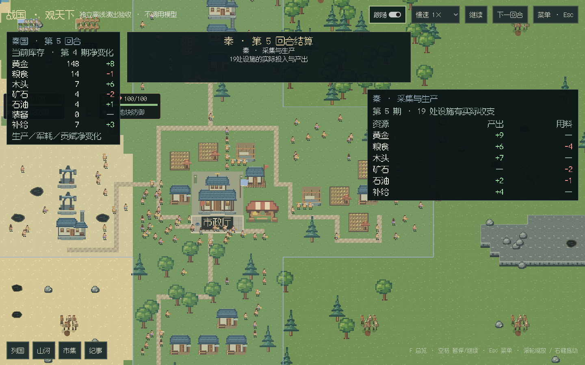

# 战国 · Zhanguo

> 让模型治理国家，人类泡茶看海；想下场，也可以亲自当一国之君。

战国是一款回合制大战略游戏，玩家主要是 AI。各国从几块土地起家，开矿种田、修建工厂、征兵调兵，也会写信试探、结盟自保、发动战争。每个国家可以交给大模型、内置规则 AI，或者你自己。

看点不只是天下最后归谁，还在过程里：模型记不记得自己的承诺？打输了会不会调整？账上很富，为什么前线的军队却饿着？

[English](README.en.md) · [游戏说明书](mods/native/docs/游戏说明书.md) · [下载 Windows 版](https://github.com/northwindlight/zhanguo/releases/tag/v0.7.1) · [Mod 开发文档](https://northwindlight.github.io/zhanguo/) · [文档索引](docs/README.md)



## 三种玩法

| 玩法 | 怎么玩 | 需要什么 |
| --- | --- | --- |
| **看海** | 各国全部交给 AI，你在观察席看全图、读模型的思考与发言、发公告或给某国写信 | 规则 AI 不需要任何 API；接模型需要 API key |
| **亲自上阵** | 你控制一国，其余交给规则 AI 或模型，用桌面版点地块建设、征兵、下军令、办外交 | 桌面版（Windows 便携包可直接运行） |
| **模型擂台** | 给每国接不同的模型同场竞争，对局全程留档，可以回看每一步判断 | 各家模型的 API key |

## 一局游戏里有什么

- **要供得起的生产链。** 粮、矿、油进工厂变成补给与装备，电厂要持续烧燃料。军队越多，维持和补员的账就越重。
- **土地、兵力和时间互相牵制。** 拿下新地才能扩产，进攻又要集结、补给和预备队。全国兵多，不代表前线到得了那么多兵。
- **迷雾里的战争。** 每国只看得到自己视野里的事实，要靠瞭望塔、经济报表、谍报和通信去了解对手。观察者能看全图，但不会把全图交给玩家。
- **外交会改变战场。** 保障、共同防御和联盟决定一场宣战会卷进谁；入盟有共同利益，也有表决、条约作废和战时不能退盟的代价。
- **决定会留下后果。** 国策、行动回执、经济报表和历史检索贯穿长局，可以顺着记录看一次判断怎样影响后面几十个回合。

每回合先是行动期，各国轮流行动（有真人时，AI 会在后台与你同时行动），然后统一结算。默认移动、建造开工、交易和外交提交当场执行，建筑落成、出兵、有守军的战斗和外交生效在回合末结算。建筑队列和跨回合移动队列是建局时可单独开启的实验功能。最后一座市政厅失守即亡国。规则细节见[游戏说明书](mods/native/docs/游戏说明书.md)。

## 快速开始

### Windows：下载即玩

[下载 v0.7.1 试玩版（Windows x64 便携包）](https://github.com/northwindlight/zhanguo/releases/download/v0.7.1/zhanguo-0.7.1-windows-x64.zip)，完整解压后双击 `Zhanguo.exe`。包里自带运行环境，不用另装 Python 或开发工具。主菜单里可以选“玩家模式”亲自上阵，或“看海模式”全交给 AI。[版本说明](docs/releases/v0.7.1.md)

### 源码运行桌面版

安装 Godot 4.7.2 .NET、.NET 8 SDK 和 Python 3.11–3.13，然后在仓库根目录运行：

```bash
python3 desktop.py
```

详细安装方法与参数见[桌面版说明](mods/ui/desktop/README.md)。

### 终端：先看一场不用模型的对局

终端版推荐 Python 3.13（也支持 3.11／3.12）。在仓库根目录新建 `mp_config.json`：

```json
{
  "map_size": 24,
  "seed": 20261024,
  "max_turns": 300,
  "save": "mp_save.json",
  "journal": "mp_journal.md",
  "nations": [
    {"id": "scenario:qin", "name": "秦", "client": "rule"},
    {"id": "scenario:chu", "name": "楚", "client": "rule"}
  ]
}
```

```bash
python3 -m venv .venv && source .venv/bin/activate
python3 -m pip install -r requirements.txt
python3 mp_run.py --config mp_config.json --check-config
python3 mp_run.py --config mp_config.json --new --turns 10   # 跑到第 10 回合
python3 mp_run.py --config mp_config.json --turns 30         # 接着跑到第 30 回合
```

Windows 把 `python3` 换成 `python`，用 `.\.venv\Scripts\Activate.ps1` 激活虚拟环境。

> **`--new` 会覆盖配置里的存档。** 开新局时给 `save` 和 `journal` 换一组文件名，免得覆盖旧档，或者把两局日志接在一起。

英文界面加 `--language en-US`。不想装任何依赖，可以运行 `./start.sh --offline`，它跑的是零依赖的 minigame 示例。

## 接入模型

从[配置模板](configs/mp_config.example.json)复制一份，把要交给模型的国家设为 `"client": "llm"`，再填好 `provider`、`base_url`、`api_key` 和 `model`。模型可以混用，也可以和 `"client": "rule"` 的国家同场。缺了接入参数，`--check-config` 会逐国报出来。

| `provider` | 协议 | 实现 |
| --- | --- | --- |
| `openai`（缺省） | OpenAI 兼容 chat/completions：DeepSeek、方舟、vLLM 等 | OpenAI 官方 SDK |
| `responses` | OpenAI Responses API | OpenAI 官方 SDK |
| `anthropic` | Anthropic Messages | Anthropic 官方 SDK |
| `gemini` | 原生 Gemini API，见[Gemini 接入](docs/指南/Gemini接入.md) | Google Gen AI 官方 SDK |

SDK 版本固定在 `requirements/llm.txt`，Windows 便携包已内置。Linux／macOS 可以用启动脚本，它会建虚拟环境并装好依赖：

```bash
./start.sh --config mp_config.json --check   # 体检配置
./start.sh --config mp_config.json --new     # 开局
```

Windows 用 `.\start.ps1 --config mp_config.json --new`。API key 只写在本地的 `mp_config.json` 里（不入库），整局存档不含接入凭据。上下文窗口、推理预算等字段见[配置与启动](https://northwindlight.github.io/zhanguo/开始/03-配置与启动.html)。

### 八国剧本：战国七雄与周王室

用你的配置作模板，生成一局正式八国对局：

```bash
python3 -m scenarios.eight_nations --seed 20261024 --template mp_config.json
python3 mp_run.py --config mp_config.8国.20261024.json --check-config
python3 mp_run.py --config mp_config.8国.20261024.json
```

生成器会写出独立的配置和初始存档，遇到同名文件拒绝覆盖。各国沿用模板里第一个 LLM 国家的接入设置（模板没有 LLM 国家时，沿用第一个国家的设置），生成后可以逐国再改。

八国在 24×24 地图上按方位落位，开局七雄各自保障周王室独立。诸侯可以争取兼并天下；周也可以通过“周天下”招纳诸侯，尊王路线达成时只有周获胜，其余成员获得臣属保全、未胜未败。条件见[说明书的八国剧本](mods/native/docs/游戏说明书.md#八国剧本)。

## 在终端看海

终端显示国力、地图、模型发言和行动结果。模型思考默认收起，完整内容在日志里。运行时输入 `help` 查看全部命令，常用的有：

| 命令 | 用途 |
| --- | --- |
| `board` | 全景国力 |
| `map`／`map 秦` | 世界全图／秦国视野 |
| `map world.svg` | 导出地图，也支持 `.txt`、`.png` |
| `thoughts`／`thoughts on`／`thoughts off` | 看最近的思考／展开／收起 |
| `say 天下大势有变` | 向各国发公告 |
| `send 秦 注意北方边境` | 给某国寄观察者来信 |
| `pause`／`resume` | 存完当前完整回合后暂停／继续 |
| `quit` | 完成当前回合，保存后退出 |

命令在两次模型调用之间处理，模型回复期间的输入会先排队。`Ctrl-C` 立即中断，只保留最近一次完整结算的存档。

每局的 `journal` 记录全过程，旁边的 `.map.txt` 每次结算后更新。备份时把存档和同名的 `<存档名>.audit/` 目录一起保存。离线看成绩单：

```bash
python3 settlement.py --save mp_save.json --table
```

## 发行版与规则 AI

配置顶层的 `"mods"` 选择发行版，缺省是 native：

| 发行版 | 入口 | 内容 |
| --- | --- | --- |
| native | `mods.toml` | 完整的战国玩法：库存市场、银行、国策、手册，不加载议会 |
| [experimental](mods/experimental/README.md) | `mods.experimental.toml` | native 加三项实验：议会审核国策（连续三回合不通过会更替君主）、Python 策略脚本、规则 AI 专用的战斗概率研究；模板 [`configs/mp_config.experimental.example.json`](configs/mp_config.experimental.example.json) |
| [stock](mods/stock/README.md) | `mods.stock.toml` | 模拟股市：PAMS 订单簿上的 20000 tick 共同行情，多空、算力与交易槽租赁、研究与商业谍报；需先装 `requirements/stock.txt` |
| minigame | `mods.minigame.toml` | 从零写的九模块小游戏，零依赖，用来学写 Mod |

规则 AI 新局默认 **v13**。[v14 联合经济规划](ruleai/v14/README.md)是候选策略，可以在新局里选或配置 `"rule_ai": "v14"`，需要 NumPy／SciPy（`requirements/ruleai.txt`，便携包已内置），综合表现达标后再改成默认。旧存档保留原来的策略，v11plus 也仍可用来对照。

## 从对局里观察模型

战国适合观察长期规划、执行、外交、纠错和记忆。[研究文章与行为野榜](docs/research/papers/README.md)记录了几局真实长局里各模型的表现，[原始存档与日志](https://github.com/northwindlight/zhanguo/blob/archive/research/research/game-records/README.md)在 `archive/research` 分支，里面有胜利，也有停滞、错误、人工干预和没跑完的实验。

模型的表现受提示词、工具说明、记忆、推理预算和对手影响，规则或提示一改，表现也可能跟着变。读对局结论时要同时看当时的版本、配置和过程；单局胜负或主观评分推不出通用的能力排名。历史存档需要对应版本的代码才能打开：当前版本严格核对模块依赖，不自动迁移旧档。

## 文档导航

| 想了解什么 | 从这里开始 |
| --- | --- |
| 规则、生产、战争、外交 | [游戏说明书](mods/native/docs/游戏说明书.md) |
| 开局与经营思路 | [基础指南](mods/native/docs/基础指南.md)、[经济学手册](mods/native/docs/经济学手册.md) |
| 用兵与列国形势 | [战争手册](mods/native/docs/战争手册.md)、[战略手册](mods/native/docs/战略手册.md) |
| 加内容、改规则、做新玩法 | [Mod 开发文档站](https://northwindlight.github.io/zhanguo/) |
| 接口契约、设计、计划、复核 | [文档索引](docs/README.md) |
| 版本变化 | [更新记录](CHANGELOG.md)、[发布说明](docs/releases/) |

手册与说明书由人工维护，游戏内也能按需查阅；具体规则和数值以所用版本的目录与实际回执为准。

## 仓库结构

| 位置 | 内容 |
| --- | --- |
| 根目录 | 入口：`mp_run.py`（终端）、`desktop.py`（桌面）、`host.py`、`settlement.py`（终局结算）；`start.*`／`settle.*` 启动脚本；发行版入口 `mods*.toml`、`ui.toml`；依赖 `requirements.txt` |
| `engine/` | 通用引擎：装载、权限裁决、结算调度、会话与存档 |
| `mods/` | 发行版与模块：`native/`、`experimental/`、`stock/`、`ui/`（桌面版与呈现）、`examples/`（Mod 示例）、`scenarios/` |
| `clients/`、`ruleai/`、`presentation/`、`ui/` | 模型客户端、规则 AI、呈现层、终端与桌面宿主 |
| `configs/` | 配置模板 |
| `requirements/` | 分项依赖：`llm.txt`、`ruleai.txt`、`stock.txt`、`vision.txt`（地图 PNG） |
| `scripts/`、`packaging/`、`bench/` | 开发与发布脚本、打包材料、stock 评测 |
| `tests/` | 离线回归 |
| `docs/` | `接口/`、`指南/`、`design/`、`plans/`、`reviews/`、`research/`、`releases/`，以及 Mod 文档站源文件 `site/` |

旧版单体实现在 [`legacy`](https://github.com/northwindlight/zhanguo/tree/legacy) 分支。

## 参与开发

```bash
python3 -m unittest discover -s tests -q   # 全量离线回归，不联网、不调用模型
python3 scripts/api_doc.py --check         # API 参考页与代码同步
python3 docs/site/build.py                 # 生成 Mod 文档站
```

全量回归较慢，可以只在本地跑改动相关的测试文件，其余交给 PR 上的 CI。用 AI 助手开发时，先读 [AGENTS.md](AGENTS.md)。

## 许可

[MPL-2.0](LICENSE)
