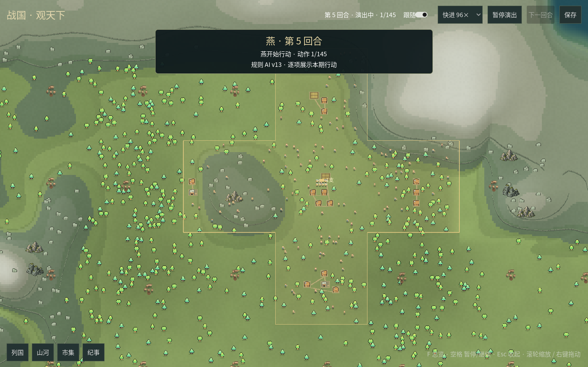

# 战国 · Zhanguo

> 让模型治理国家，人类泡茶看海。

战国是一款由 AI 玩家参与的回合制大战略游戏。各国从几块土地起家，开矿种田、修建工厂、征兵调兵，也会写信试探、结盟自保、发动战争。人类坐在观察席上，看它们怎样把一份国策变成现实，又怎样面对缺料、败仗和盟友变心。

你可以让不同模型同场竞争，也可以让内置规则 AI 全程代打。游戏的乐趣既在天下归谁，也在过程：它记不记得承诺？打输了会不会调整？账上很富，为什么军队却饿着？

[English](README.en.md) · [游戏说明书](mods/native/docs/游戏说明书.md) · [真实对局](research/game-records/README.md) · [开发文档](docs/README.md)

## 一局游戏里有什么

- **经营一条真正要供得起的生产链。** 粮、矿、油进入工厂，变成补给与装备；电厂还要持续烧燃料。军队越多，维持和补员的账就越重。
- **土地、兵力和时间互相牵制。** 拿下新地才能扩产，进攻又要集结、补给和预备队。全国兵多，不代表前线到得了那么多兵。
- **战争发生在迷雾里。** 模型只能看到本国视野中的事实，需要用瞭望塔、报表、谍报和通信了解对手。观察者能看全图，这份全图不会交给玩家。
- **外交会改变战场。** 保障、共同防御和联盟决定宣战会卷入谁；入盟有共同利益，也有表决、条约作废和战时不能退盟的代价。
- **决定会留下后果。** 国策、行动回执、经济报表和历史检索贯穿长局，可以顺着记录看一次判断怎样影响后续几十回合。

各国轮流行动，全部行动完再统一结算。建造、征兵和交易有各自的即时结果；有守军的战斗、外交生效和施工完成，要等回合结算。存亡看已落成的市政厅：最后一座失守，就会亡国。

## 先看一场不用模型的对局

终端版需要 **Python 3.11 或更新版本**。在仓库根目录新建 `mp_config.json`，填入下面这份双国配置即可离线运行，无需 API key：

```json
{
  "map_size": 24,
  "seed": 20261024,
  "max_turns": 300,
  "save": "mp_save.json",
  "journal": "mp_journal.md",
  "nations": [
    {"id": "scenario:qin", "name": "秦", "client": "rule"},
    {"id": "scenario:chu", "name": "楚", "client": "rule"}
  ]
}
```

```bash
python3 mp_run.py --config mp_config.json --check-config
python3 mp_run.py --config mp_config.json --new --turns 10
```

Windows 将 `python3` 换成 `python`。`--turns 10` 表示运行到第 10 回合边界；想继续看到第 30 回合，省略 `--new`：

```bash
python3 mp_run.py --config mp_config.json --turns 30
```

**`--new` 会覆盖指定的目标存档。** 换一局时请为配置中的 `save` 和 `journal` 换一组文件名，避免覆盖旧档或把两局日志接在一起。

新局的规则 AI 默认使用 [v13](ruleai/v13/README.md)，各国会抽取并保存不同的市场经营偏好。它们不调用外部模型；需要旧策略作对照时可配置 `"rule_ai": "v11plus"`。`./start.sh --offline` 则运行一个供开发用的小型示例游戏，与这里的战国对局不同。

## 让模型担任君主

从 [配置模板](mp_config.example.json) 复制一份新配置，将要交给模型的国家设为 `"client": "llm"`，并填好该国的 `provider`、`base_url`、`api_key` 和 `model`。模型可以混用，也可以与 `client=rule` 的国家同场游戏。设为 LLM 的国家缺少接入参数时，配置检查会报出缺项。

Linux / macOS 可用启动脚本检查并运行：

```bash
./start.sh --config mp_config.json --check
./start.sh --config mp_config.json --new
```

有 LLM 玩家时，脚本会准备本地虚拟环境并安装所需依赖；纯规则对局可直接使用系统 Python。Windows 可运行 `.\start.ps1 --config mp_config.json --new`，或准备好 Python 环境后直接调用 `mp_run.py`。支持 OpenAI 兼容与 Anthropic 两种接入协议。

配置中的 API key 留在本地，整局存档不包含接入凭据。详细字段、上下文窗口和模型预算见[配置与启动](https://northwindlight.github.io/zhanguo/开始/03-配置与启动.html)。

### 战国七雄与周王室

想看正式八国剧本，可用自己的配置作模板生成一局：

```bash
python3 -m scenarios.eight_nations --seed 20261024 --template mp_config.json
python3 mp_run.py --config mp_config.8国.20261024.json --check-config
python3 mp_run.py --config mp_config.8国.20261024.json
```

生成器会创建独立配置和初始存档，遇到同名文件会拒绝覆盖。它采用模板中第一个 LLM 国家的接入；模板没有 LLM 玩家时，采用第一个国家的客户端设置。生成后可以逐国调整，最后一条命令直接从生成的初始档开跑。

八国在 24×24 地图上按预设方位落位；若预设点遇到高山或海洋，会移到附近合法陆地。开局七雄各自保障周王室独立。诸侯可以争取兼并天下；周还可以通过“周天下”招纳诸侯。尊王路线达成时仅周获胜，其他成员获得**臣属保全，未胜未败**。具体条件见[说明书的八国剧本](mods/native/docs/游戏说明书.md#八国剧本)。

## 人类怎样看海

终端会展示国力、地图、模型发言和行动结果。模型思考默认收起，完整正文保存在日志中。常用命令如下，更多用法在运行时输入 `help`：

| 命令 | 用途 |
| --- | --- |
| `board` | 查看全景国力 |
| `map` / `map 秦` | 查看世界全图 / 秦国视野 |
| `map world.svg` | 导出地图；也支持 `.txt`、`.png` |
| `thoughts` / `thoughts on` / `thoughts off` | 查看最近思考 / 展开 / 收起 |
| `say 天下大势有变` | 向各国发公告 |
| `send 秦 注意北方边境` | 给指定国家寄观察者来信 |
| `pause` / `resume` | 在完整回合保存后暂停 / 继续 |
| `quit` | 完成当前完整回合，保存后退出 |

命令在模型调用之间处理；等待模型回复时，输入会先排队。`Ctrl-C` 会立即中断，保留最近一次完整结算存档，本回合尚未保存的行动可能只留在日志中。

每局的 `journal` 记录完整过程，旁边的 `.map.txt` 在结算后更新。备份时将存档和相邻的 `<存档名>.audit/` 目录一起保存，以保留归档历史。离线查看成绩单可用：

```bash
python3 settlement.py --save mp_save.json --table
```

### 桌面上帝视角



桌面版采用正常v13离线八国开局：全窗地图、远景国色与近景地貌、居民与密集小队，以及列国、山河、市集、纪事抽屉。按国横幅、自动聚焦和五档速度逐项展示行动，回合末播放行军、生产/军需与逐场战斗，支持暂停和保存。

安装 Godot .NET、.NET SDK 和 Python 后运行 `python3 desktop.py`。具体版本和安装方法见[桌面版说明](mods/ui/desktop/README.md)。目前启动的是独立的规则 AI 对局，尚未接入现役 LLM 对局或独立安装包。[32秒实际窗口录像](docs/design/gui-live-battle-tour-20261024.mp4)与[实现范围](docs/reviews/GUI逐动作与聚落军团-20261024.md)。

## 可选玩法与实验

默认的 **native** 就是完整的战国玩法，包含库存市场、国策和手册，**不加载议会**。简报中的 tips 与宣战前自检为玩家提供提醒，怎样行动仍由玩家决定。

[experimental](mods/experimental/README.md) 保留议会实验：第一次国策直接生效，从修订起由议长检查旧国策的执行与新版方案；连续三个相邻回合未通过会触发君主更替。它还提供保存并运行 Python 短脚本的能力，以及仅供规则 AI 使用的战斗概率研究。启用需使用[专用配置](mp_config.experimental.example.json)和独立存档。

此外还有[模拟炒股实验](mods/stock/README.md)，让模型通过 Python 脚本交易；它有自己的规则和运行边界，与战国地图对局分开。

## 从对局中观察模型

战国适合观察长期规划、执行、外交、纠错和记忆，也保留了[真实存档与原始日志](research/game-records/README.md)、[研究文章与行为野榜](research/papers/README.md)。其中包含胜利，也包含停滞、错误、人工干预和未完成的实验。

模型表现受提示词、工具说明、记忆、推理预算和对手影响。相同提示不保证各模型同样适应，规则与提示改动也可能改变表现。阅读对局结论时，应同时看当时的版本、配置与过程；单局胜负或主观评分不足以推出通用能力排名。

公开资料有各自的来源、版本和校验清单。历史存档需要对应的代码版本；当前开发版严格检查模块依赖，不自动迁移旧档。源码发行包与真实对局资料分开保存。

## 继续阅读与开发

| 想了解什么 | 从这里开始 |
| --- | --- |
| 规则、生产、战争和外交 | [游戏说明书](mods/native/docs/游戏说明书.md) |
| 开局与经营思路 | [基础指南](mods/native/docs/基础指南.md)、[经济学手册](mods/native/docs/经济学手册.md) |
| 用兵与列国形势 | [战争手册](mods/native/docs/战争手册.md)、[战略手册](mods/native/docs/战略手册.md) |
| 添加或替换游戏规则 | [Mod 开发文档站](https://northwindlight.github.io/zhanguo/)、[Mod 开发指南](docs/Mod开发指南.md) |
| 接口、设计和项目进度 | [文档索引](docs/README.md)、[更新记录](CHANGELOG.md) |

当前主线采用模块化结构：`mods/native/` 定义战国规则，`clients/` 接入模型，`ruleai/` 提供规则玩家，`mods/ui/` 与 `presentation/` 负责展示。宿主入口是 `mp_run.py`，桌面入口是 `desktop.py`。旧版单体实现保存在 [legacy](https://github.com/northwindlight/zhanguo/tree/legacy)。

开发检查：

```bash
python3 -m unittest discover -s tests -q
python3 scripts/api_doc.py --check
python3 docs/site/build.py
```

规则说明和策略讲义由人工维护，游戏内也可按需读取；开发接口参考页从代码生成。策略讲义提供思路，具体规则与数值以所用版本的目录和实际回执为准。

[MPL-2.0](LICENSE)
