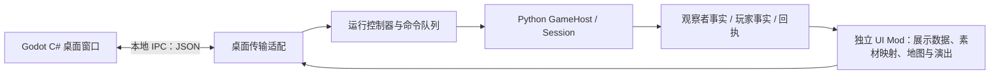

# 战国 GUI 选型与实施计划

更新：2026-10-23。状态：已按用户指令正式开始 Godot GUI，实现记录见下；后文保留原选型依据。

后续改版以[上帝视角演出系统详细设计](上帝视角演出系统详细设计.md)为设计入口，含空间/时间尺度、地貌与聚落、军团与战斗、气泡、速度、协议和验收，以及两张布局示意。此前讨论记录见[地图尺度与看海演出](地图尺度与看海演出.md)。2026-10-23 用户已授权按两周到一个月节奏开展第一阶段，进度见[GUI 第一阶段](../plans/GUI第一阶段.md)。

新增 `python3 desktop.py --sample terrain` 独立 3×3 地貌比例草样：大地块、连续山谷、房舍落点、四档森林、露金岩与农田。它不启动对局；阶段 A 尚在进行，美术和持续运行验收待补。

## 首版实现进度（2026-10-23）

已采用 Godot 4.7.2 .NET + C#、Compatibility、Mini World 小比例 2D。
入口 `python3 desktop.py`，项目位于 `mods/ui/desktop/`，详见
[桌面说明](../../mods/ui/desktop/README.md)。原作者素材包已下载核对，选用七张
通用素材原图，来源、版本、逐文件哈希和许可已记录；不使用具名 IP 角色。

本次完成 P0/P1 的首条可运行通路以及 P2 部分地图：原生窗口、Python 独立离线
八国宿主、NDJSON、地图/国界/建筑代用图标/军旗、待机、镜头点选、国力/市场/
纪事、暂停/单回合/保存/关闭和演示档复制续看。只跑规则 AI，不接管 `zg`。

尚未完成 P0 的全部动作帧样板、P2 行军与战斗演出、P3 管理工具及三平台打包。
控制器当前专用于桌面离线入口；接入 LLM 前须先与终端共用运行控制，并补齐
等待/重试/压缩、完整回执和思考展示。本文后续路线继续作为验收目标，不因
首版窗口可运行而视为全部完成。

## 已确认目标与当前建议

用户已明确：**跨平台原生桌面、非 Web、优先看海，玩家操作后做。** 地图希望达到文明式 3D 或世界盒子式像素 2D 的游戏观感；2D 动画也需要精细，优先找现成素材和实现参考。

发行目标补充：先发布免费 Steam 本体，依据表现再做付费 DLC、地图和剧情包；用户明确 DLC 届时另用付费素材。本体现在即按可商用、可随游戏发布的标准选材。

**已采用 Godot 4 .NET + C# 桌面呈现，继续使用 Python 游戏宿主，小比例 Mini World 2D。** 下方保留当时的 2D/3D 比较依据；当前先验证大地块比例与地貌，再依次补动画，不能把像素 2D 自动视为低成本。

现役目录是 `~/zhanguo`；原选型审阅基于 `4c5a6cc`，当前实现进度以上方记录为准。旧稿的浏览器、TypeScript、SVG 和 HTTP 服务路线已被原生桌面目标取代。

## 技术栈比较

| 方案 | 对当前目标的适配 | 主要代价 | 结论 |
| --- | --- | --- | --- |
| Godot 4 + C# | 同一工具链可做像素 2D 和 3D 地图，组织相机、动画、特效、选择与 UI | 需要学习节点/资源模型，并处理 Python 通信和双运行时发布 | **首选** |
| MonoGame + C# | 程序结构更由自己掌握，适合自定义 2D 渲染；DesktopGL 覆盖三大桌面系统 | 相机、动画编辑、UI 和素材管线需要自行组织更多部分 | 希望控制底层绘制时的备选 |
| Avalonia + C# | 国力表、日志和表单合适 | 游戏地图和演出需要再组织渲染体系，3D 路线更不直接 | 当前不作为主前端 |
| PySide6 / Qt | 接现有 Python 方便，桌面控件完备 | 精细游戏地图仍需搭建动画/绘制体系 | 管理工具取向的备选 |

这是对战国需求的工程判断。Godot 的生命周期和类型仅进入呈现适配层，Python 领域对象、Player API 和规则 AI 不引入 Godot 类型；C# 的传输数据和展示数据使用普通类，转换为 Vector/Node/Resource 的工作留在场景层。

平台依据：[Godot Linux 下载页](https://godotengine.org/download/linux/)列出 .NET ARM64 编辑器与 .NET 导出模板；[MonoGame 平台说明](https://docs.monogame.net/articles/getting_started/platforms.html)列出 DesktopGL 对 Windows/macOS/Linux 的覆盖。正式发布目标为 Windows、Linux、macOS，各自打包并验收；树莓派 ARM64 另列兼容检查，不能仅凭编辑器可下载就宣称游戏运行已通过。

2D 先评估 Compatibility 渲染器；简单 3D 也可以从它开始。它支持的功能及其他渲染器差异见 [Godot 渲染器说明](https://docs.godotengine.org/en/stable/tutorials/rendering/renderers.html)。是否更换由样板的效果和目标硬件实测决定。

## 地图与美术路线

| 路线 | 看海效果 | 真正需要补齐的工作 | 建议 |
| --- | --- | --- | --- |
| 小比例像素 2D | 同屏看国家扩张、城市与军队，近似世界盒子的观察距离 | 地形衔接、建筑层级、角色动作、方向、调色和缩放细节 | 优先核对 Mini World 素材的实际动画覆盖 |
| 较大比例像素 2D | 单位动作与建筑特效更明显，可近看战斗 | 同屏密度、角色遮挡、动作组合、跨素材风格一致 | 优先用 Tiny Swords 的明确版本做样板 |
| 文明式 3D | 倾斜视角、地形起伏、建筑模型与军队棋子，空间感强 | 模型/骨骼、材质、光照、边界贴合、拾取和遮挡 | 用成套低多边形素材评估，工作量单独估 |

已有成套 3D 动画资产时，3D 也可能比手绘多方向像素动画省事。最终比较的是**可用资产覆盖后的剩余工作**，不能只比较 2D 和 3D 的维度。

底层仍是当前方格规则。文明式画面不意味着改成六角格；一个规则格可以显示更多树木、房屋和人物，但这些装饰不新增人口、路径、资源、单位或战斗规则。24×24 是规则地图尺寸，不能直接等同于只画 576 个单色方块。

## 已核对的素材与项目

2026-10-15 直接核对作者页、GitHub README、项目配置或授权文件。尚未下载素材包检查全部帧，也未运行这些项目。

| 候选 | 已确认内容 | 对战国的用途与限制 |
| --- | --- | --- |
| [Tiny Swords / Pixel Frog](https://pixelfrog-assets.itch.io/tiny-swords) | 当前免费包包含人类单位、8 类建筑、资源、地形、UI；列出剑兵、枪兵、弓手、僧侣、采集工以及水波、火焰、爆炸等动画/特效；地形网格 64×64 | **优先动画样板**。画风偏西式奇幻；骑兵、战国建筑、现有 16 类建筑的完整对应仍是缺口 |
| [Mini World Sprites / Shade](https://merchant-shade.itch.io/16x16-mini-world-sprites) | 16×16；作者列出 100+ 角色、135+ 建筑，更新记录有马、骑士和多种设施 | **优先小比例看海样板**。数量多不等于各角色都有完整方向和动作，必须逐类检查帧表 |
| [Universal LPC 角色生成器](https://github.com/LiberatedPixelCup/Universal-LPC-Spritesheet-Character-Generator) | 可组合角色，项目提供动画指南和每项素材的作者/授权清单 | 人物动作与装备扩展候选；不是一套即用的完整战争地图美术，画风和比例需要统一 |
| [Quaternius Ultimate Animated Character Pack](https://quaternius.com/packs/ultimatedanimatedcharacter.html) | 作者列出 50+ 动画角色，FBX/OBJ/Blend 文件，CC0 | **3D 对照样板**。角色包不等于完整地形、建筑和文明风格资产；还要验证模型/动画导入 |
| [Godot Open RTS](https://github.com/lampe-games/godot-open-rts) | MIT；README 列出 AI 对战、玩家切换、迷雾、小地图和简单 UI，注明 Godot 4.3；使用 Kenney 太空素材 | 参考相机、迷雾和界面结构，素材风格与战国不同；不移入其经济、AI 或即时战斗规则 |
| [Godot RTS Entity Controller](https://github.com/philipbeaucamp/godot-rts-entity-controller) | MIT；选择、移动、攻击组件和示例场景，另有演示项目 | 参考点选和单位表现组织。其完整实体组件体系不必成为战国依赖 |

另外核对了几个容易误判为“现成可抄”的项目：

- [Age of Tinies](https://github.com/hoangpx/age-of-tinies)使用 Tiny Swords，适合看组合后的画面；本次 GitHub 元数据未识别到许可，尚不能列为代码直接复用来源。
- [2D RTS 教程项目](https://github.com/steincodes/real-time-strategy-2d-godot)有 Apache-2.0 授权，但 `project.godot` 是旧格式且使用旧对象语法；不能把它当作直接可运行的 Godot 4 模板。
- 本次查到的 WorldBox clone 候选尚无合适的明确许可和成熟度证据，不列入直接依赖。

### Tiny Swords 的版本区别

作者当前页面允许个人/商业项目使用和修改素材，同时禁止重新分发、转售或重新打包素材；下载列表另外明确提供 **TS_old version_CC0 Licensed**。这两个版本不能混称为 CC0。开源仓库需要随代码分发素材时，**先检查旧版 CC0 包的内部文件和实际覆盖**，再决定采用范围。

补充核对：**Mini World 作者页的 Asset license 栏明确列出 Creative Commons Zero v1.0 Universal**，正文也允许商业/非商业使用和修改。这修正了上次只读正文而漏看许可栏的结论。LPC 按具体素材选用许可和保留 credits，不能仅凭仓库代码许可推断所有图片许可。正式选用时保留来源、版本、包内授权和所用文件清单。

### 免费 Steam 本体的素材选择

以 2026-10-15 作者公开许可为依据；下面判断针对许可条件，不代表已逐文件核查原创来源或已通过 Steam 审核。

| 素材 | 免费 Steam 本体 | 本项目安排 |
| --- | --- | --- |
| Mini World 的作者原创素材 | 作者标注 CC0，允许商业使用 | 作为小比例路线优先候选，逐文件挑选通用地形、士兵与建筑 |
| Tiny Swords 旧版 CC0 包 | CC0 允许商业使用 | 作为较大比例动画路线优先候选，保存该版本的包和授权依据 |
| Tiny Swords 当前版本 | 作者明确允许个人及商业游戏使用，也有禁止素材重新分发/打包的条款 | 游戏内使用与在源码仓库分发原图分别处理；首版优先旧 CC0，避免自行扩张当前版本的分发授权 |
| Universal LPC | 可商用，但每个所选元素需要满足其许可 | 备选；署名、修改后素材的许可及 DRM 条件按选定文件逐项处理 |
| Quaternius 此角色包 | 作者标注 CC0 | 若选择 3D，可用于免费或商业游戏 |

[CC0 官方说明](https://creativecommons.org/publicdomain/zero/1.0/)允许复制、修改、分发及商业使用，无需另行许可；不会因将来加入付费 DLC 而失效，也不要求游戏代码开源。付费 DLC 的素材按届时购入的商用授权处理。

Mini World 的作者更新记录包含 `Our Lord Rimuru` 等角色条目。不能从整包 CC0 标注推断作者拥有其中所有既有角色/IP 的授权；正式选材时排除或另核这些条目，优先采用通用原创对象。不要把其他人制作的扩展包自动纳入原包许可。

此处将“游戏能否用素材”与“原图能否随开源仓库分发”分别记录。Tiny Swords 当前许可的商业项目授权支持其用于游戏的意图，禁止素材转售/重打包条款不能简单解释为完全禁止游戏发布；存在疑义的源码/原图分发方式应以具体许可或作者明确答复为准。本次未联系作者。

## 精细动画的验收对象

首个样板应是一片能观看变化的小世界，包含平原、林地、山地、城市、农田和交战点，以及完整的镜头操作。重点观察：

| 层次 | 样板内容 |
| --- | --- |
| 环境 | 树木轻摆、阴影与自然细节；只画发行版有语义或明确属于装饰的对象 |
| 建筑 | 待施工/施工/完成的表现区分；生产或受损效果仅在有对应事实时出现 |
| 单位 | 待机、行走、攻击、受击、阵亡；方向覆盖和左右翻转的可接受性 |
| 战斗 | 交战区域、箭矢/命中特效、伤亡和撤退，演出能在缩小视角保持可读 |
| 国家 | 国土颜色、边界、旗帜，八国可区分；不能把素材仅有的 5 个配色当作国家数量上限 |
| 镜头 | 全图、区域、近看单位三个缩放层级，信息密度与文字显示随距离调整 |

精细度来自帧序列、节奏、层次和反馈的组合。缺失的动作应在素材核对阶段列出，不能等接线完成后才用静态小人充当动画交付。

战国军队是群体单位。一支军队可显示为旗帜带数个代表性士兵，数量面板仍报真实军队/兵种数；装饰人物不表示独立可点选士兵或真实人口。

**演出不能发明世界事实。** 结算前交战用待结算表现；拿到结果后再表现确定的伤亡/退却。只有起终点时不能伪造权威行军路径；没有中途数据则采用明确的概略过渡。模型等待时可播放待机和环境动画，不自动产生新行动。

## 接入结构与所有权

- Godot 控制镜头、绘制、动画、声音和窗口；Python 控制世界、LLM、议会、结算和整局存档。
- 地图与演出仍归独立 UI Mod。标准 UI 的桌面部分可放在 `mods/ui/desktop/`，包含 Godot 项目、C# 呈现代码、素材映射和发行产物描述；`ui/desktop.py` 只做启动和传输装配。
- UI Mod 提供可选桌面入口与展示数据，启动器根据已选择的 UI Mod 找到对应客户端。替换 UI 时不能仍偷偷固定启动标准 Godot 地图。
- 首版倾向桌面程序启动 Python 子进程，通过保留给协议的 stdin/stdout 交换逐行 JSON，日志走 stderr；接收线程把数据送入 Godot 主线程更新场景。该通信契约须先做最小往返样板再固定。
- 结构化事实复用现有 `observe()`、`observer_snapshot()` 和地图快照；PNG/SVG 导出仍可独立服务模型输入。桌面地图不从终端截图或已截断的中文日志反向提取数据。
- CLI 和桌面共用薄运行控制器。所有世界读写在游戏执行线程的安全点完成，界面消费脱离世界的快照；等待模型时不阻塞渲染线程。
- 通用引擎不增加地形、美术、Godot 或 native 专属结构。角色场景/素材名通过 UI Mod 映射，事实里的内容 ID 不直接等同于资源文件路径。

首版聚焦本机桌面。远程宿主连接可以后续增加传输适配，当前不因此引入 HTTP 或浏览器。不能让桌面程序和现有 `zg` 进程同时驱动同一对局文件。

## 运行控制与显示时序

当前 `Session.cycle()` 同步推进完整回合，存档只允许完整周期边界。桌面前端需要准确表达：

1. “暂停请求已接收”和“整回合完成、保存成功、已经暂停”是不同状态；模型调用期间仍显示等待、重试和压缩进度。
2. “保存”在回合中排到下一个合法边界，界面显示最后真正保存的回合；窗口关闭走保存后停止流程并展示进度。
3. 演出速度与游戏推进速度分开。加快/跳过动画不自动增加模型请求、回合数或费用。
4. 动画积压可以合并或快进；完整回执保留。历史回放、待播演出与当前世界要有可辨识状态，避免面板和画面处在不明的不同回合。
5. 世代、回合、快照 revision 和事件 cursor 用于丢弃过期数据；切换新局后不能继续播放上一局动作。
6. 管理员全图与玩家视野由服务端事实来源区分。后续玩家客户端不能接收全图后仅在本地遮挡。

## 交付顺序与估算方式

| 阶段 | 交付 | 退出条件 |
| --- | --- | --- |
| P0：素材与动态样板 | 核对候选包，按同一场景比较小比例 2D、较大比例 2D；必要时增加简单 3D 对照 | 已有动作、方向、建筑对应和缺口可列清单；确定一条视觉路线 |
| P1：桌面与宿主通路 | 原生窗口、Python 子进程、事实与事件通信、共用运行控制、完整回合保存 | 模拟慢请求时镜头流畅；暂停/保存状态准确；使用合成对局 |
| P2：地图看海 | 选定美术路线，地形、建筑、军队、国界、镜头、点选、行军与战斗演出 | 可以连续观看合成八国对局，事实与演出对应，细节达到样板标准 |
| P3：日常看海工具 | 国力、市场、经济、外交、完整回执、思考折叠、管理抽屉与平台打包 | 能查看、暂停、继续、公告、寄信和管理；三平台分别验收 |
| P4：扩展 | 人类玩家、专门补绘、更多演出与历史回放 | 按选定目标另排 |

此前浏览器稿的 5–9 工作日估计已不适用。**先用约 1–2 工作日规划 P0 的素材核对与一个小动画样板；完成后再估 P1–P3。** 角色方向、骑兵、建筑覆盖、跨平台 Python 打包以及美术精细度都可能改变工作量。定制完整战国题材资产另估，不能包含在通用原型报价里。

P0 的目标是选型证据，不同时维护两套正式渲染器。2026-10-15 规划时尚未创建 Godot 工程或导入第三方资产；当前实现进度以上方 2026-10-23 记录为准。

## 后续实现验收

- 显示对象数量、归属、位置、军队兵种数和经济数字与输入快照对应；动画角色不影响规则对象数。
- 没有事实支持的占领、伤亡、建筑落成或撤退不提前播放；迷雾不泄露隐藏对象。
- 素材缺失、未知内容 ID 有稳定占位和文字说明；美术替换不要求修改领域代码。
- 模型等待、重试、压缩时镜头、点选、面板和关闭请求仍响应；离线模拟覆盖这些状态。
- 动画队列、事件列表和资源缓存有界；看长局不因历史累积不断增加场景节点。
- DPI、中文字体、像素缩放、窗口模式、子进程退出和保存失败在各目标系统分别检查。
- 测试使用临时目录和合成存档；真实存档接入和真实付费模型运行不属于原型验收。

原规划建议为：**Godot 4 + C#，先围绕可复用动画素材做小样板；看海与管理先交付，人类玩家后做。** 当前已启动 Mini World 2D 首版。
