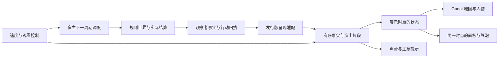
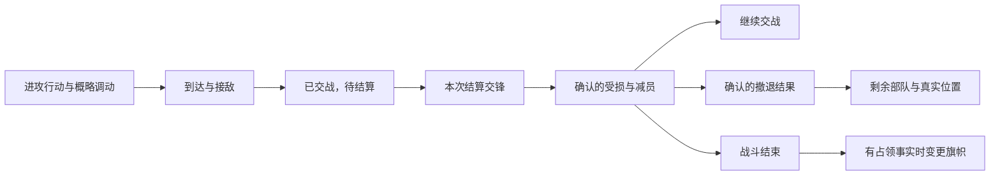

# 战国上帝视角与演出系统详细设计

版本：讨论稿 1.0 · 2026-10-23。

源码接入依据：对照当前 `main` 的 `7e5b77e` 核对；第 12 节列出的缺口是本次设计核对结果。

本文是后续地图、美术、交互与工程接入的设计依据。原设计批次交付文档与布局示意；2026-10-23 用户已授权以两周到一个月节奏推进阶段 A，进度见[GUI 第一阶段](../plans/GUI第一阶段.md)。正文中的尺寸、阈值、时间和性能预算均为样板起始参数，须经视觉验证后定案。

## 1. 体验目标与范围

打开游戏时，主要看到山河、聚落与军队。拉远看疆域和战线，靠近看谷地中的城市、小人在街巷中穿行、驻军训练和设施运转；发生行动时，能看见过程，并能停下来理解结果。

后续开发的主体是独立的呈现与演出系统。引擎继续决定国家行动、资源变化、交战、伤亡、撤退与占领；Godot 把事实组织成空间、动作、节奏和声音。演出不能改变游戏胜负，也不承担新的战术计算。

### 1.1 用户已经明确的要求

| 方面 | 已确认方向 |
| --- | --- |
| 产品 | 原生桌面，上帝视角，先看海；Godot + C#，Python 保留游戏宿主 |
| 地图 | 每个规则地块很大，多素材拼出内部层次；建筑与人物小 |
| 内部尺度 | 地块内展示 16×16；本文暂按 16×16 视觉小格设计 |
| 地貌 | 山地以山体为主，内部存在谷地；设施错落在合适位置 |
| 建筑 | 最多的建筑类型决定地区主题；有市政厅后改为三级城市，城堡单独布局 |
| 军队 | WorldBox 式迷你人物；按真实数量分三级军团样式；野人在地块内游走 |
| 节奏 | Rule AI 提供速度挡位；不能快到看不见发生了什么；演示使用 v13 |
| 君主 | LLM 从市政厅冒出气泡，展示已有的思考与发言 |
| 动态 | 树木轻摆、人流穿梭、驻军训练、磕头机抽油及战斗演出 |
| 资源 | 贫木/富木森林不同，含金地块显露黄金，地貌体现资源差异 |
| 分层 | 这些工作主要发生在呈现层，对规则引擎保持无感 |

### 1.2 本稿给出的待验证参数

内部格解释为 16×16 个视觉小格；三级城市/军团阈值、镜头范围、速度挡位时长、装饰数量、面板尺寸、动画节奏均给出可调整的起始方案。它们不作为新增游戏规则。

现有 Mini World 作为比例和风格的起点。矿脉、山体衔接、磕头机、城市层次和完整战斗动作需要逐项补素材，不能假定已导入的七张图覆盖全部目标。

## 2. 三种尺度与三个时点

### 2.1 空间尺度

| 单位 | 建议基础尺寸 | 含义 |
| --- | --- | --- |
| 规则地块 | 256×256 基础像素 | 一片地区，仍对应原规则一个 `(x,y)` |
| 视觉小格 | 16×16 基础像素 | 组织素材、地表掩码和布局候选，不显示格线 |
| 迷你人物 | 可见身体高约 6–10 基础像素 | 建立整个世界的比例；不随军团等级放大身体 |
| 普通房屋 | 占地约 12–24 基础像素 | 可跨视觉小格；不同轮廓、朝向和组合 |
| 市政厅/专门设施 | 约 24–40 基础像素 | 有辨识度，仍小于整个地区 |
| 城堡组合 | 约 40–72 基础像素 | 主体、庭院与附属构筑物形成整体 |

24×24 规则地图对应 6144×6144 基础像素，视觉布局共有 147456 个小格。此数量是布局数据规模，不意味着创建 147456 个活跃节点。人物素材若按原尺寸显得过大，优先补绘小比例人物，避免把有细节的大角色随意缩成模糊像素。

规则格、小格、素材像素明确分开。房屋可以跨两个小格，山体可以横跨多格；建筑位置只属于展示数据，不能作为玩家新的建设坐标。

### 2.2 时间尺度

| 时点 | 谁持有 | 用途 |
| --- | --- | --- |
| 规则当前时点 | Python 宿主 | 真正执行规则，可能已完成当前周期 |
| 展示当前时点 | Godot 展示状态 | 地图、详情、国力、事件共同显示的事实版本 |
| 最后合法保存时点 | Session 存取 | 窗口关闭、续局与异常恢复的依据 |

状态栏示例：“正在观看第 12 回合 · 本期已结算并保存”。如果宿主在下一边界保存，必须同时标明保存回合，不能把已保存误说成画面已经播放完。

### 2.3 概念图



播放控制进入宿主和演出系统，不进入战斗公式、资源对象或地图规则。

## 3. 默认画面与镜头

布局示意见 [界面布局 SVG](gui-world-layout.svg)。它只表达比例和信息位置，不是完成的美术画面。

### 3.1 默认画面

地图铺满窗口背景。顶部是一条轻量控制栏，底部只保留少量事件卡和状态。国力、市场、地块详情、完整纪事按需打开，关闭后不占固定宽度。常态下界面覆盖面积目标低于 20%，地图仍可在面板背后延展。

| 区域 | 常态内容 | 交互 |
| --- | --- | --- |
| 左上 | 战国、当前观看回合 | 点击展开对局信息 |
| 顶部中间 | 暂停、速度、单步、进度 | 随时可操作；区分播放暂停与宿主边界状态 |
| 右上 | 列国、市场、纪事、设置 | 打开单个抽屉；保持地图主体可见 |
| 左下 | 最近三条重要事件卡 | 点击定位；进入纪事查全文 |
| 地图内部 | 国名、军团活动、君主气泡 | 随镜头距离调整展示密度 |
| 右侧按需 | 地块或国家详情 | 默认宽 300–360 屏幕像素，可关闭 |

正文用干净的中文字体，标题可保留适量题材气质。界面采用温和的浅纸色或低饱和深色半透明底板，配合地图自然色；避免大量相同边框围住文字。全部状态同时用形状、文字和颜色表达，国家不能只靠红绿区分。

### 3.2 镜头层级

以下按一个规则地块在屏幕上的宽度切换，并使用约 15% 的切换缓冲，避免滚轮缩放时反复闪现。

| 距离 | 地块屏幕宽度建议 | 主要可见内容 |
| --- | --- | --- |
| 天下 | 约 24–80 px | 山势、森林团块、城市轮廓、国名、战线与重要活动提示 |
| 地区 | 约 80–240 px | 聚落布局、资源地貌、城堡、军阵与主要设施 |
| 近看 | 约 240–640 px | 迷你人物、街巷、训练、机械与交锋动作 |

像素素材使用 nearest 采样；近看优先提供舒适的整数显示倍率，滚轮过渡与非整数倍率需要实机检查闪烁。远景用预组合地貌和聚落轮廓，避免依靠大量亚像素人物产生噪点。

默认自由镜头。可选择跟随某国、跟随军团或查看事件。查看事件使用平滑移动，不强制更改玩家当前缩放；战斗只有在开启跟随时自动带镜头过去。多个地点同时有事时，选择一个焦点，其余保留位置提示与事件卡。

空格暂停播放，F 回到适合全图的镜头，滚轮缩放，中键/右键拖动，Esc 先关闭当前浮层。单步提供“下一个重要片段”和“下一完整回合”两个明确入口。

## 4. 单地块的地貌生成

局部空间关系见 [山地谷落布局 SVG](gui-region-layout.svg)。它表示山体、谷地、城市、城堡和军队的相对位置，不是每格都套用的固定模板。

### 4.1 绘制层次

从下到上组织：基础土地色与纹理、地貌高低与投影、资源显露、林木与草丛、聚落地表和小路、设施与房舍、人物和军团、尘土与短时特效、选择与提示。

人物和建筑按脚底位置排序遮挡；山体前缘、树冠可以遮住人物的部分身体，选中对象可用轻描边提示。选中地块时再出现规则边界，常态主要画国界；小格线始终隐藏。

### 4.2 生成步骤

1. 读取规则地形、地块资源、周围地形及已完成建筑事实。
2. 使用独立的视觉布局种子，生成山脊、谷地、平地、林缘等连续形状。
3. 生成地表掩码：陡坡、缓坡、平地、树木密度、矿脉、建筑候选区与人物活动区。
4. 选定地区主题，预留市政厅、城堡和主要设施的位置。
5. 放置少量有辨识度的设施组合，再补充房舍、田垄、场地与装饰。
6. 在可用空间之间形成视觉小路，安排居民、军队和野人的本格活动范围。
7. 生成近景布局与远景简化表现，缓存稳定结果。

视觉种子由地图种子、规则坐标、布局版本确定；不消耗世界 RNG。共同边缘使用相同的边缘种子，解决山脊和植被衔接。建筑增加时填入预留位置，已有设施尽量保持原位。切镜头、刷新事实、续看不能让全城重新随机排布。

### 4.3 地形构成

| 规则地形 | 地区主体 | 可布置区域 | 邻接处理 |
| --- | --- | --- | --- |
| 平原 | 草地、田地、低矮地表变化 | 较大的连续平地 | 与林缘、丘陵自然混合 |
| 森林 | 疏密不均的树群、林间草地 | 林缘和清理出的空地 | 树群可连续跨越规则边界 |
| 丘陵 | 起伏土坡、低岩带、缓坡 | 坡脚、坡顶平地、谷间 | 接山地时逐渐抬高轮廓 |
| 山地 | 连续山体、岩壁、阴影、谷地 | 谷底、缓坡、台地 | 山势向相邻地块延展 |
| 沙漠 | 沙地、裸岩、稀疏植被 | 平坦地面、岩体之间 | 以纹理和植被密度渐变 |

山地样板先试约 60%–75% 的山体视觉覆盖，保留 25%–40% 谷地和台地。比例指山地格内部，不改变规则地图的地形比例。高建筑数量时，聚落沿谷地扩展，使用紧凑街区表达密度；不能因美术空间不足拒绝规则上合法的建筑，也不能把山全部铲平成城市。

不凭装饰制造可采集的新资源或权威交通关系。首版不为了填空添加有航运含义的河道、港口；若将来需要水系美术，另行核对发行版的地图事实。

## 5. 资源丰度形成地图差异

地块资源决定外观，不用国家库存决定一片森林是否消失。先使用发行版资源上限归一化；没有上限时使用该地图固定的资源分布范围，不随每次刷新重新缩放。

建议将零、少、中、多分为四档，档位只是视觉分布参数。具体资源数字始终留在地块详情里。

| 资源 | 少量外观 | 丰富外观 | 注意事项 |
| --- | --- | --- | --- |
| 木材 | 小树群、较多裸露地面 | 多层树冠、密集林带、林间阴影 | 与规则地形共同决定密度，不能把所有含木平原改成森林 |
| 矿石 | 少量露岩和碎石带 | 较大的矿化岩层、明显矿脉 | 矿场设施落在附近的平地 |
| 黄金 | 岩石上少量金色显露 | 连续的含金岩带与采掘场景 | 用岩层中金色矿脉表达，不铺满金币 |
| 石油 | 小范围可辨认的地表资源线索 | 更多资源线索和适合设施的空地 | 磕头机只在对应已建采油设施存在时出现 |
| 耕地 | 小片田垄与草地混合 | 更连续的耕作空间 | 已建农场决定人工田块的使用表现 |

同档资源仍由固定种子形成多种组合，避免每个富木地区都长成相同方块。季节、天气和昼夜暂不作为首轮样板范围；基础地貌、比例和资源差异先达到要求。

## 6. 地区主题、城市和城堡

### 6.1 主题选择

按已完工建筑的实例数计数，升级不凭等级额外复制房屋。在建对象作为工地，不能提前触发城市升级或生产运转。

先判断是否存在已完工市政厅：存在则为城市。否则，取非城堡建筑中数量最多的具体类型作为主导，再映射到地区主题。城堡作为独立设施，不把整格覆盖成城堡图标。

| 主导建筑 | 地区主题 | 核心视觉组合 |
| --- | --- | --- |
| 农场 | 农业区 | 田垄、少量农舍、谷仓与田间活动 |
| 林场 | 林业区 | 保留森林主体，林缘工棚、木垛、作业空地 |
| 矿场/金矿场 | 采矿区 | 露岩矿脉、坑口或采场、料堆与短运输路径 |
| 油井 | 采油区 | 磕头机、配套设施和工人通道 |
| 装备厂/补给厂等 | 生产区 | 成组厂房、堆场、小路与适量生产动效 |
| 能源设施 | 能源区 | 类型明确的装置、附属建筑和运行状态 |
| 兵营/军屯类 | 军事区 | 营房、操场、驻军活动；有真实军队才显示对应军团 |
| 未映射内容 | 通用设施区 | 简洁设施组合，详情保留真实内容 ID 和名称 |

初次并列按视觉映射表中的稳定顺序选择；已有主题在并列时保留，其他类型严格超过后再切换。主题改变主要更新地表、少量设施与装饰，保留地貌骨架与可复用的建筑位置。

少数与主题不同但重要的设施，可占用专门的展示位置。首版建议每格同时强调一个主主题、一个城堡位置及至多两类次要设施；其余以街区/设施群的密度和详情表达。规则数量与美术实例不要求一一对应。

### 6.2 三级城市

样板起始分级按已完工建筑总实例数计算，含市政厅与城堡。规模依据建筑数量，升级等级不增加此计数。

| 级别 | 建议数量 | 空间结构 | 活动 |
| --- | --- | --- | --- |
| 小城 | 1–5 座 | 市政厅、小型中心空地、疏散房舍、外围地貌充分可见 | 少量间歇人流 |
| 中城 | 6–12 座 | 连续街巷、两三个街区、专门设施位置 | 多条短人流路线 |
| 大城 | 13 座及以上 | 更密的中心与外缘街区，沿谷地或平地扩展 | 更丰富但有上限的人流 |

城内房舍是规模化表达，不是新增规则建筑。市政厅是实际规则建筑的视觉锚点；同格多座市政厅时选择一个主锚点，其余合并到市政区表现，详情报告实际数量。

仅有市政厅时也形成小型城市地表，但房舍保持克制。移除最后一座市政厅后，按剩余建筑重新判定主题，以地表和场景过渡表达变化；未有建筑被毁事实时不演房屋爆炸。三级变更使用短过渡，不能突然整片翻新布局。

### 6.3 城堡

按已建城堡事实，在高台、谷口或城市边缘的合理候选位置独立布置。周围留出通道和空地，禁止嵌进陡峭山体。等级可改变主体轮廓和附属构筑物，但具体样式取决于素材覆盖。

城堡可与农业区、林业区或城市共存。同格多个城堡时，采用主堡和附属防御设施的紧凑组合，真实数量留在详情；不把整个地块排满同一城堡素材。装饰城墙不新增规则障碍或防御数值。

## 7. 迷你人物、三级军团与野人

### 7.1 军团分组与尺寸

默认按“所属国家 + 当前规则地块”形成一个军团展示组，内部保留军队实例与兵种映射。交战中同一国家不同状态的部队可以分为交战组、后方组、撤退组，避免一个动作控制整格所有单位。

| 级别 | 建议真实军队数 | 代表小人数量建议 | 阵形 |
| --- | --- | --- | --- |
| 小队 | 1–3 支 | 3–5 个 | 疏散短队列，少量驻留位置 |
| 中型军团 | 4–9 支 | 8–12 个 | 明确前后排、军旗与小营地 |
| 大型军团 | 10 支及以上 | 16–24 个 | 多组队列、纵深与更宽驻扎区域 |

代表小人不是规则上的独立士兵，也不表示实际人口或精确兵力。详情按兵种报真实军队数量和逐支 HP，不用总 HP 替代军队数。军旗在近景保持小比例，远景使用独立的活动提示，不能为了全图可见把小人放大到接近城市。

步兵、骑兵、民兵使用不同轮廓和活动。当前兵种以发行版实际目录为准，不能因为素材里有弓手就给军团添加实际不存在的弓兵攻击。

### 7.2 日常活动

驻军在预留的操练场、营地和谷地中小范围训练、整队、休息；交战组停止训练，转入对应状态。居民在短路线之间穿行，时而停留，活动人数由城市规模决定并设上限。人物避开建筑占地、山壁和密集树冠，使用本地展示导航，不生成玩家可查询的新规则路径。

### 7.3 野人

野人只在自己的规则格内随机游走，路线固定种子生成，动画相位各异。远景可省略个体，近景显示小规模散落活动。

当前普通观察者军队快照只含已物化军队，而规则中的部分无主守军按遭遇物化。正式显示全图野人前，需要发行版提供只读的“潜在守军存在”事实及其稳定地块标识。不能为显示而执行进攻、征召或物化，也不能把每个无主格无条件画成一支真实军队。未接入该事实前，样板用标明的合成数据展示这一效果。

## 8. 演出系统与速度控制

### 8.1 每个片段包含什么

每段演出关联有序事实、影响对象、起止展示状态、位置、动画状态、关键时刻与可跳过部分。动画随机只决定小人站位、动作相位、扬尘等外观，不决定命中、伤害或胜负。

例如，建造动作成功后先显示实际工地；完工事实到达该片段时再切为完成设施。军队移动时位置图标、地块详情、国力和事件卡随同一展示状态切换。

### 8.2 速度挡位

| 挡位 | 普通重要片段建议停留 | 一次结算战斗建议时长 | 观看方式 |
| --- | --- | --- | --- |
| 慢速 | 2–4 秒 | 8–12 秒 | 展开主要动作和结果，适合近看 |
| 常速（默认） | 0.8–1.5 秒 | 4–6 秒 | 相同经营动作适量合并，保留军情和重大事件 |
| 快进 | 0.15–0.4 秒 | 1–2 秒 | 简化普通动作，保留因果与结果 |
| 瞬时 | 无强制停留 | 直接展示结果 | 快速观察宏观发展，完整事件仍可查 |
| 单步 | 等待用户继续 | 按选择播放片段 | 下一个重要片段 / 下一完整回合 |

时间是初始建议，不承诺固定的秒/回合。一回合事件多时自然更长；界面可显示本回合播放进度。空回合在常速下仍应有约 2 秒的观察停留，慢速约 4 秒，避免连续跳回合。

环境、人流、训练和机械有独立的自然动画时钟。快进主要压缩规则事件演出，避免整片森林和居民疯狂加速。播放暂停时，规则事件与其面板冻结；环境可保留轻微活动，并提供“暂停时冻结全部动画”设置。

### 8.3 事件合并与多地点

同国同格相邻的多次同类经营行动，可合并为一次场景变化，并保留原回执可展开。普通市场买卖不要求每笔都出现跨地图运输队；结算、贸易和调动只有实际起终点事实时才可采用对应的空间表现。

同地交锋、撤退和占领按因果顺序串行。不同地块的独立变化可同时表现，但地图状态只推进到已确认的共同事实点。远处战斗保留位置提示，不为了等所有战斗特写而无限拖长一回合。

### 8.4 宿主推进与积压

建议首版以一个完整周期为预取上限：宿主正常执行一个周期，现有回执回调收集事实并送出；Godot 可以边接收边播放。该周期完成后合法保存。宿主等到界面确认播放完成，或用户选择追上最新状态，再启动下一周期。

这段等待发生在周期外的宿主调度器中，`Session.cycle()` 和战斗公式无需等待动画。回调只采集并排队，不从 Godot 主线程读写世界，不在规则执行链里阻塞等待玩家观看。

建议事件积压预算为 8 MiB 或 2000 条，任一达到后转入合并/追赶流程。不能丢掉一条影响事实的变化后继续套后续差分：需要保留关键帧并将展示状态原子地追上最新完整快照。宿主控制命令和保存状态使用独立优先通道。

### 8.5 暂停、保存、关闭

“暂停播放”立即冻结当前演出，并请求宿主在合法边界暂停。当前周期仍在执行时显示两个状态：演出已暂停、宿主正在完成本回合。保存显示最后真正完成的回合，不能在周期中途偷偷写入游戏存档。

正常关闭完成当前周期、保存并退出。LLM 长等待时保留进度；需要提前退出时，明确使用最近完整存档并放弃未完成周期。纯视觉布局/播放进度另存，不改变游戏存档格式；首版续看默认从最近完整边界开始，不承诺恢复半段动画。

## 9. 战斗演出

### 9.1 一次战斗的因果顺序



持续交战可以跨多个游戏周期，每次实际结算只有一段对应演出；小人循环挥砍不代表引擎额外进行攻击。原地攻击直接接敌，不补一段不存在的跨格行军。

同一次战斗结算的伤亡、撤退与占领按关联事实组成片段。现有领域事件可能先写入占领通知、后写入战报，不能直接把文字事件列表的入队顺序当成镜头顺序。适配层保留原审计顺序，同时用明确的阶段与关联标识组织结果呈现：先展示本次交锋和确认伤亡，再揭示该结算产生的撤退或占领；不能跨不同动作或不同结算任意重排。

### 9.2 阶段与表现

| 阶段 | 常速建议 | 表现 | 必须有的事实 |
| --- | --- | --- | --- |
| 接敌 | 0.5–1 秒 | 从实际来向进入合理接战区，军团展开 | 行动成功、参与单位、起终位置 |
| 待结算 | 随真实等待 | 对峙、小范围接触、活动标记 | 已交战状态，结果尚未到达 |
| 本次交锋 | 1.5–2.5 秒 | 前排接战、骑兵短冲击、扬尘、声音 | 本次战斗确实结算 |
| 结果呈现 | 0.8–1.2 秒 | 受击、队形收缩、实际阵亡单位退场 | 战斗来源的 HP/存续变化 |
| 撤退/占领 | 0.5–1.5 秒 | 有序撤离或追随真实撤退落点；旗帜变化 | 撤退落地、归属变化事件 |

这些阶段在常速下组合为约 4–6 秒的常见战斗片段，可适量重叠。多地点交战不把每场时长简单相加；被选中的战场展开，其余保留简化表现与结果通知。

### 9.3 战斗空间

在目标地块中选择谷地、空地、城外道路或堡前场地为接战区域，双方保持可辨认的阵形。接战区属于美术布局，不能产生包围、侧击、射程、碰撞伤害或新的高地加成。

城堡参与防御时可以把接战区域安排在堡前，强调城堡的存在。未收到攻城毁坏事实时不播放城墙被炸塌。只存在步兵和骑兵的交战，使用相应动作；素材里的弓箭、火球或投石不能暗示发行版不存在的武器机制。

多方战斗使用实际敌对关系决定谁与谁交锋，盟友不能互砍；未参战或已退出的组保持独立。军团小人仍按三级规模封顶，镜头不会因为百支规则军队就创建上千个角色。

### 9.4 伤亡与撤退

HP 下降而军队仍存活，表现受击、疲态或队列松动；实际单位被战斗消灭时，才表现该规则单位对应的小人组退场。代表小人的倒下数量只表现规模感，详情中明确的单位数与 HP 才是精确数据。

撤退命令提交后，本期部队仍可能参加战斗。先表现撤退准备和交战，拿到真实落点后再播放撤离。原落点受阻、改撤他处或无法撤走时，按实际结果表现；不能在申请成功时就把部队从战场移走。

对断粮、遣散、国家灭亡等不同原因，使用相应的离开或消散表现，不一律演成战死。伤亡、撤退与占领的提交时刻必须与详情面板同步。

### 9.5 可追溯与简化

战场事件卡列出本次结算的参与者、兵种数量、存续变化、结果和位置。点击可查看原始回执/战报。快进简化挥砍和粒子，不跳过关键结果；“追上最新”直接安装最新完整展示状态。

首轮仅保存最近若干片段用于短时复看，建议最多 100 个片段、5 分钟或 64 MiB，以先到者为限；完整历史文本独立保留。全局任意回合拖动回放不列为首轮交付。

## 10. LLM 市政厅气泡与活动提示

### 10.1 来源和状态

| 状态 | 地图表现 | 展开内容 |
| --- | --- | --- |
| 等待输出 | 市政厅上方轻微呼吸的省略号 | 当前国家、调用阶段和真实等待时间 |
| 收到思考 | 小型思考气泡，显示收到的短片段 | 本次已有思考全文，标明所属回合 |
| 收到发言 | 发言气泡 | 原文，可选择复制 |
| 调用工具/议会 | 活动提示与关联事件 | 真实回执或审核状态 |
| 重试/故障 | 清楚的状态标识 | 实际错误和重试进度 |

气泡只使用客户端已经提供并允许观察者查看的内容，不额外调用模型生成“内心独白”。流式显示跟随实际文本片段；若当前客户端只在请求结束后给出完整内容，首版先整段显示，不能宣称已实现思考直播。

### 10.2 显示与锚点

默认气泡最多约两行、40–60 个汉字；点击打开全文卡片并暂停该段文本的自动收起。默认只展开当前观看国家/关注国家的一个气泡，其余收成小提示；近距离屏幕上最多展开三个，进行避让。

同一国家多座市政厅时，以稳定的主市政厅锚点显示，可在国家详情切换关注城市。主市政厅失去或消失后，选择当前展示时点仍存在的下一座；无市政厅时挂到该国国名或详情入口，不能虚构一座建筑。

LLM 的真实调用状态与气泡所属回合分别标明。用户在看旧片段时，新请求状态可以显示在顶栏，不能把未来发言贴到旧片段中已经被占领的城市上。

## 11. 环境与生产设施动画

| 对象 | 初始节奏建议 | 具体表现 | 远景处理 |
| --- | --- | --- | --- |
| 树冠 | 约 3–7 秒一周期、相位错开 | 轻摆、少量枝叶动作 | 保留少量成片变化，取消逐棵更新 |
| 城镇居民 | 走动 2–6 秒，停留 1–5 秒 | 短路线、拐弯、进出街巷 | 合并或隐藏个体 |
| 驻军训练 | 约 4–9 秒一个动作段 | 整队、操练、休息交替 | 保留军团轮廓和轻微活动 |
| 磕头机 | 约 2–4 秒一个完整起伏 | 梁架运动、机械停顿 | 保留主要运动轮廓 |
| 林场/矿场 | 间歇动作 | 作业位置、料堆附近活动 | 静态设施加低频提示 |
| 城市规模过渡 | 约 1–2 秒 | 局部增密、街区扩展 | 轮廓平滑变化 |

连续工作动画需要来自设施状态或最近生产事实：在建显示施工，已完成但状态未知时使用普通待机，确认运行时启动机械，确认停工时停止关键生产动作。当前桌面投影没有逐设施运行状态，这属于接入缺口，不能仅凭“设施存在”宣称它正在产出。

只对可见区域精细更新；离开镜头的常态对象保留种子、位置和时间相位，重新进入时恢复合理姿态，不从同一帧集体启动。可在设置中关闭屏幕震动、降低粒子和环境运动。

## 12. 事实采集、适配与协议

### 12.1 当前代码具备什么

| 入口 | 已具备 | 局限 |
| --- | --- | --- |
| `NativeObserver.observer_snapshot()` 与内部场景读取 | 脱离世界的全图、稳定建筑ID/施工状态、军队、潜在守军、账户与市场 | 持续运行状态尚未逐设施投影；以实际生产结算事实确认产出 |
| `Session.cycle(on_result=...)` | 成功/失败动作回执采集，标准UI逐动作差分与横幅 | 当前接入离线v13；实时LLM接管另做 |
| `cycle(emit/head/on_call)` | LLM 文本及调用阶段的现有输出入口 | 部分为已格式化文字，流式能力需按真实客户端核对 |
| 军事结算与事件 | 结构化交锋前后军队/HP/敌对对象/归属，以及军需和回血支出 | 撤退与其他结算效果仍有概略同步，不伪造子步战斗 |
| `ui/desktop.py` | 单线程访问宿主、完整周期保存、单周期timeline与播放确认 | 保存点可领先演出位置，不把当前动画进度当可存规则状态 |
| `mods/ui/desktop_facts.py` 与 `desktop_activity.py` | 写动作拆解、稳定设施/施工、生产和军需图标、逐场战斗 | 城市主题、完整素材和更多连续动作继续打磨 |

`cycle()` 内部发生了生产、军需、战斗、撤退等多个变化。周期前后快照中的 HP 差值混合治疗、断粮、战损等原因，不能直接当作精确战斗伤亡。中文战报可以展示给用户，不作为演出核心的机器解析格式。

2026-10-24按用户补充接入逐国横幅、五档慢速与跟随镜头；调动先以军令播报，行军统一安排在回合末，
随后展示生产/军需和各场交锋、伤亡、易帜。依次播完所有战场才确认本期完成。
行军使用同一可达性搜索的一条合法演出路线，不宣称底层规则已有持久化的唯一子步路径。
当前仍为 `zhanguo.desktop/1`，新增timeline、notice与playback_ack消息；下一节v2结构仍为草案。
代码、真实窗口录像与范围见[逐动作验收](../reviews/GUI逐动作与聚落军团-20261024.md)。

### 12.2 采集方案

动作通过既有 `on_result` 回调采集结构化回执；在同一执行线程的有效读点采集必要的脱离世界状态。不要每次只读查询都复制完整全图：重点采集写动作、已知影响对象和周期关键帧。

阶段性战斗结果优先由发行版已有事件通道追加结构化 `details`：参与军队、前后 HP/存续、伤害来源、持续交战、撤退请求/真实落点和归属变化等。它是观察者证据扩充，不新增玩法，不依赖 Godot，不调用新的战斗计算。

稳定建筑身份、施工和运行状态由其所属发行版提供只读事实，再经 UI 投影；潜在守军同理。不允许 UI 为取事实写世界、运行一次模拟结算，或接触修改世界 RNG。

首版不为演出改通用引擎的规则与存档。若已有发行版事实仍不足以支撑某段演出，先使用忠实的概略表现，并把缺口列出。未来若确需新的通用观察钩子，须独立说明理由，不能把 `play_animation`、镜头或时间线接口放进引擎。

### 12.3 建议消息结构

下面是待实现的协议草案；当前运行协议仍是 `zhanguo.desktop/1`，不混称已经升级。

```json
{
  "protocol": "zhanguo.presentation/2",
  "session_id": "demo-session",
  "epoch": "connection-epoch",
  "seq": 41,
  "period": 12,
  "phase": "battle",
  "type": "fact_batch",
  "before_revision": 18,
  "after_revision": 19,
  "events": [
    {
      "id": "battle-12-7",
      "kind": "battle_resolved",
      "position": [8, 11],
      "source_refs": ["domain-event-204"],
      "payload": {}
    }
  ],
  "delta": {}
}
```

这只是字段结构示意，空 `payload` 不具备播放战斗的资格。每个具体事件需要其事实载荷。

| 字段/消息 | 职责 |
| --- | --- |
| `session_id` | 区分真正不同的对局，同种子新局也不能混为一局 |
| `epoch` | 区分连接或重新装载代次；旧代消息直接丢弃 |
| `seq` | 整个连接的消息顺序与去重，不代替世界事实 revision |
| `before/after_revision` | 确保差分只应用于匹配的展示状态；缺口请求完整关键帧 |
| `source_refs` | 连接事实、原始回执和审计；点击可查依据 |
| `keyframe` | 完整的脱离世界快照与事件游标 |
| `fact_batch` | 有序事实、演出依据与对应状态差分 |
| `actor_text` | 带 actor、period、channel 与真实文本序号的思考/发言 |
| `host_status` | 真实调用、边界、保存、故障与结束状态 |
| `playback_ack` | 播放到哪个事实点；宿主据此安排下一周期 |

输送线程只传普通 JSON 数据，Godot 主线程消费。一次事实提交到展示状态后，地图与面板共同更新。关键帧重同步原子地切换整份展示状态，不从不同回合拼装 UI。

现有 `Session.record()` 会把回调异常视为执行故障，所以呈现采集回调必须隔离绘图、队列或断连错误，不能将其重新抛进规则动作。失联后宿主完成当前合法周期并保存，再停止下一周期调度；保存本身失败则明确报告，不伪装保存成功。

### 12.4 最小事实字段

| 事件 | 最小字段 | 缺失时的降级 |
| --- | --- | --- |
| 移动 | 国家、稳定军队标识、成功状态、起终点、是否实际变位 | 只有终点时直接重定位，不捏造实际路线 |
| 建造/完工 | 地块、建筑类型、稳定实例、阶段、等级 | 无完工证据只显示工地或普通变化提示 |
| 战斗结算 | 地点、参与方/单位、战斗前后状态、结果、来源标识 | 仅标示本格交战及已有文字战报，不编排精确减员 |
| 撤退 | 请求、参与单位、最终落点或失败 | 未落地时保留原位置及撤退准备状态 |
| 占领 | 地块、原归属、新归属、生效时点 | 等完整快照确认后变旗 |
| 设施运行 | 实例、在建/完工、运行/停工、采样时点 | 已建普通待机，详情显示状态未知 |
| 潜在野人 | 地块、存在性、稳定标识、是否已清除 | 不显示无依据的守军 |

缺少可证明的中途路径时，跨格移动采用明确的概略调动过渡；地块内部的精细走位仍可由演出安排。不能把美术导航结果回传为规则路径。

## 13. Godot 场景与代码职责

建议在现有 UI Mod 内逐步拆分，先保持简单类与显式装配，不引入额外实体框架或依赖注入容器。

```text
DesktopRoot
├─ WorldView
│  ├─ TerrainChunks       地表、山体、植被、资源组合
│  ├─ Settlements         城市、地区设施、城堡
│  ├─ ActorGroups         居民、野人、军团代表小人
│  ├─ SceneEffects        尘土、受击、施工、短时效果
│  └─ WorldLabels         国名、军团提示、市政厅气泡
├─ Overlay
│  ├─ PlaybackBar         观看状态、速度、单步
│  ├─ EventCards          最近重要事件
│  └─ Inspector           地块/国家/全文详情
└─ PresentationController
   ├─ FactInbox           收消息、代次检查、去重
   ├─ DisplayState        当前展示时点的普通数据
   ├─ ClipScheduler       演出顺序、快进、跳过与提交
   └─ AudioController     距离、并发与音量
```

布局生成、主题选择、城市/军团分级、事实差分应用采用普通 C# 数据和函数；把 Vector2、Node、Texture 等 Godot 类型限制在场景适配中。Python 负责读取世界、模型与保存；不为动画增加第二份可运行规则世界。

### 13.1 稳定布局与保存

视觉布局通过 `map_seed + cell + layout_version` 重建。需要保留的主设施锚点、用户选择、镜头、关注国家等放在独立的呈现侧文件，使用 session_id 关联；损坏时可丢弃并重建，不影响游戏续局。

布局版本改变时明确重建缓存，避免旧锚点套进新地貌。短时回放缓存只持有脱离世界的状态/事件，无权执行游戏行动。正式玩家视野将来由服务端过滤后输送，不能把观察者全图发过去再本地遮盖。

## 14. 性能与声音预算

以下是工程起始预算，不是已测成绩。

| 项目 | 初始目标 |
| --- | --- |
| 普通桌面目标 | 1440×900 下以 60 FPS 为目标；完整地图内存稳定 |
| 本机 ARM64 检查 | Compatibility 下保证操作流畅，目标至少 30 FPS，记录硬件与画质 |
| 地形组织 | 按若干规则格组成块，静态地貌缓存，变化时局部重建 |
| 活跃人物 | 首版默认可见范围约 256 个代表人物上限，可配置；不隐藏真实军团组 |
| 活跃机械/设施 | 近景按需启用，远景简化轮廓与状态 |
| 音效并发 | 同类近距离效果限流，战斗细节声不盖住重要提示 |
| 事件/复看缓存 | 使用第 8、9 节的字节数、条数和时长上限 |

人物超预算时，先减少居民和每组代表人数，再简化远方军团；每个真实军团组仍要有位置/活动提示。避免把每棵树、每个小格都创建成带独立更新函数的节点。树木轻摆优先用批量绘制/材质参数；人物和短特效可复用实例。

声音根据镜头距离淡入淡出。近看城镇有稀疏生活声，近看设施有机械节奏，战斗有兵种相应的接触声与短促结果提示；远景保留总体安静。音乐、环境、战斗、界面独立调节，并有总静音。

## 15. 素材与补绘清单

当前实际导入素材范围以 [manifest](../../mods/ui/desktop/assets/manifest.json) 和 [credits](../../mods/ui/desktop/assets/CREDITS.md) 为准。以下“缺口”指尚未验证或尚未接入，不能以作者包总数量推断全部可用。

| 类别 | 已有起点 | 必须核对/补齐 | 优先级 |
| --- | --- | --- | --- |
| 地表 | grass、trees、wheat | 衔接纹理、林缘、树木疏密与小变体 | 高 |
| 山地 | 首版程序三角山峰 | 多段山体、岩壁、谷地、缓坡、遮挡边缘 | 高 |
| 城市 | houses、barracks | 统一比例的市政厅、三级街区组合、城堡、工地 | 高 |
| 资源 | 尚未独立导入完整资源集 | 含金岩层、矿石、木垛、采掘设施 | 高 |
| 军队 | swordsman、knight 待机起点 | 微型比例、行走、交战、受击、退出、训练及兵种覆盖 | 高 |
| 人流/野人 | 未独立组织 | 微型居民与野人、走动和停留动作 | 中 |
| 石油 | 无已验证对应图 | 磕头机与配套设施、运行/停工动画 | 中 |
| 效果/声音 | 未建立正式集 | 扬尘、轻受击、施工、交锋与机械声 | 中 |
| UI | 首版通用控件 | 紧凑控制栏、事件卡、气泡与选择状态 | 高 |

Mini World 偏中世纪，现有规则同时有现代工业内容。首轮先统一比例、材质和配色，保留设施正确用途；战国题材的专门建筑与服饰后续补绘。磕头机等不可直接用普通房屋替代后宣称完成。

新增素材登记来源、文件、版本、许可和是否修改；优先复用既有明确可分发的素材。生成/补绘计划另列，不在本稿中承诺不存在的帧序列。

## 16. 分阶段交付与验收

先完成少量大地块的视觉与动作样板。每阶段均需实际窗口产物，不能仅凭测试通过宣称画面已达标。

| 阶段 | 具体交付 | 退出条件 |
| --- | --- | --- |
| A：尺度与地貌 | 3×3 合成地区；山地谷落、贫/富木森林、金矿、农田；全景和近景 | 小人确实小、地区足够大、建筑不压山、边缘衔接自然 |
| B：聚落与军团 | 三级城市、城堡共存、主导建筑主题、三级军团、野人游走 | 并排对比可辨三级差异，建筑增减不造成布局跳动 |
| C：活地图 | 树木、人流、训练、磕头机运行/停工，LOD 和声音起点 | 静看 30 秒有自然变化，远看清楚，近看有细节，性能可测 |
| D：战斗样板 | 合成的接敌、持续交战、减员、撤退成功/受阻、占领、多方交战 | 每个结果对应输入事实；慢速/快进都能读懂发生了什么 |
| E：事实接线与节奏 | v13 八国逐动作事实、关键帧、速度、面板同步、播放确认 | 不再一帧跳过多回合，快进不丢结果，暂停/保存口径准确 |
| F：LLM 与日常观看 | 模拟慢请求的气泡、调用状态、全文、错误；完整看海界面 | 无付费请求即可验证等待时地图响应；真实接入另验 |
| G：平台交付 | Windows/Linux 原生包与说明，macOS 单独验收 | 依赖、中文路径、DPI、输入、关闭与保存分别通过 |

### 16.1 样板必须覆盖的输入

- 相同森林地形，木资源为零/少/中/多；固定资源和种子重复打开布局一致。
- 山地零建筑、少量建筑、高密度城市、有城堡的城市；保留山体与合理落点。
- 两类建筑并列、数量超过后换主题；市政厅在建/完工/最后一座消失。
- 城市数量 5→6、12→13 及反向变化；军团数量 3→4、9→10；确认只是视觉阈值。
- 同格多国驻军、多方交战、原地进攻、仅 HP 受损、真实阵亡、非战斗移除。
- 撤退请求未结算、正常落地、改撤、受阻；无主地占领和既有归属变更。
- 同一周期多个战场、无事回合、大量经营动作、快进中切慢速和暂停。
- LLM 无文本、收到整段文本、模拟流式、长文本、多气泡冲突、失去市政厅。
- 旧代消息、重复消息、差分缺口、宿主异常、保存失败、窗口关闭与半段演出。

### 16.2 验收产物

每阶段留下可运行样板、固定输入、远景/近景截图、约 30–60 秒录像、性能记录和事实对照清单。城市/军团分级采用并排样例；战斗录像标注对应事件 ID，验证阵亡、撤退、占领时刻及面板数值。

速度验收观察实际完成一回合的时间与可读性，不只检查延时配置存在。性能验收报告帧时间、可见人物数、内存及长时间运行是否增长；Windows 与本机 Linux 分别记录，不互相替代。

## 17. 尚待样板决策的事项

| 事项 | 当前建议 | 需要的验证 |
| --- | --- | --- |
| “内部 16×16”最终解释 | 16×16 个视觉小格，每格 16 基础像素 | 小人/建筑/山体同屏比例样板 |
| 城市三级数量 | 1–5、6–12、13+ | 对照实际建筑密度和视觉识别 |
| 军团三级数量 | 1–3、4–9、10+ | 对照常见兵力规模与多方战斗 |
| 城市与山体比例 | 山体保留，谷地增密 | 高建筑数时仍可读且不压山 |
| 普通设施具体映射 | 主主题 + 有限次要设施 | 每个现行建筑种类有明确表达 |
| 速度具体时长 | 第 8 节为起始值 | 真正观看 v13 的多事/空闲回合 |
| 角色动作覆盖 | 先完整覆盖现役兵种 | 原包逐帧核对，列清补绘工作 |
| 机械和建筑运行事实 | 发行版只读观察事实 | 核对可获得粒度，未知状态有合理待机 |

在视觉样板确认前，不以整个大地图的重写量估算美术已完成比例。阶段 A 已按后续指令启动，其他阶段依照第 16 节顺序推进。

## 18. 现有实现与相关资料入口

- [GUI 选型与计划](GUI选型与计划.md)：原选型、素材许可和已完成首版。
- [地图尺度与看海演出](地图尺度与看海演出.md)：用户前两轮讨论记录。
- [桌面工程说明](../../mods/ui/desktop/README.md)：当前可运行入口及其实际范围。
- [桌面运行控制器](../../ui/desktop.py)、[UI 投影](../../mods/ui/desktop_facts.py)、[UI 装配](../../mods/ui/mod.py)。
- [发行版观察者](../../mods/native/observer.py)、[Session](../../engine/session.py)。
- [军事领域对象](../../mods/native/army/domain_objects.py)、[军事阶段装配](../../mods/native/army/mod.py)：当前战斗/撤退/占领顺序的核对依据。
- [当前首版截图](godot-preview.png)：只用于比较改版前的比例与面板布局。
