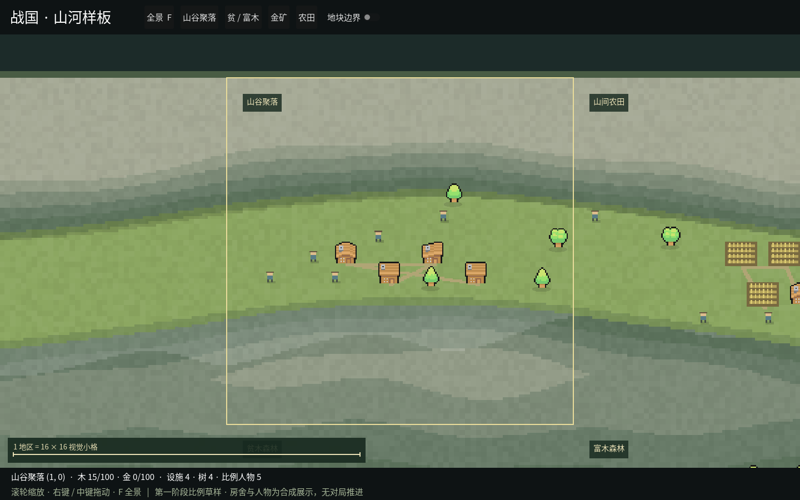

# GUI 第一阶段：尺度与地貌样板

开始：2026-10-23。按用户要求用两周到一个月分批推进，预留四周，先完成前两周的核心样板。
范围对应[详细设计第 16 节的阶段 A](../design/上帝视角演出系统详细设计.md#16-分阶段交付与验收)，
以实际窗口中的比例和地貌为验收依据。现有八国 v13 演示入口保留。

## 节奏与交付

| 时间窗口 | 工作 | 可检查的结果 |
| --- | --- | --- |
| 第 1 周，10/23–10/29 | 固定 3×3 输入、256 像素地区与 16×16 小格；连续山谷、稳定房舍落点、森林丰度；全景/近景 | 独立可运行样板、输入清单、真实窗口截图；检查人/屋/山比例 |
| 第 2 周，10/30–11/05 | 调整山体层次与边缘、贫/富木及矿脉观感、农田和谷地聚落；补邻接对照与缺口清单 | 同种子前后对照，设施不压山，资源差异容易辨认；核心样板可验收 |
| 第 3 周，11/06–11/12 | 依据实际观看修正比例、遮挡、缩放与中文显示，补更多地貌组合 | 远中近景对照，明确素材替换与补绘项 |
| 第 4 周，11/13–11/19 | 稳定性、性能与证据整理，处理剩余问题 | 30–60 秒窗口录像、性能记录、事实对照清单，评估阶段 A 退出条件 |

这是分批工作的排期，不代表已经设置后台定时开发。每批完成后记录产物、问题与下一步；
若前两周已达到退出条件即可结束阶段 A，后两周是打磨余量，不提前展开 B–G。
三级城市/军团、动态生产、战斗、v13 逐动作接线、LLM 气泡和平台包按原计划分阶段开展。

## 第一批：比例草样

2026-10-23 已增加独立合成样板，运行：

```bash
python3 desktop.py --sample terrain
```

样板场景与输入由 UI Mod 自己提供，不创建 Python 对局，也不读写对局存档。
固定输入在 [terrain-v1.json](../../mods/ui/desktop/Samples/terrain-v1.json)。
资源值 0–100 是合成样板的归一化参数，不是给规则引擎新增的资源上限。

| 地区 | 本批比较对象 |
| --- | --- |
| 空山、山谷聚落、山间农田 | 山体占比、连续谷地、设施落点与尺度 |
| 零木、贫木、富木森林与中等木量 | 同一森林地形的四档资源外观 |
| 含金丘陵 | 岩层上的金色显露与小型设施 |
| 平原农田 | 小农田、房舍、小人的比例 |

每地区为 256×256 基础像素，内部 16×16 小格不显示网格。房舍占 16×16，
农田组合占 24×18，比例人物为 6×8。人物与农田暂用代码草图，房舍和树沿用已核对的
Mini World 原图；尚未达到精细人物和地貌美术的最终标准。

本批只验证静态比例、布局可复现、资源差异与基本镜头。尚不宣称阶段 A 已完成：
山体/边缘观感仍需打磨，城市高密度与城堡另在阶段 B，30–60 秒录像与持续性能记录待后续补齐。

实际窗口：[全景](../design/gui-stage-a-overview.png) · [山谷近景](../design/gui-stage-a-close.png)。



本机 Linux ARM64 / Godot Compatibility / Mesa llvmpipe 已验证启动、点选、全景和近景截图。
固定输入合计 19 处设施、306 棵树、19 个比例人物，含金丘陵显示 14 处露金岩；
零/贫/中/富木地区的树数分别为 0/30/100/162，数字是各自输入与坐标生成的样板对象数。
更换镜头不重新生成布局。C# 编译为零警告零错误，布局检查通过。
性能数据的实际范围与剩余问题见[首批验收记录](../reviews/GUI阶段A首批-20261023.md)。

## 验证入口

```bash
dotnet run --project tests/desktop-layout/Checks.csproj -- mods/ui/desktop/Samples/terrain-v1.json
python3 -m unittest tests.test_desktop_launcher tests.test_desktop tests.test_ui_mod -q
python3 desktop.py --sample terrain --build-only
xvfb-run -a -s '-screen 0 1440x900x24' python3 desktop.py --sample terrain --smoke-output /tmp/terrain.png
```

C# 检查直接运行实际布局代码，核对固定输入/种子重现、输入顺序无关、设施和人物数量、
建筑不压山/树/其他建筑、森林丰度递增、含金与无金区别，以及共享边缘高度连续。
窗口验收检查点选，输出全景 `terrain.png`、近景 `terrain-close.png` 与 `terrain.png.json`。
JSON 记录输入哈希、实际对象数、平台及短时帧时间/内存；短截图过程不代替持续运行性能验收。

后续第一件事：依据这批全景和近景，调整山谷轮廓、谷地地表与聚落构图，再补地貌邻接组合。
