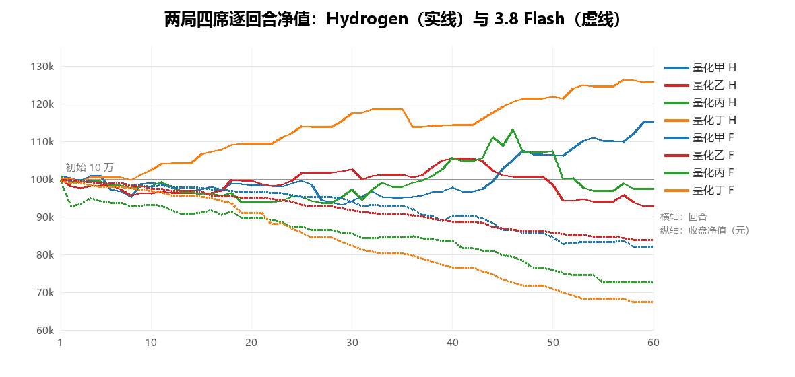
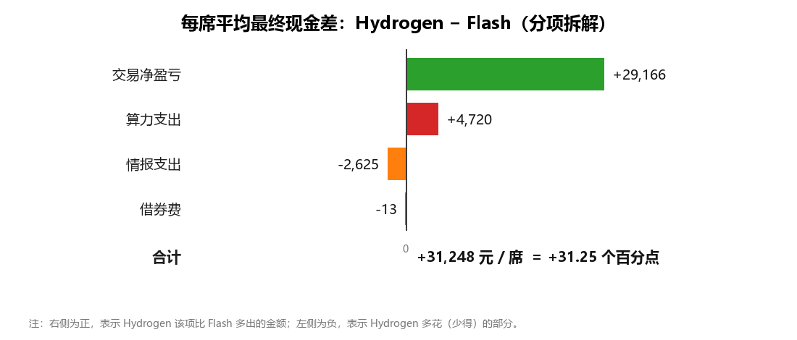
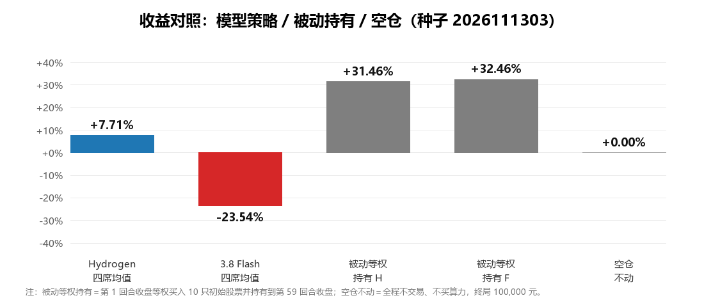

# 成为现代基准：六条规格与 stock 的实现

2026-11-16 · 观点 + 规格 + 实证 · 核心主张：不以模型为尺

> 代码与材料：仓库 <https://github.com/northwindlight/zhanguo>；stock 发行版说明 [`mods/stock/README.md`](../../../../mods/stock/README.md)；两局存档与审计 [`research/game-records/`](https://github.com/northwindlight/zhanguo/blob/archive/research/research/game-records/README.md)；文档站 <https://northwindlight.github.io/zhanguo/>。

> 本文先给观点，再给能支撑它的设计与证据。凡证据不足处写成条件、不写成结论；凡本文拒绝的用法（用静态基线定标、用模型分布定阈值、用重复采样代替审计），都明确列出并说明理由，而不是一边拒绝一边偷偷使用。

---

## 摘要

AI 基准的现代性危机不是「题目不够难」，而是**尺子由被测物定义**：饱和指数取榜单前 $k$ 名分差[1]，measurement headroom 取最强模型到上界的距离[2]，「健康起点」取当前模型的答对率[5]，Elo 与百分位取对手阵容。模型一进步，基准就被判「饱和」、退役、重发新版；下一轮再按新模型重新定标。与之并列的还有四个结构缺陷：测试集进语料、任务可被绕过、评估不含成本、环境没有对手。**根因只有两条：刻度寄生在模型上；目标函数里没有代价，也没有反制。**

本文给出**现代基准的六条规格**（理论主张），并论证 zhanguo 的 stock 发行版是据检索所及第一个把六条规格全部实现的公开实例（创新主张）：

1. **判分 $M$-free**：判分、环境参数、阈值都不引用被测集合的统计量，且答案空间不可由有限语料逼近；
2. **程序即动作**：被测对象是提交的代码，不是一次问答或一次下单；
3. **代价入分**：算力、信息、代码复杂度都从游戏内现金扣，且每回合归零重买；
4. **反制真实**：对手的订单改变你的成交价与成交概率；
5. **审计即证据**：账本逐笔可复算、重放逐字节一致，**账本层**测量误差为零（模型采样层不在此列）；
6. **一个分数 + 一份审计**：读数与尺子分层报告，权威来自设计效度、难刷、可复核与采用。

stock 把六条压进同一个可复现的目标函数：没有买卖按钮，只有盘前提交的受限 Python 策略；计步沙盒把计算量变成可测量的成本；付费档位同时买步数、调用次数和**代码结构上限**；四席共享 PAMS 订单簿；终局按清算现金排名，全量审计可重放。

三类主张的强度不同，本文分开写，不许互相借力：六条规格是**理论主张**（可攻，攻倒一条即改写全篇）；「第一个全部实现」是**创新主张**（给出更早的公开反例即撤回）；「审计到哪一步」是**事实主张**，必须逐项对应——本文的审计状态是 D1/D3 通过、D2/D6 未完成、**D4 未通过**（结算价可操纵），且价格层耦合只到二阶。因此本文**不**主张 stock 已通过六项判分审计，也**不**主张它「不可刷」；它主张的是六条规格已被实现，并给出检验这些实现的方法（§8.3）。

证据分两层。**规格证据**：两局 8/8 会计恒等残差为 0、23 项校验全过、确定性重放逐字节一致（含世界哈希）、佣金 0→0.1% 恰好多亏 297.49、深度 100→20 使成交率 97.26%→29.18%、Flash 局亏损的 81% 来自算力与情报账单（规格 3 真的咬了人）、同卷跨局价格相关中位 0.98。**读数**：31.25 个百分点的跨代际差可逐项分解为交易 +29,165.89、算力 +4,720、情报 −2,625、借券 −13.03，八席均不敌若干常数策略，Flash 局空仓可夺冠。前者是本文的主张，后者只是读数——它不参与尺子的判定，但它是规格 3（代价真的入分）与规格 6（读数可诊断）生效的直接体现。

定位：stock 不承诺区分度（那是被测集合的性质）。据检索，它是**第一个把「判分不随被测物变」写成设计约束、并给出可运行实现与判分审计**的基准；与文明/4X、历史回测、实盘比赛逐维度比较（§5），六条规格均已实现，其余载体没有一个是六条规格全部实现（逐条见 §5.7）。

---

## 一、基准的现代性危机：六类失效与两个根因

### 1.1 六类失效

**（一）饱和。** ICML 2026 的系统测量用 60 个语言模型基准、14 个属性给出结论：近一半基准已饱和，且饱和率随基准年龄上升；抗饱和的保护来自「专家构建」，而不是公开或私有测试集[1]。饱和的定义不是「题目简单」，而是「顶级模型之间失去可靠区分度且贴近经验天花板」。

**（二）污染。** OpenAI 在 2026-02-23 宣布不再用 SWE-bench Verified 衡量前沿编码能力，理由是该基准被污染、且有相当比例的测试用例会把功能正确的提交判错，而半年内头部分数只从 74.9% 爬到 80.9%[2]。

**（三）可被刷。** BenchJack 对 10 个主流 agent 基准做自动红队，在**不解决任何任务**的情况下刷出接近满分，共报告 219 个缺陷，并让 WebArena 与 OSWorld 在三轮迭代内被打穿[3]。NeurIPS 2025 的立场论文把这类问题归结为评估生态的治理缺失：污染、选择性报告、判分质量控制不足[4]。

**（四）缺成本维度。** 面向 agent 的评估范式论文明确要求把智能体放在「分数 × 金钱/时延」的帕累托前沿上比较，而不是只看终态对不对[5]；但主流 agent 基准几乎都不给算力定价，于是「暴力搜索」「无限重试」在评测里是免费的。

**（五）单一终态。** 综合综述把 agent 评估的断裂归纳为三条：任务成功 ≠ 过程质量、基准分 ≠ 部署成本效率、孤立任务 ≠ 端到端工作流[6]。只判终态，就无法区分「第 15 回合财政崩溃」与「第 59 回合惜败」。

**（六）无对手、无反应。** 绝大多数基准是一次性任务：环境不会因为你的行为而改变策略。金融类基准尤其明显——历史回测里的 agent 是价格接受者，它的买卖不改变价格，因此评测的是「在给定价格序列上做预测」，而不是「在有人跟你抢流动性时做决策」[7][9][10]。

### 1.2 共同根源：目标函数里没有代价，也没有反制

把六类失效放在一起看，其实是一个结构问题。设一个基准的分数为 `S(π)`，`π` 是被测策略。失效发生的条件通常是以下四条之一：

1. **`S` 不依赖行为的真实后果**（judge 主观、终态可绕过）→ 失效（三）（五）；
2. **获得 `S` 的代价不被计入**（算力免费、试错免费）→ 失效（四）；
3. **环境对 `π` 没有反应**（价格接受者、一次性任务）→ 失效（六）；
4. **`S` 的测试分布可以被训练语料逼近**（固定题库、历史数据）→ 失效（一）（二）。

反过来，一个抗失效的基准必须让 `S` 同时满足：分数 = 行为的真实后果；获取分数要付真实代价；环境会对行为作出反应；测试分布不可从语料中获得。本文第二节把这四条展开成六条规格。

### 1.3 本文的主张

诊断之外要给药方。本文的主张是六条规格（§2），压成一句：**一个现代基准必须让判分不引用被测模型、让动作成为可执行程序、让代价进入分数、让对手真的反制、让过程可审计，并把读数与尺子分层报告。**

六条里最容易被忽略的是第六条。主流做法把「分数」和「尺子好不好」混在同一个指标里，于是分数一低就去调难度、换锚点、改阈值——先射箭再画靶。本文把它拆成 Layer 1（读数）与 Layer 2（判分审计），并给出 stock 这个六条规格全部实现的实例。

---

## 二、现代基准的六条规格：把危机翻译成要求

| 规格 | 一句话 | 对应判据 |
|---|---|---|
| 1 | 判分与难度不引用被测模型，答案不可由语料逼近 | C1、C2、C3 |
| 2 | 被测对象是动作程序，不是一次问答 | C1、C6 |
| 3 | 拿分的代价进入分数 | C4a、C4b |
| 4 | 环境对行为有反应，对手改变你的成交 | C5 |
| 5 | 账本层测量误差为零，过程可重放可审计 | C1、C2 |
| 6 | 读数与尺子分层：一个分数 + 一份审计 | C6 |

每条规格都有对应的反例；它们不是抽象美德，是从第一节六类失效里逐条反推出来的。

| 规格 | 为什么必须 | 反例（具体数字见 §5） |
|---|---|---|
| 1 判分 $M$-free + 答案不可穷尽 | 引用 $\mathrm{stat}(M)$ 则淘汰是定义的必然结果；答案有限则污染与饱和同时发生 | MMLU 类题库进训练语料；CivBench 的归一化分被作者自称「描述性」 |
| 2 程序即动作 | 只测「一次调用对不对」会漏掉工程能力：拆解、预算、错误恢复；程序还让「意图 → 可执行」成为可测对象 | 工具调用型基准（Civ VI 76 个工具、单局数千次调用）；一次性任务（OSWorld 等） |
| 3 代价入分 | 代价为零时「烧钱、重试、暴力搜索」在评测里免费，结果偏向肯花钱的一侧 | PolyBench 只报 $1.34–11.50 推理费；TradingAgents 计入 token 后 Sharpe 0.43→0.22 |
| 4 反制真实 | 价格接受者的买卖不改变价格，测的是预测而不是博弈 | StockBench/InvestorBench 的历史回放；LiveTradeBench 明确假设个体不影响价格 |
| 5 审计即证据 | 没有审计，分数只能靠自述与 judge；测量误差不为零，排名就无法复核 | 结算厅自述与账本的 3 条出入（本文 §6.6 抓到）；黑箱评分 |
| 6 一分数 + 一审计 | 两者混在一起，就会用读数反推尺子，进而按模型调难度、改阈值 | 饱和指数、measurement headroom、健康起点 |

**定义 1（基准）.** 一个基准是一个五元组 `B = (Ω, A, E, S, R)`：`Ω` 是任务/场景分布（含种子），`A` 是动作空间，`E` 是执行语义（动作如何改变世界），`S` 是目标函数，`R` 是报告协议（如何从一局或多局得到结论）。

**定义 2（判据）.** 称 `B` 对能力 `C` 是**有效**的，当且仅当：

- **规格 1 / C1a 环境确定性**：给定同一样本与同一动作序列，`E` 的输出唯一；且存在可重放记录。
- **规格 1 / C1b 测量可重复性**：同一模型在同一协议下重复评估时，分数不会因采样而不可控地漂移（允许报告方差，但不允许「复跑即换结论」）。
- **规格 1 / C2 判分客观**：`S` 由行为在世界中的真实后果决定，而不是由评估者或 judge 的主观判断决定。
- **规格 1 / C3 抗污染**：`Ω` 的测试部分不可从公开语料中获得，或获取成本足够高。
- **规格 3 / C4a 游戏内资源有价**：获得 `S` 所消耗的**游戏内资源**（算力、槽位、研究、情报、借贷）进入 `S`，即「烧钱」必须自证 ROI。
- **规格 3 / C4b 真实评估成本可报告**：模型推理 token、墙钟与美元成本作为**独立的第二轴**（分数 × 成本帕累托）报告，不与 C4a 混为一谈。
- **规格 4 / C5 策略耦合**：`E` 对动作有反应，且对手状态/订单进入别人的最优决策；但「反应」分两层——执行层（成交概率、滑点、容量、情报）与价格层（策略改变价格路径），后者需实测强度。
- **规格 6 / C6a 退化基线（读数参照，不效用）**：存在可计算的退化策略（空仓、被动持有、随机），其读数可报告、可复算；但按 §1.3 的主张，它不能充当分母、上界或刻度。
- **规格 6 / C6b 读数可诊断**：`S` 可分解到行为维度，能诊断「钱花在哪、死在哪」。注意：本文**不**把「模型效应大于种子效应」列为判据——那是关于被测集合的经验事实，且引用 `stat(M)`；采纳它等于把尺子交回被测集合。

**定义 3（可刷）.** 若存在一个不使用能力 `C` 的策略 `π*`，使 `S(π*)` 接近 `S` 的经验上限，则称 `B` 对 `C` 可刷。

六条不是并列清单：**规格 1 是前提，2–4 是能力面，5 是证据，6 是协议**。它们分别对应饱和文献指出的区分度/天花板问题[1]、污染批评[2]、red-team 结论[3]、成本帕累托要求[5]、过程审计要求[6] 与内生市场要求[10]。stock 的贡献不是发明其中哪一条，而是**把六条绑在同一个目标函数上**（§3），并给出每条的检验方式（§4、§8.3）。

**三种主张，三种强度。** 本文按类型分开写，不许互相借力：**六条规格**是理论主张——可攻，攻倒一条即可改写全篇；**「据检索第一个全部实现」**是创新主张——给出更早的公开反例即撤回；**「审计到哪一步」**是事实主张——必须与 §8.3 的表格逐项对应。事实主张里本文只主张已经发生的事：D1/D3 通过、D2/D6 未完成、D4 未通过。

---

## 三、stock 的架构：每一条设计决策在回答哪条判据

stock 是 `zhanguo` 的一个独立发行版（`mods/stock/`）。它不是在「把股票行情搬进游戏」——它是按第二节六条规格造出来的一台测量装置：每条规格在它身上都对应一个必须写进代码的设计选择。下面逐条给出实现、为什么非得这样、以及代价。

### 3.1 规格 2：程序即动作——模型写程序，引擎跑程序

模型在盘前能用到的工具只有：`script`（write/patch/read/status/run-research）、`portfolio`、`market`、`pool`、`day_report`、`round`、`bank`、`compute_status`/`compute`、`intel_status`/`intel`、`end_turn`。**没有买卖工具**：`buy/sell/short/cover` 在工具表里被显式封堵（`mods/stock/tools.py` 的 hidden 封堵工具），唯一的下单通道是写进 Python 脚本，由脚本在盘中调用 `api.call('stock:market','buy', ...)`。

这一条同时解决两个问题。第一，评测对象从「一次工具调用是否正确」变成「一段程序是否能在 20000 tick 上活下来」——这正是现代 agent 最需要的能力：把意图翻译成可执行、可维护、成本可控的工程。第二，它把 LLM 的调用频率从 tick 级降到回合级：一次盘前规划最多 40 个动作，交易日由确定性解释器执行脚本，收盘后把执行回执送回模型（`mods/stock/clock.py`、`mods/stock/python.py`）。这既避免了「20000 tick × 每 tick 一次 LLM 调用」的不可行成本，也让「长程一致性」成为可测的能力而非假设。

### 3.2 规格 3：沙盒——可计量的计算

脚本不是直接跑 CPython，而是跑一个自研的 Python 子集解释器 `Machine`（`engine/scripting.py`）。它有三个性质：

1. **可计量**：每个操作按运算、容器规模与载荷大小计步；一次 API 调用有基础计价（`engine/scripting.py` 的 `charge`/`value`，规则说明为「一次 API 基础计 100 单位」）。因此「这段策略要花多少计算」是可测量的，而不是黑盒。
2. **受限**：禁止 import、文件、网络、随机数、动态执行、类、异常处理、lambda、f-string。这既堵死了「把引擎当宿主机」的作弊面，也保证执行确定性（C1）。
3. **有结构上限**：源码字节数、语法树节点数、容器大小、嵌套深度、输出字节都有上限；**上限随付费算力档位提高**（`mods/stock/python.py: limits_for_pool`：第 1/2/3/4 档语法树节点 2048/4096/6144/8192，源码 16384/32768/49152/65536 字节；`mods/stock/mods/python.toml` 的 `[Limits]`）。

第三条是 stock 的独特设计：**代码复杂度本身是花钱买的**。写不出轻量脚本，要么花更多钱买档位，要么被结构上限截断。这使「工程能力」与「成本纪律」在同一个动作上被耦合起来。

### 3.3 规格 4：市场——内生价格与真实微观结构

市场不是历史数据回放，而是一台由种子确定的模拟器：PAMS 0.3.0 订单簿撮合，每只股票流通盘 20000 股、可借券 5000 股、盘口深度 100 股/档；佣金 0.1%、点差 0.2%；市价单带 2% 价格保护；背景有有限资金/库存的做市者、只根据已公布消息交易的基本面代理、噪声/动量流（`mods/stock/mods/market.toml`、`mods/stock/market.py`）。

因此**玩家不是价格接受者**：大单会吃穿盘口，挂单会暴露意图，撤单会改变后续成交；四名玩家的订单流与背景账户共同形成价格。这一点直接对应 C5：任何席位的策略都必须在「别人也在交易」的条件下评估。

市场还有三类非平稳性，专门用来防止静态策略：

- **公开事件**：每交易日一条市场快讯、每只股票错峰一条公司快讯、每股每 5 个交易日一次定期财报；5 类公司事件（立案、技术突破、事故召回、做市扩容、政策调整）会**永久改变该股个性**（波动率、贝塔、吸收速度、流动性、点差、敏感度、漂移）（`mods/stock/dynamics.py` 的 `SHOCKS`）。
- **动态股票池**：初始 10 只 + 候选 4 只，新股按种子排定的日程挂牌（首个挂牌日第 7 个交易日，之后每 6 个交易日一只）；连续 5 日收盘价低于锚价 35% 触发退市警示，再 5 日复核仍低则以 5% 折价强制回购摘牌（`dynamics.py`）。
- **未公布状态不公开**：市场因子、波动状态、未公布事件对玩家不可见（`dynamics.py` 文件头注释：全部是「种子与回合的纯函数」，因子水平与未公布事件保持私有）。

### 3.4 规格 3：经济——一切都是花钱买的

| 资源 | 规则 | 价格（每回合） |
|---|---|---|
| 免费档 | 每账户 400 万计算单位 / 4000 次 API / 1 个交易槽 | 0 |
| 算力池 2/3/4 档 | 每档 +400 万单位 / +4000 次 API；同时提高单次回调上限与结构上限 | 120 / 240 / 480 |
| 交易槽 2/3/4 个 | 每多一个槽多一份可并行策略 | 80 / 160 / 320 |
| 研究槽 | 只读，按次收费，每回合最多 3 次；单次 100 万步 / 1000 次 API | 200 / 次 |
| 商业谍报 | 对手现金/持仓快照；随机偷 6 行源码片段 | 1000 / 2500 |
| 借贷 | 每回合利息 2%，维持保证金 30%，借券费 0.02%/日 | 按成交量 |

（参数来自 `mods/stock/mods/*.toml`；交易成本另计：佣金 0.1%、点差 0.2%。）

关键在于：**算力池与交易槽只在本回合有效、次日归零重买**。这意味着每一回合都要重新做一次预算；不续买就退回免费档，策略立刻可能被结构上限卡住。研究与情报则把「信息获取」也标了价。C4 不是「报告一下用了多少 token」，而是「花掉的每一分钱都从终局现金里扣」。

### 3.5 规格 4 + 1：多席与公平——同一时间截面、下一 tick 生效、轮换顺序

四名玩家共享一个订单簿，但决策是异步的（各写各的脚本）。stock 用三条规则把「异步」变成「可复现」：

1. **同一时间截面**：同一 tick 的所有回调读同一份公共快照；委托与撤单最早在下一 tick 生效（`mods/stock/python.py` 的 `run_all` 调 `stock:market.freeze_public`，再按唤醒 tick 逐个执行）。
2. **同 tick 处理顺序固定**：先处理撤单，新增委托按轮换账户顺序处理（`mods/stock/README.md`）。
3. **并发只重叠等待**：盘前规划阶段各席可并发发出请求，但世界变更（下单、借贷、买谍报、改脚本）全部经会话锁串行入账；同一种子下，并发配置得到的市场状态与严格串行一致（`mods/stock/README.md`「并发规划」）。

这三条是「多席同场」能作为基准的前提：如果并行会改变结果，跨局比较就没有意义。

### 3.6 规格 5：审计与重放——账本层测量误差为零

每一笔委托、成交、费用、租金、情报、借贷都有结构化回执；存档旁保留完整审计目录（`session.json.audit/`）；日志逐动作播报，收盘每席一行摘要。存档 + 审计足以**重建账本**；脚本级重放另需引擎测试（本文 §6.8 做了确定性重放），而「整局全动作重放」（含算力/情报/借贷采购）目前只覆盖脚本与 `end_turn`（`ReplayClient`），尚未覆盖采购——这是 C1 的已知缺口。论文的实证部分用两局存档做了 23 项校验：8 席会计恒等式、8 席成交现金流 = `realized_pnl`、公开消息 160/160 对齐、休市日槽执行与两局价目一致性等全部通过。

这带来一个在其他基准里很少见的东西：**账本测量误差为 0**。给定存档，分数不是估计出来的，而是算出来的；两个模型的差距可以逐项分解，而不是靠置信区间猜。注意这只覆盖「记账/执行」这一层，不覆盖「模型采样」这一层（见 C1b 与 §7.1）。

### 3.7 规格 2：编排——把长程模型接到回合制世界上

模型每回合看到的是引擎拼装的简报：回合与日历、账户与持仓、行情（含已公布消息与财报日程）、上一交易日执行回执、最近一次脚本输出与报错（带行号与改法）、算力与谍报状态、股票池公告（`mods/stock/client.py` 的 `stock_briefing`）。

长程上下文用「500k 窗口 + 流式压缩」解决：窗口逼近上限时，把较早回合折叠成长期记忆摘要（独立预算、最多 10 次重试；失败则退回逐期小结），保留最近 20 个归档块与 240 条回合小结；旧思考在拼接时剥离（`mods/stock/client.py` 的 `_compact`、`mods/stock/compact_provider.py`）。这使得「跨 60 回合保持目标一致」成为真实约束，而不是靠无限上下文作弊。

**架构创新的清单**（本文主张的贡献，逐条对应判据）：

| # | 创新 | 实现位置 | 回答的判据 |
|---|---|---|---|
| 1 | 程序即动作：没有下单按钮，只能写脚本 | `tools.py` hidden 封堵 | C2、C6 |
| 2 | 计步沙盒：按运算/容器/载荷计量，禁 import/random/网络 | `engine/scripting.py` | C1、C4 |
| 3 | 算力档位同时买步数、调用与**代码结构上限** | `python.py: limits_for_pool` | C4 |
| 4 | 回调时间模型：20000 tick、同一截面、下一 tick 生效、轮换顺序 | `python.py: run_all`、`market.freeze_public` | C1、C5 |
| 5 | 并发规划：只重叠等待，世界变更串行入账 | `session.py`、README「并发规划」 | C1 |
| 6 | 情报市场：快照与源码片段可定价购买 | `intelligence.py` | C4、C5 |
| 7 | 动态股票池 + 事件永久改变个股个性 | `dynamics.py` | C5、C6 |
| 8 | 全量审计 + 重放 + 结算厅 | `session.audit/`、`settlement.py` | C1、C2、C6 |
| 9 | 长程上下文压缩（长期记忆 + 归档块） | `compact_provider.py`、`client.py` | C6 |
| 10 | 终局清算：按最后成交价平仓收佣，空仓也是策略 | `clock.py` 规则、`settlement.py` | C4、C6 |

这张表是本文与「又一个 LLM 炒股 benchmark」的分界线：stock 的创新不在「让模型炒股」，而在**把计算的代价、代码的复杂度、信息的获取、对手的反应全部写进同一个可复现的目标函数**。

单看每一条，都有先例：计步解释器像受配额限制的沙盒，订单簿像 ABIDES[32]，全量审计像交易所对账，上下文压缩是任何长上下文工程的标配。**没有先例的是把这十条绑在同一局、同一个账本上，并让付费档位同时买「计算量、调用次数、代码结构」三样东西**——于是工程能力、成本纪律与对抗策略互相牵制：写得太重就买不起，写得太轻就抢不到成交，买太多档位就吃掉收益。「六条规格全部实现」的实质就是这个耦合，不是任何单项的先进。

---

## 四、可证明的性质

本节把第二节的判据落到 stock 上。命题都以显式假设为前提：**凡不是由设计直接保证的，就写成假设并标注**。这是本文与「设计说明」的区别。

| 命题 | 类型 | 依赖假设 | 是否实测 |
|---|---|---|---|
| 一 执行确定性 | 实现不变量（对 tick 归纳 → 等价于 A1 的推论） | A1 | 已由 §6.8.1 的引擎重放证明（逐字节一致、workers 无关） |
| 二 账本恒等 | 记账恒等式 | A2 | 两局 8/8（但样本无退市/利息，边界见下） |
| 三 成本单调 | 会计恒等式的直接推论 | A2 | 由账本结构保证，§6.2 给出实例 |
| 四 往返无套利 | 数学推论（鞅假设） | A3 | 已做：零佣金毛现金流零和、点差负期望、佣金精确抽水（§6.8.3） |
| 五 策略耦合 | 简化博弈模型 | A4 | 方向成立；强度只有执行层证据（§7.2） |
| 七（协议准则）随机环境 | 条件性概率上界 + 设计准则 | A5 | 主协议用随机种子 + 对手池（§8.2） |

命题一~五由设计或简化模型给出；另有一条随机环境准则（A5）用于 §8.2 的同卷抽签。本文不引入任何统计命题：理由见 §2 规格 6。

**假设 A1（确定性实现）.** 引擎不使用系统时间、外部随机源或不可复现的并发语义；市场状态的演化是 `(种子, 回合, 本 tick 请求)` 的纯函数；沙盒解释器是确定性的。

**假设 A2（审计完整）.** 每一个改变现金或持仓的事件都有唯一记录，且记录可按序重放；无未记录的现金流入流出。

**假设 A3（无信息优势，仅用于命题四）.** 在没有私有信息的条件下，价格过程对交易者是鞅。

**假设 A4（线性冲击，仅用于命题五）.** 价格对净订单的冲击可近似为 `p = p_0 + λ Q`，`λ>0`。

**假设 A5（环境随机化）.** 每局种子从大空间中随机抽取；引擎不向模型泄露未来信息。用于第八节的随机环境准则。

### 4.1 命题一：执行确定性（对应 C1）

**命题一.** 在 A1 下，固定评测协议、同一种子、四席逐字节相同的脚本序列，则成交序列、账本与终局现金唯一确定；结果与运行时刻、并发配置（`planning_workers`）和重跑次数无关。

**证明.** 对 tick 归纳。设第 `t` 个 tick 开始时市场状态为 `X_t`。本 tick 的请求由各席脚本与 `X_t` 决定（脚本固定、A1）；请求的处理顺序固定为「先撤单、再按轮换账户顺序处理新增委托」（`mods/stock/README.md`）；委托最早下一 tick 生效。因此 `X_{t+1}` 由 `X_t` 与固定请求唯一确定。tick 数有限（20000），归纳成立。终局现金是账本的函数（A2）。并发规划只重叠「等待接口」的时间，世界变更经会话锁串行入账（`mods/stock/README.md`「并发规划」），不改变写入顺序。□

**边界.** 该命题针对「给定脚本」的重放，不含模型采样本身的不确定性；真实对局里脚本由模型生成，因此可复现的是**审计记录下的那一局**，不是「同一模型再跑一次」。后者属于重考与可选的稳定性问题（§8.2）。

**推论.** 基准满足 C1：存档 + 审计 = 可重放的测量记录。这也使「同卷对照」在方法上成立——两局同一批种子，环境噪声被压到很小（跨局逐日收益相关中位 0.98，§6.4），差异主要来自行为。

### 4.2 命题二：账本恒等与判分客观（对应 C2）

**命题二.** 在 A2 下，对每席 `i`：

```
c_i(T) = c_0 + Σ_{成交} 现金流_i − 算力支出_i − 情报支出_i − 借券费_i − 利息_i
```

右端每一项都可由审计逐笔重建；因此排名 `r(c)` 是审计的函数，任何自述、复盘或事后编辑都不能改变它。

**证明.** 由 `mods/stock/portfolio.py` 的记账定义：成交现金流（含手续费）逐笔入账；算力、交易槽、研究、情报、借贷各自有 `spend` 回执；`realized_pnl` 是成交现金流的闭式汇总。对审计按事件类型求和并代入上式即得 `c_i(T)`。两局 8 席实证残差均为 0（`evidence/checks.json`）。□

**推论.** 基准满足 C2：没有 judge、没有评分者偏差。附带的后果是「复盘自述不能替代账本」——两局结算厅里模型的账户字段全部与账本一致，但派生说法有三条对不上（手续费、情报份数、成交密度），见 §6.6。

**边界.** 该恒等式的右端只列了五项。若对局中出现退市强制回购、利息或负债清算，需补对应项：退市回购在 `market._delist` 里走 `execute`，**不产生 `stock_fill` 审计行**，却计入 `realized_pnl`；因此「成交现金流 = `realized_pnl`」这条 8/8 校验在出现退市的局里会失败。协议应把「退市/利息/负债清算」写进恒等式，或声明该检验只适用于无退市的样本（两局恰好没有退市、没有利息）。

### 4.3 命题三：成本单调性与 ROI 门槛（对应 C4）

**命题三.** 在 A2 下，若其他条件不变，把某回合的资源采购从向量 `x` 增加到 `x+Δ`（价格 `w>0`），终局现金减少 `w·Δ`。若这项支出使交易端收益增加随机量 `Δα`，则终局现金的净变化为

```
Δc = Δα − w·Δ.
```

于是只有当 `E[Δα] > w·Δ` 时，增加投入才是正期望；否则「多买算力/情报」是确定性的失血。

**证明.** 直接由命题二的线性分解：资源支出的价格项系数为 −1。□

**与主流基准的对照.** 在多数 agent 基准中，`Δ` 的价格为 0 或只记录不扣分，因此任何 `E[Δα] ≥ 0` 的投入都会被接受，评测结果偏向「肯烧钱」的 agent[5]。stock 把价格写进目标函数：算力池、交易槽、研究、情报、借贷全部扣现金，且**每回合归零重买**（`mods/stock/mods/compute.toml`）。这意味着基准测的不是「能不能想到策略」，而是「策略的收益能不能覆盖它自己的运行成本」。

**推论.** 基准满足 C4。两局实证给出一个具体形态：Flash 四席的交易端平均只亏 4,397 元，但算力与情报账单是 19,140 元——**亏损的 81% 来自成本项**，这就是 C4 想要暴露的东西（§6.2）。

### 4.4 命题四：往返无套利，churn 不能刷分（对应 C2）

**命题四.** 在 A3 与正交易成本（佣金率 `f>0`、点差率 `s>0`）下，任何不改变净头寸的**吃单往返**（taker–taker）策略，其期望现金变化严格为负：

```
E[Δcash] ≤ −q·p·(2f + s) < 0.
```

因此「高频刷单」不能提高期望得分；得分只能来自信息优势、流动性提供（挂单做市，见下）或趋势仓位。

**证明.** 考虑一笔往返：以 `p_b` 买入 `q` 股，之后以 `p_s` 卖出。现金流为 `q(p_s − p_b) − q(p_b + p_s)f`。由 A3，无信息优势时 `E[p_s | F] = p_b`；作为吃单方，卖出成交价不高于 `p_b − s·p_b`（点差）。代入得 `E[Δcash] ≤ −q p_b (2f + s) < 0`。多笔独立往返叠加仍为负。□

**为什么这条重要.** 旧的「静态题库」基准最怕的是「不做任务也能拿分」[3]；交易类基准对应的问题是「用高频动作堆收益」。命题四说明：在 stock 里，**动作数量本身不产生分数**，只有净头寸与真实预测产生分数——因为每一次往返都要向做市商支付点差与佣金。两局实证里，Hydrogen 四席成交 8,625 笔、Flash 四席 1,796 笔，但前者的交易净盈亏为正（+99,076），后者为负（−17,587）：**笔数不是分数，净头寸才是**（§6.3）。

**边界.** 第一，命题四依赖 A3；若模型确实有预测能力（例如从财报事件中提取 alpha），往返交易可以盈利——但那正是被测能力，不是刷分。第二，命题只覆盖**吃单**往返；主动挂单做市是提供流动性，赚的是点差，与「严格为负」不矛盾，但它要承担逆向选择与库存风险，应单独作为一条策略族评估（附录 D 未做）。

### 4.5 命题五：策略耦合——玩家互相改变局面（对应 C5）

**命题五.** 在 A4 下，`n ≥ 2` 名玩家共享一个订单簿。设玩家 `i` 的净订单为 `q_i`、其他玩家净订单为 `Q_{−i}`，成交后的价格为 `p_1 = p_0 + Δ + λ(q_i + Q_{−i})`（`Δ` 为 i 的私人信息/预测）。则 `i` 的期望利润为

```
π_i(q_i) = q_i · (E[Δ] − λ(q_i + Q_{−i}))
```

（`i` 自己的买入也会压低自己的边际收益），一阶条件给出

```
q_i* = E[Δ] / (2λ) − Q_{−i} / 2.
```

**最优订单量随对手净订单向下倾斜**：对手买得越多，你越应该少买甚至反向。因此不存在与对手无关的支配策略；均衡是博弈均衡，不是单 agent 最优。

**证明.** 对 `π_i` 求一阶条件：`E[Δ] − 2λ q_i − λ Q_{−i} = 0`，移项即得。□

**边界.** 这是「单期、同时行动、线性冲击」的约化模型（Kyle 型）；完整 PAMS 撮合是非线性的，且玩家看到的是同一 tick 的公共截面。定性结论（最优量依赖对手、向下倾斜）不依赖线性假设，但强度要用审计数据估 `λ` 才能说（附录 D）。

**这条命题的实质.** 「玩家之间会改变局面」不是一个附加的趣味点，而是 C5 的判据内容：**环境对行为的反应进入了别人的决策**。在 stock 里，玩家改变的不只是价格，还有彼此的成交概率、库存与信息。具体有五条渠道：

| 渠道 | 机制 | 参数/实现 | 如何塑造策略 |
|---|---|---|---|
| **价格冲击** | 大单吃穿盘口，推高/压低成交价 | 盘口深度 100 股/档、流通盘 20000 股（`market.toml`） | 必须分批建仓/清仓、择时；冲击成本进决策 |
| **流动性竞争** | 同一 tick 的委托争抢同一档位；先撤单后新增、按轮换顺序处理 | `market.freeze_public`、README | 挂单时机、撤单纪律、抢跑与反抢跑 |
| **信息不对称** | 可以花钱买对手的持仓快照、随机偷 6 行源码 | `intelligence.py`，1000/2500 | 情报的 ROI；反侦察（源码太短会被整段偷走） |
| **容量约束** | 可借券仅 5000 股；股票池仅 14 只；事件窗口共享 | `market.toml`、`pool` | 拥挤交易、空头容量、财报抢跑 |
| **排名竞争** | 终局按个人现金排名，且排名不公开（只能买情报得知） | `settlement.py`、`intel` | 相对排名的博弈；终局清算前的动作选择 |

**「局面」的定义.** 在这个游戏里，局面不是一份静态行情，而是四席行为共同演化的状态：`X_{t+1} = F(X_t, 四席委托, 外生事件)`。策略性就是「在别人也会行动的世界里选择行动」——这正是历史回测类基准最缺的一维：回测里没有第二个人会改变你明天的成交价。

**边界（诚实）.** 命题五只说明耦合的方向与符号，不测量耦合强度。两局实证显示**耦合在价格路径上是二阶的**：同一批公开事件下，14 只股票的逐日收益跨局相关中位数 0.98（§6.4）。原因是当前市场参数偏深（流通盘 20000 股、单席资金 10 万），玩家的订单流不足以主导价格路径。因此本文区分两个层次：**执行层耦合是一阶的**（成交概率、滑点、可借券、情报都直接受对手影响），**价格层耦合是二阶的**（当前参数下外生因子主导）。要把「策略性」推到一阶，需要下调流通盘/盘口深度或引入更直接的对抗机制（§7.2）。

---

## 五、与相邻载体的比较：文明类、回测类、实盘类

比较的维度就是 §2 的六条规格。先给记分卡（§5.7），再逐类说理由。四类载体各取代表：文明/4X 类（CivRealm、CivBench、Rome、Vox Deorum）、历史回测类（StockBench、InvestorBench、FinMem、TradingAgents）、实时与实盘类（LiveTradeBench、PolyBench、AStockArena、Alpha Arena）、内生价格多 agent（Agent Trading Arena、StockAgent）。先说清楚：**没有哪个载体全面更差**；它们各自优化了不同的目标，stock 的定位是在「六条规格全部实现」这个格子里。

### 5.1 总表

| 判据 | 文明/4X（CivRealm/CivBench/Vox Deorum） | 历史回测（StockBench/InvestorBench） | 实时/实盘（LiveTradeBench/Alpha Arena） | 多 agent 内生市场（Agent Trading Arena） | **stock** |
|---|---|---|---|---|---|
| 动作空间 | 指数膨胀：CivRealm 估 10⁴→10¹⁶⁶；Civ VI 用 76 个工具/单局数千次调用 | 买/卖/持 | 买/卖/持 | 交易决策 | **写程序**：40 个规划动作 + 受限 Python 沙盒 |
| C1 可复现 | 弱：Freeciv/Civ VI 版本、随机开局、脚本 AI 对手；Civ VI 需自购+单连接 | 强：数据固定；但实现复现差（FinMem 换标的收益转负、TradingAgents 10 次运行 5%–28%） | **弱**：实时/实盘不可重跑 | 中：仿真但依赖实现 | **强**：种子 + 确定性引擎 + 审计重放（命题一） |
| C2 判分客观 | 弱：多胜利条件、归一化分被作者自称「描述性」、mini-game 用人工阈值 | 强：收益可算 | 中：真实收益可算但含运气 | 中：收益可算 | **强**：账本闭式、逐笔可复算（命题二） |
| C3 抗污染 | 中：规则固定但地图/种子可换 | **弱**：历史行情已进语料；FinMem 跨预训练 cutoff 收益掉 71.85% | 强：实时数据未进语料 | 中 | **强**：随机环境 + 对手池轮换（§8.2） |
| C4 成本入分 | **无**：不算推理成本，只报 API 账单 | **无**：或只计佣金；计入 token 后 TradingAgents Sharpe 0.43→0.22 | **无**：只算资金（PolyBench 只报 $1.34–11.50 推理费，不计分） | **无** | **C4a 强**（游戏内资源全扣现金，命题三）；**C4b 无**（token 不进分，见 §7.4c） |
| C5 策略耦合 | 强：外交/军事；但对手是脚本 AI，且靠「只给 AI 的数值加成」维持难度 | **弱**：价格接受者 | 中：共享市场但不互相影响报价 | **强**：零和市场、agent 影响价格 | **执行层强 / 价格层弱**（当前参数下 0.98 相关；命题五 + §7.2） |
| C6 读数可诊断性 | 弱：CivBench 23 局仍未答出「比基线强多少」，单局 $31–229[21] | 中：口径有争议（StockBench 摘要与表 2 不一致） | 低：32 组只有 6 组盈利[18] | 中 | **强**：五项归因 + 行为统计可逐项诊断（§6.2–§6.3）；区分度不作承诺 |
| 单局成本 | CivBench：**$31–229/局，本地 2–8 小时**；CivRealm 数小时到数天 | 低 | 中（但不可重复） | 低 | 两局各约 2–3 小时模型调用时间、约 100 万输出 token（本机实测） |

> 表注：各格口径不完全可比——「动作空间」一行里，文明类量的是游戏原生动作数，stock 量的是「40 个规划动作 + 代码空间」；「可复现」拆成环境级与结果级；「成本」在 stock 一行同时含游戏内成本（C4a）与模型调用时间（C4b）。强/中/弱是定性判断，证据见 §5.2–§5.6。本表 C6 一行比较的是「读数可诊断性」，不是统计功效；各载体的经验分差只作描述，不作本文判据。

### 5.2 文明/4X 类：开放世界换走了可测量性

文明是最接近「大战略」的公开 AI 环境，也是近年投入最大的一类。把 2024–2026 的四个代表放在一起看，它们的困难不是「模型不够聪明」，而是结构性的：

**动作空间与状态随进程指数膨胀。** CivRealm（ICLR 2024，BIGAI，基于 Freeciv）估计动作空间随时代从 **10⁴ 膨胀到 10¹⁶⁶**、状态空间从 **10¹⁵ 到 10⁶⁵⁰**；它同时提供张量接口（给 RL）与语言接口（给 LLM），但摘要给出明确结论：**RL agent 只在 mini-game 表现合理，RL 与 LLM 在全游戏都难以取得实质进展**[13]。Civ VI 侧的 CivBench（2026，Oxford/DeepMind/UK AISI 等）放弃给动作空间上界，改为 **76 个 MCP 工具、单局数千次工具调用、300+ 回合**[21]。

**判分不可比、中间信号会骗人。** Civ VI 有六种胜利条件，CivBench 自己的归一化分数被作者称为「描述性」；CivRealm 的 mini-game 用人工设定的阈值（产出超过阈值、灭敌、达成协议）[13]；Civ V 的分数把人口、城市、奇观、军事、政策、科技揉成一个数。更尖锐的是记分板陷阱：Rome 等（2026）在 8 款策略游戏的局面比较中发现 **8%–68% 的局面对出现「当前分高、终局反而差」的反转**，五个前沿模型在这类判断上只有 **26%–34%** 准确率（低于随机）[22]——**局内分数不能当密集奖励，也不能当能力信号**。

**成本与功效的两难：贵到没法回答。** CivBench 的 23 局里只赢了 3 局，聚合 p=0.530——问题不在 p 值大小，而在于花了 **23 局 × $31–229**、本地 **2–8 小时/局**、还要自购 Civ VI 与 DLC 之后，仍然答不出「比基线强多少」[21]。要压成本就得把 LLM 从微操里摘出来：Vox Deorum（Civ V）让 LLM 只做宏观战略、战术交给脚本 AI，才在 **2,327 局**上把成本压到 **≈$0.86/局**——但代价是「换了问题」，它测的不再是端到端玩文明[23]。

**对手是脚本 AI，而且靠数值加成。** CivRealm/CivBench 的对手都是内置 AI；Vox Deorum 明确指出 4X 原生 AI 靠「只给 AI 的数值加成」维持难度[23]。CivBench 还指出它**没有同接口的脚本/随机基线**，因此无法区分「agent 弱」与「对手强/规则偏」[21]。

**长程失效有具体形态，且可测量：**

| 失效形态 | 证据 | 出处 |
|---|---|---|
| 该查不查（under-monitoring） | 胜利进度查询只占工具调用的 **0.05%–0.29%**；PMR **0.96%–2.13%**；20 场可检测败局中 8 场在 20 回合预警窗内没查过 | CivBench[21] |
| 说了不做（reflection–action gap） | RAG@10 = **48.2%–65.8%**，约 1/3–1/2 的自述承诺 10 回合内未执行 | CivBench[21] |
| 被记分板带偏 | trap 判断 26%–34%，低于随机；只给分数时掉到 0.113 | Rome[22] |
| 上下文爆炸 + 战略固执 | 单回合状态可达 10 万 token；GLM-4.6 每百回合只换 13.9 次战略（脚本 AI 51.6 次），必败时反而切「WinningWars」 | Vox Deorum[23] |
| 根本跑不完 | harness 前 19 次开发局只有 4 次（21%）跑到自然结束 | CivBench[21] |

结论：**4X/文明类基准在 2026 年不是「饱和」，而是「刚起步且被证明很贵」**。它的五个结构性困难——动作空间爆炸、状态必须主动检索、稀疏终局与不可靠的中间分、版本漂移与商业许可、对手是脚本 AI——恰好是 stock 在设计上逐条反着做的：

| 4X 基准的困难 | stock 的对应设计 |
|---|---|
| 动作空间 10⁴→10¹⁶⁶ | 回合制 + 每回合 40 个规划动作 + 受限 Python 沙盒（动作面固定且可代码化） |
| 状态庞大、必须主动检索 | 盘前简报推送关键状态（回合、账户、行情、上一日回执、上次脚本输出），细节用 API 查 |
| 多胜利条件、判分描述性、记分板陷阱 | 单一目标（终局现金）+ 账本可分解到五项；没有「中间分」可被刷 |
| 单局昂贵且无统计功效 | 单场考试 + 随机种子（§8.2）；重放不需要重跑（§6.8.1） |
| 对手是脚本 AI + 数值加成 | 四席同场、对手是同等能力的 LLM（或混合阵容），不存在「只给 AI 的加成」 |
| 说了不做 | 不存在「承诺—执行」的缝隙：不写脚本就没有动作，脚本由引擎执行而不是由模型「自觉」执行 |
| 环境脆弱、跑不完 | 确定性引擎 + 存档续跑（Flash 局第 48 回合中断后从回合边界续跑） |

代价也说清楚：stock 放弃了文明类的开放世界、军事、外交与地图，把「大战略」压缩成「市场里的经济决策」。**这是取舍，不是缺陷**——它要测的是「在代价与反制下能不能做出可执行的经济决策」，而文明类要测的是「能不能在开放世界里长程规划」；两者不该互相替代。反过来，文明类的困难也提示 stock 的边界：如果将来把 stock 的动作空间重新放大（军事、外交、多市场），它就会遇到同样的判分与成本问题。

（相邻对照：同为 4X 的 Digital Player（Unciv）选择只让 LLM 做外交、把单位与生产交回原生 AI，这正是「动作空间太大就用降级方案」的例子[24]。Cicero 在 Diplomacy 上达到「人类水平」的准确口径是匿名线上联盟 40 局、得分超人类平均 2 倍、进前 10%，并非超人，且 agent 未公开、人类对手不可复现[14]；AlphaStar 打到 StarCraft II 宗师[15]、OpenAI Five 在 Dota 2 上 2–0 击败 OG[16]，两者都要专用 RL 与巨额算力，不是「LLM 评测基准」。它们说明「游戏很难」不等于「基准有效」。）

### 5.3 历史回测类：干净的指标，缺席的对手，以及「复现即崩」

金融侧最成熟的一类基准是历史回测。它们把「在给定价格序列上做决策」做成可算分的任务，指标干净（收益、回撤、Sharpe），数据固定、可复现——C1 与 C2 看起来很强。但把近年这几项工作放在一起，三个缺口非常稳定：

**（一）价格接受者，没有对手（C5 缺）。** 先区分：FinBen[17] 是任务全集式（36 数据集 / 24 任务），交易只是其中短程的一小块；本节讨论的是真正做连续交易的 StockBench 一类。StockBench（2025）用 DJIA 权重前 20 只股票的日频数据 + 新闻做多月连续交易，评估窗 82 个交易日（2025-03-03 至 06-30），13 个模型对 1 个等权被动基准[7]；InvestorBench（ACL 2025）覆盖股票/加密/ETF，13 个 backbone，但仍是历史数据回放[9]。两者的 agent 都是价格接受者：它的买卖不改变价格，因此不存在「跟人抢流动性」这一维。

**（二）污染与「语义记忆」（C3 缺）。** 历史行情与新闻进入训练语料几乎是必然；更隐蔽的是模型的权重里带着事后新闻与复盘。这个分量已经被量化：FinMem（分层记忆的交易 agent[28]）在预训练 cutoff 之外评估时，累计收益下降约 **71.85%**（QuantAgent 的 Sharpe 下降 51.48%）[25]；FinMem 自身的第三方复测更刺眼——MSFT 的累计收益从 **23.261% 变成 −22.036%**、Sharpe 从 **1.440 变成 −1.247**，NFLX 的 Sharpe 从 2.017 变成 −0.478，偏误缓解后 buy-and-hold 在统计上显著优于它[26]。FinSABER（KDD'26）把评估拉到 **20 年、100+ 标的（含退市股）、滚动窗口**后，此前报告的 LLM 优势显著衰减[26]。

**（三）成本与复现（C4、C1 缺）。** TradingAgents（多 agent 但「对手」是机构内部的同事，不是市场对手[27]）在计入佣金、点差、冲击与 **token 成本**后，组合 Sharpe 从 **0.43 掉到 0.22**，低于净买入持有；同类工作 40 个「系统 × 摩擦项」单元里有 **35 个未建模**[25]。复现性同样糟糕：TradingAgents 同配置 10 次独立运行，最终收益落在 **5%–28%**，多数低于被动基准[27]。

一个必须说清的口径问题：StockBench 的摘要是「多数模型跑不赢 buy-and-hold」，但其表 2 里 11/13 个模型在 z-score 上排在被动基准之前、收益与 Sortino 更高[7]（本文引用时按摘要口径保留，不当作定论）。所以稳妥的引用方式是它另一条更硬的结论——**静态金融 QA 强 ≠ 交易强**——而不是把「多数打不过 B&H」当成定论。

stock 在这三条上是相反的：价格内生（订单簿撮合，命题五）、随机环境（§8.2）、资源计价（命题三）。代价是放弃了真实历史数据——stock 的市场是模拟器，不是 2020 年的纳斯达克。

### 5.4 实时与实盘类：最真实，但不可作为科学基准

这一类的方向是用真实数据把「污染」从根上绕开。LiveTradeBench（2025-11，UIUC）用 50 天实时数据流、21 个 LLM，动作是组合权重；它自己在论文里明确假设「个体交易对真实价格的影响可忽略」，并**不建模订单执行机制**，Limitations 里也列了「交易成本与市场摩擦」[8]。PolyBench（2026-04）把执行摩擦做得最实：按订单簿逐档吃单、有滑点与容量限制，但**不计佣金**，且推理花费（每模型 $1.34–$11.50）只报告、不进评分；7 个模型里只有 2 个正收益，模型自报置信度普遍过高[12]。AStockArena（2026-10）走得更远：A 股实时、82 个交易日、13 个模型、3,198 次决策，建模了佣金 0.03% + 印花税 0.05% + T+1 + 禁做空 + 整手 + 单票上限，并把评估推进到**过程审计**——1,070 个可审计交易点里 **72.99% 至少一项缺口**（模型级 52.2%–91.2%）；把被标记的交易过滤掉后，12 个活跃模型的平均收益反而上升 **3.65–8.86 个百分点**[11]。

实盘比赛是这条线的极端形态（以下比赛数据来自媒体报道[18]，非官方终榜）。Alpha Arena（nof1）第一季在 2025-10-18 起 17 天里，让 6 个模型各拿 1 万美元真钱在 Hyperliquid 永续上交易（1–20 倍杠杆）：只有 Qwen3-Max（+22.32%）与 DeepSeek V3.1（+4.89%）盈利，GPT-5 亏 62%[18]。2026 年的四季改成 8 个系统 × 4 轮美股科技股：**32 组结果只有 6 组盈利，整体组合亏约三分之一**；同一提示词下，某轮 Qwen 执行 1,418 笔交易，而表现最好的 Grok 4.20 只有 158 笔[18]。另有一场 Aster 的「人 vs AI」（二手报道[29]）：70 名真人 + 30 个 LLM 各 1 万美元真钱、2 周，AI 被限制成「只能用提示词」（禁外部数据、禁代码/agent、禁记忆），结果人类团队亏 32%、AI 团队亏 4.5%——两边都亏，「AI 赢」的准确表述是「人类亏得更多」[29]。

这类工作的价值是压力测试与科普，但作为基准有硬伤：

- **不可复现（C1）**：同一模型再跑一次就是另一个市场；比赛甚至中途换标的、换提示词变体（MONK MODE / MAX LEVERAGE / SITUATIONAL AWARENESS），模型差异与提示词差异不可分离[18]；
- **运气主导（C6）**：每季 n=1 条轨迹、17 天或 2 周、单一行情，排名在噪声量级；
- **仍然没有对手的价格反应（C5）**：它们交易美股/加密，模型之间不互相改变报价；唯一「对手相关」的观察是 Grok 的最佳成绩出现在**它能观察竞争对手**的那一轮[18]——这反而印证了 C5 的价值：一旦把对手状态给到模型，行为会变，但这没有被做成可重复的实验设计；
- **没有推理成本（C4）**：模型调用多少 token、重试多少次，不进收益。

但有一点值得注意：**实盘与比赛侧的结论与本文的两局实证同向**——2026 年 32 组里只有 6 组盈利、整体 −33%；回放基准里「没有 LLM 方法能打败 1/N 等权」[30]。这说明「LLM 交易 agent 普遍没有超额能力」不是本文两局的偶然，而是这个领域当前的事实形态。本文的贡献不是重复这个结论，而是给出**能解释它的测量装置**：账本把「为什么没赚到」拆成交易、算力、情报三项。

### 5.5 多 agent 内生市场：最近的邻居，但动作不是程序

Agent Trading Arena（EMNLP 2025 Findings）是离 stock 最近的先行工作：零和闭环市场、≥9 个 agent、3 只合成股票、bid-ask 定价、分红 + 每日持有成本，**价格由 agent 竞价决定、无外部数据**；结论主要关于数值/视觉推理（图文混合 > 纯文本）[10]。它是 C5 做得最完整的之一，但市场是玩具级（3 标的、无真实微观结构、无算力/信息成本），且动作是交易决策本身，不是「写可执行程序」（C4 与工程维度缺）。

StockAgent（2024-07）是另一个多 agent 内生市场：订单簿撮合、BBS 论坛互相影响、建模了交易费/利息/破产，264 个模拟交易日，并用「匿名化 + 三种反查」做数据泄漏检验[31]。它的贡献是行为仿真与泄漏控制，不是排行榜；只有 2 只股票，规模不足以当通用基准。

stock 与这两个邻居的差别正好是本文强调的三条：**程序即动作、算力即成本、审计即可复现**。

### 5.6 通用 agent 沙盒：不是竞争关系

OSWorld、WebArena、SWE-bench、Terminal-Bench 这一代把判分从「文本对错」推进到「世界状态是否被改对」，是执行式评估的标杆；但它们是**一次性任务**：没有资本、没有库存、没有「做完这一步会改变下一步的对手」。BenchJack 已经证明这类「终态正确即得分」的设计可以被自动红队刷穿[3]。

stock 不是替代它们，而是补上它们没有的一类能力：**在代价与反制下做长期经济决策**。

### 5.7 记分卡：stock 六条规格全部实现

| 载体 | 1 $M$-free 且不可穷尽 | 2 程序即动作 | 3 代价入分 | 4 反制 | 5 审计零误差 | 6 一分数 + 审计 |
|---|---|---|---|---|---|---|
| 题库类（MMLU、SWE-bench） | ✗ 可穷举、可污染 | ✗ | ✗ | ✗ | 部分 | ✗ 靠换题 |
| 文明 / 4X | 部分：判分主观、多胜利条件 | ✗ 工具调用 | ✗ | ✓ | ✗ | ✗ |
| 历史回测 | ✗ 行情与新闻进语料 | ✗ | ✗ 或只计佣金 | ✗ 价格接受者 | ✓ | 部分 |
| 实时 / 实盘 | 部分 | ✗ | ✗ 只报推理费 | 部分 | ✗ 不可重跑 | ✗ |
| 多 agent 内生仿真 | 部分 | ✗ | ✗ | ✓ | 部分 | 部分 |
| **stock** | ✓ | ✓ | ✓ | ✓（执行层一阶，价格层二阶） | ✓ | ✓ |

把四类放在一张图上（横轴可复现性、纵轴内生性）：历史回测在左上，实时/实盘在右下，文明类在中上，**stock 在右上角**。这张图的旧版本只敢说「可复现 + 内生」；按六条规格，它要说的是更硬的：**六条规格同时实现**（规格 4 按执行层判定，价格层仍为二阶，见 §7.2）。

这个断言必须收窄。可复现的订单簿模拟早就有（ABIDES[32]、FinRL[36]），可复现的多主体经济仿真也早就有（AI Economist[33]、Melting Pot[34]、Concordia[35]），内生价格的多 agent 市场也有（Agent Trading Arena[10]、StockAgent[31]）。它们缺的是**组合**：LLM agent + 程序即动作 + 游戏内资源计价 + 全量审计重放 + 多席同场。所以准确说法是：据检索，**尚无公开的 LLM-agent 基准是六条规格全部实现**。

代价也要说：stock 为此放弃了开放世界、军事外交与真实历史数据，市场规模是模拟的。这是取舍，不是缺陷（§7）。

## 六、实证：两局对局与一次判分过程审计

本节给出两类证据，分清用途：**规格证据**（成本真的入分、账本真的可诊断、同卷真的可比——支持 §2 的规格 3/5/1）与**读数**（两局模型的分数与行为——只描述被测集合，不参与尺子判定）。数据是两局真实对局：同一种子 `2026111303`，四席 Gemini 4 Hydrogen（2026-11-13）与四席 Gemini 3.8 Flash（2026-11-14），模型侧配置相同（500k 上下文、温度 0.3、串行规划、每回合最多 28 步）。

两局的引擎版本也需要说清：Hydrogen 局运行在 `6c7d8ee` **加当时工作区里尚未提交的改动**上，这些改动随后被提交为 `0585416`（2026-11-13 19:12，提交信息「完善股市结算、脚本算力与休市调度」）；Flash 局直接运行在 `0585416` 上。所以两局共享同一套市场、订单簿、动力学与定价语义——可以从审计直接验证：Hydrogen 局实际扣的算力价格已是 `0585416` 引入的 120/240/480（旧版 `6c7d8ee` 是 600/1200/2400），研究费也已是 200/次。**唯一的已知运行期差异是休市日调度**：`0585416` 修掉了「休市日仍调用一次交易槽」，Hydrogen 审计里有 64 次休市日席位槽执行（16 个休市日 × 4 席），Flash 为 0；全季交易槽执行 Hydrogen 255 次、Flash 172 次（上述 64 次即含在 Hydrogen 的 255 次内，Flash 的 172 次全为交易日）。这项差异不改变撮合语义，但会让休市日脚本可能提交 `state`，因此是「同引擎、已知一处调度差异」而不是「两个不同的引擎」。两局存档与审计在 `research/game-records/`，复算包在 `evidence/`。

### 6.1 结果：一局两席盈利，一局四席全亏

| 名次 | Hydrogen 席 | 最终现金 | 收益 | 名次 | Flash 席 | 最终现金 | 收益 |
|---:|---|---:|---:|---:|---|---:|---:|
| 1 | 量化丁 | 125,615.61 | +25.62% | 1 | 量化乙 | 83,890.71 | −16.11% |
| 2 | 量化甲 | 115,064.65 | +15.06% | 2 | 量化甲 | 82,070.03 | −17.93% |
| 3 | 量化丙 | 97,355.33 | −2.64% | 3 | 量化丙 | 72,559.83 | −27.44% |
| 4 | 量化乙 | 92,808.80 | −7.19% | 4 | 量化丁 | 67,332.40 | −32.67% |
| — | 均值 | 107,711.10 | **+7.71%** | — | 均值 | 76,463.24 | **−23.54%** |



两局均值相差 **31.25 个百分点**。这个数字本身不是结论（单种子、四席），它的作用是检验账本能否解释它。

### 6.2 归因：31.25 个百分点可被五项恒等式分解（命题二的应用）

| 分项 | 对每席平均现金差的贡献 |
|---|---:|
| 交易净盈亏 `realized_pnl` | **+29,165.89** |
| 算力支出（Hydrogen 比 Flash 少花） | **+4,720.00** |
| 情报支出（Hydrogen 比 Flash 多花） | **−2,625.00** |
| 借券费（Hydrogen 多花） | **−13.03** |
| **合计** | **+31,247.86** |



> 口径：表中每行都是**对现金差的贡献**（支出项取反）；四行相加 = +31,247.86 = 每席平均现金差。`compute_expenses` 含研究费（200 元/次；每局各 22 次 × 200 = 4,400 元，两局合计 8,800 元；已含在「算力」项内）。

逐局看更清楚：

| 局（每席均值） | 期初 | + 交易净盈亏 | − 算力 | − 情报 | − 借券 | = 终局 |
|---|---:|---:|---:|---:|---:|---:|
| Hydrogen | 100,000 | +24,769.13 | 12,670 | 4,375 | 13.03 | 107,711.10 |
| Flash | 100,000 | −4,396.76 | 17,390 | 1,750 | 0 | 76,463.24 |

**Flash 局的亏损有 81% 来自算力与情报账单**（19,140 / 23,536.76），交易端只亏 4,397。命题三说的「成本入分」在两局里就是这么发挥作用的：不是「报告花了多少钱」，而是「花掉的钱从终局现金里扣，并且扣成了主要项」。

### 6.3 行为：动作空间利用率差异（C6 的诊断能力）

| 行为指标 | Hydrogen | Flash |
|---|---:|---:|
| 成交笔数 | 8,625 | 1,796 |
| 成交额（四席合计） | 20,614,778 | 3,965,905 |
| 每席平均成交额 | 5,153,682 | 991,476 |
| 每元成交额净盈亏（单席口径） | **+0.48%** | **−0.44%** |
| 做空成交笔数 | 1,043 | **0** |
| 脚本写入/修订（自动检查失败） | 361（40） | 164（1） |
| 交易槽运行/失败 | 255 / 39（15.3%） | 172 / 25（14.5%） |
| 模型工具拒绝 | 17 | 0 |

两个现象值得注意。第一，**Flash 四席从未使用 `short/cover`**：它的动作空间利用是残缺的，但它在「做多日内」这一子空间里交易频率也低 5 倍——这既可能是能力（保守），也可能是退化，审计能区分：Flash 四席在第 1–59 回合的每个收盘净值都低于 100,000（峰值 99,783/99,800/99,800/99,400），总体下行但**不是单调**（四席分别有 9/4/11/2 次收盘回升）；Hydrogen 的曲线有真实涨落。第二，**笔数不等于分数**（命题四）：Hydrogen 的笔数是 Flash 的 4.8 倍，但每元成交额净盈亏为正，说明它的交易不是 churn，而是净头寸方向正确；Flash 的负值说明它的交易在支付点差与佣金后没有留下 alpha。

逐股看，两局的差异集中在三只最大趋势股（云度 +207.5%、天河 +101.1%、长风 +28.1%）：

| 股票 | 区间涨幅（H / F） | Hydrogen 四席合计 | Flash 四席合计 | 差 |
|---|---|---:|---:|---:|
| 云度传媒 | +207.5% / +204.9% | +18,447.75 | −6,163.25 | **+24,611.00** |
| 天河半导体 | +101.1% / +100.5% | +24,008.99 | −171.99 | **+24,180.98** |
| 长风电能 | +28.1% / +28.8% | +19,098.25 | −4,884.86 | **+23,983.11** |
| 中力机械 | −51.7% / −51.7% | −2,654.08 | −152.16 | −2,501.92 |

> 口径：逐股现金流 = 该股全部 `stock_fill` 的收支（含手续费）加第 60 回合 `final_liquidations` 的平仓现金流，四席加总；逐席加总与 `realized_pnl` 完全相等（8/8 校验通过）。区间涨幅用 `history` 的逐回合收盘价，IPO 股从其上市回合起算。成交笔数/成交额/手续费均**不含**第 60 回合终局平仓（Hydrogen 少 15,951.64 元成交额、15.95 元手续费），而 `realized_pnl` 含；两者口径不同，正文已分别标注。

同一批公开事件、几乎相同的价格路径，Hydrogen 在上涨中赚钱，Flash 在同一批股票上亏钱——这是执行层的差异，不是选股信息差。

### 6.4 配对证据：同种子确实提供了「同一份考卷」（C1 的应用）

- 两局存档各保留 160 条公开消息，**160/160 逐条一致**（`headline`、`cashflow_change_pct`、`effect` 全同）。注意窗口只有 **第 53–59 回合（7/59）**：引擎只保留最近 160 条（`market.py` 的 `self.news[-160:]`），这不是归档选择；更早的新闻需用种子重算（附录 D 欠账）；
- 新股挂牌日程一致（tianhe 第 9、moli 第 17、xinghai 第 25、baiyun 第 33 回合）；14 只股票的静态因子参数逐字段相同；
- 14 只股票逐日收盘收益的跨局相关系数中位数 **0.98**（0.86–0.999）；
- 第 1 回合**已上市的 10 只**里只有 1 只收盘价相同（4 只 IPO 股尚未挂牌），此后持续分叉——玩家的订单流确实改变了成交路径。

这正是配对设计要的形态：**同种子把「环境噪声」压到很小，把差异留给行为**。也是 §7.2 要讨论的边界的另一面：价格层耦合目前是二阶的。

### 6.5 读数的形状：没有人跑赢「什么都不做」

| 策略 | Hydrogen 局 | Flash 局 |
|---|---:|---:|
| 四席平均 | +7.71% | −23.54% |
| 被动等权持有 10 只初始股（第 1 回合收盘买入，持有到第 59 回合收盘；**离线反事实**） | **+31.46%** | **+32.46%** |
| 被动等权持有**全池 14 只**（各自上市首日收盘买入并持有；离线反事实） | **+41.20%** | **+41.80%** |
| 空仓不动（不交易、不买算力，终局 100,000） | 0.00% | 0.00% |
| 空仓不动的名次 | 第 3 名 | **第 1 名** |



八席相对 10 只被动基线的差额（pp）：Hydrogen −16.40 / −38.65 / −34.10 / −5.84，Flash −50.39 / −48.57 / −59.90 / −65.13（按量化甲/乙/丙/丁）。**所有席位都为负**；引擎内可执行基线（§6.8.2）的 +29.87% 也高于最强席位 125,615.61。

**这是读数，不是效度证据**，也不是「基准坏了」的证据。按 §8.2–§8.3 的两层协议，它只说明一件事：**这 8 个动态代理在这两局里不如几个常数策略**——尤其不如「什么都不做」。它不说明尺子有没有分辨率，也不说明尺子该调难度、该换更强模型做锚点。三条边界必须同时成立：

1. 被动基线是**离线反事实**：用 `history` 收盘价算，不含佣金、点差与 2% 保护下的冲击，且这条价格路径本身已被玩家订单流改过；引擎内走同一订单簿与费用的可执行版本是 +29.87%，比离线低 2.63pp。
2. B&H 是**单向 β 披露**，不是归一化分母：在可做空的双向市场里用它做分母，会把「熊市做空赚钱」归一化掉。
3. 单场分的可解释性来自账本分解（§6.2），不来自与任何基线的比值。

如果一定要从这组读数里取一句可发表的结论，那就是：**空仓与被动持有是这个环境里必须被超过的两道门槛，而当前这批代理没有超过。** 这句话描述被测集合，不评价尺子。

### 6.6 自述 vs 账本（C2 的反面演示）

两局结算厅（每位玩家发言五次）里，八个席位自报的 `realized_pnl`、`compute_expenses`、`intelligence_expenses`、`borrow_fees`、最终现金与名次**全部与账本一致**。唯一的字段语义误读是 Hydrogen 局第一轮的 `liquidations: 1`：**量化甲与量化丙两人**都把它说成「盘中风控强平」，第二轮自行纠正为「第 60 回合终局平仓」（逐条表见 [evidence/claims-check.md](evidence/claims-check.md)，其中「情报支出 7,000 元」金额一致但份数自报 5 份、实为 7 份）。但派生说法有三条对不上：Flash 量化甲自报「手续费 2000 元以上」（实为 1,582.34）、「单日 10~14 笔委托成交」（按交易日约 15 笔）、Flash 量化丙自报「5 份商业快照」（实为 7 份，总额 7,000 元正确）。

这条对基准设计的意义是：**账户字段可信，叙事不可直接采信**；C2 要求的「判分客观」必须落在审计上，而不是复盘上。

### 6.7 本节能证明什么、不能证明什么

**能证明（读数与判分过程的初步证据）**：账本能把差距分解到五项且逐席自洽（命题二）；成本是主要项（命题三）；动作空间利用与交易质量可诊断（C6b 的诊断部分）；同种子可重放（C1a），且引擎重放逐字节一致（§6.8.1）；引擎内可执行基线的读数复现了同一量级（§6.8.2），但按 §1.3 观点二，这只是读数、不作效度证据。

**不能证明**：模型能力排序（单种子、四席、接入层声明、供应商中断）；多席同场的对抗强度足够（§7.2）；「stock 比其它基准更有效度」——这是设计与采用问题，不是一组实验能证明的命题；本文只给出设计层论证、两局读数与零成本引擎探针（§6.8）。

---

### 6.8 引擎内实验：零 LLM 成本的对照与干预

本节全部结果来自**本地起一局确定性引擎**（不调用任何模型、网络或付费接口），脚本与结果在 [`experiments/stock_benchmark/`](https://github.com/northwindlight/zhanguo/blob/archive/research/experiments/stock_benchmark/README.md)，可一键复跑。协议分两档：**全尺寸 F**（20000 tick/日、60 回合，约 7–9 分钟/局）只用于对论文数字；**缩放 S**（4000 tick/日、20 回合或更少）用于多种子/多干预，**只作机制方向**。

**6.8.1 重放确定性（C1a）.** 同 seed + 同脚本序列（含每回合买一档算力池）跑两遍：逐回合账本、成交序列、`save_mod_state()` 世界哈希**逐字节相同**；`planning_workers=1` 与 `4` 也得到同一世界哈希与同一成交序列（3 个配置，哈希如 ledger `844e6665…`、fills `e4e57dbf…`）。这补上了 §8.3 D3 此前缺失的「重放确定性」实测，也支持 §3.5 的「并发只重叠等待」。边界：只验证到「给定脚本 + 采购」，模型采样仍是 C1b 的事。

**6.8.2 基线梯子：离线反事实 vs 引擎内可执行（C6a）.** 全尺寸 F、论文 seed `2026111303`：空仓局价格路径上的等权反事实 **+32.50%**，与论文两局 +31.46%/+32.46% 同量级——说明 §6.5 的 headroom 数字可被本地引擎独立复现。但**引擎内真按盘口买入持有**只有 **+29.87%**（终局 129,872.96，建仓支出 94,389.70，费用 218.69），比离线反事实低 **2.63pp** ≈ 已投入资本成本 0.85pp + 「只能投出 94.4% 现金」的拖累 1.8pp。若以可执行基线 +29.87% 计，八席超额仍**全为负**（−4.3 到 −62.5pp）。

缩放 S、8 个种子上的四类确定性脚本：空仓 100,000；买入持有 96,884（−3.12%，极差 84.7k–115.7k）；均线 98,337（−1.66%）；伪随机 98,038（−1.96%，291 笔、费用 439）。均线/随机相对持有的均值差（+1.45/+1.15pp）远小于种子间标准差（约 6pp），**不显著**；这组只说明「四类策略确实被引擎区分开」，不构成模型结论。

**6.8.3 机制干预：佣金与深度.** 佣金 `0` vs `0.1%`（5 种子配对）：佣金 0 时 70 次往返平均亏 **−491.70**（每往返 −7.02），**逐笔毛现金流零和残差 0.00**（玩家与对手方逐笔相反）；加 0.1% 佣金后终局现金**恰好多亏 297.49 = 费用总额**（5/5），成交序列除 `fee` 字段完全相同。注意：**无佣金往返的期望不是 0**——PAMS 点差使每往返约 −0.26%。所以命题四的正确表述是「佣金是系统抽水、点差使零佣金往返也为负」，不是「无成本时零和」。

深度 100→20（5 种子配对）：成交率 **97.26%→29.18%**、平均滑点 **0.272%→0.368%**（+0.096pp）、成交笔数 23.8→30.0。方向与 §7.2 一致；但终局现金差被「少买入 = 少暴露」主导，**不能**当「深度低更好/更差」的证据。边界：缩放 S、脚本固定、参数是开局前改世界对象（非配置层），只证明方向。

**6.8.4 结算价操纵探针（§7.5 的量化）.** 机制（代码级）：`market.final_close` 用 `price_of × (1∓0.1%)` 平仓、**不经过订单簿**；`price_of` 是当日最后成交价。在流通性最差的初始股上（4000 tick/日、6 回合、2 席、3 种子）：约 **1.8k–3.4k 资金可把 mark 推高 +1%**；3.8k→+2.70%、16k→+7.08%、32k→+11.85%、48k→+13.06%（接近做市库存耗尽）。操纵者自己的清算现金**上升**（+43→+2,157，因为按被推高的 mark 平仓且不过盘口），同场「持有不动」席位也被动受益（+244→+1,193），其它 9 只股票 mark 变化 0.0000%。只能当探针（缩放协议、单股、只测推高）；要修：结算价改最后 N tick 的 VWAP/TWAP 或剔除异常收盘成交，并把「反向砸盘 / 跨日建仓 / 多席合谋」列入红队（附录 D）。

### 6.9 引擎探针（可选）：环境机制与防静态刷分

本文不做联赛。这里用**脚本选手池**在本地引擎里验证的是「环境机制与防静态刷分」，不是动态代理的评估（协议 S：4000 tick/日 × 20 回合；48 局 × 4 席；选手池 5 种风格：`mom` 趋势、`rev` 反转、`news` 顺消息多空、`cash` 空仓、`short_heavy` 偏空；每局随机种子；脚本与结果在 [`experiments/stock_benchmark/`](https://github.com/northwindlight/zhanguo/blob/archive/research/experiments/stock_benchmark/README.md)，零模型调用）。

**Elo（初始 1000，48 局）**：cash 1169.25 > rev 1069.70 > short_heavy 1048.76 > mom 948.11 > news 764.18，与平均名次排序一致；cash 与 news 的 95% CI 不重叠（[1055,1255] vs [677,893]），中间三档大幅重叠。前 24 局 vs 后 24 局排序 Spearman = 0.6：头尾稳定、中间换位；约 20 局后头尾收敛、中间仍 ±60 波动。

**牛熊分组（27 牛 / 21 熊）**：`short_heavy` 对场胜率 33.3%→**91.7%**（平均收益 −3.89%→+2.94%）；cash 86.7%/64.3%；news 21.4%/9.1%；两组排序 Spearman 仅 **0.3**。这直接证明：**同一策略的相对强弱随环境改变**。因此评测必须**全员同卷**（§8.2）——不同模型若拿到不同种子，比较的是运气而不是策略；随机性只用于阻止赛前针对训练，不是给分数加噪声。

**环境健康（exp5，20 个随机种子）**：`Σ|X|`（绝对值总波动）的 CV 仅 **8.47%**——机会总量确实稳定；但 `ΣX`（买入持有）的 CV 高达 **71%**，storm 天数 CV 42%，`Σ|X|` 与 storm 相关 0.32、与事件跳空和 0.09。三风格跨种子收益 SD 5.3–6.5pp、与反事实相关仅 ±0.2。借券容量：默认 5000 股对 `news` 不 binding，默认多空累计约 5.2k vs 5.0k 近似对称；上调到 20000 后空头 20k vs 多头 5.2k，出现 4× 非对称（说明多空对称要靠参数校准，不是自动成立）。

**能得出的结论（窄）**：同一策略跨种子的相对强弱不稳定；静态选手池验证了环境对风格敏感——这也顺带说明**游戏对固定套路有防刷性**。**不能得出的结论**：静态脚本选手无法验证「动态策略的评估」——它们不会写代码、不会随反馈改变策略、不会互相针对，测的是「静态策略在这个游戏里失败」，不是 LLM 的动态能力。要验证动态评估，必须换成 LLM 阵容（要模型成本）或至少「自适应脚本代理」（按 regime/收益反馈切换策略）。局限：脚本选手 ≠ LLM；48 局偏少；池里缺纯多头基线；Elo 等常模描述只作参考、不进任何判定（附录 D）。

---

## 七、代价、边界与风险（集中一处，不打断正文）

**7.1 单场的边界。** 单局不是「样本量不足的静态测量」，而是**一场对局**：它的分数（4 席终局现金/名次）只对当场对手与环境有意义。本文两局是同一 seed 的两次单局演示，不能据此给模型排名；跨局比较用重考（可选，§8.2）；单场分本身是一次考试成绩，不是能力分布的估计。可报告的描述统计（说明两局的席位离散度）：

| 量 | Hydrogen | Flash |
|---|---:|---:|
| 四席收益的席内标准差 | 15.3pp | 7.9pp |
| 四席极差 | 32.8pp | 16.6pp |
| 跨局均值差 | 31.25pp | — |

把 31.25pp 与席内极差并列，结论是：**单局差异落在噪声带内时不可区分**；要更稳就重考（可选，§8.2），而不是反复跑同种子。

**7.2 价格层耦合仍是二阶。** 命题五说明耦合的方向，但两局的 0.98 价格相关说明**外生因子主导了价格路径**：四人更像是在同一张行情图上各跑各的策略，而不是在抢流动性。执行层耦合（成交概率、滑点、可借券、情报）是一阶的，价格层不是。要把「策略性」推到一阶，需要下调流通盘/盘口深度、增加大单冲击，或引入更直接的对抗机制（抢筹、逼空、操纵）。这是本设计最该改的地方。

**7.3 非零和。** 两局的市场都是单边上涨（被动等权 +31.5%/+32.5%），四席的交易盈亏可以同时为正（Hydrogen 四席全部为正）。因此「多席同场」不等于「零和对抗」，排名更多反映「相对环境的超额能力」，而不是「互相收割」。命题五的耦合仍然成立，但「零和」不是它的前提。

**7.4 接入层不可控。** 模型名是接入侧声明的 `gemini-4-hydrogen-high` / `gemini-3.8-flash-high`，未锁定权重修订号；温度 0.3、`max_steps=28`、500k 上下文、串行规划都会影响行为；Flash 局在第 48 回合因供应商额度（HTTP 400 `RESOURCE_EXHAUSTED`）中断后续跑，虽从回合边界继续、未重开，但中断点附近的上下文与节奏不可完全复原。这些属于协议外的变量，评测协议（§8）应把它们写死并公开。

**7.4b 引擎版本。** 见 §6：两局是「同一引擎语义 + 一处已知调度差异」。Hydrogen 局的未提交改动即 `0585416` 的内容（算力定价、结算、脚本算力与工具面），可由该提交直接复现市场与账本语义；`0585416` 同时含休市日调度修复，因此 Hydrogen 审计里有 64 次休市日槽执行、Flash 为 0。若要做逐字节重放，需要保留休市日调用的旧 `run_all` 路径；若只做市场语义复现，`0585416` 即可。报告结构（§8.5）应把这一条列为必须披露的协议项。

**7.4c 真实推理成本不进分数（C4b 未满足）。** 账本只对**游戏内**算力/槽/研究/情报/借贷扣费；模型真实的 token、墙钟、美元一分钱不进分数。两局的用量是：输出 token 1,033,246 / 1,140,319，思考 token 233,676 / 206,493，模型调用墙钟 7,762.56 / 11,440.98 秒（约 2.2 / 3.2 小时）。这些数据足以折算成本轴，但本文没有折算，也没有把「重试次数/单次输出长度」定价——所以「无限重试在评测里免费」这一失效模式在 stock 里只被 `max_steps=28` 从动作数上约束，没有被价格约束。C4a 满足不等于 C4b 满足。

**7.5 终局规则与结算价。** 终局清算按最后成交价平仓并收佣金（`market.final_close` 用 `execution_price` = 当日最后成交价 ±0.1%），因此「提前空仓」有系统性优势；这会奖励防守型策略，压缩「承担风险换收益」的空间。更尖锐的是**结算价可操纵**：盘口只有 100 股/档、市价单只受 ±2% 保护，第 59 回合一笔小额尾盘成交就能改变全场持仓的清算价（mark-the-close）。这是规则层的稳健性问题，不是账本问题——本文的「账本测量误差为 0」不覆盖它。缓解方向：结算价改为最后 N 个 tick 的 VWAP/TWAP 或剔除异常收盘成交，并列入红队第一项（附录 D）。

**7.6 假设边界。** 命题四依赖 A3（无信息优势的鞅假设）、命题五依赖 A4（线性冲击模型），A5 用于随机环境准则。这些是**显式条件**，不是隐藏前提：维护者可以用附录 D 的实验逐条检验它们是否成立；成立与否会直接改变命题的适用范围。本文的理论挂靠是市场微观结构（Kyle 的线性冲击模型[19]、Glosten–Milgrom 的价差分解[20]）与统计；更重的理论证明不是本文的主张，可核验的设计不变量才是。

**7.7 定位风险。** 「没有同类公开基准」是检索所及判断（§5），2026 年下半年可能有新工作；本设计也尚未做 BenchJack 式红队，不能宣称「不可刷」，只能说「刷的成本被结构化地抬高了」。

---

**7.8 本文主动放弃的主张。** 本文不承诺 stock 能区分模型，也不提供「最强模型到上界的距离」这类 headroom 判据。会招来的质疑是：一个不保证分出高下的基准有什么用？回答见 §2 规格 6：秤不保证每批货物重量不同。代价是本文给不出排行榜式结论——这是与主流评测的分界，不是疏漏。

## 八、怎么成为一个现代基准：实施规格

评测分成两层，两层的输出不可互相推导：**Layer 1 给出读数**（模型考了多少分），**Layer 2 给出尺子的状态**（这次测量可不可信）。主流评测把这两层混在一起，于是低分就被读成「基准坏了」或「模型弱」，进而触发调难度、换锚点——这正是 §1.3 观点一要切断的循环。

### 8.1 实施路线图：从论文到基准

六条规格要落成一个别人愿意跑的基准，还需要六件持续工作。前五件零 LLM 成本，第六件才是跑分。

| # | 工作 | 交付 | 现状 |
|---|---|---|---|
| 1 | **协议公开** | 规则、价目、种子生成、对手池、报告口径写成一份可引用的 spec | 规则在 `mods/stock/`，协议在本节 |
| 2 | **同卷抽签** | 每轮发布前抽种子 + SHA-256 承诺—揭示，赛后公开全文 | 设计完成，未实际跑过一轮 |
| 3 | **审计随版本** | 每次版本变更重发 D1–D6；D4 修复前不宣称「不可刷」 | D1/D3 通过，D4 未通过，D2/D6 待补 |
| 4 | **红队纪律** | 新攻击面先测后公布；修复记录进版本历史 | 清单见附录 D |
| 5 | **榜单与存档** | 分数 + 审计 + 存档哈希，第三方可复算 | 两局可作为样例 |
| 6 | **分数不碰规格** | 版本触发只来自规则/结构变化，不来自模型表现 | 已写进 D2 |

这六件就是「现代基准」与「一个很棒的游戏模拟」的区别：前者有运营纪律，后者只有代码。stock 现在处在第 3 件未完成、第 2 件待实跑的位置——这就是本文敢说「六条规格全部实现」却还说「不承诺区分度」的原因：规格已实现，审计与运营尚未完成。

### 8.2 单场考试（Layer 1：读数）

- **每模型一局、全员同卷**：一次评测先抽定一组种子（发布前抽定，SHA-256 承诺—揭示，赛后公开全文），**所有参赛者在同一批种子与同一对手池上跑**；4 席同场、60 回合、20000 tick/日、固定价目。不同模型若拿到不同种子，比较的就是运气而不是策略——§6.9 的静态池实验已经把这一点测实了（同一策略在牛熊两组里对场胜率 33.3%→91.7%）。
- **分数**：4 席终局清算现金均值的百分制指数（100 = 初始 10 万）。**不归一化、不报超额、不取分位**。
- **重考可选**：想更稳可以多跑几局取中位，榜单标注「单场」或「N 场中位」，重考**不是资格要求**。
- **对手池版本化**：脚本 bot / 历史模型 / 混合阵容写进协议，换池即升版本，历史分数不可跨版本直比。
- **附材料**：完整审计、五项归因、成本、回撤、行为统计与存档哈希。

### 8.3 判分审计（Layer 2：尺子，零 LLM 成本）

Layer 1 的分数低、分布窄、八席全负，都**不能**推断尺子可用或不可用；尺子由本节审计。六项全部不调用模型。

| 项 | 审计对象 | 判定 |
|---|---|---|
| **D1 判分独立（$M$-free）** | 逐行检查 $S$、报告协议中的归一化常数与阈值是否引用 $\mathrm{stat}(M)$ 或常数探针读数 | 引用即违反 |
| **D2 参数独立** | 版本历史：$\theta$、阈值、难度是否有以「模型分数」为触发理由的改动 | 有即该版本作废重发（先射箭再画靶） |
| **D3 账本与重放** | 8 席会计恒等、成交现金流 = `realized_pnl`、重放世界哈希一致、参数干预位移 = 理论值 | 残差 0、逐字节一致、位移可预测 |
| **D4 规则健全与红队** | 结算价操纵、保护单、情报反制、多席合谋、算力购买时点、限价单吃点差 | 存在绕过路径即未通过 |
| **D5 信息边界** | 种子与未公布事件不可见、公开消息与审计对齐、跨版本语义差异被披露 | 边界未被绕过 |
| **D6 报告层隔离** | 主榜描述量（排名、超额、基线差额）不得回流进 $S$ 或 $\theta$ | 无回流通道 |

**本文的审计状态（诚实版）**：D1、D3 通过（D1 是设计事实，D3 见 §6.8.1、§6.8.3）；D2 因两局引擎本就不同版本（§7.4b）只能算**未审计**，且 v0 只有一个正式版本，D2 的实质检验要等下一次版本变更；D5 结构上成立、跨版本 robustness 未测；D6 需代码级通路确认；**D4 是目前唯一明确的未通过项**——结算价可操纵（§6.8.4 探针：约 1.8k–3.4k 资金可把单股 mark 推高 +1%，48k 可达 +13.06%），修法是把结算价改为最后 N tick 的 VWAP/TWAP 并重跑探针。

### 8.4 为什么这样防刷（而不是靠统计）

1. **账本闭环**：分数 = 逐笔审计和，编不出来（§4.2）；
2. **成本入分**：算力/槽/研究/情报/借贷扣现金且每回合归零，烧钱刷不出分（§4.3）；
3. **摩擦入分**：吃单往返期望为负，churn 刷不出分（§4.4）；
4. **同卷抽签**：种子赛前不可知、赛后公开，无法针对某一局训练；
5. **红队清单**：规则层漏洞逐项测（D4），未测完就不宣称「不可刷」。

五条都是可复核的会计事实与制度，不需要重复采样。

### 8.5 报告结构

一次评测发布：分数与 4 席明细；五项归因；成本率；回撤、强平、期末仓位；行为统计（成交/换手/脚本错误/研究/情报）；可选描述量（排名、B&H 差额——仅作该 seed 的 β 披露）；协议（种子、阵容、模型与参数、对手池版本、中断记录、存档与审计哈希）；**以及该版本的 D1–D6 判分审计**。缺审计的分数不入榜。

### 8.6 权威从哪里来

1. **设计效度**：考的是写程序、管成本、与对手博弈，不是背答案；
2. **难刷**：账本、成本、摩擦、同卷抽签让「不做事/烧钱/churn」都拿不到分；
3. **可复核**：审计与重放使分数能被第三方核对；
4. **采用**：谁在跑、谁在引用、谁拿它做决策——这是权威的社会来源，不是 p 值。

### 8.7 一句话协议

> 一场考试，一个分数，一份审计：全体同卷、绝对现金、不归一化；分数回答被测集合，D1–D6 回答尺子。

## 九、结论

本文的问题不是「stock 像不像真实市场」，而是：**一个基准要怎样才能不随被测模型变旧，以及要成为「现代基准」还缺什么？**

答案写成六条规格：判分 $M$-free 且答案不可穷尽、程序即动作、代价入分、反制真实、审计即证据、一个分数加一份审计。stock 是据检索所及第一个把六条规格全部实现的公开实例：

1. **它不把刻度交给被测物**：判分是账本上的绝对现金，环境参数与阈值不随模型分数改动；没有引用模型的天花板，所以「饱和」这一失效模式对它无法被定义。
2. **它测的是工程能力**：没有买卖按钮，只有盘前提交的受限 Python 策略——写不出来就没有动作，写出臃肿代码就买不起结构上限。
3. **它的代价是真的**：算力、槽位、研究、情报、借贷全部扣游戏内现金且每回合归零重买，代码复杂度本身要花钱买；于是「刷」在账面上是负期望，防刷是会计问题。
4. **它的对手是真的**：四席共享订单簿，大单吃穿盘口、挂单暴露意图；即使价格层耦合目前只到二阶，执行层的耦合（成交概率、滑点、容量、情报）是一阶的。
5. **它的测量误差为零**：账本逐笔可复算、重放逐字节一致、参数干预的位移等于理论值。
6. **它的读数与尺子分层**：单场考试给出一个分数，D1–D6 给出尺子状态；前者回答被测集合，后者回答这次测量可不可信。

它的架构创新可以压成一句：**把计算的代价、代码的复杂度、信息的获取、对手的反应全部写进同一个可复现的目标函数。**

**它的代价**也写明：动作空间收窄、市场是模拟的、价格层耦合只到二阶、D4 结算价漏洞未修、真实 token 成本未入分、两局单种子不给模型排名。这些不是缺点的掩饰——一个现代基准的价值不在于没有缺点，而在于**缺点可以被看见、被定位、被修**：D4 有剂量探针、结算价有明确的修法、审计缺项有一条可执行的清单（附录 D）。

如果只能留一句话：**现代基准不是更难的题库，而是一个会收费、会反击、会记账、且不拿模型当尺子的世界——stock 是它第一个可运行的实现。**

---

## 附录 A：记号

| 记号 | 含义 |
|---|---|
| `P` | 评测协议：规则、环境随机化、阵容、期限、计价与报告口径 |
| `ω` | 种子；`Ω` 为候选种子空间 |
| `π` | 策略：模型在盘前生成并保存的脚本（逐字节）与资源采购决策 |
| `X_t` | 第 `t` 个 tick 的市场状态（价格、订单簿、持仓、现金、信息集） |
| `c_i(T)` | 席位 `i` 的终局结算现金 |
| `realized_pnl_i` | 席位 `i` 的交易净盈亏（含手续费） |
| `C_compute, C_intel, C_borrow, C_interest` | 算力、情报、借券、利息支出 |
| `T` | 评测期限：60 回合（第 60 回合只清算） |
| `f, s` | 佣金率（0.1%）与点差率（0.2%） |
| `λ` | 线性冲击系数（命题五的简化模型） |
| $M$-free | 判分只依赖 $(\omega,\theta)$，不引用被测集合的统计量 |

## 附录 B：关键参数与上限

| 项 | 值 |
|---|---|
| 初始现金 / 席位 | 100,000 |
| 回合 | 60（第 60 回合只清算）；5 交易日 + 2 休市日 |
| 每日 tick | 20,000；回调默认每 100 tick；盘前规划动作 40 次/回合 |
| 免费算力 | 400 万计算单位 / 4000 次 API / 1 个交易槽 |
| 算力池价格 | 第 2/3/4 档 120/240/480 每回合（每档 +400 万单位 / +4000 次 API） |
| 交易槽价格 | 第 2/3/4 个 80/160/320 每回合 |
| 研究槽 | 200/次，3 次/回合，100 万步/1000 次 API |
| 情报 | 快照 1000；源码片段 2500（随机 6 行） |
| 佣金 / 点差 / 价格保护 | 0.1% / 0.2% / 市价单 2% |
| 流通盘 / 可借券 / 盘口深度 | 20,000 / 5,000 / 100 股每档 |
| 现金贷利息 / 维持保证金 / 借券费 | 2%/回合 / 30% / 0.02%/日 |
| 沙盒 | 单次回调 5 万步 × 档数、200 次 API × 档数；源码 16K→64K；语法树 2048→8192；state 64KB/槽；print 4096 字节/槽/日 |
| 上下文 | 500k 窗口；压缩上限 8192 token；旧思考剥离 |

## 附录 C：复算入口与已执行的校验

- 仓库：<https://github.com/northwindlight/zhanguo>（stock 发行版在 `mods/stock/`，发行版说明见 [`mods/stock/README.md`](../../../../mods/stock/README.md)）
- 两局原始存档：[3.8 Flash 局](https://github.com/northwindlight/zhanguo/blob/archive/research/research/game-records/stock-gemini38-flash-20261114/README.md)、[Hydrogen 局](https://github.com/northwindlight/zhanguo/blob/archive/research/research/game-records/stock-gemini-hydrogen-20261113/README.md)
- 复算脚本：[evidence/extract.py](evidence/extract.py)；说明与文件清单：[evidence/README.md](evidence/README.md)
- 零模型引擎实验：[`experiments/stock_benchmark/`](https://github.com/northwindlight/zhanguo/blob/archive/research/experiments/stock_benchmark/README.md)（确定性重放、基线梯子、佣金/深度干预、结算价探针；一键复跑 `run_all.py`）
- 已执行（23 项全部通过，输出见 [evidence/checks.json](evidence/checks.json)）：8 席会计恒等式；8 席成交现金流 = `realized_pnl`；差异分解合计 = 每席平均现金差；公开消息 160/160 对齐；被动等权基准两局相差 < 2 个百分点。
- 结算厅自述逐条核对：[evidence/claims-check.md](evidence/claims-check.md)

## 附录 D：尚未做的实验（本文的欠账）

1. **LLM 单场（可选）**：用 LLM 阵容跑一局，验证协议可执行、分数可发布；不做联赛、不做 Elo。需要模型成本。
2. **判分审计补全（零模型成本，优先）**：D2 的版本触发原因表、D6 的报告层通路图、D4 的结算价修复（VWAP/TWAP）与重跑。
3. **引擎内对照席与参考策略梯子**：§6.8.2 已把 buy&hold/均线/伪随机放进引擎（走同一订单簿/费用/审计），但做市脚本与混合阵容尚未做。
4. **机制响应干预**：§6.8.3 已做佣金与深度两项；禁止做空后的拥挤渠道、以及「同脚本换算力预算」的 2×2 尚未做。
5. **结算价红队**：§6.8.4 已做 mark-the-close 的剂量探针；限价单吃点差、2% 市价保护、多席合谋、反向砸盘、跨日建仓、算力购买时点、退市/破产规则尚未做。
6. **全动作重放**：把算力/情报/借贷采购也纳入重放 harness，做「整局逐字节重放」；目前只有脚本级。
7. **市场深度扫描**：把流通盘/深度从当前值逐步下调，测「价格层耦合」从二阶变成一阶的临界参数；并用审计估线性冲击系数 `λ`。
8. **种子高熵化**：128-bit 随机种子 + SHA-256 提交-揭示已写入 §8.2；禁止日期编码，保留为发布前检查项。
9. **跨版本 robustness**：同一批脚本在相邻引擎版本/参数扰动下重放，估计「对模拟器先验过拟合」的幅度。

在这些完成之前，本文的定位严格限定为：**设计层的有效性论证 + 单种子的机制证据 + 零成本引擎探针**，不构成对任何模型的能力排名。

## 参考文献

[1] Akhtar, M., Reuel, A., et al. *When AI Benchmarks Plateau: A Systematic Study of Benchmark Saturation.* ICML 2026. <https://arxiv.org/abs/2602.16763>

[2] OpenAI. *Why SWE-bench Verified no longer measures frontier coding capabilities.* 2026-02-23. <https://openai.com/index/why-we-no-longer-evaluate-swe-bench-verified/>

[3] Wang, H., Li, H., Mang, Q., Cheung, A., Sen, K., Song, D. *Do Androids Dream of Breaking the Game? Systematically Auditing AI Agent Benchmarks with BenchJack.* 2026. <https://arxiv.org/abs/2605.12673>

[4] Cheng, Z., Wohnig, S., et al. *Position: Benchmarking is Broken — Don't Let AI be Its Own Judge.* NeurIPS 2025 (Position Paper Track). <https://proceedings.neurips.cc/paper_files/paper/2025/hash/693e00827fd44bdfca210801fe1e6439-Abstract-Position_Paper_Track.html>

[5] El Filali, A., Bedar, I. *Towards More Standardized AI Evaluation: From Models to Agents.* 2026. <https://arxiv.org/abs/2602.18029>

[6] *From benchmarks to deployment: a comprehensive review of agentic AI evaluation.* Artificial Intelligence Review, 2026. <https://link.springer.com/content/pdf/10.1007/s10462-026-11571-0.pdf>

[7] Chen, Y., et al. *StockBench: Can LLM Agents Trade Stocks Profitably In Real-world Markets?* 2025. <https://arxiv.org/abs/2510.02209>

[8] Yu, H., et al. *LiveTradeBench: Seeking Real-World Alpha with Large Language Models.* 2025. <https://arxiv.org/abs/2511.03628>

[9] Li, et al. *InvestorBench.* ACL 2025. <https://aclanthology.org/2025.acl-long.126/>

[10] Ma, et al. *Agent Trading Arena.* EMNLP 2025 Findings. <https://aclanthology.org/2025.findings-emnlp.294/>

[11] *AStockArena.* 2026-10. <https://arxiv.org/abs/2611.00515>

[12] *PolyBench.* 2026-04. <https://arxiv.org/abs/2604.14199>

[13] Qi, S., Chen, S., et al. *CivRealm: A Learning and Reasoning Odyssey in Civilization for Decision-Making Agents.* ICLR 2024. <https://arxiv.org/abs/2401.10568>

[14] Meta FAIR, et al. *Human-level play in the game of Diplomacy by combining language models with strategic reasoning.* Science 378(6624), 2022. DOI: 10.1126/science.ade9097. <https://www.science.org/doi/10.1126/science.ade9097>

[15] Vinyals, O., et al. *Grandmaster level in StarCraft II using multi-agent reinforcement learning.* Nature 575, 350–354, 2019. DOI: 10.1038/s41586-019-1724-z. <https://www.nature.com/articles/s41586-019-1724-z>

[16] Berner, C., et al. *Dota 2 with Large Scale Deep Reinforcement Learning.* 2019. <https://arxiv.org/abs/1912.06680>

[17] Xie, Q., et al. *FinBen: An Holistic Financial Benchmark for Large Language Models.* 2024. <https://arxiv.org/abs/2402.12659>

[18] *AI bots auditioning for Wall Street trading are mostly losing money*（关于 nof1 Alpha Arena 的报道，2026-05）. <https://www.business-standard.com/markets/news/ai-bots-auditioning-for-wall-street-trading-are-mostly-losing-money-126050701793_1.html>

[19] Kyle, A. S. *Continuous Auctions and Insider Trading.* Econometrica 53(6), 1315–1335, 1985. DOI: 10.2307/1913210.

[20] Glosten, L. R., Milgrom, P. R. *Bid, ask and transaction prices in a specialist market with heterogeneously informed traders.* Journal of Financial Economics 14(1), 71–100, 1985. DOI: 10.1016/0304-405X(85)90044-3.

[21] CivBench. *A Long-Horizon Benchmark for Tool-Mediated Agents in Civilization VI.* 2026（预印本，未见同行评审）. <https://arxiv.org/abs/2609.02459>

[22] *Rome Wasn't Built in One Turn: Replay-Grounded Reward Signals for Long-Horizon Freeciv Agents.* 2026（预印本）. <https://arxiv.org/abs/2610.41264>

[23] *Vox Deorum: A Hybrid LLM Architecture for 4X / Grand Strategy Game AI.* 2025-12 / FDG 2026. <https://arxiv.org/abs/2512.18564>

[24] *Digital Player: Evaluating LLMs based Human-like Agent in Games*（Unciv）. 2025（预印本）. <https://arxiv.org/abs/2502.20807>

[25] *The Alpha Illusion: LLM Trading Agents Are Not Deployable Evidence.* 2026. <https://arxiv.org/abs/2605.16895>

[26] *FinSABER: A Holistic Evaluation of LLM-Based Financial Agents*（KDD 2026）. <https://arxiv.org/abs/2505.07078>

[27] *TradingAgents: Multi-Agents LLM Financial Trading Framework.* 2024（arXiv 预印本）. <https://arxiv.org/abs/2412.20138>；复现性审计：DOI 10.1145/3800973.3801029

[28] *FinMem: A Performance-Enhanced LLM Trading Agent with Layered Memory and Character Design.* 2023（arXiv 预印本）. <https://arxiv.org/abs/2311.13743>

[29] Aster, *Human vs AI: Battle for the Futures*（2025-12，二手报道）. <https://incrypted.com/en/the-team-of-traders-lost-to-ai-in-the-trading-tournament-by-aster/>

[30] *Memory-Augmented LLM Agents Fail to Beat 1/N on Financial Benchmarks.* 2026. <https://arxiv.org/abs/2610.11732>

[31] *StockAgent: Simulating Stock Market with LLM-based Agents.* 2024. <https://arxiv.org/abs/2407.18957>

[32] Byrd, D., et al. *ABIDES: Towards High-Fidelity Market Simulation for AI Research.* 2019. <https://arxiv.org/abs/1904.12066>

[33] Zheng, S., et al. *The AI Economist: Improving Equality and Productivity with AI-Driven Tax Policies.* 2020. <https://arxiv.org/abs/2004.13332>

[34] Leibo, J. Z., et al. *Scalable Evaluation of Multi-Agent Reinforcement Learning with Melting Pot.* ICML 2021. <https://arxiv.org/abs/2107.06857>

[35] Vezhnevets, A. S., et al. *Concordia: A Library for Simulating Social Reasoning.* 2023. <https://arxiv.org/abs/2312.03664>

[36] Yang, H., et al. *FinRL: Deep Reinforcement Learning Framework to Automate Trading in Quantitative Finance.* 2020. <https://arxiv.org/abs/2011.09607>
