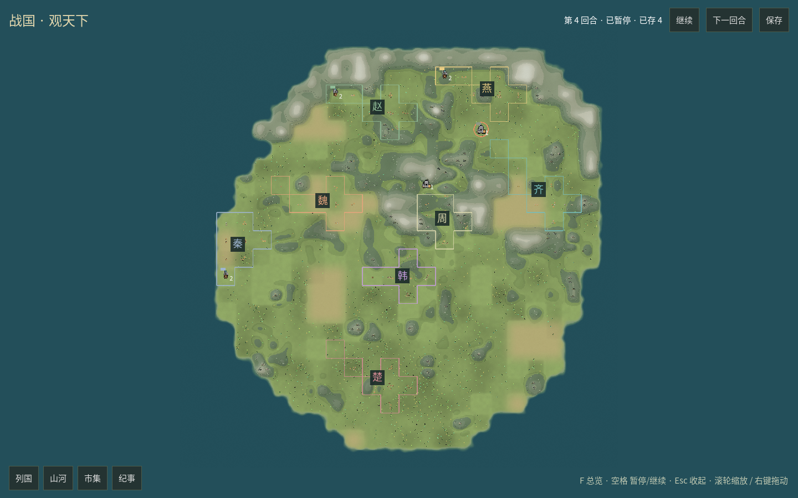
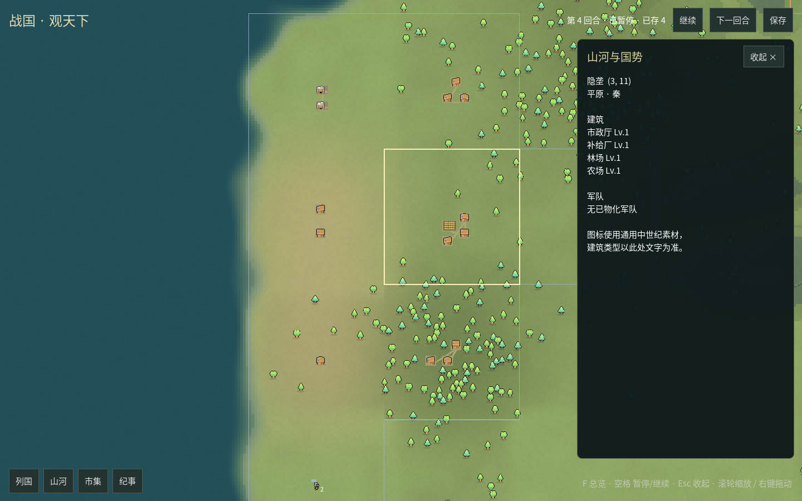

# GUI全窗地图、抽屉与自然外缘

2026-10-23。按用户要求修正默认地图仍旧、自然边界过直的问题，并将地图铺满窗口，其余功能改为抽屉。
本批使用新建离线八国演示与合成输入，不读取真实对局、不调用模型。

## 本批行为

之前细化地貌只在 `--sample terrain` 的固定3×3场景中，默认八国观察者仍用旧地块绘制。
现在默认入口也使用 `RegionLayout` / `RegionArtwork`：通过 `WorldLayoutProjection` 读取当前观察者的种子、
地形、资源容量与建筑实例。每个实际地块对应256×256视觉地区，连续地表、山脊、林地、农田、海岸和雪峰共用绘制。
固定3×3样板继续作为比例与邻接对照，不拿它代替当前对局。

地图控件铺满整个视口，列国、山河详情、市集、纪事改为覆盖式抽屉，默认全部关闭。
抽屉滑出时地图尺寸、缩放和镜头保持；点击另一功能切换抽屉，点击“收起 ×”、同一入口或Esc收起。
左键地块打开详情，F适应全图；播放、下一回合、保存悬浮在右上方，仍由Python完整回合边界处理。





[列国抽屉](../design/gui-world-nations-20261023.png) · [纪事抽屉](../design/gui-world-events-20261023.png)

## 自然边界

地图生成2.0.0的屏障面积上限会削去大部分弧形外缘，只剩贴着矩形图幅的一圈。
2.1.0对尺寸至少16的地图保留二维扭曲大陆包络，增加海湾、圆弧和不齐的山肩，不再应用这个硬上限。
最外圈全部为海洋，离陆地较远的外侧高山转为海洋，峰脊留在大陆近旁，避免山体被图幅切齐。
小地图仍保留紧凑封边。所有尺寸继续保持外缘不可通行、可用陆地四连通、海洋连通外缘；
五类可用地形配额分配到剩余陆地，原条件资源档位保持。高山与海洋的规则属性沿用上一批。

24个种子（0–19、73、20260921、20261014、20261023）的24×24地图均验证八国各有5格合法出生地，
整圈为海洋，北岸至少3种不同的陆地起始深度、最大深度差至少3格。
可用陆地为296–361格，约51%–63%；面积变化是保留自然轮廓的结果，不再保证旧版约80%的可用面积。
逐种子计数见[轮廓与出生核对](gui-world-boundary-seeds-20261023.json)。

## 布局与绘制

- 种子、地形、可通行性与资源组成地表缓存键；建筑、归属与回合变化不重新生成地表。
- 未变地区复用布局，建筑变化只重排相关地区。普通山地仍允许实际建筑，优先低处并绘制局部台地，避免每格削出圆形洼坑。
- 设施按真实实例计数；极密地区放不下时合并为计数标记，详情保留全部类型和等级。高山、海洋不生成树木、设施或资源装饰。
- 远景减少树与碎石绘制，近景恢复；镜头变换复用静态绘制。跳过近乎零面积的岩壁投影面，消除大地图三角化错误。

本批没有新增人物、战斗、路径或生产动画，建筑图标仍为通用代用素材。
阶段A的美术自然度、更多地貌组合与长时间稳定性继续完善，不据此宣布后续演出阶段完成。

## 验证

默认地图真实窗口：Linux ARM64 / Godot 4.7.2 .NET / Compatibility / Xvfb / Mesa llvmpipe，1440×900。
推进至第4回合完整保存并暂停，576地块、10支当期真实军队、141处建筑，展示计数与快照一致。
真实指针点击验证四个抽屉、首都地块选择和收起按钮；所有抽屉动画完成后均位于视口内，地图仍为1440×900且缩放不变。
地表生成1次、缓存1份，静态绘制提交6次。详情见[窗口指标](gui-world-drawers-metrics-20261023.json)。

这次短截图流程验证接线与操作，不作为帧率或长期内存测试。Xvfb没有音频设备，日志的ALSA失败随后回退dummy；
没有岩壁多边形或协议解析错误。此前Windows Iris Xe的约60fps记录仅适用于固定3×3样板，
本批24×24活地图的Windows/Vulkan性能仍需实机测试。

- C#项目构建零警告、零错误；实际布局检查覆盖观察者投影、屏障、设施计数、304设施密集输入、局部布局复用与地表键。
- 原3×3主/邻接布局检查通过，轮廓仍为745边/460前面和701边/377前面。
- Python全量离线回归865项：863通过，2项可选本地C扩展因独立工作树无编译产物跳过。
  回归发现旧随机提示造成存取后简报分叉，已改为同国家、回合和简报事实确定同一句提示，不消耗游戏随机源；原存取测试通过。
- 地图测试覆盖封边、海陆连通、配额、跨进程确定性、出生、移动/进攻/撤退/遣返绕障与保存读回；额外24种子核对通过。
- API参考同步检查与文档站构建通过。
- 共享绘制修改后的固定3×3样板实际窗口回归通过：主/邻接切换、点选、880个外缘裁切像素均通过；19设施、286树、19比例人物保持，地表缓存2份。
  [样板窗口指标](gui-world-sample-regression-20261023.json)记录实际绘制453个前面；与460个候选面的差额为跳过的7个零面积投影面。

## 运行

Windows在仓库目录：

```powershell
git pull
python desktop.py --rendering-method mobile --rendering-driver vulkan
```

默认入口每次新建独立离线演示。需要自动截图与操作验收时：

```powershell
python desktop.py --rendering-method mobile --rendering-driver vulkan --smoke-output windows-world.png --log-file windows-world.log
```

固定样板仍为 `python desktop.py --sample terrain`。新生成算法与依赖版本为
map-generation2.1.0、native4.17.0、experimental0.18.0、ui1.7.0；旧档继续按既有依赖规则拒绝混载，未迁移运行局。
