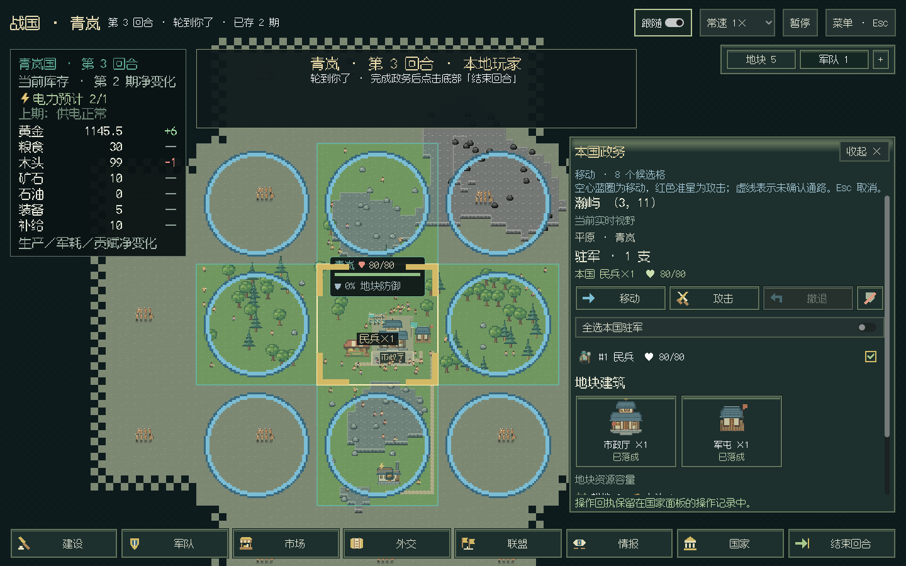

# GUI军令规则与自动预发布

2026-10-28，v0.6.3。用户授权拆为两个单机版本，本批先完成[两版实施安排](../plans/GUI两版实施-20261028.md)第一版；联机及动态回合不实施，原18阶段结算顺序保持。

## 规则来源与修复

先核对正式 `ArmyAPI.reachable`、领域 `reachable_many / action_reason / _batch / retreat_many / can_disband`。公开可达接口提供可见范围，不能单独代替行动资格、攻击终点、原地攻击和迷雾尝试。因此把既有加权寻路、夹角限制、通行、攻击终点与资格规则提取到 `mods/native/army/navigation.py`，正式执行与玩家预览共用。前者提供真实世界，后者只提供当前玩家事实；没有向玩家调用全图观察者接口。

修复的实际合成反例：

- 秦楚交战、赵也进攻楚而秦赵中立时，楚地上的赵军不应阻止秦进攻楚。只有无主地的抢战限制才适用。
- 移动到已清空的无主格后，本期仍可原地攻击占领；按钮资格改读规则侧投影，移除C#重复裁决。
- 本国受进攻地块仍允许其他部队进入。留在当地部队能否继续移动／撤退，按各自行动资格处理。

真人地图候选保留逐支适用集合和排除原因；已知路线提供逐格节点，演出按节点行走，未知路线不伪装成已验证路线。当前仍是原按钮与同驻地选择；跨驻地右键／Ctrl／Shift军令及光环留到第二版。防御显示、自动交易等剩余重复判断未在本批宣称完成。

## 瞭望塔与存档

`Watchtower.MAX_PER_SITE=1`，沿现有规划／报价／建造／部署校验统一限制，建成和施工中一并计数，不限制全国总数。读取旧存档时只豁免旧瞭望塔的这一新上限，保留既有建筑；新的安排继续严格限建。视野效果原本就不按同格数量累加，保持半径4。

没有改变存档格式、模块版本或依赖检查。离线构造旧规则多塔存档并正式保存、载入，确认两座均保留，仍不能新增第三座，视野未扩大。

## 灭国反馈

新增观察者从灭国前快照重放至完整结算、真人视野中旧国土地变为无主、以及视野外购图历史不被后台改写的回归。合成局中这三条均正常，未发现最终完整快照缺少归属更新；不能据此宣称用户所有实机旧国色问题已修复。本批没有擦除正常历史地图，也没有把真人亡国改成全图观察模式，该缺陷继续保留。

## CI交付

根目录 `VERSION` 是便携版发版版本，配 `docs/releases/v<版本>.md`。main存在待发布版本时，CI构建对应Windows包；必须同时通过离线回归、文档／API检查、C#／布局检查和Windows便携包实际窗口验收，才上传Windows ZIP、同提交源码ZIP和SHA256SUMS。上传摘要与大小验证后才公开Pre-release，保持正式Latest不变。

已发布标签后的日常规则改动也触发Windows构建，不复用旧包；完成下一版时递增VERSION。仅文档改动且无待发版本不发包。同一提交重跑可续传草稿，公开附件不覆盖；版本／标签绑定另一提交时拒绝重用。代码在离线假GitHub接口上验证过错误提交、损坏上传、缺失附件、重跑与规则路径，未使用测试代码访问真实发布接口。

## 验证记录

- 本地全量1011项离线测试通过（182.319秒）。
- C#编译零警告、零错误；实际地貌、视野、布局、道路、资源与军团状态检查通过。
- API参考同步与文档站链接检查通过。
- Linux实际窗口（Godot4.7.2 mono／Mesa llvmpipe软件渲染）从正常零军开局推进到第3期，21写操作／21行动批次／3结算批次及四尺寸通过，含连续交易、原地攻击与视野权限。见[窗口指标](gui-command-063-linux.json)。不是Windows实体GPU或Vulkan测试。
- 首次CI [40638067952](https://github.com/northwindlight/zhanguo/actions/runs/40638067952)的1011项回归（含2项可选扩展跳过）、C#、文档和Windows全部窗口／包验收通过；最后发布步骤因草稿按标签查询返回404失败，未公开附件。已改为从带权限的发行列表定位草稿、按Release ID核验，并补草稿分页查找回归，5项发布定向检查通过。失败草稿已清理，重新由CI构建并交付同提交版本。

