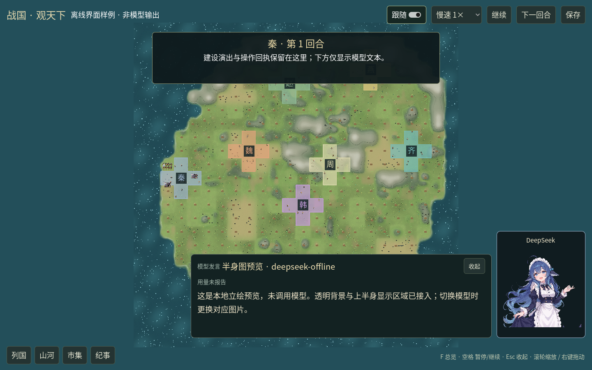
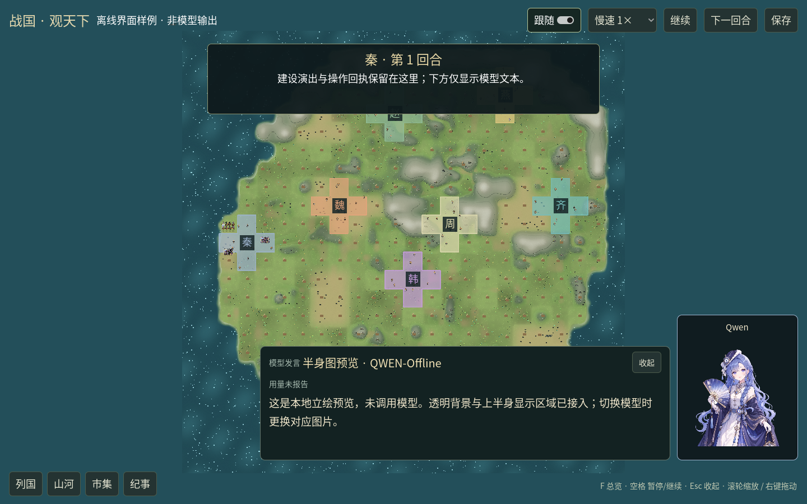
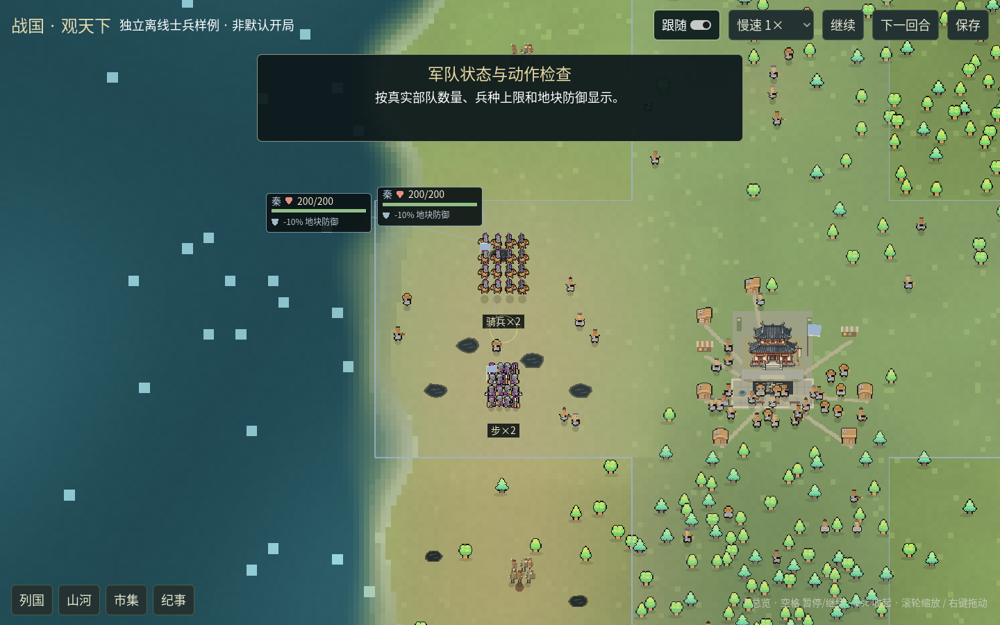
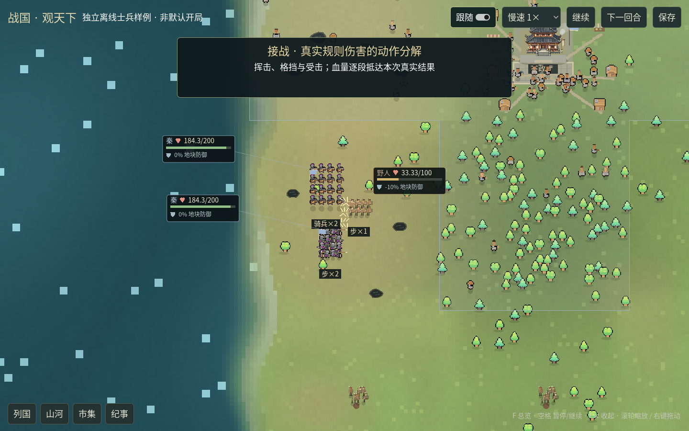
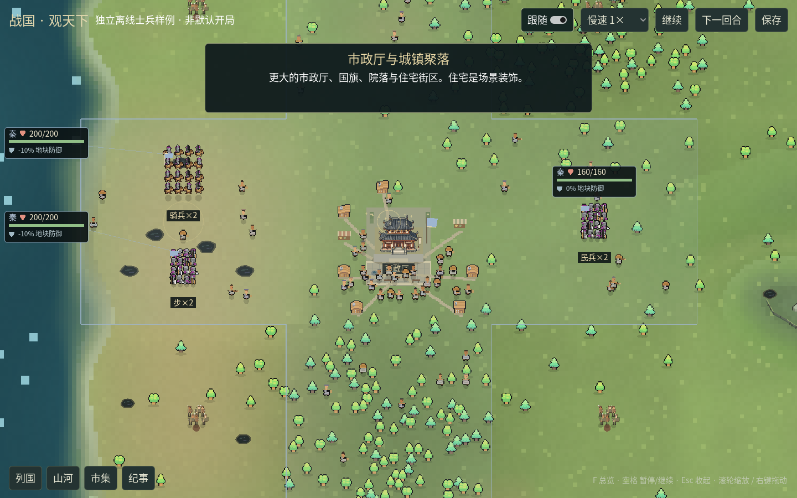
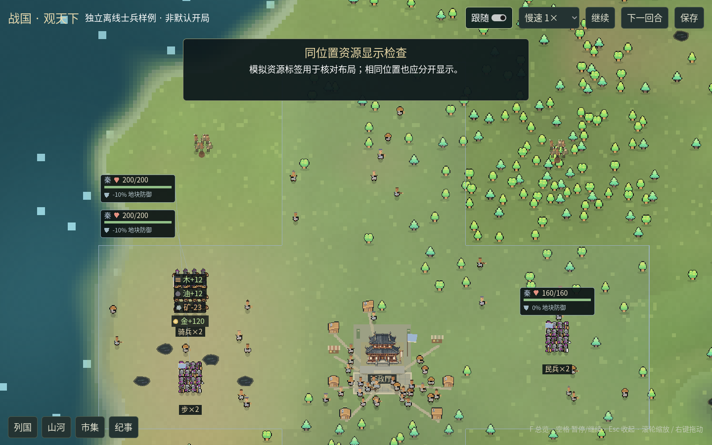
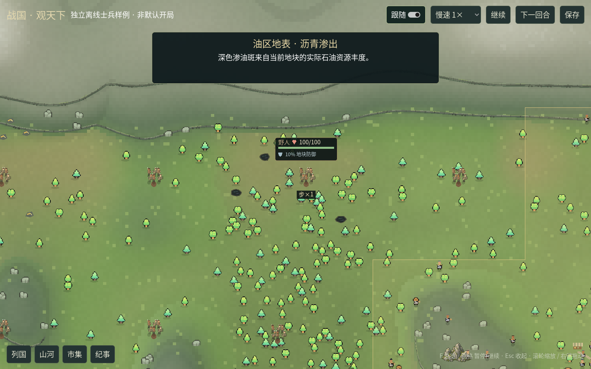

# GUI 半身图、军团与城镇油区

接续[真实流与布局修订](GUI流式正文与布局修订-20261024.md)。本批处理用户提供的图片、人物与战斗动作、军团状态、LLM 速度、资源重叠、市政厅与油区地表。使用独立工作树与离线世界，没有调用真实 LLM 或操作现役对局。

## 图片与居民

用户将 `立绘.zip` 放在主目录，内有 DeepSeek、Qwen、Kimi、Gemini、GPT、Claude、Grok 七张透明 PNG。原始字节保存在 `assets/portraits/`，清单记录 SHA-256、尺寸、透明度和上半身显示区域。Godot 用 AtlasTexture 取头部到腰部，源文件不裁写；图片保持比例，人物区域高度与正文长度分开，小窗口自动收窄。作者、原始网址及许可未随文件提供，清单留空，不借用 Mini World 许可。





人物复用原 Mini World 包的 17 张未修改贴图：剑兵、矛兵、斧兵、骑兵各四种配色及农民，逐文件来源与哈希在 `assets/actors/mini-world-characters.json`。清单分别指定每种人物的方向行号与动作帧数；剑兵攻击4帧、斧兵6帧、农民工作3帧，骑兵每方向分待机、行走、攻击三行。矛兵原攻击区格子不规则，采用完整身体与程序突刺，避免半个人或透明空帧。居民增加发型、头巾、衣色和携带物，野人保留粗布、棍棒与矛的外观。

## 军团与战斗

同格同国同兵种聚合为小队，步骑兵分别列队，骑兵有完整人马形象。用户确认保留剑、矛、斧外观混编，但规则仍为原兵种。士兵上方显示国名、爱心图形、真实合计 HP / 上限，以及盾牌与实际地块防御；脚下显示“步×2”“骑兵×2”等规则军队数量，插图小人数不参与计算。野地潜在守军在聚焦或选中时显示状态，避免远处野人血条占满屏幕。

HP 上限来自实际兵种定义：步骑兵100、民兵80，不把所有军队写死为100。防御取地形与本方堡垒，按规则的整数合并方式计算；进攻方不会借敌方地形减伤。沙漠 -10% 等实际负防御也会显示，用户举例的20%不作为固定数值。



一场战斗分接敌、三次交锋、受击和确认伤亡，使用方向动作、近战挥击、骑兵前冲、火花和扬尘。血条在接触点分段抵达本次规则已经确认的结果，不另算伤害；倒地数量来自实际阵亡 ID。普通近战不再出现无依据的箭雨。每场演出结束后沿用原结算顺序易帜、聚焦下一处，全部播放完再确认整期。



五档速度只对规则 AI 行动与回合结算生效。LLM 思考、发言和行动强制1×，按钮显示“LLM 1×”；所选档位保留，轮到规则 AI 或结算后恢复。判断依据为宿主传来的客户端类型与播放阶段，不猜模型名字。离线实际控制器验证选16×时，0.2秒分别推进 LLM 0.2秒、规则 AI 3.2秒、结算3.2秒。

## 城镇、资源与沥青

市政厅地面脚印56×40，实际建筑高64像素，优先落位，屋顶占用也参与遮挡与居民避让。落成后有石板广场、水井、国旗、街道、住宅与摊位，以及更密集的居民。住宅和摊位是装饰，不增加规则人口、生产设施或防御；实际设施仍列在详情中。



黄金与岩石原来可能采用同一个候选点。现在为黄金、岩石与山岩分别检查真实显示脚印，树、建筑和聚落装饰也会避让。资源飘字按实测文字宽度排列，避让其他资源标签和军队状态卡；同一位置的金、矿、油、木四种标签已经实窗检查。



油区按当前地块真实石油丰度显示1–5块不规则沥青：深褐色边缘、黑色主体、轻微油光。零石油不画，含油越丰富斑块越多；避开水面、实际建筑、广场、住宅、树木、黄金、岩石与山岩，居民绕开油斑。这是地表资源表现，不增加新地形或修改采油规则。



## 验证与复现

首轮同步至 `ad1d4e6` 后952项离线回归通过（950通过、2项可选本地C扩展跳过，184.486秒）。随后同步至 `0bb8a8a`，保留主线原生模型接口与股市分支拆分；最终909项离线回归通过（907通过、2项可选C扩展跳过，158.291秒，股市测试已随上游移到stock分支）。清理CI中仍指向股市旧文件的路径，并将一处旧测试从匹配英文错误单词改为核验结构化容量拒绝原因与实际缺口。C#编译零警告、零错误，API参考同步与文档站28页/站内链接检查通过。

纯 C# 检查覆盖真实血量与兵种上限、防御合并、进攻方减伤、已知结果插值、LLM 速度策略、地表资源碰撞与城镇/沥青落点。PNG 检查逐帧验证17张人物表的坐标、非空及完整身体，并核对七张原图哈希与上半身区域。

实际窗口检查七模型×三种窗口尺寸（1440×900、1280×720、1024×768），核对模型别名、实际加载图片、上半身区域、气泡边界和重叠。军团窗口检查“秦200/200、步×2、骑兵×2”、最终 HP 与实际结算一致、4个同位置资源标签不重叠，以及8个市政厅、64处城镇装饰、246块实际油区渗出斑。

正常 v13 独立局从第4期续看到第7期：576地块、149实际建筑与投影一致、1084代表居民、284潜在野人、11支已物化军队；实际播放24个按国横幅、13段行军、13场交锋与伤亡、5次易帜，再完整结算。地表生成1次、缓存1张、地区节点576，抽屉真实指针、地块选择、保存与宿主退出0均通过。输入中的4支军队来自正常前4期推演，开局没有赠兵。

[32秒实际窗口录像](../design/gui-squads-tour-20261024.mp4)，从首场自然战斗开始捕获，1440×900、640编码采样帧；[正常对局指标](gui-squads-natural-metrics-20261024.json)、[录制指标](gui-squads-recording-20261024.json)、[军团/城镇指标](gui-squad-town-metrics-20261024.json)、[七模型三尺寸检查](gui-portrait-metrics-20261024.json)。首次录制的退出等待180秒在软渲染负载下超时，该次未算通过；延长独立录制脚本等待预算到360秒后重跑，完整结算与退出通过。正式速度档和底层规则没有因此提速。

原3×3样板实际窗口点选与880像素裁切检查通过，仍保留19设施、19比例人物。资源脚印避让后为284棵树、6处金矿标记、64处普通岩石；这些是视觉候选数量，不是规则资源减少。

可复现的专门样例：

```bash
python3 scripts/review_desktop_actors.py --output archive/previews/actors-review-new
python3 desktop.py --ui-review-output archive/previews/portraits-review-new.png
dotnet run --project tests/desktop-layout/Checks.csproj -- mods/ui/desktop/Samples/terrain-v2.json
python3 -m unittest tests.test_desktop_assets -v
```

前两个命令需实际窗口；无桌面 Linux 加 `xvfb-run -a -s '-screen 0 1440x900x24'`。专门军团样例会明确添加测试兵力，截图注明“非默认开局”；默认 v13 仍零军队起步。正常对局复现入口仍为 `scripts/record_desktop_demo.py`，从独立正常世界推演4期再继续，没有赠兵或补助。

本机为 Linux ARM64、Xvfb 与 Mesa llvmpipe 软件渲染；不将录制采样帧率当引擎性能。Windows 活地图 GPU 仍待用户实测；此前 Iris Xe Vulkan 约60fps记录只对应固定3×3地貌样板。
