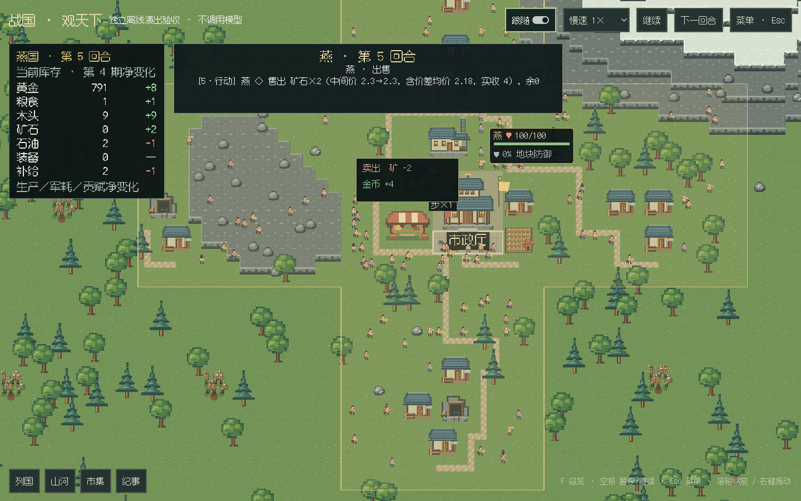
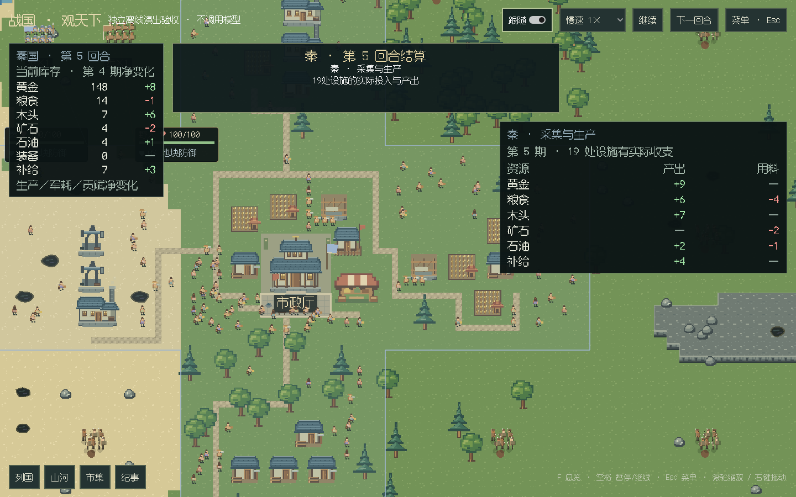
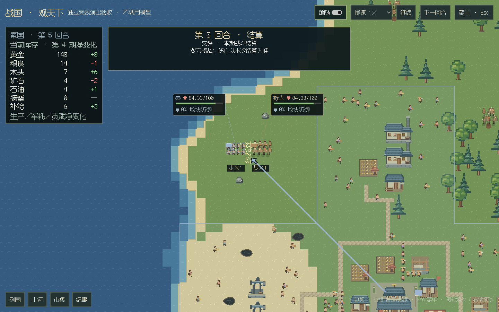
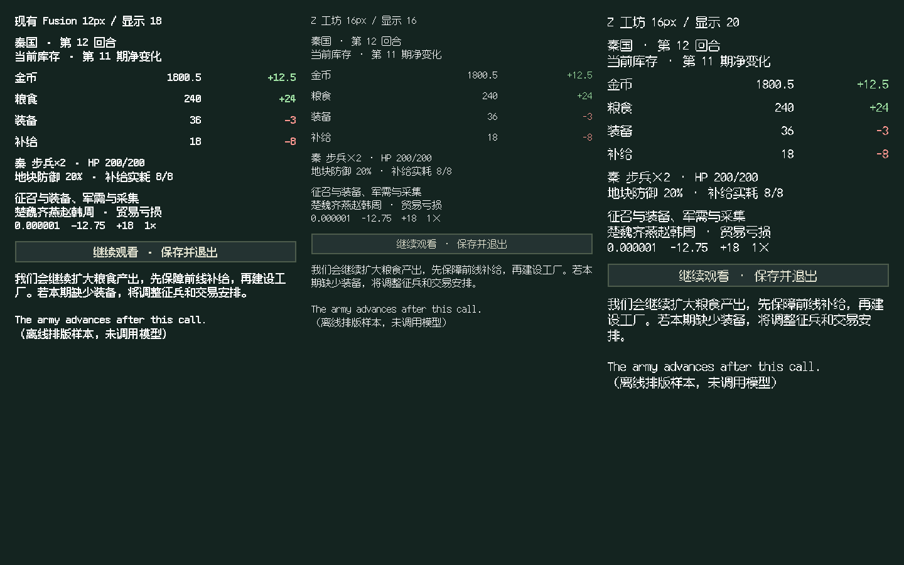
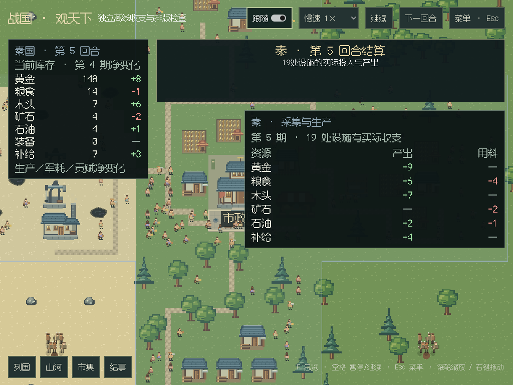
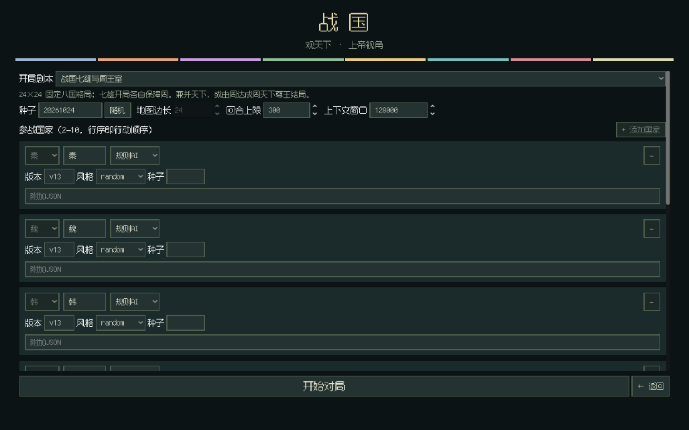

# 单国收支、街道与演出验收

日期：2026-10-26。运行实现：`9cfdaa7`，已推送 main。对应[试玩改进计划](../plans/GUI下一阶段改进计划.md)。

## 结果与时序

11 项功能已接入实际对局。**native 和 GUI 保留原结算阶段顺序**：先播所有国家的生产，再播各国补给，随后逐场战争、伤亡、易帜、落成与实际送达的信件。不采用“一国全部结算后再换国”。本轮 native 仅调整观察者的资源流量投影，没有改规则阶段或存档格式。

| 反馈 | 当前行为 |
| --- | --- |
| 收集、补给太碎 | 在原阶段内每国汇总一次，稳定选取已落成市政厅；缺少时退回本国土地或军队位置。生产列产出与用料，军需列实际耗用、缺口、回血及断粮损失 |
| 不容易看清账目 | 左上角随行动／结算切国，显示当前已演出时点的库存，以及上一完整期生产、军耗、贡赋的净值；期数、正负号、红绿颜色齐全。交易和赠礼不混入这项流量 |
| 街道混乱 | 按建筑入口连接，先连接市政厅与集市，再接邻近短支路；8px 路格检查屋顶、檐口、矿点、树干、水面和高度，最多 T 形路口，相邻地区使用配对出口。无通道便不铺路，布局在普通刷新时保持稳定 |
| 市政厅旁假房太多 | 移除原自动装饰房屋，保留所有真实生产建筑；市政厅旁只设一处集市，用于对应调用批次的实际买卖演出 |
| 缺素材 | 补绘市场、街道路格、战争箭头、信封与两帧飞鸟，保留[SVG 源文件与尺寸](../../mods/ui/desktop/assets/ui-v2/README.md)及许可 |
| 放大后飞鸟消失 | 移除旧缩放阈值，远近景共享鸟群位置与飞行时间，屏幕尺寸连续限制 |
| 战争没有方向 | 由真实进攻出发点指向目标；使用进攻方国色，随军令和该场战斗显示，结束清理 |
| 军服归属不清楚 | 所有六种人物素材的身体衣料与装饰色映射到国色；保留混编武器，肤色、金属和马匹不随服装染色 |
| 写信缺少演出 | 只对本周期真正新送达的信件播放国与国之间的信封传递；以实际消息 ID 去重，尚未送达不预播 |
| 开局不能选剧本 | 主菜单提供正式八国与自由列国；前者固定正式落位、七条保周保障及胜利钩子，后者可配置 2–10 国和地图大小。继续游戏显示原存档的剧本 |
| 字太难读 | 默认 Z 工坊像素圆体 16px，账目默认 20px；调整行距及军团标签。Esc 菜单可切回 Fusion Pixel，账目可选 16／20px |

每次模型响应的所有工具执行后统一演出，播完才继续调用；行军仍随该调用播放。LLM 仍固定 1×，规则 AI 与结算保留可调速。Esc 自动暂停、排队保存及完整回合保存边界保持。

## 实际画面

以下为 Linux ARM64 实际 Godot 窗口，Xvfb／llvmpipe 软件渲染。样例采用正常 v13 开局，未补贴资源或添加测试军队；推进到第四期后，额外通过正常接口提交国策与一封信，以覆盖真实送达演出。不是硬件 GPU 性能测试。

字体为作者官方 `Build_20260501` CN 文件，未修改字体；来源、SHA256 与 OFL 许可见[字体元数据](../../mods/ui/desktop/assets/fonts/zlabs-roundpix.json)。寒蝉仅在立项时列为候选，未引入、未声称完成三字体比较。

## 检查依据

- 本地全量离线 Python：924 项，922 通过、2 项可选 C 扩展跳过，187.200 秒。覆盖国家聚合金额、阶段顺序、实际供给与伤亡、交易收付款、延迟信件去重、最终场景回放一致，以及正式／自由开局的真实规则钩子。
- Godot C# 构建零警告、零错误；纯布局检查通过，覆盖道路完整视觉占位、T 形路口、相邻出口一致、确定性及绘制数据复用，以及库存与已结算流量的分离。
- 实际默认窗口从 0 推进至第 3 期：576 地块，121 个真实建筑与源事实一致，24 个行动批次、3 个结算批次、24 次国家生产汇总。正常开局军队为 0；Esc、保存排队、抽屉、点选、保存退出均通过。
- [最终 Linux 演出指标](gui-national-effects-linux-20261026.json)：实际交易、军令、生产、补给、战斗与信件均有截图；8 处集市，进攻与战斗各显示方向箭头，实际投递显示一封信。缩放 0.85／0.95／2.0 时鸟群均可见。
- 六种实际人物图集、两种国家色逐像素检查：全部衣料和装饰色正确映射，非衣料像素保持原值，覆盖各方向及动画帧。
- 收支面板以 1920×1080、1440×900、1280×720、1024×768 四种逻辑尺寸，16／20px 两档账目，以及 1.25／1.5 倍 Godot 内容渲染缩放共 12 组检查，面板在窗口内且不互相覆盖。此项**不是修改 Windows 系统 DPI**；不同显示器的系统缩放与字体舒适度仍需实机试玩反馈。
- API 参考页同步及文档站 28 页链接检查通过。未调用真实模型，未读写运行局、真实存档或私人接入配置。

## Windows 便携包

[Windows 构建与验收](https://github.com/northwindlight/zhanguo/actions/runs/40268362667)已通过。ZIP 移至中文空格路径，隔离系统 Python／.NET／源码及私人配置路径后，仅用包内运行库完成实际窗口、剧本菜单、暂停保存、新演出与 12 组账目排版检查；五个子进程 stderr 均为空。

Windows 实际使用 ANGLE／Microsoft Basic Render Driver，属于软件渲染验收，不是 Vulkan 或实体 GPU 基准。默认 0→3 期的 576 地块、121 个建筑、24 个行动批次、3 个结算批次及 24 次生产汇总均通过。数据见[正常对局](gui-national-world-windows-20261026.json)、[演出接线](gui-national-effects-windows-20261026.json)、[字号与渲染缩放](gui-national-ledger-windows-20261026.json)。

同一提交的[标准 CI](https://github.com/northwindlight/zhanguo/actions/runs/40268362619)全部成功：924 项离线回归（2 跳过，184.482 秒）、示例巡礼、C# 零警告错误、道路／账目布局及文档同步。

原始工件 `Zhanguo-Windows-x64-9cfdaa7.zip`：104494831 字节，SHA256 `79139b2da4e722d37f486abf64d4c9ce7605aeb48b45f295a7e603e173b5d1af`。下载后核对整包摘要、ZIP CRC 与清单内 798 个文件摘要全部一致；四个更新的 Python 运行模块与本轮源码在换行归一后相同（Windows 检出使用 CRLF）。

本轮是开发版改进，不修改已发布的 v0.5.1 tag 或附件；原 Release 下载仍对应上一版运行实现。
