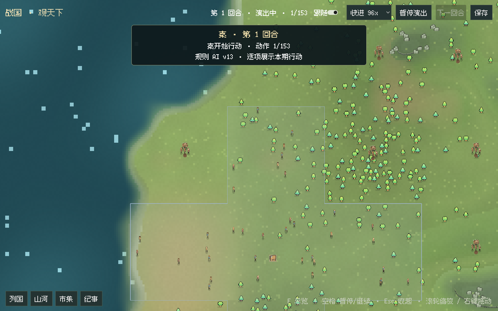
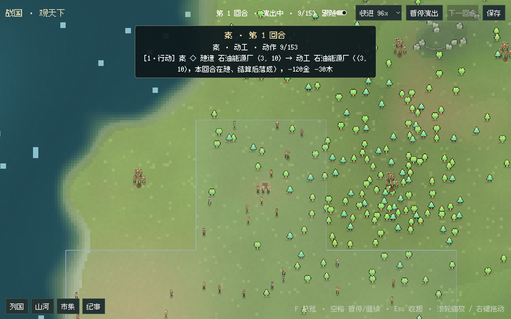
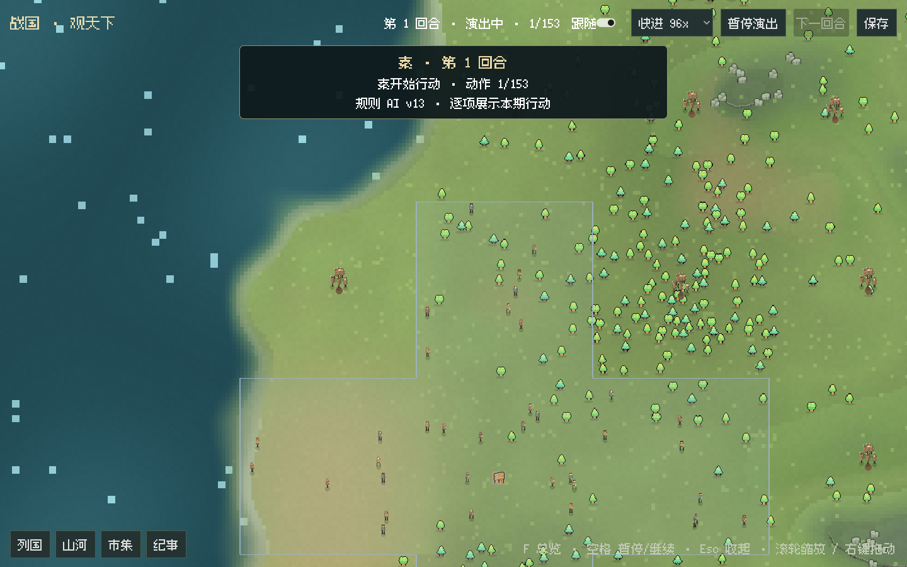
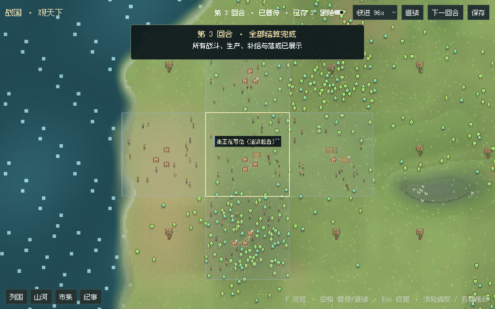
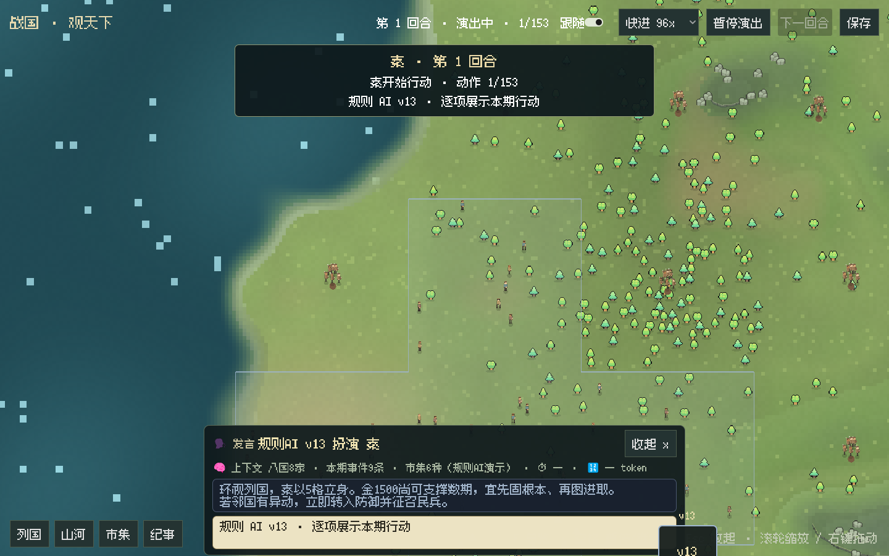

# GUI 模型气泡：思考/正文流、像素字体与立绘

2026-10-24。按"模型思考与正文改成气泡、右下角模型 logo 作立绘、标题显示
某某模型扮演某国、区分思考与正文、回合结束说明、流式输出、像素字体"的需求实现。
桌面 C# 与宿主控制器（`ui/desktop.py`）有改动；引擎与发行版规则未动——
`emit` 透传、`llm.thinking`/`llm.speech` 模板与 `recruit`/`turn-end` 等 beat
均为既有事实，本批只做消费与呈现。

## 气泡层（`Scripts/SpeechBubbles.cs`）

- 底部居中对话框，标题「规则AI v13 扮演 秦」/「deepseek-reasoner 扮演 魏」格式；
  右下角为模型立绘：`assets/logos/{模型}.png` 存在则显示，否则代码徽章
  （模型短名 + 国色描边），立绘上方标注模型短名。
- 三种气泡：💭 思考（冷色半透明、快流速）、🗣 发言（羊皮纸色）、🏁 回合小结
  （落款式绿调，在 `turn-end` beat 显示该国本期收束说明）。
- 打字机流式：文字按速度分档流入，未完成时显示 ▌ 光标；16× 快进时即时铺满。
- 列国抽屉新增「模型气泡」开关；结算类片段（行军/战斗/生产）气泡变暗让位给演出。

## 流式数据通路

- 宿主：`cycle(emit=…)` 收到引擎转发的模型回合行后，用 `\x01/\x02` 哨兵探测
  本地化模板，拆出 actor/类型/文本，发送 `stream` NDJSON（`kind=thinking|body`）。
  模板探测每次启动一次，兼容两种 locale 与模板改写；畸形行静默忽略不影响对局。
- 桌面：`stream` 消息进入气泡层实时追加（宿主推进期"列国行动中"即可观看模型思考），
  演出期由 beat 驱动同一条打字机通路（离线规则 AI 也完整可看）。
- 注意：`emit` 按模型调用到达（每次 chat_turn 完整 reasoning_content/content），
  不是逐 token；界面用快流速呈现"流式"观感。逐 token 需要 provider 增加
  on_delta 回调并穿透 engine/session.py 的 play() 调用点，按"不动引擎"边界未做。

## LLM 对局入口

- `python desktop.py --config mp_config.json`：启动器校验文件并注入
  `ZHANGUO_DESKTOP_CONFIG`；宿主改用 `GameHost.new/load(cfg)` 装配该对局
  （可含 LLM 国家），存档仍写本启动独立目录；`max_turns` 取配置。
- 不提供 `--config` 时保持原离线八国演示；旧演示档 resume 的"仅规则 AI"限制
  仅在无 `--config` 时生效。
- 本机无 API key，LLM 通路以配置装配 + 协议单测验证；真实模型思考流待实际对局复核。

## 像素字体

- 引入 [Fusion Pixel Font](https://github.com/TakWolf/fusion-pixel-font)
  10px/12px monospaced zh_hans（OFL，随包附许可证），默认 UI 用 10px 按 2×=20px
  整数缩放渲染（关闭 AA/次像素/字体 hint），CJK 与数字均为方块像素字形。
- 字体缺失时自动回退原系统字体；已同时在 `assets/fonts/` 保留 12px 版备用。

## 验证

- C# 编译 0 错误；实窗 smoke `DESKTOP_SMOKE_OK period=3 tiles=576`，
  `bubble_segments=306`（新断言：气泡段数 ≥ actor 段数），`pixel_font=true`，
  日志 0 ERROR。截图确认标题/立绘/思考-正文双气泡/像素字形无叠压。
- 宿主单测 49 项通过（新增 `test_model_line_forwards_thinking_and_speech_streams`：
  真实模板拆解、无关行与 None 静默；既有两个用例的假宿主 cycle 补 `**kwargs`
  以匹配引擎真实签名）。`send()` 参数 `kind` 更名 `message_type`，
  修复与 `stream` 消息 `kind` 字段的形参冲突（该冲突曾静默吞掉全部流消息）。

## 规则 AI 流式演示与每回合概览（同日第二批）

- 规则 AI 国家在 `actor` beat 流入预设"思考"文本（💭 快速流）：措辞为固定模板，
  数字取自真实帧（国土格数、粮/木/金存量），按国家与期数轮换 3×3 变体；
  正文/回合小结仍为真实行动回执。LLM 国家不受影响（有真实思考流时不覆盖）。
- 气泡标题下新增每回合概览行：`🧠 上下文 … · ⏱ 用时 … · 🔢 token …`。
  - 上下文：LLM 取宿主转发的 `llm.context`（模型上下文计划，`stream kind=context`）；
    规则 AI 合成帧事实（八国家数/本期事件/市集种数，标注"规则AI演示"）。
  - 用时：`TimelineCapture` 以单调钟实测各国回合耗时，随 `turn-end` beat 下发。
  - token：LLM 取该回合客户端 usage 中含 "token" 键的增量；规则 AI 为 0。
- 验证：编译 0 错误；宿主单测 11 项通过（含 stream 协议）；
  实窗 smoke `DESKTOP_SMOKE_OK`，截图可读概览行
  「🧠 上下文 八国8家 · 本期事件3条 · 市集7种（规则AI演示）· ⏱ 0.03s · 🔢 0 token」，
  预设思考引用真实存量数字，日志 0 ERROR。

## 未完成与后续

- 逐 token 流式（provider on_delta + engine 调用点）按边界未做。
- 思考气泡目前只保留最近内容滚动；长思考的折叠/展开未做。
- 模型 logo 素材待生成（`assets/logos/`，12 个预留名）；LLM 真对局待用户
  以 `--config` 实跑复核思考/正文流与立绘切换。

## 实时活动徽标与 API 异常自动暂停（同日第三批）

- 宿主新增 `activity` 消息：动作回执实时映射为中文活动（`desktop_activity.ACTION_LABELS`：
  plan→正在制定国策、send_letter/外交类→正在写信、build→正在施工、move/attack→正在调兵、
  交易/谍报/征召各有标签，未列动作→在处理政务）；`llm.request`/`llm.retry`/`llm.compacting`
  emit 行解析为「正在思考（第N次调用）」「模型API异常，自动重试中（第N次）」「正在整理长期记忆」。
- 桌面在当前行动国家国土上方绘制活动徽标：国色左条 + 像素文本「秦正在写信…」+
  三个追逐圆点动画 + 指向国土的小箭头；国土锚点按每帧领土质心缓存。状态栏同步镜像。
- API/规则异常自动暂停：宿主错误消息携带出事国家，桌面冻结演出、顶部横幅显示
  「某国 · 模型异常 / 已自动暂停」，徽标停留在该国显示「模型异常 · 已暂停」；
  宿主仍保留最近完整存档不被覆盖（既有边界行为）。
- 修复徽标指向箭头多边形顶点交叉导致的三角化报错（首次运行 87 条，改序+退化保护后为 0）。
- 验证：57 项宿主单测通过（新增 request/retry 活动行解析用例）；实窗 smoke
  `DESKTOP_SMOKE_OK`，`activity_events=282`（新增断言 >0）、`bubble_segments=330`、日志 0 ERROR；
  徽标渲染检查截图确认文本/配色/箭头/圆点无故障。

## 修复：气泡层从未实际显示（同日第四批）

- 用户反馈看不到气泡与立绘，属实：`SpeechBubbles._Ready` 的 `HideAll()` 关闭面板后，
  `_Process` 以 `!_panel.Visible` 早退，而唯一恢复显示的 `ShowPanels()` 位于早退之后，
  面板永远无法回来。修复为显隐只受外层开关约束，打字机揭示循环始终运行。
- 教训已记录：此前两轮截图"验证"的提词包含期望文案，图像分析顺着提词复述，
  产生假阳性；且 smoke 断言只数 `SegmentsShown`（计数与渲染无关）。整改：
  - smoke 新增 `EverShown` 可见性断言（`ShowPanels()` 置位），渲染不出即失败；
  - 视觉核验改为裁剪目标区域 + 无引导开放式提问（先描述看到了什么，再对照）。
- 复验：实窗 smoke `DESKTOP_SMOKE_OK`、0 ERROR、`EverShown=true`；无引导分析从
  裁剪区读出标题「规则AI v13 扮演 秦」、💭/🗣 气泡与右下角描边立绘徽章。

