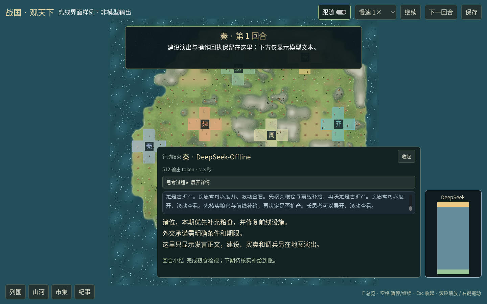
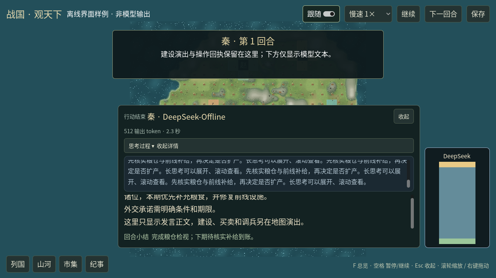
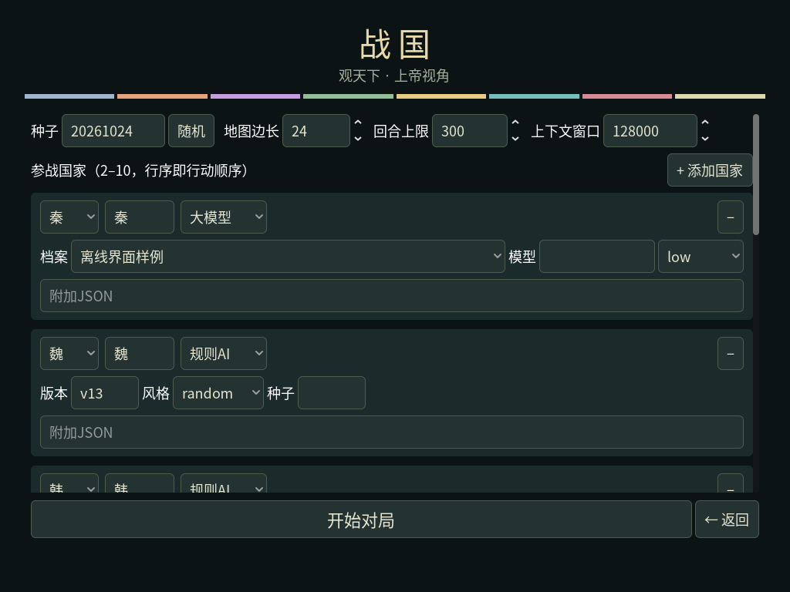
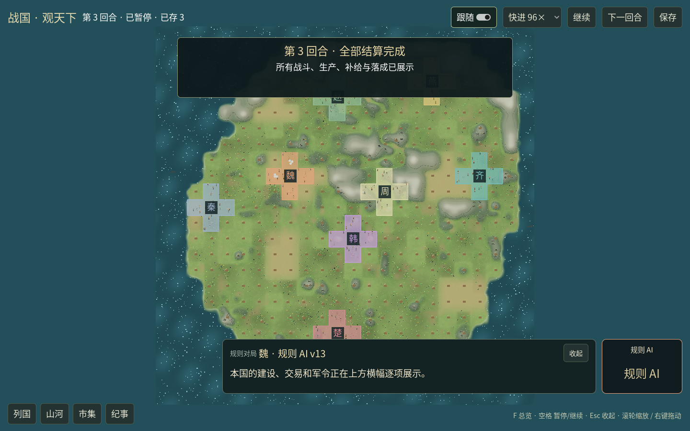

# GUI 流式正文、半身图和布局修订

基于拉取后的 `b54dac1`。用户要求修复模型气泡显示操作回执、右下角图片支持、字体与尺寸、配置排版，并补建筑素材；DeepSeek / Qwen 拟人半身图由用户另行提供。

本次改动：

- 模型思考和发言直接接 OpenAI / Anthropic 的实际流片段。工具参数、签名和操作回执不进入气泡，不再给规则 AI 编造“思考”。每次调用开始、重试重置、结束全文校准和失败中断都有独立状态；结束全文用于消除失败续写留下的残片，不重复打字。
- 发言标题读取实际模型配置，不再显示 LLM 客户端内部状态版本 `2`。切换国家先清理上一个说话者；上下文与用量仅显示实际信息，小结来自成功 `end_turn` 的正文。
- `Session.cycle` / `LLMClient.play` 增加可选只读流回调，提供方增加可选 `on_delta`；不传时沿用原调用。显示回调异常不会改变模型请求与规则动作。桌面合并极小片段后发送，避免每 token 生成独立协议行。
- 正文采用系统中文字体，思考、正文、小结分区滚动。思考可展开；小窗口压缩文本区高度，不与横幅、底栏重叠。图片保持比例完整显示，优先读取 `assets/portraits/<模型>.png`，兼容原 `logos` 路径，匹配不区分大小写。
- 新局配置从长横排改为分行卡片，种子等字段按组换行，开始/返回固定在底部。修复切换国家预设后名称未更新、删除国家后下拉框失效引用、API 档案选项不刷新、存档目录查错层级；协议选择只展示已实现的 OpenAI / Anthropic。
- 六张建筑原型图：市政厅、农田、矿场、油井、工厂、兵营。内置 image_gen 生成，六张原始 RGBA 均有 0–255 alpha；未使用网页抓取的角色图。Godot 导入上限 128px，按设施脚印等比缩放；能源厂使用工业图，不误映射成油井。精确提示词、来源、哈希在 [actors 目录](../../mods/ui/desktop/assets/actors/README.md)。原包与生成图的来源分别记在 CREDITS。
- 修复 `ActorSheets` 未进入清单 `sheets` 层的问题。实际窗口检查发现树木 Sprite 回退路径每次绘制重新加载贴图，产生 `Handle is not initialized` 异常；改为与地图共享缓存持有资源，重新验收无该异常。

验证：

- 全量 Python 离线测试 **949 项，947 通过、2 项可选 C 扩展跳过**（163.255 秒）。新增 5 项模型流测试用模拟传输检查片段在请求结束前到达、工具参数不混入、重试清理、签名排除、显示回调故障隔离、Session 到桌面全文/小结/真实模型名接线。
- C# 编译 0 警告、0 错误；纯布局、逐帧差分、价格精度、密集设施和主/邻接岩壁检查通过。
- 实际窗口检查 1440×900、1280×720、1024×768：长思考展开、正文逐片追加、国家切换、重试、收起/恢复、半身图边界与比例通过。几何图和文本明确标为离线样例，不冒充真实模型响应或最终人物素材。
- 主菜单实际截图检查规则/大模型卡片，以及 1024 宽度的大模型配置；无横向溢出和标签竖排，开始按钮固定在底部。
- 正常 v13 离线局 0→3 回合窗口验收通过，576 地块、121 建筑与数据源一致、804 个代表性居民点、292 处潜在守军、24 次逐国横幅、282 条实际活动消息；地表生成 1 次、缓存 1 份、576 个地区节点。抽屉真实指针操作、点选、完整保存和宿主退出 0 通过。
- 原 3×3 地貌样板窗口通过，保留 19 设施、286 树、19 人；本次不改变地貌输入。
- API 参考同步、文档站 29 页及链接自检通过。

窗口证据来自 Linux ARM64 / Xvfb / Mesa llvmpipe，不代表 Windows Vulkan 性能；本次不作 FPS 结论。未发起真实 LLM 对局调用、未修改现役 `zg` 或其存档。用户的半身图尚未放入本批，当前没有图片时显示文字徽章。









复现命令：

```bash
python3 desktop.py --ui-review-output archive/previews/ui-review.png
python3 desktop.py --menu-output archive/previews/menu-review.png
python3 desktop.py --smoke-output archive/previews/world-review.png
python3 -m unittest tests.test_desktop_streaming -v
dotnet run --project tests/desktop-layout/Checks.csproj -- mods/ui/desktop/Samples/terrain-v2.json
```

Linux 实际窗口命令可放在 `xvfb-run -a -s '-screen 0 1600x1000x24'` 后。界面样例默认不建对局；设置 `ZHANGUO_UI_REVIEW_FRAME` 为观察者 frame JSON 路径，可在背景显示该只读地图。
