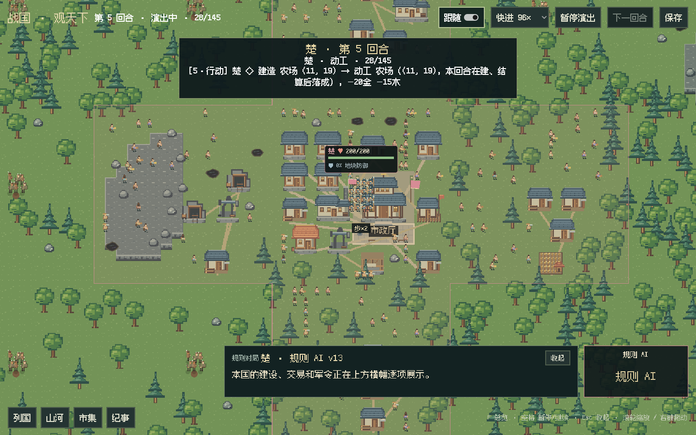
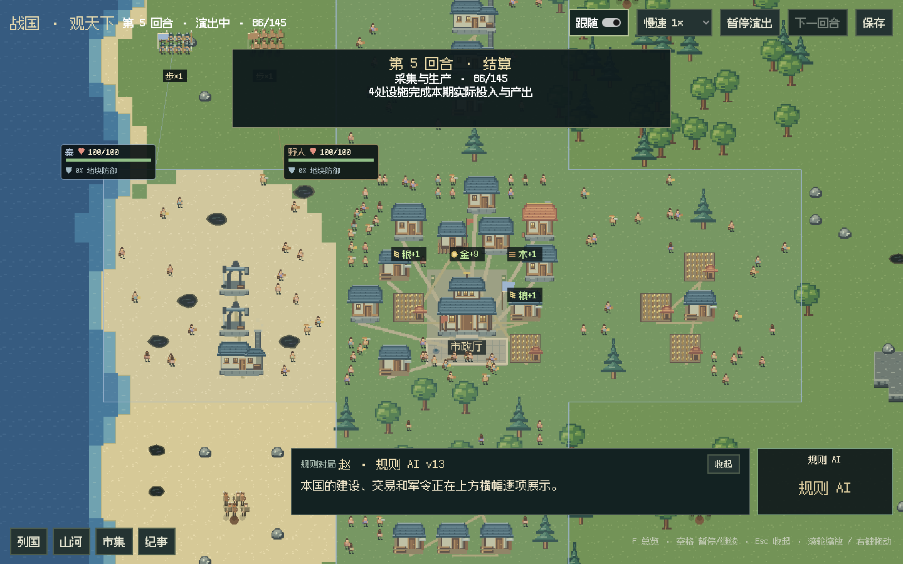
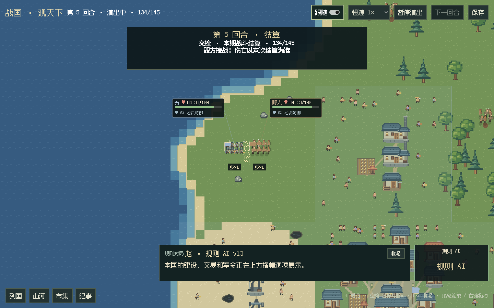
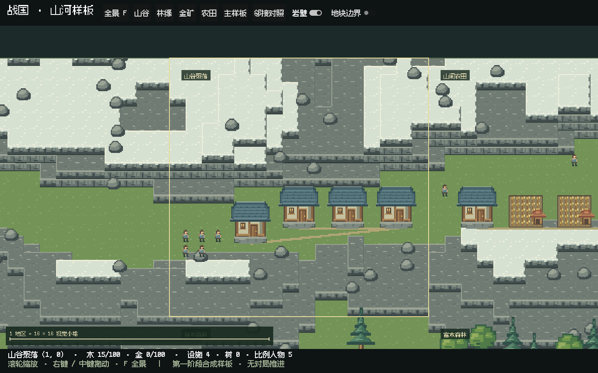

# 统一像素世界与动画接线

2026-10-24。把 `unified-v1` 从独立美术样板接到默认 Godot 对局，以及独立地貌样板。
视觉方向参考 [WorldBox 官方展示](https://www.superworldbox.com/) 的格状地貌、小比例人物与聚落组织；
图片使用仓库原创 SVG 组件导出的图集。规则仍由原来的 Python 宿主持有。

## 运行画面










[32 秒实际窗口录像](../design/gui-unified-tour-20261024.mp4)从正常离线对局的首场自然战斗开始录制。
输入局先按默认规则正常推进四期，之后继续播放到第七期；没有额外赠兵，也没有调用模型。
单独的军团检查则明确添加测试兵力，不把它当作正常开局证据。

## 本次接线

- 地形使用16×16世界像素连接格，山体取离散高度，每档8像素；更大落差逐条叠接岩壁，不拉长贴图。
  同高度相邻格不画共享墙，海岸按四邻格连接，海水分深、中、浅三档。
- 107个素材条目共享一张1024×1024图集。普通建筑地面32×32、工厂48×32、市政厅64×48；
  普通人16×16帧格、骑兵24×24，锚点直接读取清单。近景不再单独限制人物最大尺寸。
- 阔叶树使用8帧、6 fps叶冠轻摆，树干保持固定；三档水面各6帧、4 fps，按世界位置错开相位。
  居民、工人、剑兵、矛兵、斧兵和骑兵按实际有效帧数播放，行走朝向跟随移动方向，步兵仍是外观混编。
- 居民服装只替换三档布色，士兵盾牌/马鞍只替换赭红色槽；保留原皮肤、金属、马匹和轮廓。
  六类图集共432个帧格，包含重复待机格，不能解释成432张独立动作设计。
- 施工脚手架从地面分阶段出现，落成继续接真实结算事件。工坊与工厂炊烟读取素材的烟囱锚点，
  删除旧版按房顶猜位置的普遍冒烟与窗户发光。
- 金矿、铁矿和沥青来自真实丰度。扩大建筑与树冠避让范围；矿点同时考虑山体抬升后的实际显示位置，
  居民路线也避开矿点。密集设施聚合后，飘资源仍按实际建筑ID定位到对应展示组。
- 恢复 Fusion Pixel 简体中文像素字体，关闭字体抗锯齿和子像素定位，面板改方角。
  七张用户半身图、思考/正文/小结布局，以及规则AI/结算快进、LLM自动1×继续保留。

数据与布局只读观察者事实，不改变世界边界、地形通行、经济、兵种、伤害或存档协议。
野人仍用程序图形，受击与阵亡沿用动作位移、旋转和淡出；专用受击/阵亡帧、更多建筑等级仍可后续补画。

## 验证

- Python全量911项，909通过、2项可选本地C扩展跳过；新增实际图集读回、角色有效帧与固定树干检查。
- Godot C#编译零警告、零错误。纯C#检查包含离散高度、共享边、连续海洋、地表不随建筑重建，
  建筑数量、真实HP/防御、速度策略，以及金矿/铁矿/岩石和居民的空间避让。
- 默认正常v13离线对局连续播放四至七期，576地块、149设施，设施投影数与来源一致，
  24个逐国横幅、13次行军、13场战斗与伤亡、9次施工和9次落成全部播完；保存并退出宿主成功。
  地表只生成一次、缓存一份、576个地区节点保持。
- 独立军团实窗检查：步×2和骑兵×2均显示200/200，实际战斗终值一致，同位置4个资源提示不重叠，
  16×规则AI→1×LLM→16×结算切换通过；实际导入字体、精确装备替色与未污染肤色也已断言。
  相隔约0.55秒的两张实窗图中，避开横幅的海面区域58320像素里1856像素发生变化，确认水面实际播放。
- 七个模型图片×三种窗口，加三组流式长文本，共24组真实窗口检查通过；半身比例、窗口范围、
  切换国家和重试重置均通过；主菜单、配置与API档案实窗自检也通过。
- 固定3×3样板保留19设施和19人物，主/邻接样板、点选及880个裁切像素检查通过。
- API参考重新生成并核对，28页文档站和站内链接检查通过。修正了此前上游把思考移到独立文件后
  留下的旧主日志断言，以及新增客户端进度API尚未生成的参考页；没有改动这两项的业务实现。

本批实窗环境为Linux ARM64 / Xvfb / Mesa llvmpipe软件渲染。
录像1440×900、32秒、640个编码采样帧；编码帧率不代表引擎性能。
之前Windows Iris Xe的固定3×3 Vulkan成绩不能代替本批活地图GPU测试。

指标：[实际对局](gui-unified-world-metrics-20261024.json)、[军团与城镇](gui-unified-actors-metrics-20261024.json)、
[字体与半身布局](gui-unified-ui-metrics-20261024.json)、[地貌样板](gui-unified-sample-metrics-20261024.json)、
[录像](gui-unified-recording-20261024.json)。

## 本地复现

Windows更新后启动默认活地图：

```powershell
git pull
python desktop.py --rendering-method mobile --rendering-driver vulkan
```

Linux的独立离线检查（无桌面显示时，为窗口命令加 `xvfb-run -a`）：

```bash
python scripts/review_desktop_actors.py --output archive/previews/unified-actors-new
python desktop.py --ui-review-output archive/previews/unified-ui-new.png
python desktop.py --sample terrain --smoke-output archive/previews/unified-sample-new.png
python scripts/record_desktop_demo.py --output archive/previews/unified-recording-new
dotnet run --project tests/desktop-layout/Checks.csproj -- mods/ui/desktop/Samples/terrain-v2.json
```

目录参数要求新目录。素材母版、锚点、帧数、许可与逐文件哈希见
[统一素材说明](../../mods/ui/desktop/assets/unified-v1/README.md)。
