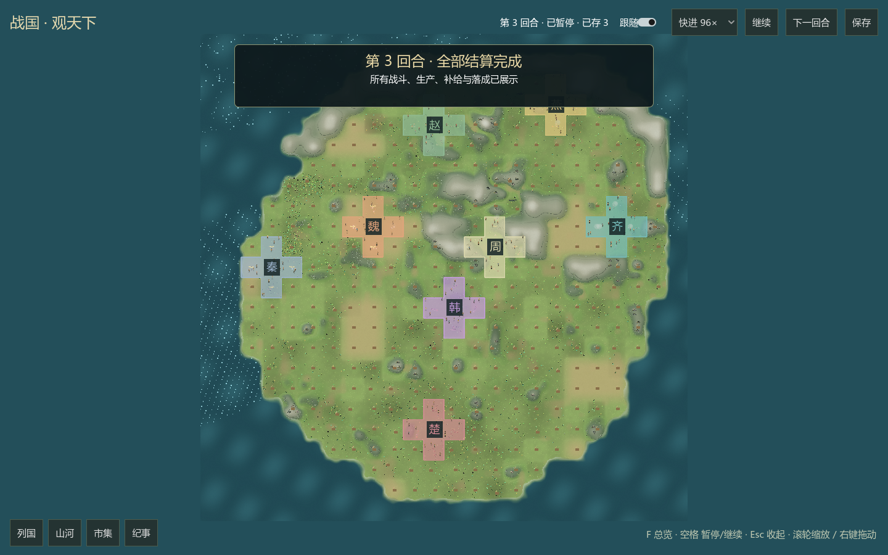
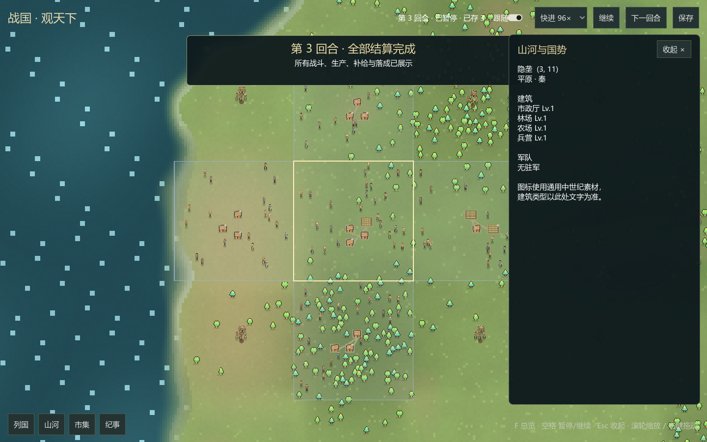
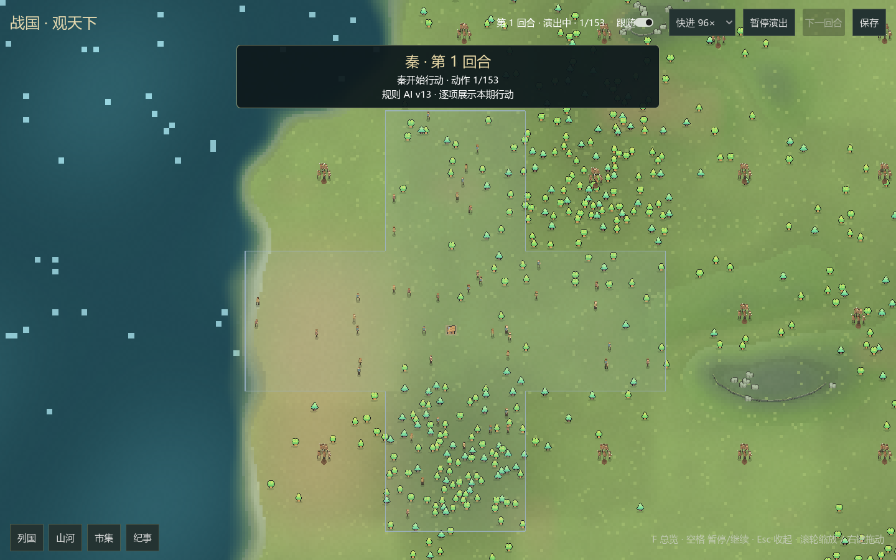
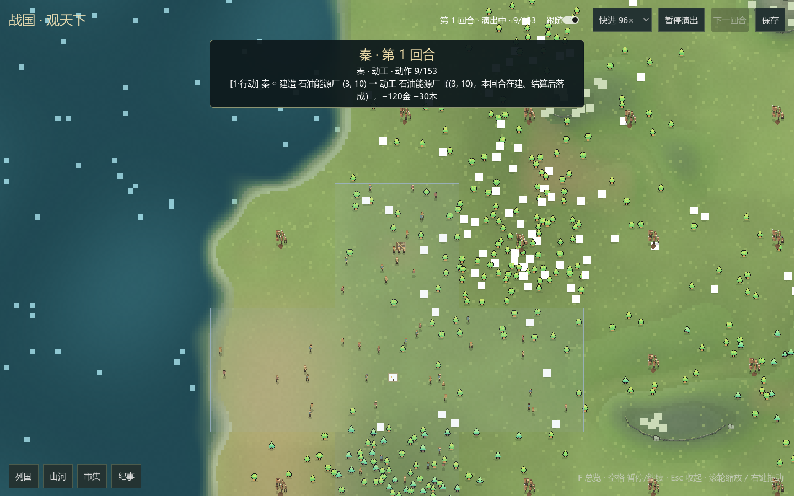
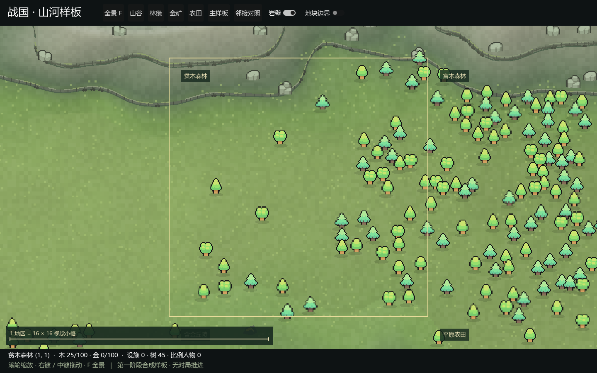

# GUI 视觉增强：动水、细角色与场景生命

2026-10-24。按"动画少、小人缺细节、地形太简单"的反馈做桌面视觉批，
只改 `mods/ui/desktop` 的 Godot C# 与素材目录；引擎、发行版规则与 Python 宿主未动。
本批不涉及 LLM 文本气泡、声音与安装包，仍按排期在后续批次。

## 水面动画

- `RegionArtwork` 改为三层子节点绘制：地表（含水着色器）→ 岩壁 → 物件；
  着色器只作用于贴图地表，不会把波光染到岩壁或房舍上。
- 地表烘焙新增 R8 水面遮罩（同一 GeometryKey 缓存，样板为共享平坦遮罩）；
  着色器按遮罩驱动两组正弦波光带、稀疏闪光与岸边泡沫脉冲，随 `TIME` 连续动画，
  不占用每帧 CPU 重绘。实窗截图可见外海泡沫边缘与水面高光带。

## 地形细节

- 陆地色带从硬阈值改为平滑插值；坡面阴影保留并新增陡坡岩层条纹。
- 新增烘焙细节：稀疏草丛、干草斑、水线湿沙、深水卵石、雪线颗粒、
  两条等高线级别的暗色环境光遮蔽。草丛按设计读作单块粗像素。
- 岩壁正面加水平层理、部分段苔帽与坡脚碎石，哈希挑选避免重复感。
- 房舍加门与暖窗底色；窗户灯光闪烁、屋顶炊烟由覆盖层动画叠加。

## 角色与军队

- `MiniPerson` 重画为约 13 像素带轮廓的角色（骑兵约 16）：肤色/发型四档、
  衣色明暗变化、双腿交替跨步、身体起伏、双臂反相摆动、行走背物、草帽变体；
  士兵有金属盔+国色盔缨、竖矛行军、突刺攻击、盾牌与盾钉；骑兵有奔马四蹄
  交替、鬃尾、持枪骑手与冲锋突刺；工人保留挥锤并加围裙。
- 军旗改为多边形正弦飘动，旗杆加顶珠；阵亡表现保留并加暗色血渍淡出。

## 场景生命（粒子层）

- 新增 24Hz 粒子系统（世界坐标、上限 260、随覆盖层时钟推进）：
  屋顶炊烟（建成设施、哈希错峰）、施工扬尘、行军队伍脚尘、
  战斗箭矢抛射与火花、占领涟漪+星光、回血星光、落成金色星光、伤亡碎屑。
- 窗户灯光在放大时轻微闪烁；两群飞鸟掠过地图（远景可见）。
- 树木在近景细节档随共享风时钟轻微摇摆（24Hz，仅可见区域节点重绘，
  远景档不重绘保持缓存）；样板物件层同机制。

## 预留素材位（Gemini）

- `assets/actors/` 新增清单与说明：4 张角色表（6帧×4行：右行/左行/右攻/左攻）、
  6 类建筑、2 种树。PNG 缺失时全部回退代码绘制；放入即自动生效并按国色染色。
  `ActorSheets` 读取 `manifest.json` 的单元格/帧数/行数，行序固定。
- 布局投影把建筑原始 kind 透传为 `Art` 字段（仅选图用，不影响布局几何与复用）。
- 提示词规格已并入[素材规格](../design/素材补充与生图规格.md)与本目录 README。

## 验证

- `desktop.py --build-only` 编译 0 错误。
- 实窗八国 smoke：`DESKTOP_SMOKE_OK period=3 tiles=576`，576 区域节点、
  地表构建 1 次、804 居民、292 潜在守军、抽屉/点选/地图铺满检查全部通过，
  Godot 日志 0 ERROR。本局前三期无战斗，battle/march 粒子路径为同构代码，
  待下一批随真实战斗录像复核。
- 地貌样板：`TERRAIN_SAMPLE_OK`，含邻接对照与点选检查，日志 0 ERROR。
- 视觉核对：外海泡沫边缘与高光带、草丛纹理、近景小人与门窗、森林树冠阴影
  均在截图确认；未发现黑块、丢图或着色器故障色。

## 未完成与后续

- 声音、LLM 气泡、三级城市主题、历史回放未动。
- 战斗粒子未在真实战斗窗口录像中复核；树木摇摆在超远档关闭，性能巡览
  应在下一次 `--sample-tour` 与录像中记录帧率对比。
- Gemini 素材到位后需逐张在实窗检查缩放轮廓与国色染色效果。
