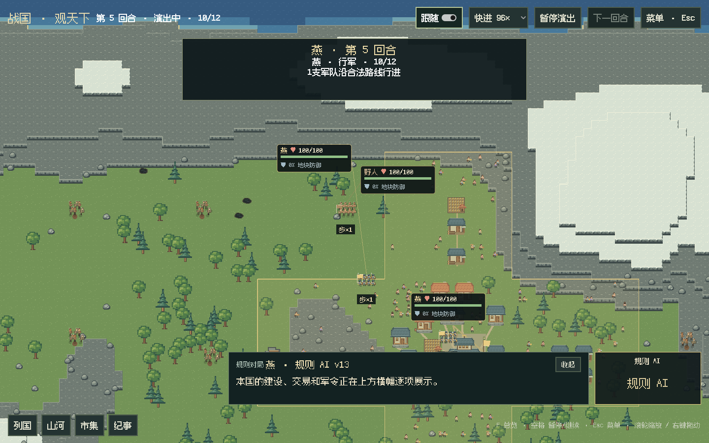
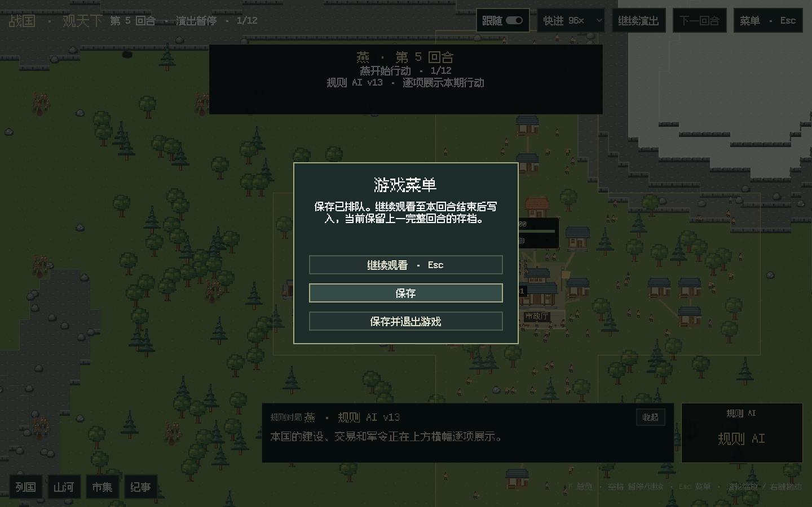

# GUI 调用批次演出与暂停菜单

2026-10-25，替代先算完整周期、再统一播放的旧时序。

## 行为

每次模型响应内的工具全部执行完，连同脚本内部产生的动作收为一个 action 批次。先统一演出这批操作，收到正确代次、序号的播放确认后，才发起下一次调用、换国或结算。同一响应内不会在两个工具之间等待动画。纯查询没有地图变化时不制造空片段。

规则 AI 没有模型往返，每国一批，批内逐项播放。行军、抵达和接敌在对应行动批次中展示，军队不会一直留在旧营地等回合末。回合末仍按真实规则结算生产、军需、战斗、伤亡、易帜与施工完成，再播放 settlement 批次。

实际规则本来就即时执行 move / attack 的位移；本次修的是呈现延迟与宿主调度。没有改变战斗公式、行动额度、军队数量或存档格式。

模型使用的 `military(action=move/attack)` 及其他伞工具，通过发行版工具层的动作映射识别，不再只给规则 AI 的直接 API 调用生成行军片段。每批快照来自该批操作后的事实，避免提前拿下一批或整回合的结果覆盖画面。自动补交的 end_turn 也在结算前单独展示。

## 菜单与保存

顶部“保存”改为“菜单 · Esc”。按 Esc 或点击自动暂停当前演出，宿主完成当前模型响应的工具批次后等待。菜单提供继续观看、保存、保存并退出；再次 Esc 返回，原来暂停的局面保持暂停，单步观看也不被菜单切成自动跑局。

回合中途不能写正式存档。保存请求明确显示“已排队”，继续观看到完整结算边界后才写入；最近的完整存档始终保留。关闭窗口或选择保存并退出时解除演出等待，完成当前合法周期后保存退出，避免等待已关闭窗口的播放确认。

## 验证

- 完整离线回归 918 项：916 通过、2 项可选 C 扩展跳过；最终定向 22 项通过。模型传输均为本地模拟，不调用真实 API。
- 实际单响应多工具：国策和两笔采购均执行完后才出现第一批演出；未确认前第二次模型调用计数保持 1。
- 旧代确认无效；显式暂停后即使收到正确确认也不继续调用，保存文件保持原字节；恢复单步后只完成当前周期。
- LLM 的军令伞工具：本批出现军令→行军→抵达；下一次模型调用与结算均在确认后。关闭未确认的批次可以完成、保存并退出。
- 脚本内部采购后故障：成功动作、脚本失败、外部补购仍完整属于同一响应批次，不拆成多次等待。
- 自动 end_turn、投影异常降级、正式保存读回、真实思考/正文流和规则状态/RNG 不变检查通过。
- Godot C# 编译零警告、零错误；纯 C# 布局检查通过；API 文档同步与站内链接自检通过。
- Linux ARM64 / Xvfb / llvmpipe 实际窗口：从正常 v13 第 4 期的 4 支军队推进到第 7 期 11 支军队；576 地块、149 建筑与来源一致。24 个国家行动批次、3 个结算批次，13 次行军全部在行动批次，结算批次行军为 0；13 次交锋和伤亡、5 次易帜。
- 同一窗口以真实 Esc 和指针事件验证菜单暂停、保存排队、再次 Esc 恢复、顶部菜单打开和继续按钮。抽屉、点选、保存和宿主退出码 0 同时通过。

窗口指标见 [JSON](gui-call-playback-metrics-20261025.json)。这里的截图和运行结果不代表实际 GPU 性能；正常开局没有添加测试兵力。独立原始预览保存在本地 `archive/previews/call-battle/`。

Windows 导出检查也按批回复确认，并检查菜单与批次指标。[Windows 便携包工作流 40173335896](https://github.com/northwindlight/zhanguo/actions/runs/40173335896) 全部通过：中文及空格路径移动、随包 Python/.NET、主菜单、实际窗口三期演出及 Esc 菜单。构建提交 `6ad0a3c`；后续本篇验收文档不改变运行代码。
