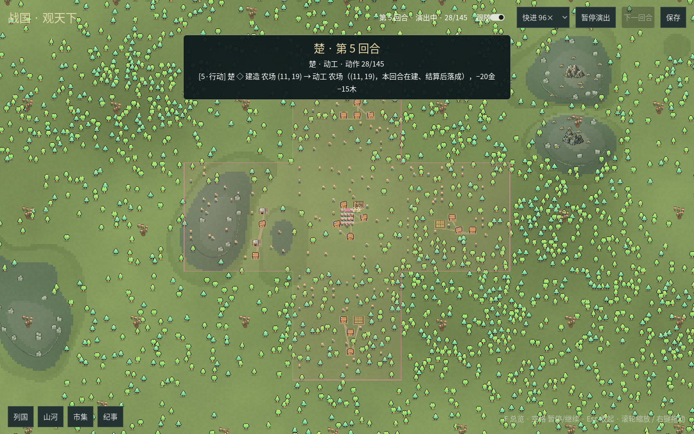
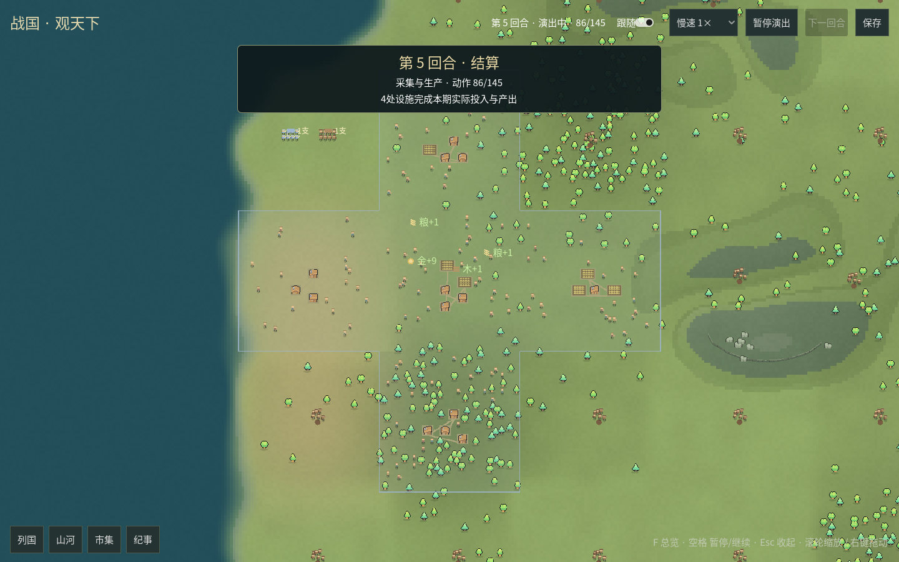
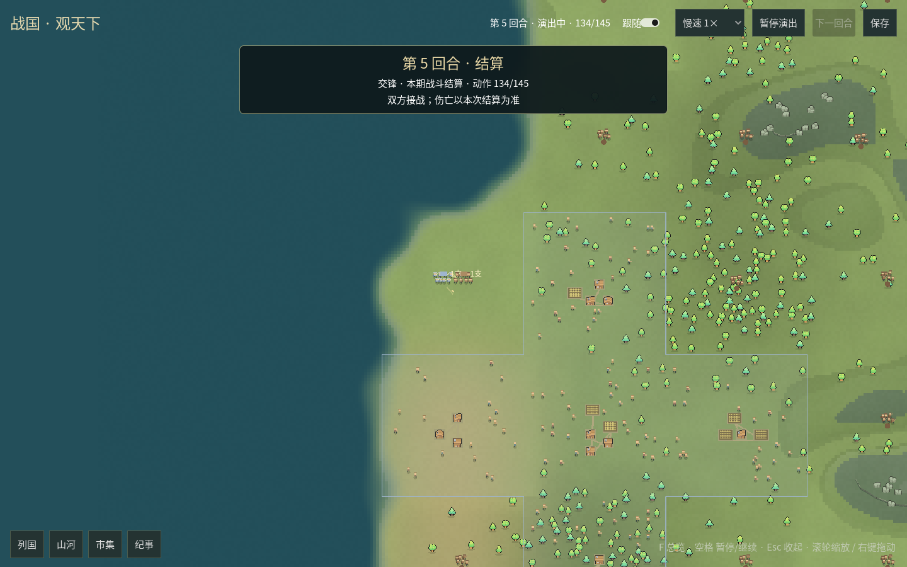

# GUI逐动作、聚落小人与密集军团

2026-10-24。按用户追加的观看要求接入慢速逐动作、逐国横幅、自动聚焦、建设与战斗演出、生产和军需飘字。
默认地图继续铺满窗口，功能抽屉保留。本批为阶段A之后提前接入B–E的部分功能，不宣称三级城市、美术与全部演出阶段完成。

## 运行行为

- 横幅按真实行动顺序显示“秦 · 第1回合”等国名/回合，并播报当前采购、出售、动工、征召、行军与接敌。
  引擎内部周期从0计数，观看横幅从第1回合开始；下一期首位国家按引擎轮换，不固定秦永远第一个。
- 默认慢速1×，提供0.5×、1×、2×、4×、16×五档；自动聚焦可用“跟随”关闭。暂停立即冻结当前片段。
- 远景用国色铺满已占领地区，放大后透明度从约0.68降至0.10，地貌细节逐渐显露。
- 聚落布置代表性居民，走动、停留、搬运和施工；地基/脚手架保持到实际落成，工人随施工状态活动。
- 野地守军来自发行版的只读存在性事实，未遭遇也可见；高山、海洋、已清除或已有站点的地块不补画潜在野人。
- 一支规则军队用多个微型角色表现，同格同国同兵种为密集编队，近景8–48个代表小人，远景简化。
  旗旁“几支”和详情HP仍对应真实规则军队；居民数与代表士兵数不新增人口、兵力或资源规则。




## 结算顺序

按用户最后补充要求，各国行动阶段先显示调动军令，军队在演出中保留原营地位置；
回合末统一沿合法路线播放行军、抵达和接敌，再展示生产、军需，随后逐场播放真实战斗：镜头移至战场、交锋、确认伤亡、更新归属，随后进入下一战场。
这只调整演出的时序，不修改发行版动作原有的离散执行规则，也不把插值移动当成新的规则子步。
所有战斗、落成与整期同步片段结束后，才向宿主确认播放完成，进入下一期。
原地进攻不补行军；跨格移动使用同一可达性搜索给出的一条合法演出路线，不宣称引擎保存了唯一逐步行军路径。
多起点军队按各自路线分组，不能把整批军队都套用第一支的起点。

生产图标直接对应逐设施经济事实的投入和产出，包含采集、工厂和金币收入；未生产的设施不凭空冒产出。
军需使用真实补给/装备扣款，回血使用逐军队实际恢复HP；多地点军需不重复标出全国总扣款。
战斗结构化记录包含交锋前后参与者、HP、存续、实际敌对对象、伤害与归属；不解析中文战报猜伤亡，也不拿整个周期的HP差混算战损。
确认消灭的军队才退出并显示短时倒地，已确认占领才易帜。





[回合末行军](../design/gui-live-march-20261024.png) · [补给提示](../design/gui-live-maintenance-20261024.png) · [易帜](../design/gui-live-occupation-20261024.png)

## 正常v13开局与装备价格

实际构造并核对八国客户端全部为 `ruleai.v13.entry.RuleClient`、版本 `v13`，包括balanced、merchant、buffer、liquid等本局抽出的经营偏好。
v13重新实现经济规划，军事沿用v11plus，因此“仍在打野人”不是版本退回的证据。界面版本和偏好现从实际客户端事实读取。

之前桌面入口为展示单位给每国额外补助两支骑兵，共16支。本批删除默认补助，正常开局0支军队；随后由AI按规则建设兵营并征召。
本批录像从全新正常开局自然推演4个完整周期后续演，此时有4支国家军队，播放到第7期完整边界已物化军队合计11支（9支国家军队、2支遭遇野人）；没有为录像补兵或改HP。

用户澄清“装备归零”是市场报价显示成0.00。当前市场价格随库存相对基准的高低调整：买走库存会抬价，
库存过多会压价；价格下限0.000001，旧界面两位小数能把很小的正报价显示成0.00，不等于卖空。
市集改用有效数字，并同时列库存、参考价、首单位买卖参考价；没有买货时显示“无货”。没有修改市场曲线或v13策略。

默认种子20261023的40期离线对照：[原始指标](gui-v13-price-diagnostic-20261024.json)。正常无补助开局，装备库存640→457、报价8→11.1676；
原两骑兵补助开局，库存640→1057、报价8→3.0238。这段对照观察到累库压价，未复现用户那次0.00的具体时点，
不能据此认定其实际存档或种子。另一次较长探针只完成至225期后中断，不作为完整300期结果。

## 接线与边界

`TimelineCapture`在会话线程通过既有 `cycle(on_result=...)` 收集写动作，只读查询不复制场景。
标准UI投影返回普通JSON差分，Godot按顺序应用，建筑、归属、军队和动作账户同步；整期统计在最后关键帧同步。
建筑使用发行版稳定实例ID、remaining状态，落成不换锚点。每地区复用静态装饰节点，镜头和小人更新不重建地表。

协议沿用 `zhanguo.desktop/1` 的generation/revision，增加单期timeline与带generation/sequence的playback_ack。
宿主每次只发送一个已完整结算并保存的周期，正确确认前不推进下一期；上限2048片段，采集故障退回完整快照。
采集回调不触及Godot，异常隔离，不把呈现错误重新抛成规则动作失败。保存仍只发生在合法周期边界；
暂停中的画面可以落后于已经保存的规则结算，保存按钮有相应提示。

没有修改通用引擎、AI经济策略、市场参数、真实zg会话或真实存档，也没有调用模型服务。
内部场景/路线读取函数不新增终端管理命令。LLM气泡、声音、任意历史回放、完整三级城市主题与平台安装包继续保留。

## 验证与复现

- 集成最新主线后Python全量离线919项：917通过，2项可选本地C扩展因独立工作树无编译产物跳过。
  覆盖正常开局、实际v13、逐国顺序、施工生命周期、演出前后世界与RNG不变、故障隔离、精确播放确认、真实战斗顺序、合法路线、设施产出与回血扣款。
  最后追加回合末行军时序后，20项相关定向回归再次通过，核对下令时保留营地、全部国家结束后才行军、所有行军在战斗之前，以及最终场景重现。
- C#实际布局检查通过：原主/邻接轮廓745边/460前面、701边/377前面保持；另核对国色淡化、密集编队封顶、极低正价、差分应用、居民与落成锚点稳定。
- 正常开局窗口播放前三回合，验证0初始军队、居民/野人、逐国动作、建设/落成/产出、全窗地图和抽屉指针操作。
  [开局窗口指标](gui-live-opening-metrics-20261024.json)；正常开局与战斗续演均保存并退出0。
- 正常发展后的窗口播放第5–7回合：24次逐国横幅、13次行军/接敌、13场交锋及伤亡片段、5次易帜、120处地区生产片段、22次军需片段。
  第7期576地块、149设施、956个居民落点、284处潜在守军；设施计数与源快照相同，地表生成1次/缓存1份、静态装饰节点576个。
  [战斗窗口指标](gui-live-battles-metrics-20261024.json)。
- 原固定3×3样板窗口回归通过：19设施、286树、19比例人物、两份地表缓存，以及点选和880个外缘裁切像素保持。
  [样板回归指标](gui-live-sample-regression-20261024.json)。API参考同步检查和文档站构建/链接检查通过。
- [32秒真实窗口录像](../design/gui-live-battle-tour-20261024.mp4)，1440×900、640个编码采样帧；
  [原始录制元数据](gui-live-recording-20261024.json)。输出文件经过H.264重编码，场景与顺序保持。
  验收模式快进经营并放慢部分结算片段以便录制；编码采样帧率不是引擎帧率。

本批窗口为Linux ARM64 / Xvfb / Compatibility / Mesa llvmpipe软件渲染，日志的无音频设备错误回退dummy。
新演出尚未得到Windows/Vulkan GPU实机性能数据；此前固定3×3样板的约60fps不能外推到此处。
角色目前是代码绘制的动作草样，建筑仍有通用视觉代用图标，未宣称最终美术质量或长时间无泄漏。

Windows正常观看：

```powershell
git pull
python desktop.py --rendering-method mobile --rendering-driver vulkan
```

录像复现：

```bash
python3 scripts/record_desktop_demo.py --output archive/previews/desktop-recording-new
```

依赖Xvfb/ffmpeg/ffprobe，输出目录不能已存在。普通窗口默认暂停、慢速1×，点击继续后观看，速度与跟随可随时调整。
本批依赖native4.18.0、army2.12.0、ui1.8.0、experimental0.19.0；旧档继续按既有严格规则拒绝混载，不迁移运行局。
