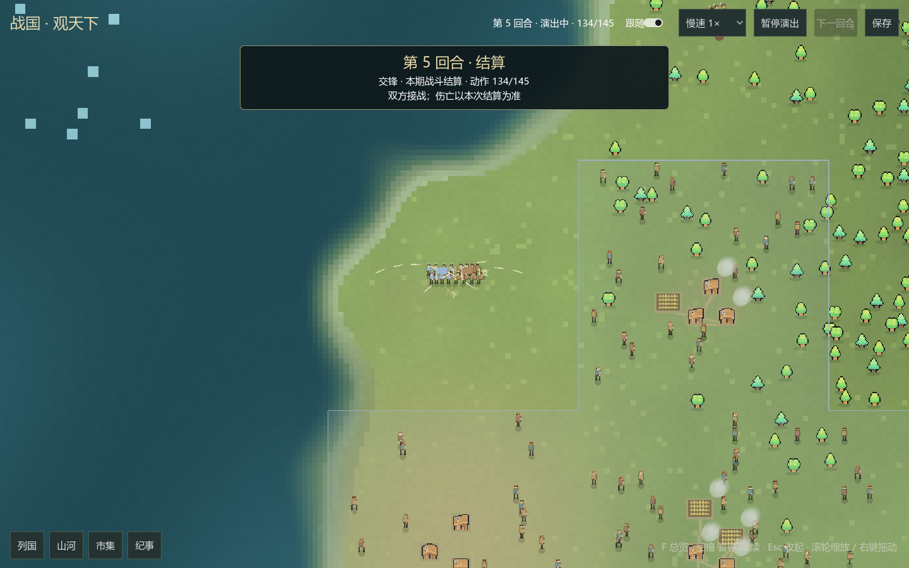
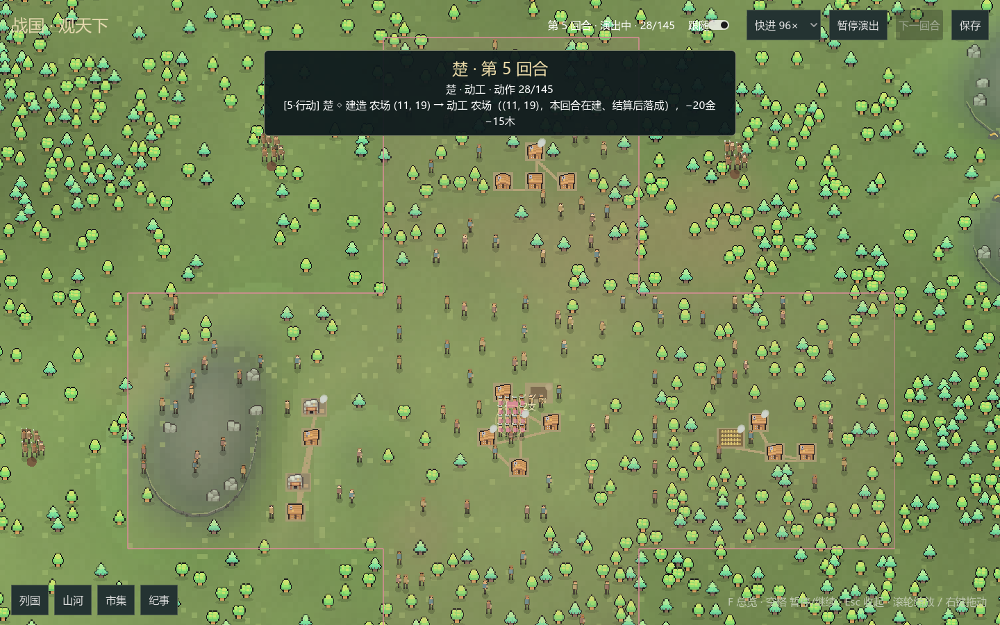
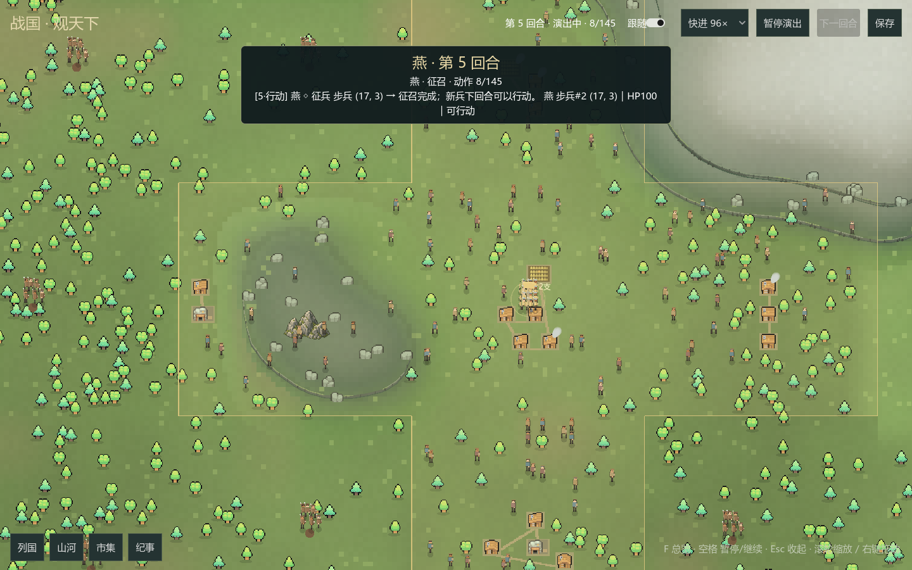
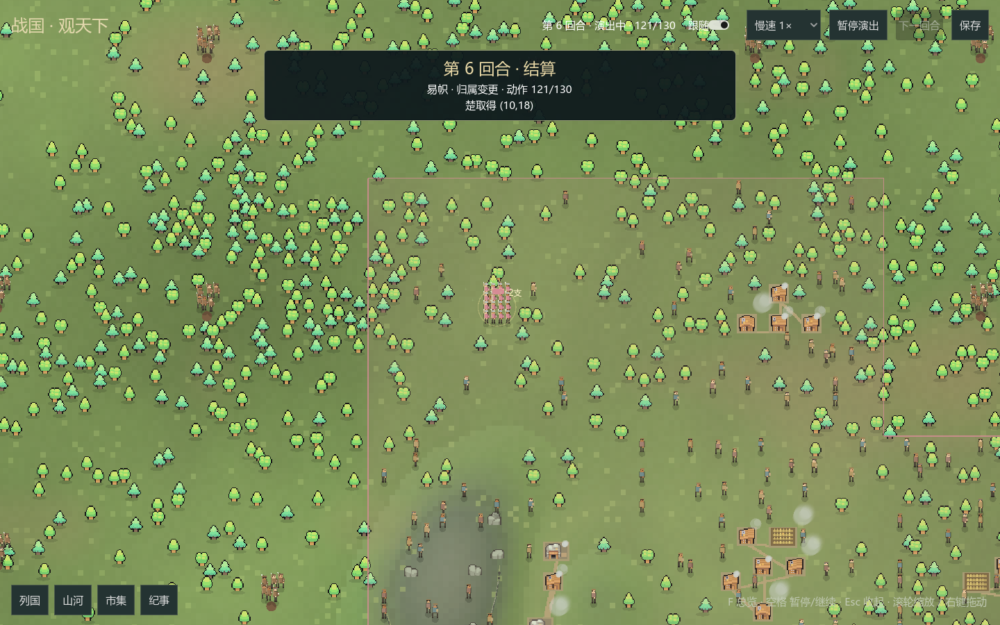

# GUI 演出批：跟随镜头、动工征兵与战斗改进

2026-10-24。按"跟随视角太小、地基瞬现、落成与征兵缺演出、战斗待改进"的反馈做演出批，
只改 `mods/ui/desktop` 的 Godot C#（含 smoke 阶段截图清单补 `recruit`）；
引擎、发行版规则与 Python 宿主的 beat 结构未动——`recruit`/`build`/`complete`
阶段与 `building/{id}` 来源是宿主早已提供的既有事实，本批只是消费它们。

## 跟随镜头

- 变焦从固定 0.88× 提高并按阶段分档：战斗/伤亡 1.55×，动工/落成/征兵/生产/
  军需/易帜 1.45×，接敌/抵达 1.25×，行军 1.0×（看路线），其余 1.15×。
- 变焦改为平滑插值（世界锚点+目标缩放，~0.5 秒到位），不再瞬跳；
  拖动、滚轮、点按钮都会取消跟随。
- 动工/落成直接对准建筑本体（complete 用 `building/{id}` 定位设施矩形，
  build 用该格新出现的中工地），不再是格子中心。
- 战斗阶段加轻微震屏（指数衰减的确定性抖动，同步作用于地表与覆盖层）。

## 动工与落成演出

- 新工地分四阶段升起（约 2.2 秒）：平整场地展开 → 地基从中心铺满 →
  四角立柱从地面长高 → 支架与斜撑淡入合拢。期间该地区节点以 24Hz 重绘
  （不依赖近景档位），结束后回到静态缓存。首帧快照不触发（续档不重放全部地基）。
- 落成演出：原有金弧与星光之外，新增金框脉冲外扩与揭幕尘雾（前 35% 盖住
  脚手架→成品的切换），加涟漪与环形尘土。

## 征兵演出

- `recruit` 阶段：新兵从聚落中心走向集结点列队（缓动插值、行走动画、
  朝向随移动方向），脚下扬尘，集结点涟漪与尘土爆发；军旗在队列旁飘动。

## 战斗改进

- 交战双方站位随片段进度从 34px 逼近到 12px 并持续对冲颤动；
- 每 25% 进度触发一次冲击波尘环；开战涟漪+尘暴；
- 箭矢、火花、伤亡倒地与血渍保留；伤亡阶段仍有轻微震屏。

## 验证

- `desktop.py --build-only` 编译 0 错误。
- 续档实窗验收（离线八局先推进 4 个完整周期再 `--resume`，含
  `ZHANGUO_DESKTOP_SMOKE_TOUR=1`）：`DESKTOP_SMOKE_OK period=7 tiles=576 armies=11`。
  本轮实际播放 recruit×7、build×9、march×13、engage×13、battle×13、occupation 若干，
  逐阶段截图核对：战斗双方阵列与国色、动工地基/立柱/工人/尘土、征兵列队/走位/旗帜、
  易帜涟漪均确认；`world2-recruit.png` 等截图归档。
- 第一次续档运行出现的 3 条 `SwapGCHandleForType` 为程序集更换后的一次性
  脚本缓存噪音（栈内无用户帧）；同命令第二次运行 0 ERROR，退出码 0。
- 新开局实窗 smoke 与地貌样板此前已通过（见[视觉增强批](GUI视觉增强-20261024.md)），
  本批未改动其覆盖路径的公共逻辑。

## 未完成与后续

- 战斗仍无音效与命中数字以外的战报浮层；多场战斗连续播放的节奏未调。
- 征兵集结点目前是格子中心，未按兵种/建筑区分队列样式。
- 平滑变焦在 16× 快进下直接到位（无慢速插值），属预期。
