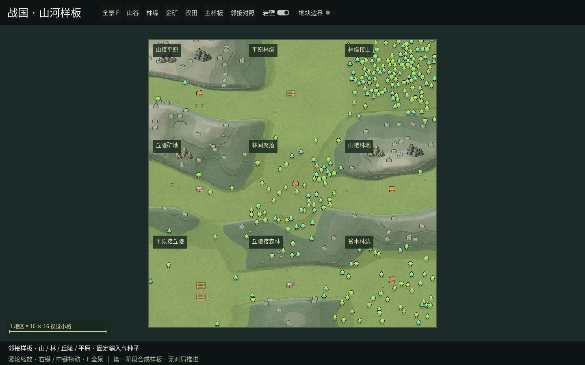

# GUI 阶段 A 第三批：岩壁连接、邻接与持续观看

日期：2026-10-23。阶段 A 的第三批展示修订，布局算法仍为版本 2，主样板输入和对象数保持。

## 画面与录像

| 产物 | 内容 |
| --- | --- |
| [主样板全景](../design/gui-stage-a-v3-overview.png) | 山谷、森林、矿地和农田；世界外缘正确裁切 |
| [山谷近景](../design/gui-stage-a-v3-close.png) | 随高度场连接的前向岩壁与谷地设施 |
| [邻接全景](../design/gui-stage-a-v3-neighbors.png) | 山地/平原/森林/丘陵交错排列 |
| [邻接近景](../design/gui-stage-a-v3-neighbors-close.png) | 岩壁转角、林缘和聚落同屏 |
| [实际窗口录像](../design/gui-stage-a-v3-tour.mp4) | 33.07 秒，1440×900，15 fps；主样板与邻接样板的镜头巡览 |



岩壁由同一个全局高度场的等高轮廓生成，跨小格和规则地块共用边缘采样；
转角连续，朝向镜头的一面显示短立面和石纹。低处收短，设施附近留出空间。
目前仍是几何与比例样板，石面偏规整，后续继续调整自然度。
本批未导入原包的整张岩壁图集，未新增生图请求。

## 实现与输入

`RegionArtwork` 保存静态地貌、岩壁与对象的绘制命令，`RegionMap` 负责镜头、点选和覆盖信息。
镜头拖动改变世界裁切容器的变换，不重新生成地表。
地表缓存限制为两份，切换主/邻接样板时复用；世界矩形作为裁切边界，树冠、碎岩和阴影在外缘被裁掉。

新增 [terrain-neighbors-v2.json](../../mods/ui/desktop/Samples/terrain-neighbors-v2.json)，
与主样板同种子，九块土地交错使用四种地形。

| 样板 | 设施 | 树 | 比例人物 | 碎岩 | 山岩组合 |
| --- | ---: | ---: | ---: | ---: | ---: |
| 主样板 | 19 | 286 | 19 | 80 | 6 |
| 邻接样板 | 9 | 259 | 10 | 67 | 5 |

所有输入均为独立合成数据。通用引擎、真实对局和规则 AI 没有改变。
岩壁几何只用于呈现，不形成额外的规则建筑、防御或移动约束。

## 验证

- C# 编译零警告、零错误；21 项 Python 桌面相关回归通过。
- 实际布局检查通过，补齐邻接样板的设施与人物数量、平地落点核对。
- 岩壁轮廓检查包括平地无岩壁、斜面连续线、孤立山峰闭环、鞍点分支，以及两个实际样板内部端点连接。
- 主样板 745 条轮廓段，其中 460 条有前向立面；邻接样板 701 条，其中 377 条有前向立面。
- 两个样板共检查上/左外缘 880 个截图像素，确认树木和岩石没有越出世界矩形；点选详情核对通过。
- 实际窗口录像已用 ffprobe 检查时长、分辨率和帧数，并抽取山谷/邻接画面检查内容。

## 持续观看记录

环境：Linux ARM64 / Godot Compatibility / Mesa llvmpipe 软件渲染，1440×900。
预热约 5 秒后测量 32 秒镜头巡览，使用 Stopwatch 墙上时钟计算帧间隔，截图过程不计入巡览窗口。
录制与不录制分别保存原始数据，编码会与软件渲染竞争 CPU。

边录边看数据：[gui-stage-a-v3-recorded-metrics.json](gui-stage-a-v3-recorded-metrics.json)。
单独巡览数据：[gui-stage-a-v3-unrecorded-metrics.json](gui-stage-a-v3-unrecorded-metrics.json)。
录像文件核对：[gui-stage-a-v3-recording.json](gui-stage-a-v3-recording.json)。

| 运行 | 测量时间 | 实际渲染帧数 | 中位帧间隔 | P95 | 最长 |
| --- | ---: | ---: | ---: | ---: | ---: |
| 单独巡览 | 32.05 s | 467 | 65.6 ms | 90.0 ms | 129.0 ms |
| 边录边看 | 32.07 s | 349 | 90.9 ms | 122.5 ms | 173.2 ms |

录像为 15 fps 编码采样，不代表界面以 15 fps 渲染。
本次未隔离系统其他负载，数据记录当次运行，不能把两次差异全部归因于编码。

节点数始终为 19，地表缓存为 2、素材缓存为 7，地貌总生成次数保持 2；
巡览期间只重新提交两次静态画面的绘制命令，镜头拖动没有重建静态地貌。
巡览采样工作集约 479.5→483.4 MiB，托管内存约 1.5–2.3 MiB；短时检查不作长期内存泄漏结论。

软件渲染录制时仍偏慢，实际 GPU 与 Windows/macOS 尚未验收；大地图与活地图性能另验。

## 复现

```bash
python3 desktop.py --sample terrain
# 顶部选择“邻接对照”，可开关岩壁和地块边界。

dotnet run --project tests/desktop-layout/Checks.csproj -- mods/ui/desktop/Samples/terrain-v2.json
.venv/bin/python -m unittest tests.test_desktop_launcher tests.test_desktop tests.test_ui_mod -q

# Linux，需要 Xvfb、ffmpeg、ffprobe。输出目录须不存在。
python3 scripts/record_terrain_sample.py --output archive/previews/terrain-recording-new
```

阶段 A 继续保留石面自然度、地貌组合覆盖及实际 GPU 验收。
进入 B 时再做三级聚落/城堡与军团，不以本批轮廓和录像代替后续演出验收。
