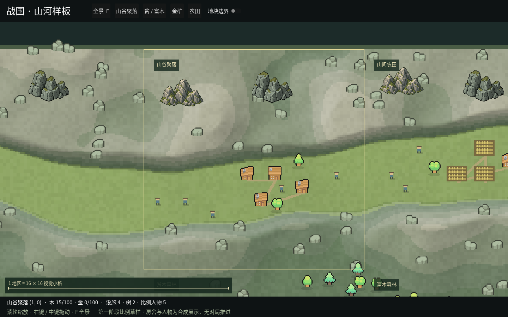

# GUI 阶段 A 第二批：地貌、林缘与素材

日期：2026-10-23。按[第一阶段计划](../plans/GUI第一阶段.md)推进。
本批完成山体与树林的第二轮布局，补入三张原作者素材、GPT 山岩和本机 Antigravity 生成后去底的山岩，并在实际窗口检查。

## 窗口对照

| 画面 | 首批 | 第二批 |
| --- | --- | --- |
| 3×3 全景 | [v1](../design/gui-stage-a-overview.png) | [v2](../design/gui-stage-a-v2-overview.png) |
| 山谷近景 | [v1](../design/gui-stage-a-close.png) | [v2](../design/gui-stage-a-v2-close.png) |
| 贫/富木林缘 | — | [v2](../design/gui-stage-a-v2-forest.png) |
| 含金丘陵与矿场 | — | [v2](../design/gui-stage-a-v2-gold.png) |

山体的峰面与谷地分别生成，坡面朝向形成明暗，地表增加小块色差；同一山带可见不同的峰面起伏。
树林采用跨地块的打散候选点与最小间距，再按木资源和连续噪声决定成簇密度。
贫木到富木之间渐变，零木地区保持无资源树木，相邻有木侧逐渐变疏。

从 Mini World 原包补了绿色松树、灰色岩石和矿洞；本批窗口检查发现松树表第 0 格是树桩、
第 2 格有积雪，最终仅选第 1 格绿色完整松树。岩石在渲染时轻微调色，与坡面搭配。
GPT 山岩和 Antigravity 山岩的最终 PNG 具有真实 alpha，按 64×48 交替展示，落在通过高地检查的位置，不覆盖平地聚落。

## 固定输入与对象数

当前输入 [terrain-v2.json](../../mods/ui/desktop/Samples/terrain-v2.json)，SHA-256：
`a7a14a709a791e20abce453b97a2e7f1a73572796a8efa176a70677ecd15f361`。
保留首批的种子 `20261023`、九地块的坐标、地形、资源与设施/人物输入，布局算法版本改为 2。
首批的 v1 文件和截图仍作为历史记录，当前实现显式只接受布局版本 2。

| 地区 | 设施 | 树 | 人物 | 露金 | 碎岩 | 山岩组合 |
| --- | ---: | ---: | ---: | ---: | ---: | ---: |
| 空山与谷地 | 0 | 0 | 0 | 0 | 27 | 2 |
| 山谷聚落 | 4 | 2 | 5 | 0 | 16 | 2 |
| 山间农田 | 4 | 3 | 3 | 0 | 22 | 2 |
| 零木森林 | 0 | 0 | 0 | 0 | 1 | 0 |
| 贫木森林 | 0 | 45 | 0 | 0 | 3 | 0 |
| 富木森林 | 0 | 139 | 0 | 0 | 4 | 0 |
| 中等木量 | 1 | 78 | 2 | 0 | 0 | 0 |
| 含金丘陵 | 2 | 11 | 3 | 7 | 7 | 0 |
| 平原农田 | 8 | 8 | 6 | 0 | 0 | 0 |
| 合计 | 19 | 286 | 19 | 7 | 80 | 6 |

树/碎岩/山岩组合是呈现对象。其数目由布局版本决定，房舍与人物的输入数保持一致。
六处山岩组合各三处使用两种轮廓；新增图片不增加规则对象或资源。

## 验证

- C# 编译：零警告、零错误。
- 实际布局检查：同输入重现、数组重排不变、设施与人物数、设施落点和碰撞均通过。
- 资源检查：同坐标木量增加时已有树不移动、零木无树、含金与无金区别；新增林缘渐疏与连续性检查通过。
- 几何检查：树木跨地块仍保持最小间距，山岩不盖谷地，松树只用绿色帧；新增第二种子和交错地貌组合的边缘连续性检查通过。
- Python 桌面启动/控制器/UI Mod：20 项通过。世界与模型相关 Python 源码未改，本批未重复全量 853 项；全量由现有 CI 继续运行。
- Linux ARM64 / Xvfb / Compatibility / llvmpipe 实际窗口通过，模拟点选成功，保存全景、山谷、森林、矿区四张截图。

原始短时记录在 [gui-stage-a-v2-metrics.json](gui-stage-a-v2-metrics.json)。
截图过程约 1.42 秒、20 帧，中位帧间隔约 50.4 ms，P95 约 142 ms；包含首次绘制与连续截图，
不能与首批的短截图过程推断性能增减。持续镜头运动、录像与长时内存仍待专门验收。

## 素材与后续

来源、许可核对和 GPT 完整提示词见[素材补充与生图规格](../design/素材补充与生图规格.md)。
同一文档提供 Gemini 网页/App 可直接使用的提示词。

本机 Antigravity 网关已实际生成一张山岩，约 92 秒返回 1200×896 RGB JPEG，
背景棋盘为绘制内容；内置 image_gen 随后去底生成透明 PNG。
输入/输出格式与哈希见 [生图实测记录](agy-image-probe-20261023.json)，两步提示词与原图均保留。

阶段 A 尚在推进。当前两种山岩轮廓仍有重复、颗粒与既有素材不完全一致，坡面仍偏平滑；
下一批补不同山岩轮廓、岩壁拼块与邻接样例，再安排持续观看证据。
