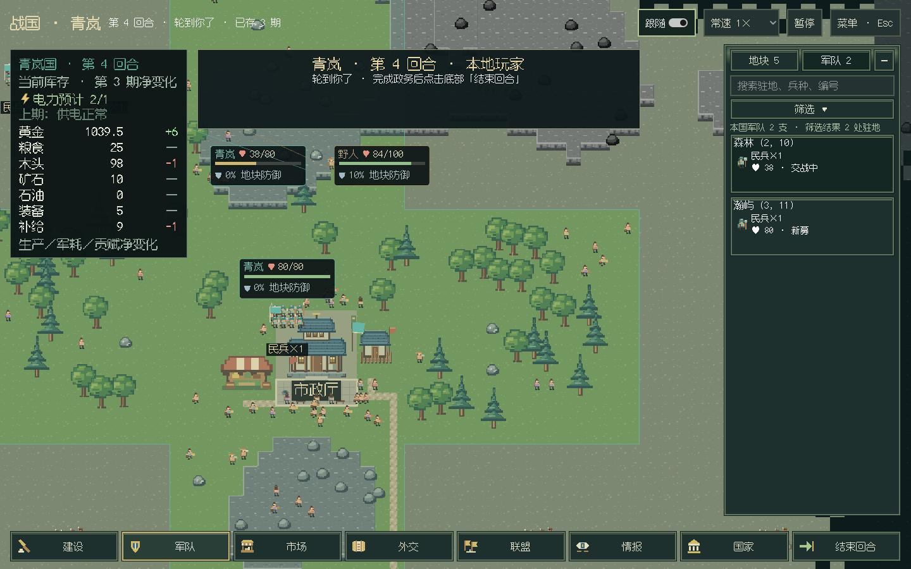
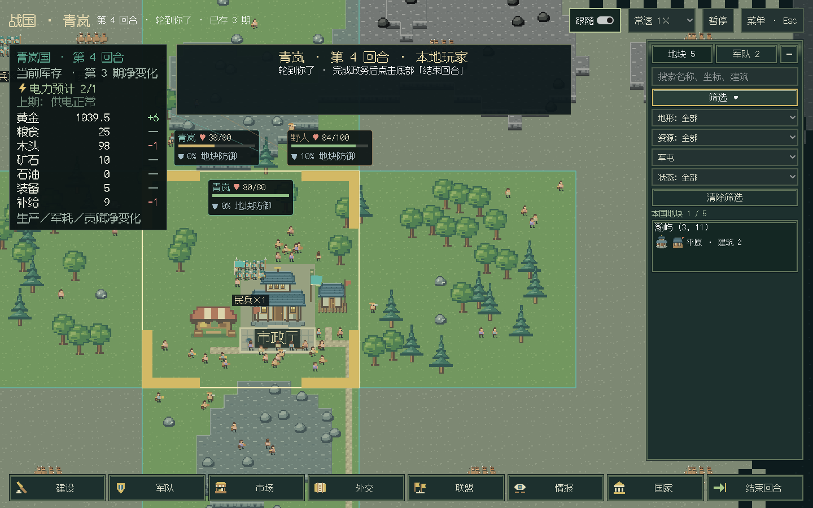
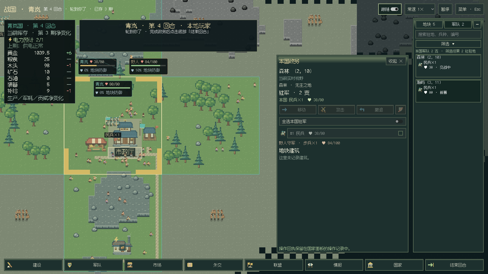
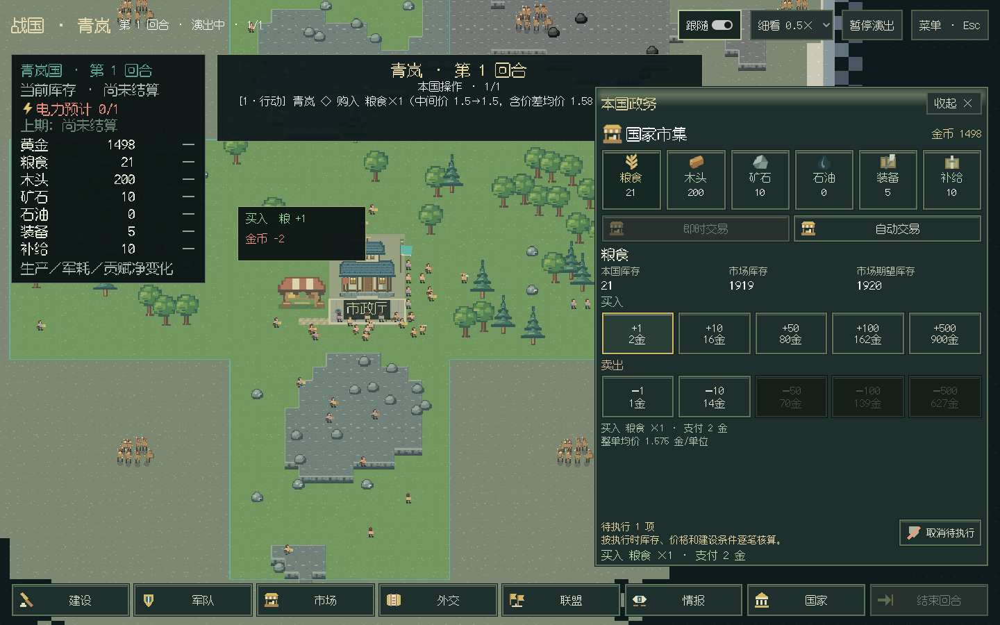
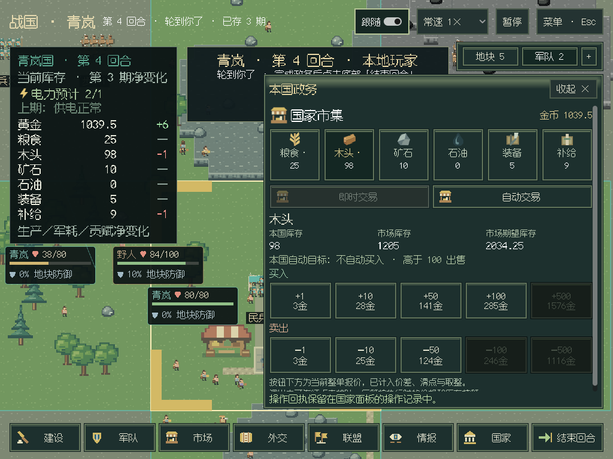
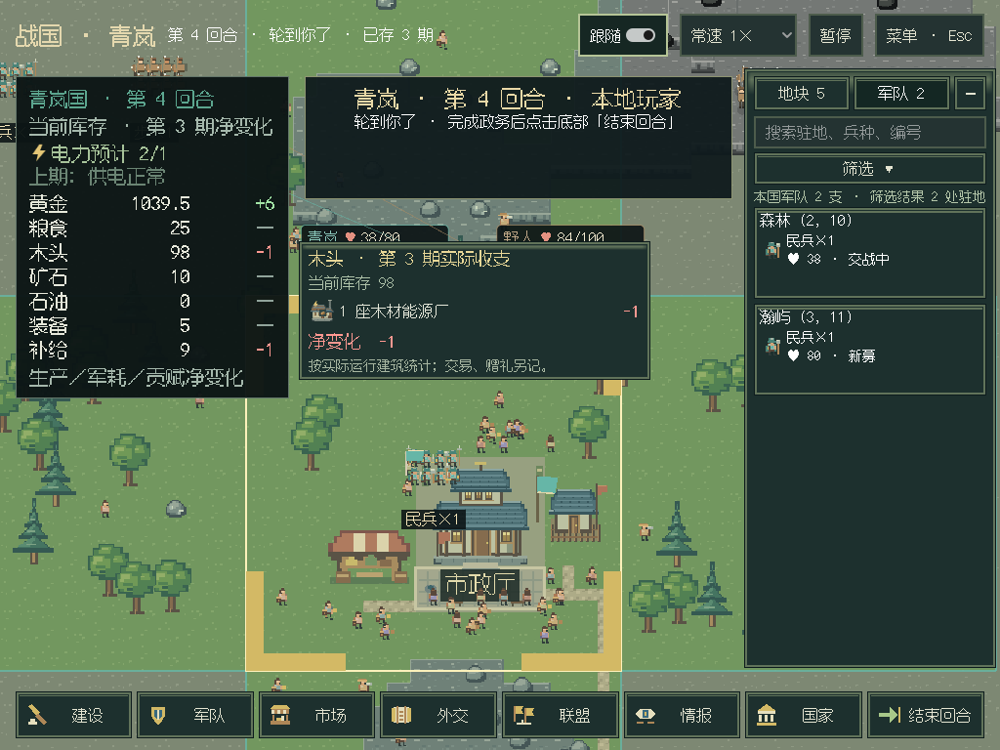

# 军队总览、筛选、连续操作与资源明细

2026-10-27，承接 v0.6.1 试玩反馈。单机一位真人、本国权限和18阶段结算顺序保持；本批不改存档字段与模块版本。

## 地块和军队总览

右侧常驻“地块／军队”标签，点击列表直接定位和操作。地块可搜索名称、坐标和建筑，按地形、资源、建筑类型，以及施工中／有征兵设施／有驻军组合筛选；建筑卡显示实际实例，包括在建。军队按驻地分组，可筛兵种、可行动、新募、已行动与交战状态。

选择另一处驻军清除旧选择，同一驻地仍可多选；移动后跟随原部队，失去或离开驻地的军队不会残留。每次目标查询带本地代次，取消或换组后的旧响应不再覆盖新范围。新募军队的移动／攻击／撤退变暗；其他军令仍经过正式候选与执行检查。

宽屏将详情放在总览左侧；小窗口打开详情时保留总览标签，点标签即可返回列表。回合横幅避开右侧总览，地图继续铺满窗口。

## 连续操作与倍速

真人建造和其他操作沿用所选0.5／1／2／4／16倍速，不再在执行时强制跳到1倍。LLM行动仍固定1倍，规则AI与结算保留所选速度。

买卖、建设和征兵可在本国行动动画期间继续点击排队。每项保存原资源／数量／地块，按先后逐笔送到正式规则层，执行时重新核算价格、余额、库存和施工条件。队列有数量提示，可取消尚未提交的指令；已成交交易不会被“取消待执行”撤销。同一地块已有建设或征召指令时阻止重复排队。结束回合、军令与外交保持各自的权限和确认检查。

后端仍在前一笔演出确认后接收下一笔操作；界面接受连续输入。请求编号去重继续有效，连续点击是不同指令，每笔各执行一次。暂停时队列等待，返回继续操作后恢复；行动席位／期数变化时取消旧指令。

## 数字输入与市场信息

主菜单、通用表单、自动交易和征兵数量改为随输入更新。征兵数量改变立即禁用旧报价，稍停后刷新并保留输入焦点。大步进设置只用于箭头加减，输入值不再被强行取整到大步长。

市场分别显示本国库存、市场库存和市场期望库存，本国自动买卖目标另列。成交回执到达后独立刷新库存、金币、整单报价、可用性和悬停，不必等动画完成，也不重建正在点击的按钮。

## 资源悬浮明细

左上角资源行悬停展开标注期的实际产出／用料，按建筑类型列数量、图标和红绿变化，再列军需与贡赋，并与该行净变化对账。实际结算测试：4座农场产粮+4，1座补给厂耗粮−2，粮食净变化+2。停工工厂没有实际消耗，不套用额定配方。

实际来源从结算的生产记录汇总，通过现有本国私有事件保存。之后拆除或易帜不会改写上一期来源；玩家只取得自身明细，看海可切换国家。资料只用于明细，不额外插入生产播报。旧期没有记录建筑来源时明确显示历史汇总，下一次结算起出现完整明细。

## 军屯与存档

农场、军屯及其他使用同类本地资源的建筑共用资源容量，包含在建。修复此前各建筑类型单独计算，导致耕地已被农场用完仍能建军屯的问题。报价、动工、初始化与真人置灰统一计算，v11plus／v13规则AI同步筛选。

本版可读 v0.6.1 存档：已用原版代码生成合成存档并由新代码读取。旧档已经存在的耕地重叠占用保留，不自动拆建筑；新增动工按修正后的剩余容量检查。原先更老版本的严格依赖检查保持，不承诺跨所有历史版本迁移。[旧档读入验证](gui-outliner-save-061.json)。

## 验证

- 本地全量996项离线回归，994通过、2项可选C扩展跳过，202.392秒；后补演出及资源定向回归通过。
- C#编译零警告错误，纯布局含真人16倍速、4农场与1补给厂对账、历史来源不随当前建筑变化；API参考和28页站内链接通过。
- 正常0军真人开局0→3期，21次实际写操作、21个行动批次和3个结算批次。用真实键盘输入验证不按回车；两次连续买入各成交一次，取消待执行卖10不影响已执行卖1。
- 建筑／地形／资源搜索筛选、两处真实驻军切换、新兵军令置灰、原地攻击和野人连续性、实际资源悬停、买图历史静止与保存退出通过。
- 1920×1080、1440×900、1280×720、1024×768四尺寸，宽屏并列、小窗总览、横幅、市场／自动交易、驻军及资源悬浮在屏内。
- 默认看海0→3期，24个行动批次和3个结算批次，抽屉、菜单、保存退出通过，宿主退出0。仅独立离线测试局，无付费调用。

[Linux真人指标](gui-outliner-linux.json) · [Linux看海指标](gui-outliner-observer-linux.json)。Linux采用Xvfb／llvmpipe软件绘制；Windows包和实际窗口验收待工作流完成后补充。
