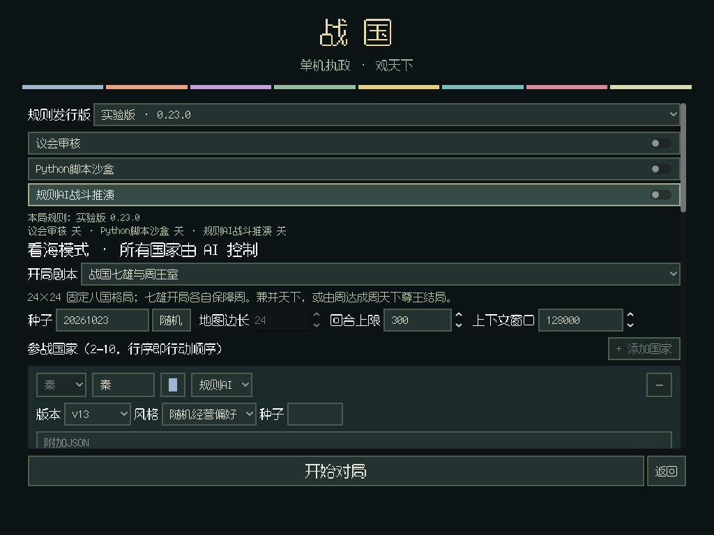
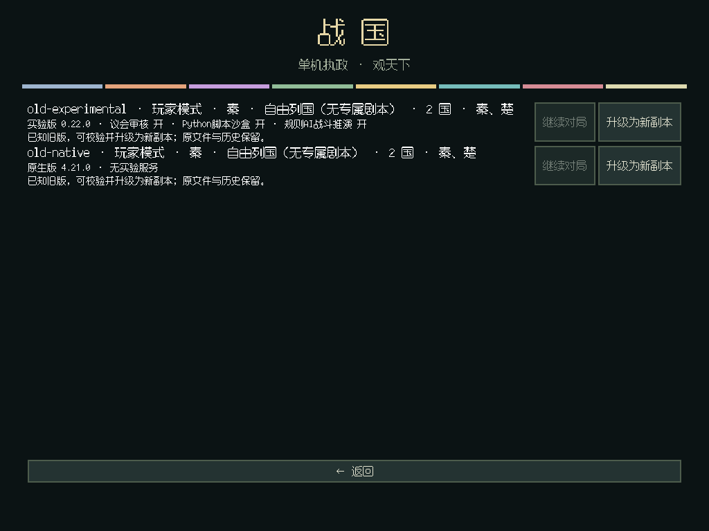
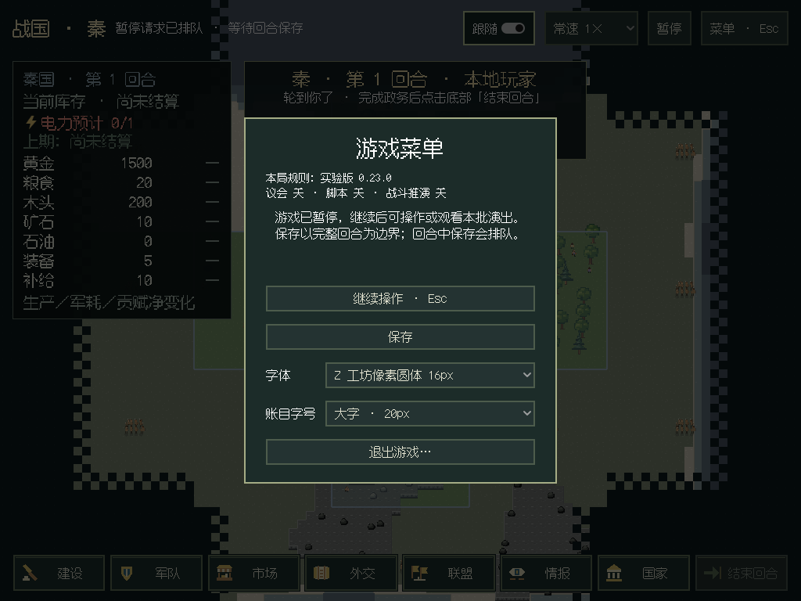

# 发行版开关与旧档副本

2026-10-28，v0.7第二版的启动与兼容组。全局版本仍为0.6.3，本组尚未单独发布；已发布包不变。原18阶段、单机一位真人及本国权限保持。

## 实际行为

- 玩家第一步与看海配置页都能选择原生／实验发行版，显示版本及开关摘要。玩家仍先定制本国与地图，再添加修改AI对手。附加JSON与上方选择冲突时明确报错，国家条目不能偷偷设置发行版。
- 实验版议会、脚本、规则AI战斗推演三个开关可独立组合，默认全开。开关进入正式发行版装配，移除实际模块、服务、工具及工厂注入；真人仍不绑定议会和脚本服务。关闭议会后使用native政权与普通模型客户端。
- 开始前仅校验配置，不发模型请求；开启议会的规则AI可选择本地保存的API档案作为审核模型，缺字段会明确提示，模型国家默认自身。已结束的存档只查看结局无需未使用的审核接入。
- 客户端、规则AI版本和v13经营风格按正式注册表生成。去掉旧菜单中未注册的简易客户端与无效经营风格；v11plus固定策略有明确提示。
- Esc菜单显示宿主实际加载的发行版与功能。存档列表显示该档的规则版本与实验组合；继续使用该档配置，独立于当前新局的菜单选择。
- 已知旧档显示“升级为新副本”。完整恢复并核对状态后写入新目录，复制配置和相邻`.audit`历史，保留源文件。支持已发布v0.6.3、生产队列230e97d和持续军令50244cb的两发行版清单；未知依赖、混用发行版及借升级删除已有实验组件仍拒绝。

native发行版声明由4.21.0变为4.22.0，experimental由0.22.0变为0.23.0；状态字段未删除。功能组合属于严格依赖契约，不能在续局中改开关。源码命令升级与桌面入口复用同一正式校验和复制实现，不自动迁移真实档。

## 验证

本地最终全量1063项通过（231.848秒，2项沿用跳过），C#编译0警告／错误、全部无窗口布局检查、API参考同步及28页文档站链接通过。原有人类窗口流程完成三期、四尺寸及市场／建设／征兵／军令／保存退出验收（`HUMAN_GUI_OK`）；启动组独立通过`STARTUP_GUI_OK`。

新增离线测试检查8种实际规则AI组合及8种模型客户端组合的模块、工具、服务、工厂和严格保存读回；关闭议会时不创建审核服务，也不要求模型。模型仅使用离线占位参数，未调用外部接口。

副本测试使用历史代码生成的完整合成夹具，逐字段比较升级前后状态：只改变允许的依赖声明；保留29生命的回血路线、已付费施工／待施工订单、脚本及相邻历史。原文件字节不变，目标存在时拒绝覆盖。已结束的真实合成胜利档覆盖CLI和桌面启动检查。

Linux实际Godot窗口通过`--startup-review-output`验收：缺议会模型阻止开局，真实点击三个开关，两种旧档点击升级、继续原生副本，再启动实验全关真人局，核对Esc实际规则。1920×1080、1366×768、1280×720、1024×768均检查菜单溢出。

源码提交`a72b9b2`的[最终CI40709818729](https://github.com/northwindlight/zhanguo/actions/runs/40709818729)全部通过：1063项离线回归（220.149秒，2项既有跳过）、文档、C#及Windows便携包。Windows作业`122891833084`于15:01:24 UTC输出`WINDOWS_PORTABLE_VERIFIED`，包含新增startup窗口检查的11项断言及原有七组实际窗口流程；中文与空格路径、自带Python/.NET均通过。夹具是显式测试输入，运行代码全部来自便携包。Linux使用软件OpenGL，Windows使用ANGLE；未测试实体显卡Vulkan。根VERSION仍0.6.3，自动预发布按设计跳过，本组不改已发布标签。

## 后续

此组完成启动与兼容入口，防御显示／自动交易的剩余重复校验继续收敛。地形简图、费用分项、空位筛选、紧凑图标、右键返回与指南，以及银行／十期报表邮箱仍属v0.7待办；联机不在本轮范围。整版完成后由CI发Pre-release。
