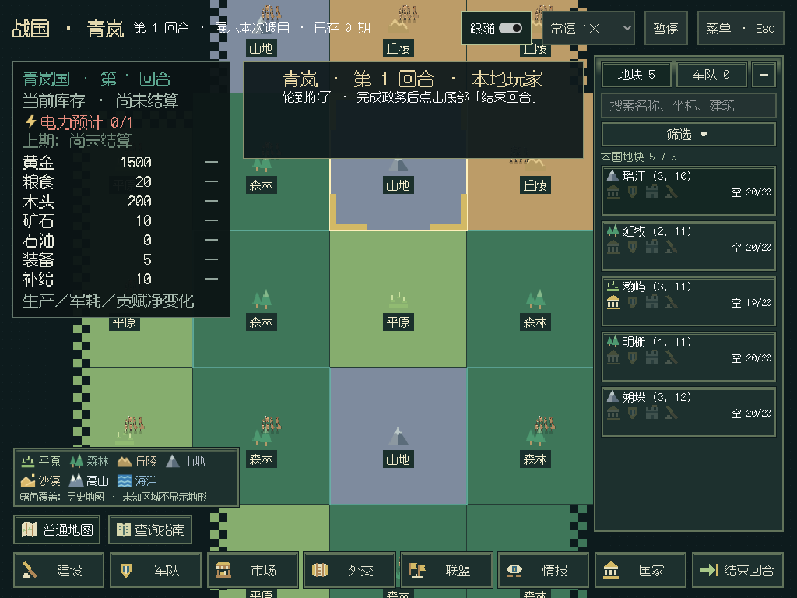
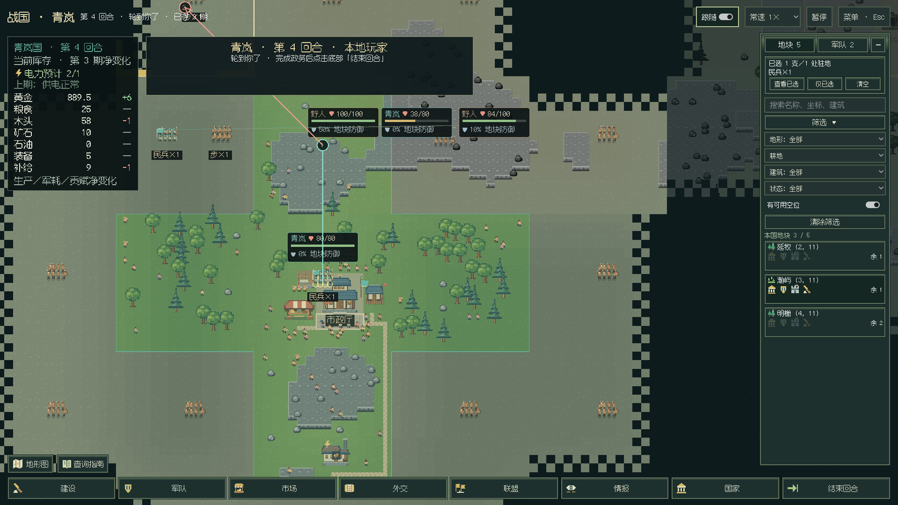
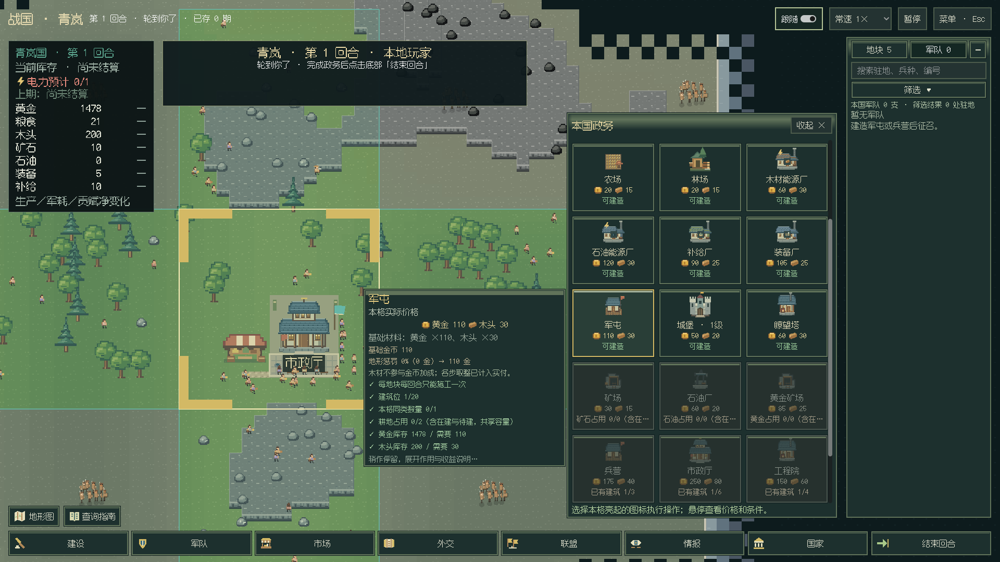
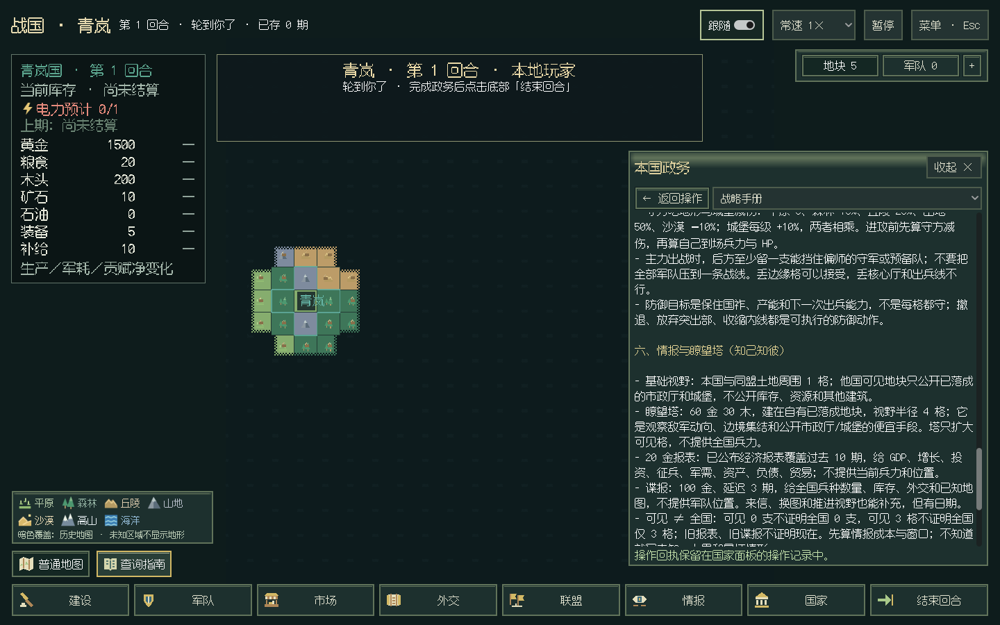

# 地形地图、空位筛选与指南

2026-10-28实施，2026-10-29完成验收。v0.7第二版地图交互组，对应总计划第4–6节。当前根版本仍0.6.3，整版尚未发布。保持一位真人、原18阶段结算与既有视野权限。

## 变化

- 普通地图增强森林的绿色和丘陵的土色，沿既有地形插值平滑过渡。左下可切换简易地形图：七种地形用不同颜色、图标与文字表示，附图例；保留国界线和军队，隐藏地表装饰。切换保持镜头和选择，不改玩家事实、不重新生成地表。
- 简易地图只读取收到的玩家快照。未知地块不显示地形，历史地图保留暗色覆盖、原有字段和采样日期。悬停可查看地形与历史日期；选军时仍优先显示军令候选。
- 右侧地块行由94像素大图改为66像素紧凑布局，地形图标与名称／坐标配合市政厅、军队、城堡、施工／待建四个状态图标；缺项变暗，悬停看数量与实际空间。军队分组与跨驻地选择保持。
- 筛选增加“有可用空位”，可与资源、地形、已有建筑及状态组合。选择“耕地＋空位”时读取共享耕地的正式剩余容量，计入农场、军屯、施工与待建预占；资源空位同时受总建筑位限制。空位不是材料与本期施工资格的替代，悬停单独列出施工次数、已落成／施工／待建数与各资源可用容量。
- 建设／征兵面板显示本格地形，建设金币加价与独立征兵报价分别注明。建筑悬浮说明分列基础金币、地形加价、工程院折扣、国策调整的百分比、真实增减及各步结果，最终支付以正式报价为准，木材单列。长悬停仍显示作用、要求及预计收益。
- Esc新增“右键返回上次操作”并保存偏好。选军时优先下达军令；无选军、未编辑路径时回到上次操作页及实际点击的建设／征兵按钮位置，仍需用户点击才执行。关闭时保持右键拖图；Esc取消目标与路径的行为保持。
- 左下“查询指南”从绑定玩家的`manual`面板读取游戏说明书、基础／经济／战争／战略指南，固定切书和返回栏；长文滚动时仍能返回操作。表格转换为窄窗可读条目，去掉面向模型接入的引言。指南不发出写操作。

新增七种地形、城堡和指南共9张原创SVG小图标，母版放在`assets/map-ui-v1`，Windows美术预览附“地图SVG”。

## API与兼容

先查阅既有`planning`、`sites`、共享资源占位、队列与`construction_cost`，然后补充缺少的只读派生结果：

| 正式结果 | 用途 |
| --- | --- |
| `native:buildings.sites().capacities` | 全国自有站点剩余建筑位、资源位、施工次数与队列占用 |
| `planning.space / penalty` | 当前地块真实空间与地形加价 |
| 建筑行`cost_breakdown` | 按正式造价方法得到各步金币，不在C#重写取整 |

未增加世界状态、修改定价公式、结算阶段或存档依赖；原本可读的同依赖存档继续直接读取。更早发行版的严格检查和显式副本升级保持。只读查询不推进队列、不扣款，不使用观察者全图，也不返回外国站点的私有容量。

## 验证

本地1067项离线回归通过（238.982秒，2项既有跳过），新增4项检查共享资源的已建／在建／待建预占、取消释放、权限与只读性、逐步取整和实付一致、保存读回。53项相关规则回归、9项打包／手册／派生结果检查通过。C#编译0警告／错误，全部布局检查通过。

后续演出采集优化增加2项快照等价性检查，最终1069项全量通过（240.920秒，2项既有跳过）；优化后实际Godot三期真人演练再次完整通过，原有断言与新增9项门槛全部保留。

实际Godot真人窗口运行三期，保留原有市场、建设、征兵、军令、队列、资源明细与退出检查，增加地形切换、未知／历史不变、容量组合筛选、紧凑图标、右键偏好保存恢复、军令优先、上次按钮定位、五本指南和返回检查。1920×1080、1366×768、1280×720、1024×768检查地图图例与列表；原有四尺寸建设／征兵长悬浮仍核对视口范围。Windows完整窗口CI加入9项对应门槛，最终通过记录见下文。

最后的“返回上次按钮”检查曾复现页面回来但卡片被截断：报价响应先于VBox／ScrollContainer的新内容范围，单次deferred滚动被夹回0。现等待两次布局帧并核对页面代次后再恢复滚动、定位和聚焦；修补后完整三期验收通过，卡片全部可见且无额外建造回执。

## Windows阶段等待修正

[e6894eb的首轮Windows作业](https://github.com/northwindlight/zhanguo/actions/runs/40723229592)在首期生产等待120秒后超时。诊断为`period=0, revision=108, advancing, sequence=12`，演出确认12/12匹配，未等待帧确认；连续线程采样显示规则AI仍在出售、投资和正式市场报价中推进。尚未进入后续生产回放与本轮空位／队列末段检查。

这两处生产／战斗等待都跨越其余七国行动，此前仍固定120秒，现与已有完整回合检查共用`HumanRoundTimeout=300`。保留固定v13种子、八国规模、三期、全部断言与整体900秒预算；只调整验收等待，不改变正式游戏速度或规则。

## 演出快照的重复查询

[00cda7c的Windows作业](https://github.com/northwindlight/zhanguo/actions/runs/40726421036)随后触及完整真人验收900秒总上限。工件显示已经演出野人战斗并推进到第3期，演出确认22/22匹配；超时前线程仍在v13征兵／资金规划中执行真实操作，随后进入`PlayerCapture → HumanAPI.state → operations → Player.actions`，复制大型查询参数表。未出现等待画面确认的死锁，未完成整轮验收。

每次采集对手动作都读取了完整真人状态，但绘图只需要玩家事实、地图和颜色。现为`HumanAPI.state`增加可选的`controls=False`，演出采集跳过操作目录、路线／生产管理、报表与外交待办；默认调用仍返回完整状态。玩家事实、当前与历史地图、军令资格及整张绘图投影与完整状态逐项相等，不引入缓存或全图读取。新增测试覆盖native／experimental、未知与历史地块、只读性、完整面板保留及演出不再查询操作目录。

本机12×12合成局交替运行两组各50次查询，完整状态约24.2毫秒／次，演出状态约8.5毫秒／次；原始值见[采样记录](gui-terrain-capture-performance.json)。这是局部快照耗时，不等于Windows整局提速比例。

## 最终Windows与CI结果

最终源码`7a4a996a02f357695b079264ac02133cc5753603`的[CI 40733311350](https://github.com/northwindlight/zhanguo/actions/runs/40733311350)全部通过：离线1069项（163.515秒、2项既有跳过）、示例巡礼、C#编译／布局、API与文档链接、构建范围均成功。

[Windows作业122975207556](https://github.com/northwindlight/zhanguo/actions/runs/40733311350/job/122975207556)在中文移动路径下使用包内Python与.NET，完成portable、菜单、启动／发行版、世界演出、特效、国别面板、真人、灭国残影共八组验收，于`2026-10-28T17:30:13.632Z`输出`WINDOWS_PORTABLE_VERIFIED`。真人三期及新增9项地图／筛选／指南门槛通过，整体900秒上限保持。本地Linux与Windows CI使用各自渲染环境；未将它们当作实体Vulkan显卡复验。

已下载该轮验收工件，核对三期27次人类操作、9项新门槛及1024窗口截图；脱离私人路径的结果分别保存在[Linux记录](gui-terrain-linux.json)和[Windows记录](gui-terrain-windows.json)。

根`VERSION`仍0.6.3，自动发布按既有标签正常跳过。本次推送源码与验收记录，未修改旧Release附件；整版v0.7完成后再发Pre-release。

## 后续

本组完成地图交互与指南。v0.7仍待防御显示／自动交易的剩余规则重复收敛，以及清晰银行入口、十期经济报表邮箱和提醒；联机不在本轮范围。整版完成后由CI发Pre-release。
