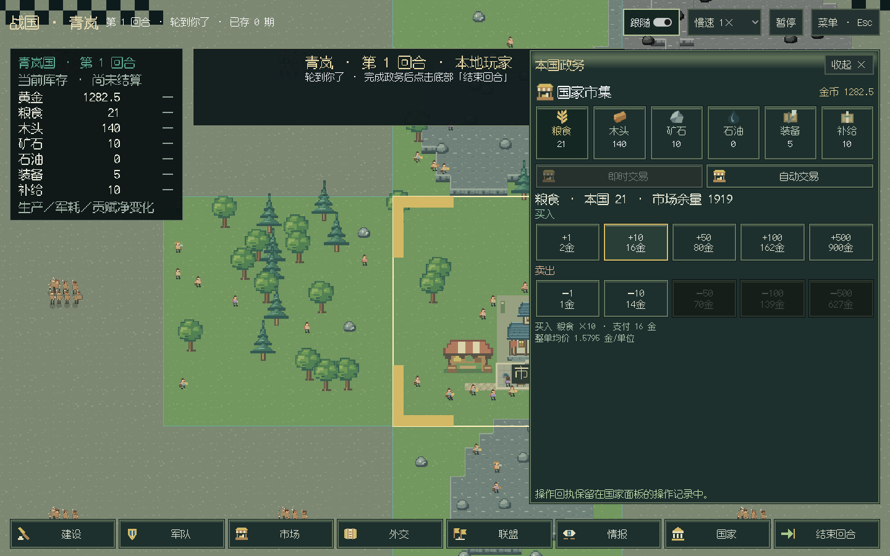
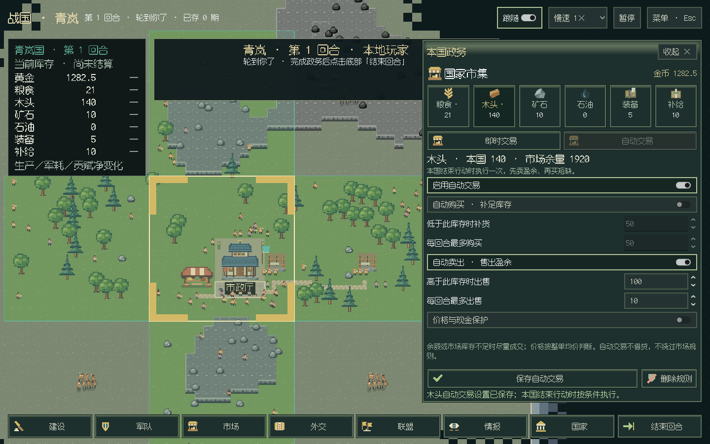
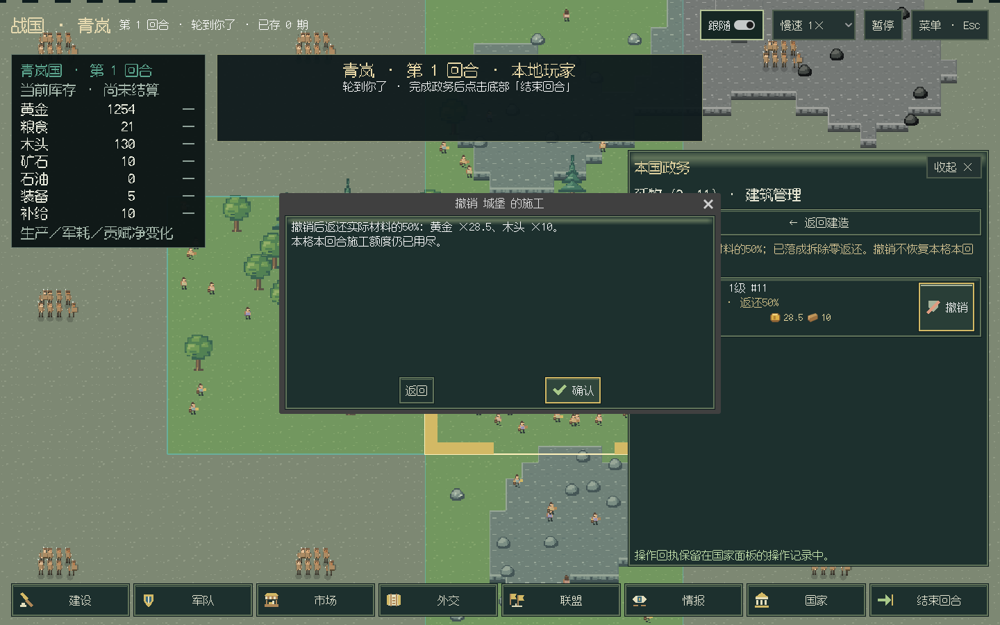
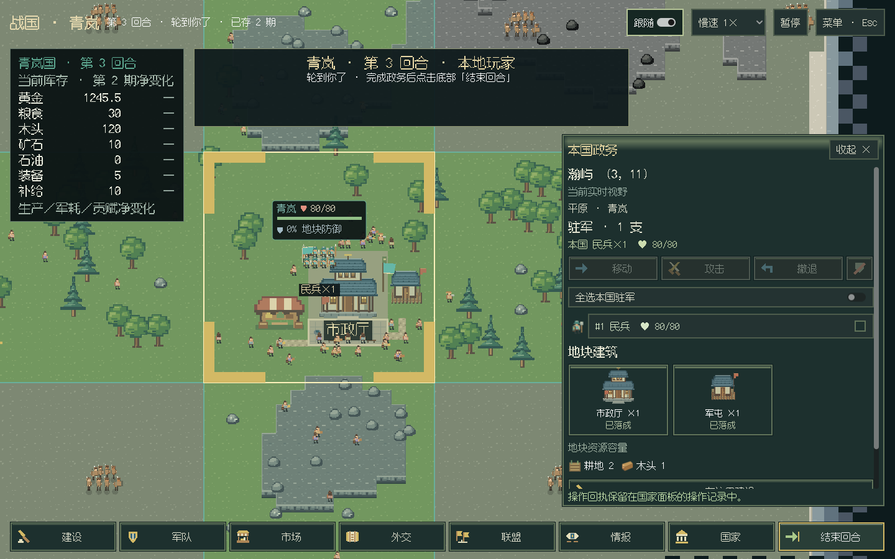
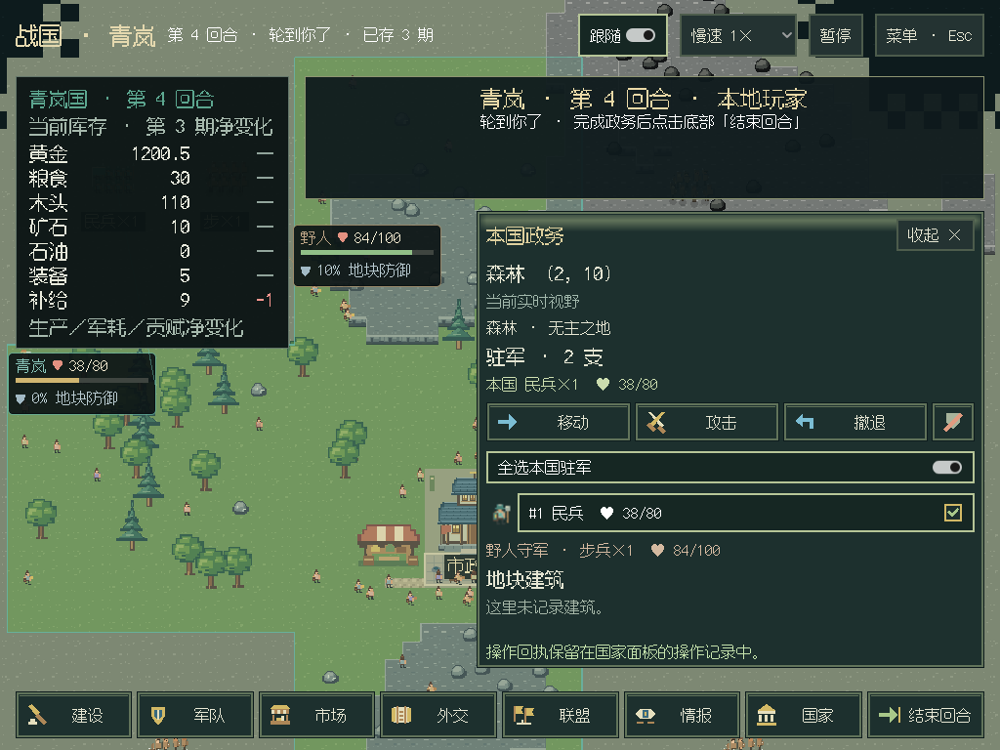
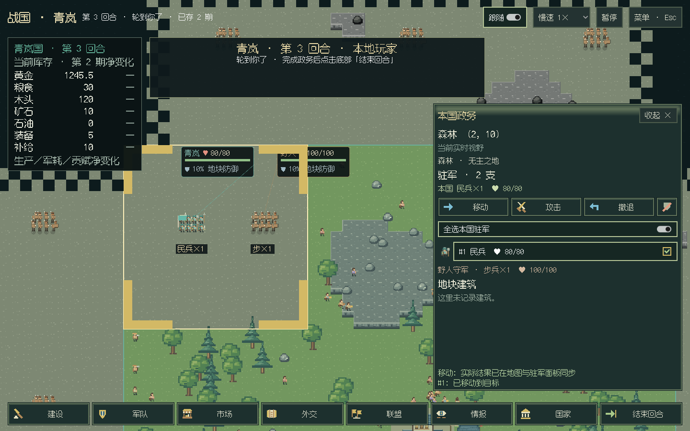
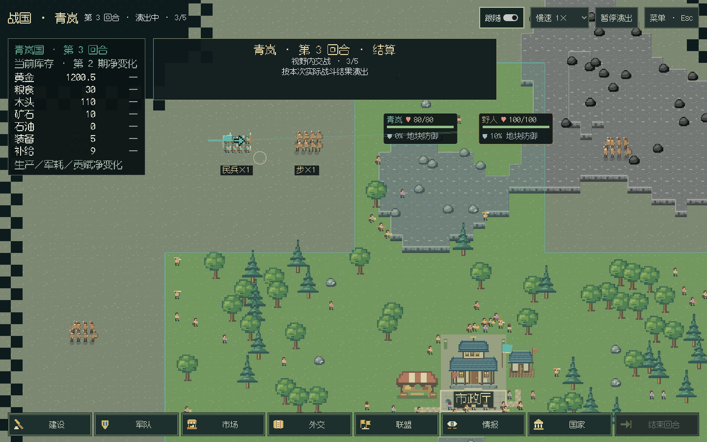

# 市场、建筑拆除与驻军一致性

2026-10-27。旧市场要求在通用表单里选动作和填写数量，施工无法撤销；地块面板把驻军放在建筑与资源下方，开打时的野人与待战守军又走不同绘制路径。本批将这些操作接回图形面板和共享领域规则。保持单机一位真人、本国视野、原有军队规则和18个结算阶段。

## 市场与自动交易

六资源图标选择，买入 `+1/+10/+50/+100/+500`，卖出 `−1/−10/−50/−100/−500`。每个按钮显示本国这笔订单的真实金币，悬停看整单均价和限制；缺货／余额不足变暗，双击只成交一次。

自动购买按库存下限补货，自动出售按保留量卖盈余；可分别启用，购买目标不得高于出售保留量。支持每回合数量上限、保留金币、最高购买均价和最低出售均价。切商品保留未提交草稿；保存和删除固定在底部。

本国成功结束行动后、世界结算前执行一次，先卖再买。设置时不成交，本次生产所得等下次本国结束行动再出售。资金、市场库存或限价不足时，沿原计价曲线找到最大合法整数数量并部分成交，不借贷或补货。半单位库存短缺按整单位向上补货，出售向下取整，不穿透保留量。

自动单共用手动交易的报价、滑点、累计成交深度、金币零头和原子兑换。规则、最近结果与本期执行标记随存档保存，读档不会重跑本期交易；查询只返回本国设置。成交在本国集市统一演出，看海市场也改为图标行情卡。

## 撤销与拆除

标准玩家 API 为 `native:buildings.demolish(id=建筑实例编号)`；模型直接调用 `demolish(id=...)`，编号查 `building_sites`。身份由玩家句柄绑定，只能拆本国实例。

- 未完工退原实际支付材料的50%，包括原地形、工程院和国策修正。例如57金、20木退28.5金、10木；15木退7.5木。
- 已完工零返还，随建筑移除停止生产与相关效果。取消不恢复本格当期施工额度，其他地块仍可正常建设。
- 城堡从最高一级拆，避免等级中断；拆最后市政厅会提示亡国风险。确认框提前展示实际返还。
- 先经过资源域原子兑换，失败保留建筑、队列、计数和额度。取消记录随存档保存，剩余一半材料按本期建设损耗入报表，不再落成或生产。

自动交易对应 `economy:queries.auto_trade / remove_auto_trade`，模型用 `economy(action=auto_trade/remove_auto_trade)`，`query(panel=market)` 查设置和结果。真人、LLM和规则／脚本共用这两组 API、审计和行动权限。

## 驻军与野人

驻军、兵力／生命摘要、选兵和紧凑军令位于地块面板顶部，建筑排在其后。打开地块回到顶部，全国军队入口也先显示兵力摘要。

待战野人和参战野人按同一 `owner/id` 合并，优先采用实际／分阶段军队记录，再过滤死亡项；同一套编队、形象、锚点和血条贯穿待战、交锋与伤亡。真人战斗回放清除战场营地守军副本，避免重复绘制或伤亡后复活。远景保留简化标记，查看不物化守军或改变游戏状态。

实际真人局的野人编号59，待战和交锋均8个代表小人，实际仍是一支100HP步兵；结算后按真实伤害显示84/100。代表人数不充当规则兵力。血条避开实际国家面板、横幅和抽屉，狭窄空间按界面边缘补位。

## 验证与交付

- 全量984项离线测试，982通过、2项可选C扩展跳过，202.146秒。新增自动交易13项、拆除8项及战斗死亡不复活回归。
- C#编译零警告错误；纯布局含守军身份／HP去重、死亡优先、窄窗血条避障及原有道路、地貌、资源、迷雾和军团检查。
- Linux ARM64 / Xvfb / llvmpipe真实真人窗口正常0军开局，0→3期，17次写操作、17个行动批次与3个结算批次；十档按钮、整单悬停、双击去重、草稿／校验、自动买卖、半额撤销、成品零返还及野人连续性通过。
- 1920×1080、1440×900、1280×720、1024×768四尺寸，市场／自动交易／驻军及原有建筑兵种长悬停在视口内；驻军、选兵和军令无需滚动，自动交易保存／删除固定可见。
- 原有征兵、移动不占领、原地攻击、购图与历史静止、宣战确认、排队保存和退出检查保持通过。实际看海0→3期，市场抽屉和保存退出通过，宿主退出0。

[Linux真人指标](gui-market-garrison-linux.json) · [Linux看海指标](gui-market-observer-linux.json)。复现：`python3 desktop.py --human-review-output archive/previews/<新目录>/world.png`；无桌面时加 `xvfb-run -a -s '-screen 0 1920x1080x24'`。

Windows便携包及实际窗口待主线工作流完成后补充；Linux软件图形检查不替代Windows或实体GPU检查。验证后发布新的Pre-release，包只保存在项目 `archive/releases/`。

模块：UI2.1、native4.21、experimental0.22、buildings2.13、market2.2、economy-queries1.11；session仍为5。新增状态与工具契约继续严格版本检查，旧开发档不自动迁移，请用原版本读原档或新开局。未操作真实挂机局或付费模型。
