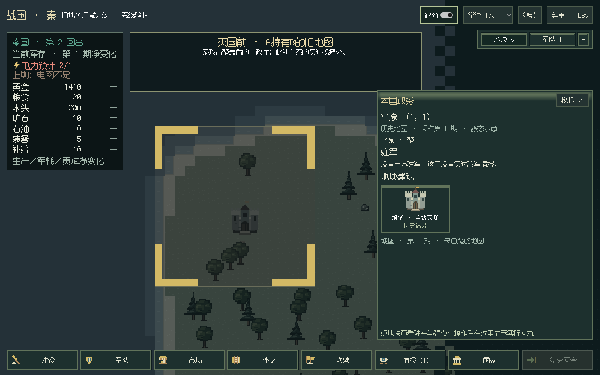
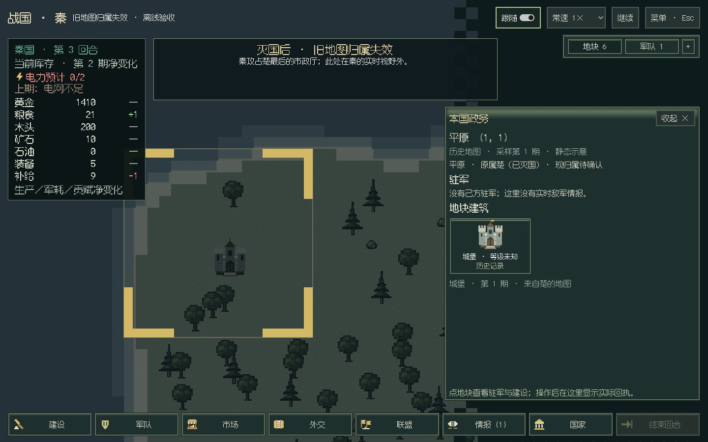

# 旧地图灭国残影

2026-10-28，第二版开发中的先行修复；**不包含在已发布的v0.6.3包内**。

用户补充了复现条件：玩家A持有上一份B国地图，A灭掉B后，旧图仍显示B的地区与国色。

## 已复现的原因

正式国家API已公布B的`alive=false`，实际土地也已释放或转给其他国家。视野外的地图记忆按设计保留旧采样，其中仍有`owner=B`；真人投影直接把这个历史值交给国色渲染，没有结合B已灭国的公开事实使旧归属失效。

此前v0.6.3回归核对了当前可见归属和完整观察者快照，并把“历史记录整块不变”作为预期，漏掉了历史归属仍能否用于国色这一层。按用户补充的场景，现已重现并修正。

## 修复行为

复用现有`native:nations.snapshot`经`foreign.nations`提供的公开国家存续事实。旧图中领主已灭亡时，投影清除国色，标注“原属楚（已灭国）·现归属待确认”。绘图用`owner=null`，并带`ownership_status=outdated`及`historical_owner`。

原地图`knowledge`的领主、地形、建筑、采样日期和来源都保留。视野外的新领主仍未知，不读取全图，也不将失效归属冒充已经确认的无主地。当前可见地块继续使用实时归属。

存档格式、模块版本和规则结算均不变；读取已灭B而保留B旧图的旧档时，同样按公开事实生成失效标记，无需迁移或删除旧地图。

## 验证

- 正式合成局：A购买B地图，宣战生效后攻占B最后的市政厅，确认B灭亡。覆盖远处余地释放、远处在此前已被第三国暗中占领两种情况；两者界面都只显示待确认，不泄露第三国。
- 当前可见的原B首都正常显示A的实时归属；原B远处历史地形、建筑与日期不丢失；保存／读取后结果一致。
- 本地全量1013项离线测试通过（186.594秒）；后补的便携隔离环境／真人投影16项定向检查通过。
- C#编译零警告、零错误；纯布局验证归属失效后不再产生该国颜色，保留历史建筑日期和静态地貌。
- Linux实际窗口（Godot4.7.2 mono／Mesa llvmpipe）验证旧图、灭国后、读档后三种状态，含1440×900和1024×768，见[指标](gui-extinction-memory-linux.json)。这是独立离线样例的窗口回放；真实宣战／占领及存读档由前述正式API合成局验证。
- [CI40656876871](https://github.com/northwindlight/zhanguo/actions/runs/40656876871)已全部通过：1013项回归、C#、文档及Windows七个环境／窗口检查，新增旧图三状态检查也已成功。Windows使用随包Python在中文路径生成合成局并在导出程序中验证，属于CI软件图形设备测试；开发工件对应`25287c8`，没有改动或重发v0.6.3。

