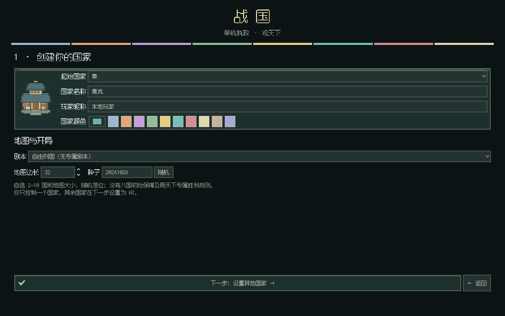
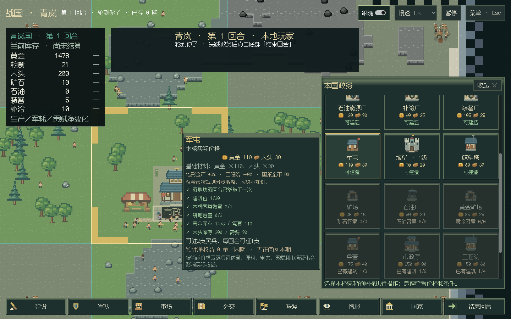
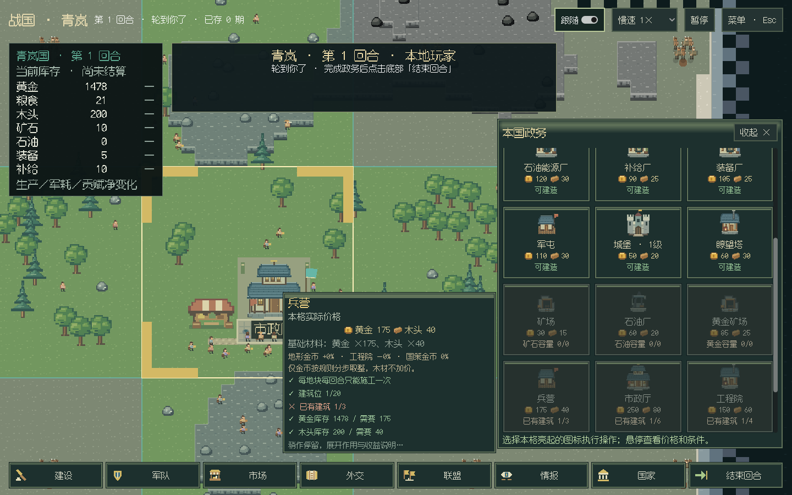
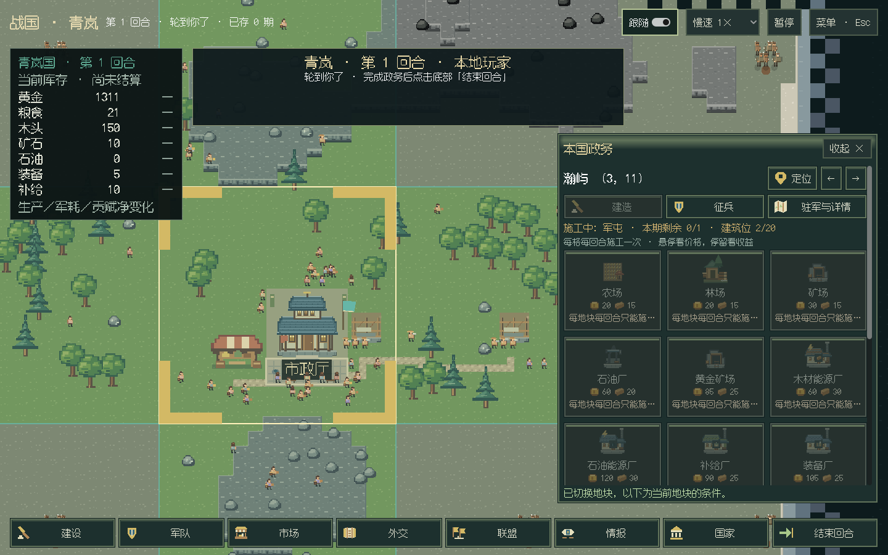
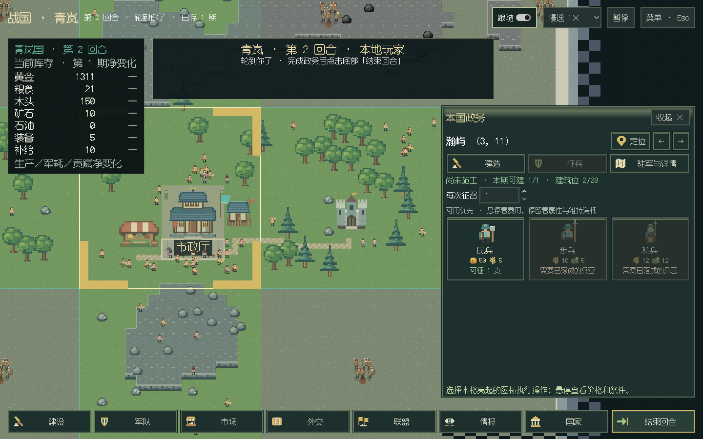
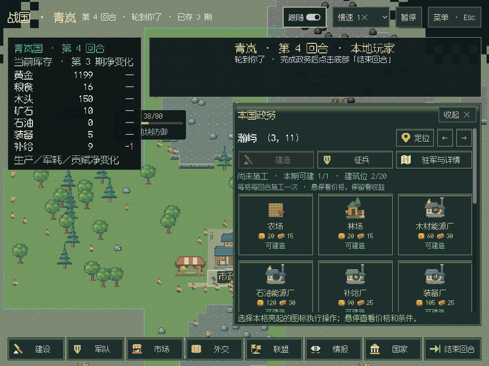
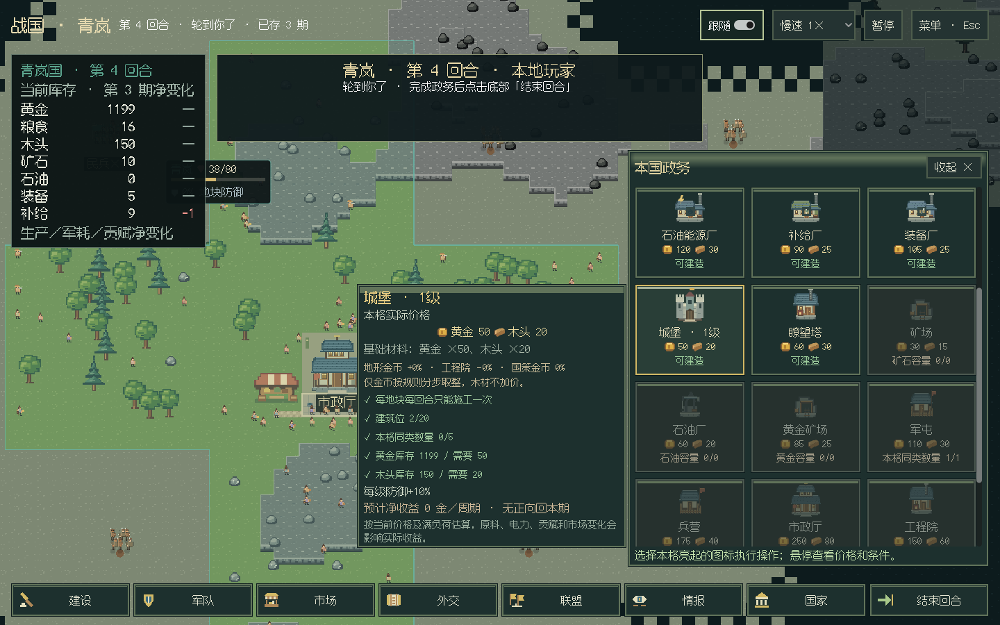

# 真人 GUI 图标与交互 · 2026-10-27

本批承接真人试玩反馈和[图标交互计划](../plans/真人GUI图标与交互打磨.md)，把建设与征兵改为直接作用于所选本国地块的图标格。
保持单机一位真人、玩家信息边界、原有 18 阶段结算与调用批次动画；没有调用付费模型，也没有修改正在运行的真实对局。

## 地块操作

- 可建造／可征召的候选先排，组内使用稳定顺序；缺材料、前置建筑、容量或当期额度的候选变暗，仍可悬停看缺项。
- 立即悬停显示本格实际费用、基础材料、金币的地形加价／工程院优惠／国策变化，以及逐项满足与缺失条件。
- 停留0.85秒展开建筑作用、预计净收益、实际报价下的回本期和估算限制；兵种展开生命、攻击、行动力及维持消耗。
- 收益采用现有公开经济查询，注明当前价格、满负荷、原料、电力、贡赋与市场假设，不承诺实际到账。未来缺电只提醒建设风险，不新增禁止建设的规则。
- 当前格直接显示施工中／尚未施工、本期次数和建筑位。每格每回合一次施工；A 建设后锁定，切 B 重新读取价格与资格，再回 A 仍显示已使用。
- 兵营／军屯未落成时不能征召对应兵种，完成施工后再启用；材料、数量、兵营配额、全国民兵编制和上期电网取正式规则。
- 切换地块或操作页面清掉旧提示；异步候选忽略过期返回，操作回执注明提交时的期数与坐标。提交期间切地块，返回提示明确属于原地块。

`Buildings.planning` 与 `Military.planning` 是本国只读规划接口。建设报价和真正施工共享价格计算，征兵成本和真正征兵共享配方。
真人通过绑定玩家 API 读取，最终提交仍由原领域命令裁决。工具层根据已装配模块声明提供隐藏规划面板，兼容没有军队的精简建筑发行版与替换建筑示例。

## 入口与素材

主菜单分为玩家／看海。玩家先填本国名称、昵称和颜色，下方选剧本、地图大小与种子；第二步才配置其他 AI 国家。
返回保留内容，更换起始国家时更新冲突的默认席位。看海没有真人选项；读档条目标明模式与操控国家。
国家颜色经过 RGB 校验，合法已知国家的颜色同步到地图底色与军服，保存读回保持。

普通建筑去掉通用 Lv.1，只显示数量与施工状态；仅城堡保留实际等级。修正原城堡复用兵营的映射，补绘独立城堡、林场、四类厂区及资源图标，
同时接到地图、地块库存和建设候选。[SVG 母版与哈希](../../mods/ui/desktop/assets/rts-ui-v1/README.md)随 Windows 美术预览提供。
另修复原玩家投影将城堡序号相加计算防御的问题，现按实际已完成层数乘每层防御显示。

## 检查与边界

Linux ARM64 / Xvfb / Mesa llvmpipe 实际窗口，从正式零军队开局完成两步定制、A→B→A 两格建设、征兵、军令、购图、三期结算和保存退出。
四种窗口（1920×1080、1440×900、1280×720、1024×768）检查图标格横向边界，以及建筑和兵种长悬停是否完整位于窗口内。
看海默认八国三期、菜单配置、自由开局和 LLM 配置布局也单独检查，模型未联网。

本地全量962项回归通过（960通过、2项可选扩展跳过，192.369秒）；C#编译零警告零错误，纯布局、API参考页同步和28页站内链接检查通过。
[真人原始指标](gui-rts-linux-metrics.json)记录12次实际行动批、3次结算、534未知格与21历史格，四种窗口的图标和长悬停均通过。
[默认看海指标](gui-rts-observer-metrics.json)记录正式八国三期；菜单还检查更换起始国家、玩家→看海→玩家配置保留。
[CI 40442608854](https://github.com/northwindlight/zhanguo/actions/runs/40442608854)全绿；
[Windows 40442608814](https://github.com/northwindlight/zhanguo/actions/runs/40442608814)构建与实际窗口全部通过，运行提交 `1f8366179fc133e81d907b48a58c9ae067f0cb8c`。
导出包移至带中文和空格的目录，撤去外部源码、Python及.NET路径后，内置运行环境、菜单、正式看海三期、演出和账目测试均通过。
真人窗口在 Windows / ANGLE Direct3D11 软件设备上完成12次行动、3次结算，四种窗口图标及长悬停通过；不能据此推出 Iris Xe / Vulkan 的性能。
[真人原始指标](gui-rts-windows-metrics.json)、[看海指标](gui-rts-windows-observer.json)、[内置环境检查](gui-rts-windows-portable.json)保留。

本轮重点是建设／征兵链路与建局入口；市场、外交、联盟和情报保留前一批正式表单，不声称这些操作已全部重绘。
模块版本为 UI 2.0.0、native 4.20.0、experimental 0.21.0、buildings 2.12.0、army 2.13.0；session 格式仍为5。
旧开发档继续按模块版本严格校验，不自动迁移。本批随 [v0.6.0 Pre-release](https://github.com/northwindlight/zhanguo/releases/tag/v0.6.0)，v0.5.1 附件保持。

## 便携包交付

[预发布下载](https://github.com/northwindlight/zhanguo/releases/download/v0.6.0/zhanguo-0.6.0-windows-x64.zip)：`zhanguo-0.6.0-windows-x64.zip`（104,728,282字节），与 Actions 原包字节相同。主目录的旧交付副本已清理，本地发布材料保存在 `archive/releases/v0.6.0/`。
SHA-256：`0dbf557fcbfb497ee78c50028cb31828da4121cfd42aad85c14dcd56acf41352`。
ZIP CRC 与969个实际文件的清单SHA全部通过，8个关键Python运行源文件换行归一后与运行提交一致。
16个新增SVG的源码哈希按仓库LF文本核对；Windows检出版本使用CRLF，归一换行后全部一致，随包 `bundle-manifest.json` 另记录实际文件字节的SHA。
[完整交付校验记录](gui-rts-package-delivery.json)。

## 实际窗口截图

