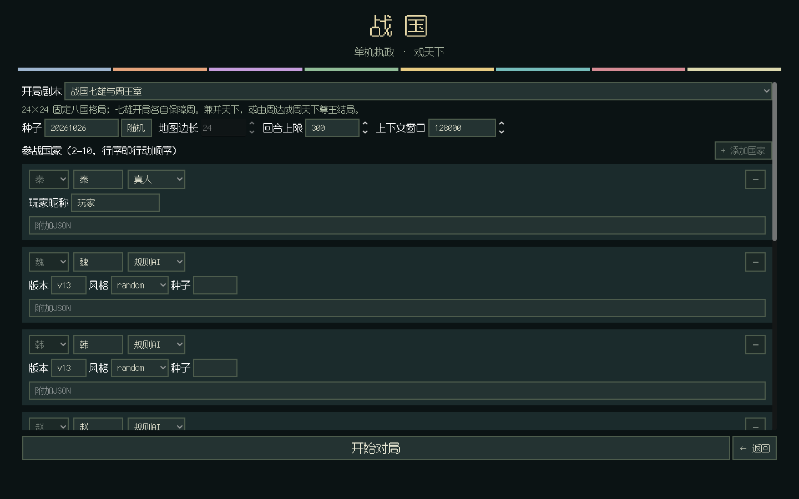
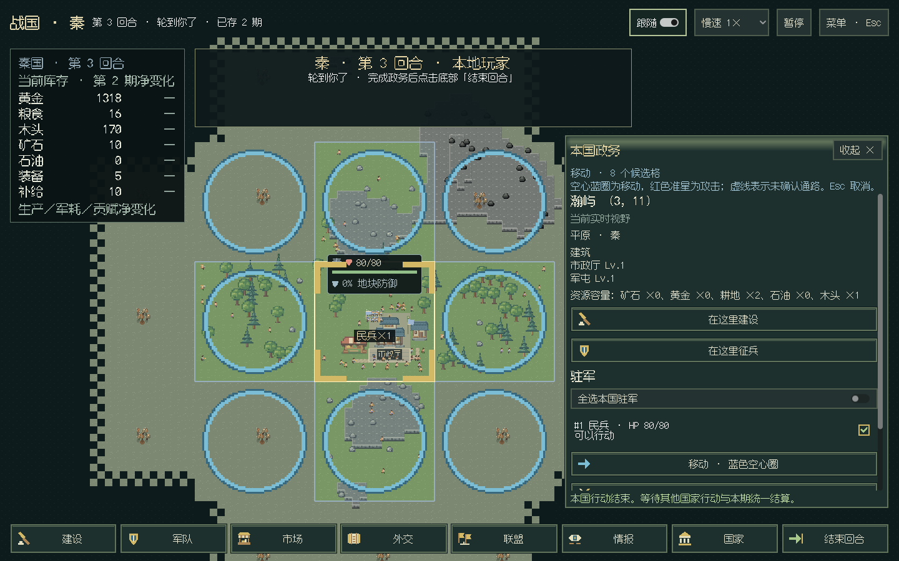
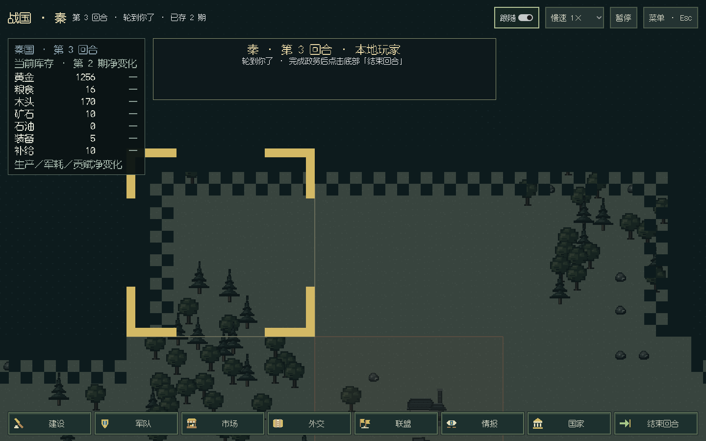
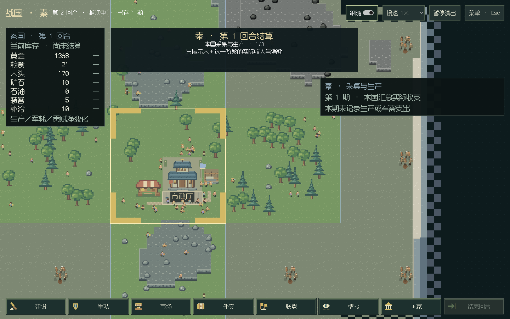
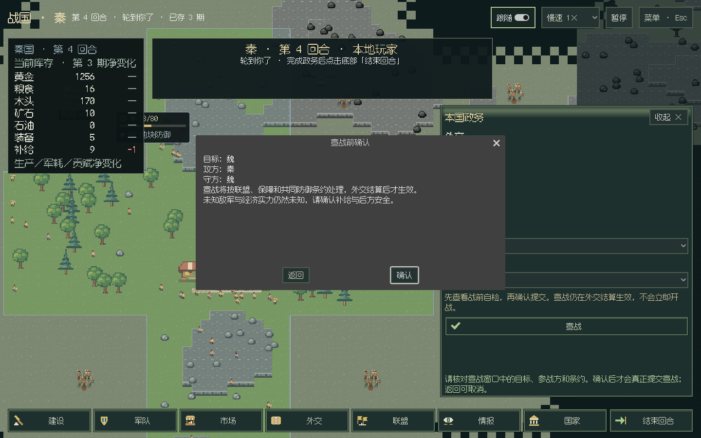
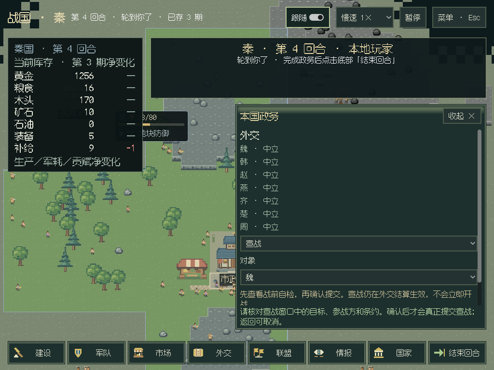
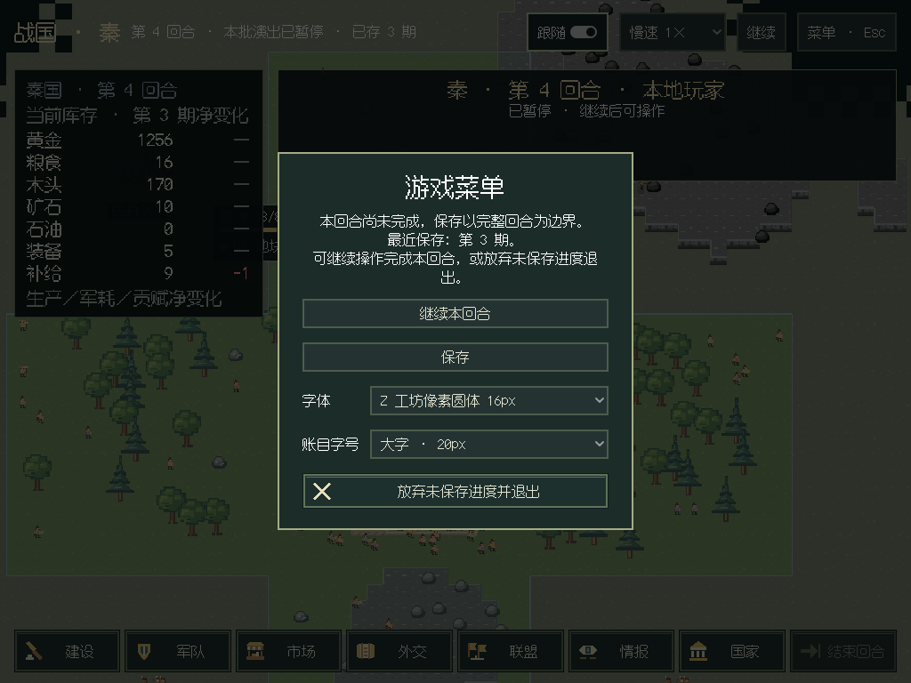
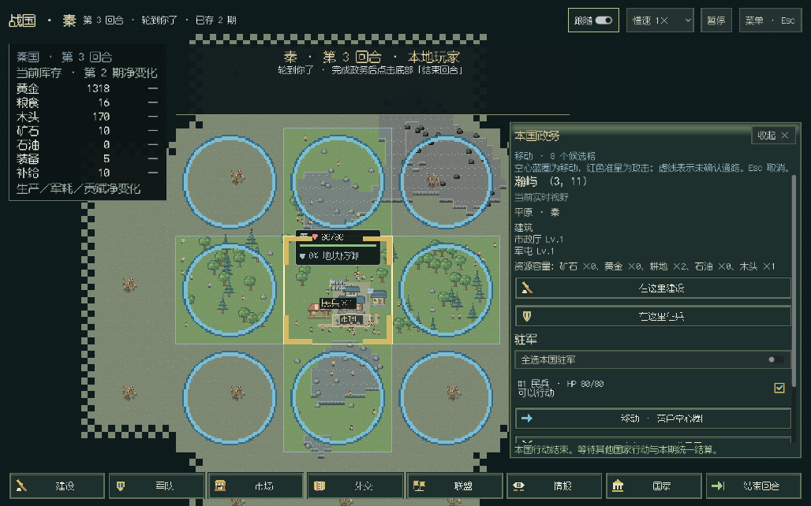
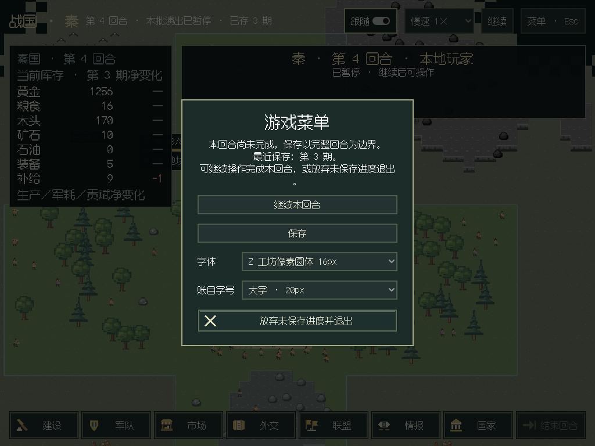

# 真人 GUI 第二步验收

按根目录 [plan.md](../../plan.md) 接入单机一位真人。当前支持真人混合规则 AI／LLM；本批离线验收采用 v13，不调用付费模型。原有 18 阶段结算与顺序保持，整局仍为 `session/5`，UI 模块升级到 `1.9.0`，遵守严格依赖校验。

## 交付

- 新局选择剧本、真人国家和昵称，无需为真人填写模型参数；自由列国可用，第二位真人会被阻止。读取存档保留真人席位。
- 底部八个入口、右侧操作抽屉、固定本国账目；建设／征兵按地块与种类选择，交易按资源与数量选择，费用由正式查询预览。外交、联盟、提议、投票、来信、赠礼、派谍、报表与地图均有列表及表单。
- 只点地块选军；本国驻军复选框与全选，移动／攻击／撤退／遣散独立。逐格蓝色空心圈／红色准星、迷雾虚线，悬停显示可执行子集与排除原因；后台按最新事实重新筛选后一次组批。
- Godot 仅消费授权玩家状态的 `visual`。未知区不建立秘密布局；历史区压暗去色，水面、树木、人物、施工与烟气静止。建筑类型、数量来自历史事实，未知等级显示“示意”和采样期；局部实时外国视野保留额外旧建筑日期。
- 己方迷雾军团按同格汇总，浮在遮罩上；敌军只使用依法可见位置。地图直接合入大地图，能定位已收报告；没有把间谍兵种总量变成分布。
- 操作回执后演出再解锁写入。真人行军只画已知端点的示意段，不查询秘密通路；生产／补给、本国建筑落成、权限内战斗／伤亡／易帜与真实来信分别演出。其他国家只有视野内实际变化，不发送私人调用、国策或思考。
- Esc 优先取消军令，再打开暂停菜单；空格只管播放。回合中保存排队，退出可继续或明确放弃未保存部分，保留最近完整档，绝不自动结束真人行动。

## 离线验证

本地全量 `unittest discover -s tests -q`：947 项，945 通过、2 项可选 C 扩展跳过（204.588 秒）。补充外国调用元数据回归后，最终 CI 为 948 项，946 通过、2 项可选扩展跳过（188.837 秒）。新增玩家投影回归覆盖历史冻结、字段日期、未知地形、己方迷雾军团、真实交易差额、外国隐私与信件送达；补充 25 项定向回归通过。

Godot C# 编译零警告／错误，纯 C# 布局检查通过；增加未知格不进入布局、暗区无居民、示意建筑保留日期且不伪造等级检查。原道路、军团血条、原子场景、收支与运行环境检查保持。

实际窗口在 Linux ARM64／Xvfb／Mesa llvmpipe 上运行。正常八国零军队开局，通过真实指针事件完成买入、写信、军屯动工／费用预览、落成征兵、下一期移动、原地进攻、买图与三期结算；双击只执行一次，移动不占领。历史地块在间隔 0.7 秒的像素比较中完全不变。1920×1080、1440×900、1280×720、1024×768 的按钮、抽屉与本国账目均在窗口内。实际执行保存排队及明确退出选择。

真实独立 NDJSON 宿主另运行三期，6 个实际真人动作、3 次重复去重、6 个行动批次和 3 个结算批次、13 份玩家快照，存档读回完全相同且 stderr 为空：[协议指标](human-gui-protocol-20261026.json)。

复现（新输出目录）：

```bash
python -m unittest tests.test_human tests.test_desktop_player tests.test_windows_package -q
xvfb-run -a -s '-screen 0 1440x900x24' python desktop.py --human-review-output /tmp/zhanguo-human/world.png
```

[Linux 真人指标](human-gui-linux-20261026.json)：11 次真实写请求／预检、11 个行动批次及 3 个结算批次，21 格历史、534 格未知；真实确认框取消／确认、宣战自检返回、Esc 取消目标、保存排队和放弃后进程正常退出均通过。补充的隐私回归 24 项通过，外国可见变化不携带后台调用的 actor／call 元数据。

旧看海窗口另从正常开局运行三期，576 格、24 个行动批次和 3 个结算批次，菜单及保存退出通过：[回归指标](human-gui-observer-regression-20261026.json)。原始截图与完整指标保留在开发树 `archive/previews/human-gui-*`。界面验收不修改私人 API 档案，不读取或覆盖真实对局。

## 实际窗口截图















## Windows

便携包脚本包含新的玩家渲染模块与 `human-ui-v1` 素材。`verify_windows_package.ps1` 在中文空格目录、屏蔽开发源码／系统 Python／SDK／私人配置的环境中，继续检查原看海、交易信件战争演出和排版，并新增完整真人窗口验收。最终运行代码 `19fec89` 的 [Windows 构建与验收](https://github.com/northwindlight/zhanguo/actions/runs/40317006180)全部通过，[常规 CI](https://github.com/northwindlight/zhanguo/actions/runs/40317006028)全部通过。开发包不替换 v0.5.1 Release。

[Windows 真人指标](human-gui-windows-20261026.json)同样为正常零军开局至第 3 期、11 行动／3 结算、21 格历史与 534 格未知；建设、写信、军令、静态像素、四尺寸、宣战取消、保存排队与明确退出均通过，进程正常退出。[内置运行环境报告](human-gui-windows-portable-20261026.json)和[原看海回归指标](human-gui-windows-observer-20261026.json)附入本目录。portable、menu、world、effects、ledger、human 六份 stderr 均为空；原演出和 12 组字体／内容缩放检查保持。

验收指针等待抽屉展开后再点击；完整真人周期单独允许较长等待，不依赖 Windows 在 30 秒内完成 AI 行动。ANGLE／Microsoft Basic Render Driver 为构建机软件图形后端，不代表实体 GPU 性能或系统 DPI 切换实测。




