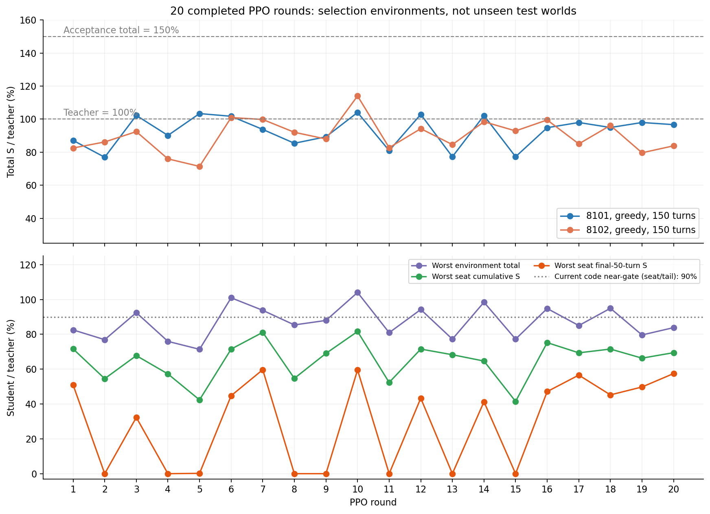
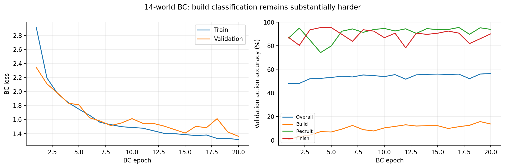
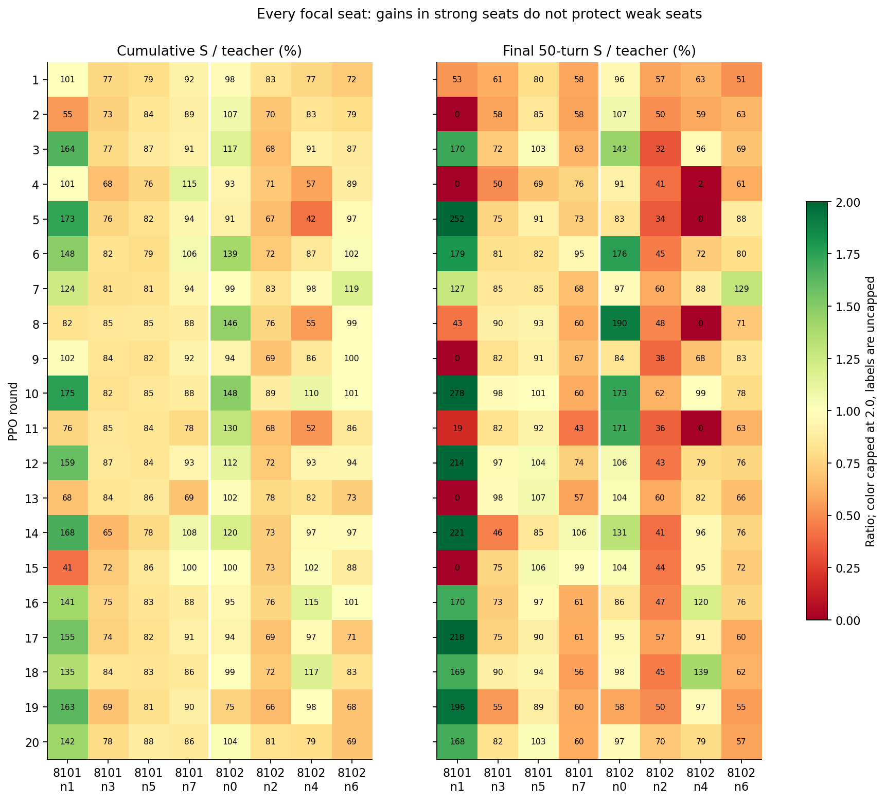
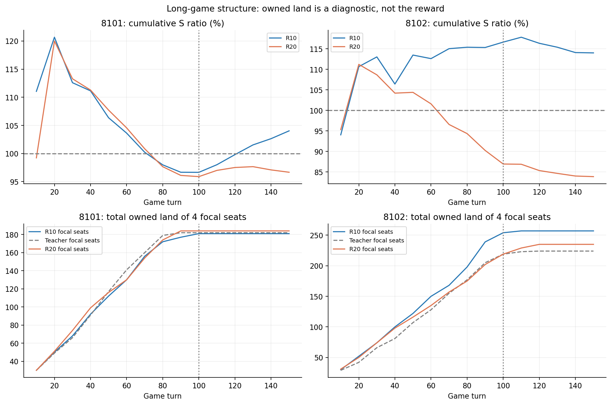
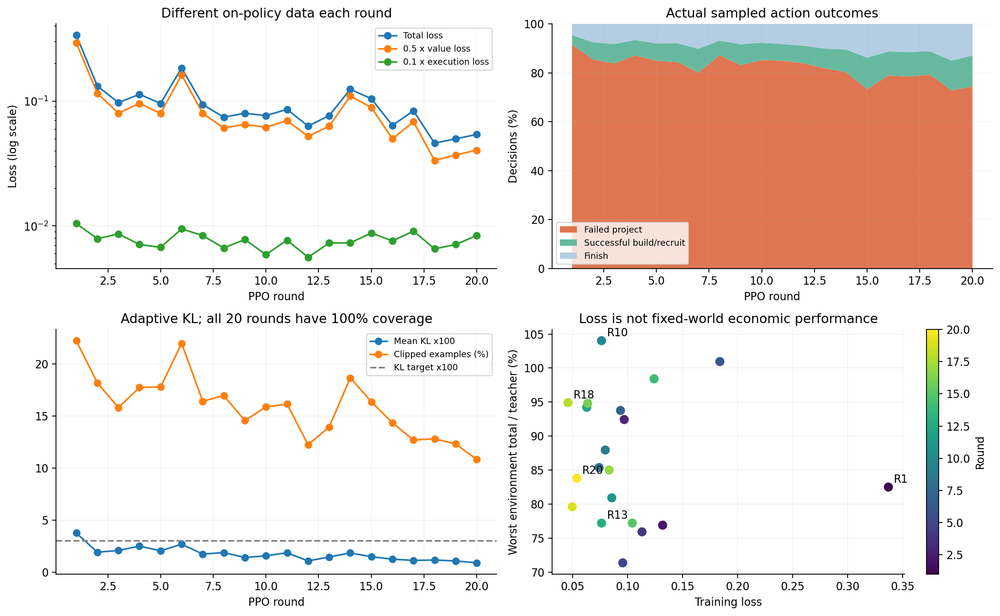

# 经济 RL 二十轮综合报告

数据冻结：2026-11-11 04:04（北京时间）；资源状态另于 04:06 核查。主分析固定为已完成的第 1—20 轮，不把仍在更新的第 21 轮混入结果。数据、模型身份与图表见 [附件目录](econ-20rounds-20261111/README.md)。本次仅收集和分析，未改变训练参数、奖励、网络或验收器。

## 1. 结论

**这条模型已经学会征兵、扩张与部分经营行为，在两个已反复使用的筛选环境中曾同时超过教师总 S；但二十轮 PPO 没有形成持续改善，更没有稳定达到教师 150%。**

1. 当前链真实处理了 **160 个训练世界、1,053,116 条决策、8,237 次优化更新**。每轮都覆盖全部当轮样本，20 份权重与评测身份一致。旧版“只更新 16 行、覆盖 0.14%”的问题已经修复，不能再用它解释这一轮平台期。
2. 按“两个环境中较差的总 S”排名，最佳是第 10 轮：**104.03% / 114.03% 教师水平**。第 20 轮为 **96.67% / 83.84%**，相对第 10 轮分别下降 **7.07% / 26.47%**。
3. 总分最好也没有解决弱席：第 10 轮最差席累计 S 为教师 **81.62%**，最差尾段 **59.55%**；第 20 轮为 **69.46% / 57.48%**。强席可以高于教师 150%，但不能代表整个环境或所有席位都过关。
4. 全部采样中 **83.26% 是失败项目**，成功建设、成功征兵合计只有 **7.94%**，其余是结束经济行动。失败占比从第 1 轮 91.51% 降到第 20 轮 74.45%，执行效率有改善，固定环境 S 却未持续改善。
5. loss 从 0.33693 降到 0.05403，但它来自不断变化的 on-policy 数据，且第 20 轮加权价值损失占总 loss 约 74.90%。不能把这条曲线当作经济能力增长或容量充足的证据。
6. 第 20 轮复核已完成：第 11—20 轮没有满足相对第 10 轮的改善条件，自动生成了 **`prepared_not_trained`** 的模型/探索对照计划。新架构尚未训练，无效动作惩罚仍未启用。



本报告支持“需要改变假设并做受控对照”，不支持“继续原样训练一定到 150%”，也不支持“已证明模型容量不足、陷入局部最优或达到 RL 上限”。

## 2. 数据范围与可信度

### 2.1 证据范围

| 数据 | 数量及用途 |
| --- | --- |
| 14 世界 BC | 10 个训练世界 15,017 行，4 个验证世界 6,222 行，共 21,239 行；20 epoch |
| 连续 PPO | 20 个完整轮次，每轮 8 世界 × 150 回合，共 24,000 个世界回合、96,000 个模型国家回合 |
| 训练场景 | 地图 20/24/28 分别 60/60/40 世界，换位与不换位各 80 世界；160 个种子互不重复 |
| 固定筛选 | 每份当前权重 2 个完整 150 回合世界，共 40 个模型对局、160 个席位结果；教师对局复用已核验缓存 |
| PPO 指标 | 8,237 条优化更新记录、全部 KL 窗口、60 个分项梯度探针（每探针 7 项） |
| 旧版消融 | 19 组冻结数据更新；其中 default/lr/batch 三组另做长局对照，不能声称 19 组均已长局验证 |
| 身份审计 | 20 份 checkpoint 文件 SHA、实际 state_dict 策略摘要、19 个相邻轮次的行为策略继承关系 |

训练世界内部的四个模型国家共享同一市场，不能把 640 个国家样本当作 640 个独立世界。40 个筛选对局也只来自两个重复使用的环境，不能用它们估计未见环境上的置信区间。

### 2.2 本次实际核验

- 每轮 `manifest.json` 与 8 份完整报告的种子、地图、换位、150 回合配置一致。
- 每轮报告决策数之和 = PPO steps = examples_used = unique_examples_used；coverage 均为 1，完整 1 epoch，没有 KL 硬停止。
- `updates.jsonl` 的行数等于 updates，末条累计行数等于 consumed examples；各轮失败、成功建设、成功征兵、结束四类决策加总与决策数一致。
- 20 份权重文件摘要与 `candidate.json` 一致；冷加载后实际策略张量摘要也一致，配置和参数量一致。
- 第 2—20 轮的行为策略均等于前一轮当前候选，构成实际连续链，不是拼接不同实验的曲线。
- 筛选按完整策略 SHA 查找，重新从学生/教师原始缓存核算总 S 与尾段比值。第 3、5 轮的重复作业另列，未混入当前链。
- 14 个 BC NPZ 及其 14 个元数据 JSON 均与原打包清单 SHA 一致；20 份模型的种子祖先记录不含筛选和默认确认种子，第 20 轮已记录 174 个见过的种子（14 BC + 160 PPO）。
- 冻结时另核验了当前保留的 24 份轨迹压缩文件，合计约 252.25 MiB。它们包含最近两轮完整轨迹和当时正在进行的轮次，不等于全部 160 世界的原始数组。

旧轨迹按存储策略清理，**无法拿目前文件精确重放全部二十轮的每一条原始观察**。保留的是各轮权重、报告、优化日志、身份及当前轨迹；这与“完整训练过程可任意重放”不同。模型 logp 检查也是每轮最多 64 条抽样复核，不是对百万条决策逐一重算。未完成更新的恢复从该轮行为权重重新更新，不是继续原来的半轮优化器状态，也不保证重做后得到逐位相同的候选。

证据索引：[sources.csv](econ-20rounds-20261111/tables/sources.csv)、[checkpoint 审计](econ-20rounds-20261111/checkpoint-audit.json)、[BC 原始文件摘要](econ-20rounds-20261111/bc-input-checksums.json)、[保留轨迹摘要](econ-20rounds-20261111/retained-trajectory-checksums.json)。本地复核基线提交为 `c154ede`；实际采样实现按每份报告的 implementation/source 记录追踪，不能把它写成所有世界都来自同一提交。

## 3. 游戏、动作与目标到底是什么

### 3.1 多国动态市场与军事解耦

每局正常资源、八个国家：四个 v13plus 教师席位被学生经济层替换，其余三个 v13、一个 v11plus。地图、种子、五种经营偏好及席位变化，市场价格由真实成交和生产变化。没有赠兵或无限资源。

这里的教师是修复了材料出售/采购冲突、征兵供电预检等问题的 **v13plus**，不是原封不动的v13，也没有在本报告中重新对比v14联合规划。所有“超过教师”结论都限定于记录的教师契约，不能推广成已经超过所有传统经济求解器。

学生选择 **建设项目、征兵项目、结束经济行动**；v13plus 的项目执行器负责正式验资、材料筹集、交易和运营补货，v11plus 军事负责移动和实际扩张。教师不会替学生选择投资或征兵。军事层目前不主动宣战，所以主要检验无主地扩张、土地趋于饱和后的经营和多国市场竞争，不能据此宣称已覆盖主动国家战争。

每次经济决定前自动读取玩家权限内事实、目录与规划并编码；不是每回合只给一次状态，也不是给全图私有信息。动作空间没有主动查询、购买情报、借贷、还款等动作，PPO 无法凭增加轮数学出动作空间中不存在的融资策略。

### 3.2 奖励与长局

主指标是正式账本的累计消费 **S = 征召 + 军需 + 行政**，按当期价格计量；建设属于固定资本形成，单列投资，不计入 S。GDP、资产、现金、领土、军队作为诊断，不能替代既定目标。

原始奖励是 `ΔS / 1000`。按国家和世界分别累计完整回报，γ=1、Monte Carlo 回报（对应 λ=1 的端点）；不会把不同国家轨迹串起来。结算所得 ΔS 记到该国家当期最后一条决策上。

这有一个容易误解的区别：**失败动作当下通常没有正奖励，但它仍可能获得后续整局 S 的回报和非零优势**，不能说这些步“完全没有学习信号”。相同观察下连续失败的动作也会共享后续结果，因此“既要保留投资的长期价值，又要区分无收益的乱尝试”仍是信用分配问题。

PPO 用 Categorical 随机采样，主筛选和验收用 **argmax 贪心**。每国家每回合最多 96 次经济决定，只屏蔽 padding，不以正式可执行性做硬掩码。可执行性是输入、软先验和辅助学习目标。失败但状态未变时可复用同一前向分布以节约计算，仍逐次采样、计数、保存 logp；它不删除失败样本或免除动作预算。

采样器仍会调用 `expert_index`，给观察附教师标签并记录项目种类一致率；PPO 更新没有使用该标签做全局教师动作交叉熵，动作仍由学生采样。不能把“没有全局BC监督”说成“完全不再查询教师”。其诊断查询开销尚未在本轮单独消融，属于后续性能测量项。

### 3.3 实际验收代码与语义边界

现行 `acceptance.compare` 的代码事实如下；本报告不修改它：

| 项目 | 当前实现 |
| --- | --- |
| near | 至少 150 回合；所有模型席位第 8 回合前征兵、第 12 回合前扩张；环境总 S ≥教师95%；各席累计 S、各席末50回合 S ≥教师90% |
| surpass | near 成立，且环境总 S ≥教师150% |
| 筛选后正式流程 | 六组选择环境（20/24/28 地图，150/200/250 回合，各换位一次）全过后，再用新的确认种子 |
| 相对受保护模型 regresses | 任一环境总 S 下降、原本早期达标的席位开局退化、任一席累计或尾段低于旧模型95%，就判退步 |
| stable 字段 | 早期动作达标、零失败、零触顶、零短缺；当前作为诊断，不直接参与 surpass 的布尔值 |

**“环境总分150%”已经实现；“每席都超过教师100%”或“每席都达到150%”不是当前代码门槛。** 另外，regresses 本身不检查失败/短缺/触顶计数的回退，不能把旧 overnight 阶段门全部套到连续 PPO 上。若最终要求是每席都必须超教师，必须在晋级前明确并落实，不能用现有90%条件冒充。

目前较宽的 near 条件都没有通过，所以上述语义差别不会改变“当前不验收”的结论。两个筛选环境是 `8101/20/150/不换位` 与 `8102/24/150/换位`，**第二个不是正式六环境中的 8102/200 回合**。二十份当前候选都止于筛选，没有跑通本链候选的六环境及新种子确认；不能把两环境筛选称为最终泛化验收。

## 4. BC 起点：征兵学得较好，建设分类仍弱

14 世界数据的训练种子为 121—126、131—134；验证为 141、142、221、222。候选不截断，按候选长度分桶，batch24、lr3e-4、开局/动员课程权重，动作族头开启；约 20 分钟完成 20 epoch（纯 epoch 时间约 18.93 分钟）。

| epoch | 验证loss | 总体动作准确率 | 建设准确率 | 征兵准确率 |
| --- | --- | --- | --- | --- |
| 1 | 2.3418 | 48.09% | 0.43% | 86.54% |
| 5 | 1.8088 | 53.10% | 6.85% | 79.77% |
| 10 | 1.6109 | 53.79% | 10.33% | 94.58% |
| 15 | 1.4050 | 55.91% | 12.19% | 93.51% |
| 20 | 1.3595 | 56.40% | 13.59% | 93.80% |

epoch20 验证建设准确率只有 **13.59%**，征兵为 **93.80%**、结束为 **90.04%**。这支持建设排序比征兵分类困难，不能从征兵高准确率推断经济已经全面学会，也不能直接把建设误分类归为网络容量不足。教师项目的精确分类命中率也不等于收益：多个项目可能经济上近似等价，仍须实局判断。

| BC 快照 | 8101 / 教师 | 8102 / 教师 |
| --- | ---: | ---: |
| epoch5 | 62.81% | 36.60% |
| epoch10 | 84.17% | 87.17% |
| epoch15（PPO 起点） | **99.70%** | **90.86%** |
| epoch20 | 82.28% | 72.69% |

epoch20 的验证 loss 比 epoch15 更低，长局成绩反而明显退化。选择 epoch15 是按实局，不是把最小监督 loss 当作最佳策略。上述验证集在 epoch 选择中被使用，不能算未见测试。



原始表：[bc_epochs.csv](econ-20rounds-20261111/tables/bc_epochs.csv)。旧交接中的 8 世界族头、2/4 世界 PPO 和 FFN 版属于其他起点或配置，见[交接](经济BC交接-20261107.md)，不与这条 14 世界 BC→连续 PPO 曲线合并统计。

## 5. 二十轮完整成绩

全部为与当前轮权重 SHA 匹配的贪心实局。总 S、最差席和最差尾段均以教师为 100%；最差席/尾段取两个环境共八席的最小值。决策/更新只计当前连续链，不计重复及失败作业。

| 轮次 | 8101总S | 8102总S | 最差席S | 最差尾段 | 决策 | 更新 |
| --- | --- | --- | --- | --- | --- | --- |
| 1 | 87.12% | 82.52% | 71.62% | 50.96% | 93,182 | 728 |
| 2 | 76.92% | 86.18% | 54.54% | 0.00% | 60,381 | 472 |
| 3 | 102.25% | 92.44% | 67.77% | 32.29% | 56,439 | 441 |
| 4 | 90.13% | 75.94% | 57.26% | 0.00% | 68,675 | 537 |
| 5 | 103.37% | 71.39% | 42.37% | 0.18% | 58,008 | 454 |
| 6 | 101.73% | 100.96% | 71.51% | 44.76% | 58,046 | 454 |
| 7 | 93.77% | 99.79% | 81.13% | 59.67% | 45,957 | 360 |
| 8 | 85.39% | 92.04% | 54.71% | 0.00% | 67,387 | 527 |
| 9 | 89.31% | 87.96% | 69.04% | 0.00% | 55,818 | 437 |
| 10 | 104.03% | 114.03% | 81.62% | 59.55% | 60,259 | 471 |
| 11 | 80.94% | 82.72% | 52.36% | 0.00% | 56,228 | 440 |
| 12 | 102.87% | 94.23% | 71.52% | 43.33% | 52,178 | 408 |
| 13 | 77.23% | 84.58% | 68.28% | 0.00% | 46,821 | 366 |
| 14 | 102.18% | 98.42% | 64.65% | 41.29% | 45,089 | 353 |
| 15 | 77.24% | 92.87% | 41.48% | 0.00% | 34,557 | 270 |
| 16 | 94.82% | 99.51% | 75.23% | 47.13% | 41,924 | 328 |
| 17 | 97.96% | 85.02% | 69.37% | 56.59% | 41,235 | 323 |
| 18 | 94.93% | 96.21% | 71.54% | 45.23% | 42,291 | 331 |
| 19 | 97.96% | 79.63% | 66.32% | 49.76% | 31,809 | 249 |
| 20 | 96.67% | 83.84% | 69.46% | 57.48% | 36,832 | 288 |

只有第 6、10 轮在这两个筛选环境中同时超过教师总 S；所有轮次均至少有一个席位累计 S 和尾段不达 near 的要求。第 11—20 轮中，没有一轮的最差环境总 S 高于第 10 轮，因此即使不考虑其他保护项，也不能称作超过该参考。

模型选择反复看了这两个环境，可能存在选择偏差。第 10 轮是当前筛选最优，不能据此声称所有新地图、全部经营偏好或真正战争局都能超过教师。

原始全精度表：[rounds.csv](econ-20rounds-20261111/tables/rounds.csv)。第 3 轮历史首次作业 `e70409ba…` 与当前 `2f804e26…` 不同；第 5 轮历史首次 `366c5f6b…` 与当前 `1e1356b0…` 不同，尽管后两者在这两个贪心环境的总分恰好相同。旧摘要仍保留，不能按“round3/round5”字样盲目连接。详情见[五轮复核](经济RL五轮PPO结果复核-20261108.md)。

## 6. 弱席、尾段和饱和后的经营

### 6.1 第 10 与第 20 轮逐席比较

| 环境/席位 | 偏好 | R10累计S | R10尾段 | R20累计S | R20尾段 |
| --- | --- | --- | --- | --- | --- |
| 8101/n1 | buffer | 175.17% | 277.56% | 141.76% | 168.33% |
| 8101/n3 | integrated | 81.62% | 98.14% | 78.39% | 82.11% |
| 8101/n5 | liquid | 85.00% | 100.74% | 88.37% | 103.12% |
| 8101/n7 | balanced | 87.92% | 59.55% | 85.95% | 60.43% |
| 8102/n0 | buffer | 148.28% | 172.99% | 103.52% | 97.43% |
| 8102/n2 | balanced | 88.92% | 62.09% | 81.38% | 70.44% |
| 8102/n4 | liquid | 110.17% | 99.44% | 79.28% | 78.89% |
| 8102/n6 | merchant | 100.89% | 78.24% | 69.46% | 57.48% |

第 10 轮 8101 的 buffer 席位达到教师 **175.17%**，其他三个席位却只有 **81.62%—87.92%**。8102 的 buffer 为 148.28%，balanced 的尾段却只有 62.09%。这说明确实存在局部优势，但总分不能代替最弱路径的可靠性。

第 20 轮全部席位都能在第 4 回合征兵、第 6—7 回合扩张，**这次失败主要不在固定环境的首次征兵链**。但训练多样世界里，640 个模型国家仍有 37 个征兵超时/未发生、37 个扩张超时/未发生；固定两局的开局表现也不能代表全场景已经稳定。



### 6.2 贪心部署中的失败重复

两环境合计每份模型有 1,200 个国家回合。第 10 轮共触顶 **608 次（50.67%）**，第 20 轮 **595 次（49.58%）**。例如第 20 轮 merchant 席位出现 7,680 次失败、80 次触顶，正好是 96×80。

按当前执行器，若 argmax 指向不可执行项目且观察未变，再次计算仍可能选中同一项目，直到预算耗尽。PPO 训练时随机采样有机会转到其他项目或 finish，贪心部署则会放大这种排序问题。**训练随机策略的期望收益，不直接等于训练其 argmax 策略的收益。** 这是一条明确的机制和现象，尚不是已经完成的新 PPO 采样/贪心因果消融；不能据此直接改验收策略。

第 10 轮 8101 的几个席位有 28/92/56 次供给短缺；第 20 轮有 84/49/78 次。它们与尾段经营问题同时出现，值得逐期回放定位，但尚不能仅凭共现判定短缺是全部分差的原因。

### 6.3 土地趋于饱和的证据

比较四个模型席位在第 100→150 回合的土地增量：

| 环境 | 第10轮学生 / 教师 | 第20轮学生 / 教师 |
| --- | ---: | ---: |
| 8101 | 0 / 0 | 0 / 0 |
| 8102 | +3 / +5 | +16 / +5 |

这支持 8101 后段增长更依赖既有土地经营；但 8102 仍在扩张，不能断言所有地图都恰在第100回合完全饱和。第20轮在8102获得更多后段土地，累计及尾段 S 仍落后，领土不是既定目标的充分代理。



来源：[evaluation_seats.csv](econ-20rounds-20261111/tables/evaluation_seats.csv)、[evaluation_history.csv](econ-20rounds-20261111/tables/evaluation_history.csv)。历史曲线每10回合一条，不是逐回合完整审计。

## 7. 采样效率、loss、KL 与梯度

### 7.1 全部采样动作的真实构成

| 结果 | 决策数 | 占全部决策 |
| --- | ---: | ---: |
| 失败项目 | 876,803 | 83.26% |
| 成功建设 | 56,735 | 5.39% |
| 成功征兵 | 26,919 | 2.56% |
| finish | 92,659 | 8.80% |
| 合计 | 1,053,116 | 100% |

所有成功项目占比约 **7.94%**；在“实际尝试的建设/征兵”中成功率约 **8.71%**，分母不含 finish。这里是实际执行结果，不能与旧消融中的 `legal` 标志概率直接等同。

| 轮次 | 失败占全部决策 | 成功建设 | 成功征兵 | finish |
| --- | --- | --- | --- | --- |
| 1 | 91.51% | 2424 | 1298 | 4186 |
| 6 | 84.46% | 3209 | 1222 | 4589 |
| 10 | 85.27% | 2904 | 1343 | 4628 |
| 13 | 81.81% | 2490 | 1312 | 4714 |
| 18 | 79.26% | 2566 | 1473 | 4733 |
| 19 | 72.79% | 2682 | 1204 | 4770 |
| 20 | 74.45% | 3166 | 1502 | 4743 |

全链只有 3,341 次国家回合触顶，占 96,000 个模型国家回合的 **3.48%**；它与前述贪心评测约一半回合触顶的差别值得重视。没有世界触及样本行数硬上限。

总 S / 成功项目数在第20轮为 **45.83**，但这是描述比值：既有设施与军队会在没有当期成功项目时继续产生消费，不能解释为“每个成功动作的因果 S 增量”。各国家的成功所在期 S、无成功项目期 S 均保存在 [training_seats.csv](econ-20rounds-20261111/tables/training_seats.csv)。

### 7.2 loss 不代表长局收益

第1、10、18、20轮 total loss 分别为 0.33693、0.07644、0.04601、0.05403；对应最差环境总 S 为 82.52%、104.03%、94.93%、83.84%。第10和13轮 loss 都约0.07643，但经济表现差很多。

第20轮 total loss 的约74.90%来自 `0.5×value`，第10轮约80.69%。每轮新世界、回报标准差缩放、优势归一化和不同有效更新批次都会改变这个量。不能给下降曲线外推“到150%还要多少轮”的概率或时间。

### 7.3 KL 和更新覆盖

本链主要更新配置如下。每轮 AdamW 状态重新建立、β从0.1重新开始；策略和critic权重沿轮次继承。这是实现事实，尚未由本次全链对照证明重置有利或有害。

| 项目 | 实际配置 |
| --- | --- |
| 每轮数据/遍历 | 8个新世界×150回合，1 epoch |
| 优化器/学习率/衰减 | AdamW，3e-5，weight_decay=0.01 |
| 逻辑批/微批 | 128 / 8，累积后才更新 |
| PPO clip/梯度裁剪 | 0.2 / 全局范数0.5 |
| 分项系数 | policy=1、value=0.5、execution=0.1、opening anchor=0.05、entropy=0.001 |
| critic | 共享编码器，价值梯度未detach，权重连续继承 |
| anchor | 固定初始BC15，仅前12期；不是每轮新教师重训 |
| KL | 目标0.03，β窗口自适应，无微批硬停 |

正常路径微批8，累积成有效批128；每8个有效批次按行数统计窗口 KL，通常1,024行。目标0.03，自适应 β 从每轮0.1开始；不再由8行微批的一次超标停止全轮。

第1轮平均 KL 0.0374，第10轮0.0156，第20轮0.0088；相应 clip 比例约22.2%、15.9%、10.8%。这是分布改变量的诊断，不能把较低 KL 或较低 clip 当作成绩更好。完整更新覆盖与最终 S 是否改善是两件事。



### 7.4 分项梯度探针：存在竞争，未证明因果主因

每轮只在更新1、2、10的**首个微批**测量加权分项梯度，并按该逻辑批次缩放，共60个探针。共享编码器口径为 `context.* / blocks.*`；这既不是全部共享参数的任意新定义，也不是整个128行有效批次的梯度。

| 损失项 | 有共享梯度的探针 | 与策略共享梯度夹角余弦<0 | 分项共享范数 / 策略共享范数，中位数 |
| --- | ---: | ---: | ---: |
| value | 59/60 | 27/59 | 1.199 |
| execution | 60/60 | 27/60 | 0.0141 |
| opening anchor | 17/60 | 7/17 | 0（全60个探针） |
| entropy | 60/60 | 28/60 | 0.00228 |
| 全部项之和 | 60/60 | 1/60 | 1.465 |

这表明：训练后的 critic 确实会影响共享表示，部分批次与策略方向相反；但总体方向不等于长期结果，微批抽样也不代表整轮。不能据此认定价值头导致全部退步。开局锚只作用前12期，不是整个150回合都在逐动作模仿教师；BC影响同时还来自初始化。

应把 `detach_value_encoder` 加入下一阶段的同样本诊断，再做新世界闭环。它是本报告建议的**额外待测项**，尚未写成当前已训练配置。原始数据：[gradient_probes.csv](econ-20rounds-20261111/tables/gradient_probes.csv)、[kl_windows.csv](econ-20rounds-20261111/tables/kl_windows.csv)；全部更新明细在证据ZIP的 `tables/updates.csv`。

## 8. 旧参数消融回答了什么，没有回答什么

旧实验（11月3日）固定两份150回合轨迹，共11,248条决策、2,195个不同观察；legal 标志下的采样可执行率19.13%。它使用旧暖身起点和局部 KL 硬停，**不是本次1—20轮的消融**。

| 旧对照组 | 更新次数 | 进入更新的行数 | 覆盖11,248行 | KL停止 |
| --- | --- | --- | --- | --- |
| default | 2 | 16 | 0.142% | 是 |
| lr_1e5 | 64 | 512 | 4.552% | 否（到预算） |
| no_value | 2 | 16 | 0.142% | 是 |
| value_encoder_detached | 2 | 16 | 0.142% | 是 |
| no_execution | 2 | 16 | 0.142% | 是 |
| no_anchor | 2 | 16 | 0.142% | 是 |
| anchor_all_periods | 2 | 16 | 0.142% | 是 |
| no_entropy | 2 | 16 | 0.142% | 是 |
| clip_01 | 2 | 16 | 0.142% | 是 |
| kl_001 | 2 | 16 | 0.142% | 是 |
| one_epoch | 2 | 16 | 0.142% | 是 |
| no_weight_decay | 2 | 16 | 0.142% | 是 |
| grad_clip_01 | 2 | 16 | 0.142% | 是 |
| batch_32 | 28 | 896 | 7.966% | 是 |
| policy_only | 2 | 16 | 0.142% | 是 |
| value_only | 17 | 136 | 1.209% | 是 |
| execution_only | 2 | 16 | 0.142% | 是 |
| anchor_only | 2 | 16 | 0.142% | 是 |
| entropy_only | 2 | 16 | 0.142% | 是 |

19组里许多配置只更新了16条，原因是同一早停设计；因此“关价值/关熵/关锚后仍差”不足以证明这些项在当前全覆盖训练中无影响。也不能拿旧消融的组间成绩当作当前模型的容量消融。

追加完整长局只测了三组，以下相对同一起点暖身模型，**分母不是教师**：

| 配置 | 不换位总 S 变化 | 换位总 S 变化 | 最差席累计回退（不换位/换位） |
| --- | ---: | ---: | ---: |
| default | −8.78% | −0.32% | −22.65% / −3.77% |
| lr=1e-5 | −26.76% | −0.63% | −38.34% / −6.07% |
| batch32 | +15.85% | +1.20% | −1.13% / −8.86% |

batch32 的总分改善是真实测量，但仍有席位回退，且不换位有席位尾段回退22.13%，没有通过保护。旧实验还只用一个随机种子比较过采样/贪心：暖身采样比贪心更高、default更新后采样更低，不能断言“换成采样验收就会更好”。

已经测实并修复的是局部 KL 硬停和小有效批问题、克隆权重推理缓存的身份问题，以及 source 哈希把训练超参修改误当数据变更的问题。本轮全覆盖、精确契约和哈希匹配证据说明这些旧故障不能直接作为当前平台期的解释。详见[旧消融](PPO参数消融-20261103.md)、[修复记录](PPO设计与数据复用修复-20261103.md)。

其他工程修正包括：BC/DAgger/PPO按席位×回合×96统一行数预算、线程与设备可用性检查、缓存持有Parameter引用而非裸id。真实 `acceptance --smoke` 已验证短局采集、更新、复测与落盘；这只证明流程通路，不等于当前链完成了六环境正式验收。

## 9. 模型结构、FFN 与容量

当前 PPO 权重全部为：width160、2个上下文 Block、4头、projects 动作模式、动作族头、critic；**1,037,607 参数**。BC 同结构无 critic 时为1,011,686参数。族头和 critic 使用首个 context token。

模型包含上下文自注意力/FFN、候选与上下文交互及候选自注意力、候选残差与评分、执行辅助和动作族先验。两个上下文 Block 已各有 **160→640→160 GELU FFN**，嵌入和评分头也有非线性；不能说“没有用 FFN”。

关闭的是额外 `cand_ffn`。旧开关实际增加两个完整注意力 Block，参数变为1,450,727，增加约39.81%，不是单纯增加两层逐候选 MLP；其 forward 没传候选 padding mask。

已有合成随机初始化对账：同一3候选输入单独运行与和29候选输入组批，关闭开关的有效 logit/概率差为0；开启后最大 logit 差0.03154、概率差0.01002。此路径当前未启用，不影响现在的在线模型；它是组批一致性缺口，**不是已测的正式 S 收益或旧FFN差成绩的唯一原因**。

因此下一步不能直接把旧开关打开当作纯容量实验。应先做批处理一致性检查；纯残差 FFN 可以用末投影零初始化保持起始策略，再量新增容量的收益；width256/depth3则不能直接把160维权重当作等价初始化，需要单独BC训练和明确预算。见[FFN复核](经济RL候选FFN开关复核-20261109.md)。

## 10. 推理性能与算力中断

### 10.1 推理与引擎的既有实测

历史r3、前30回合的 Pi 分阶段实测：整局116.45秒，编码53.52秒（45.96%）、模型前向6.44秒（5.53%）、finish10.33秒。阶段有嵌套，不能把 observation/funding 再加一遍，也不能把30回合比例外推到150回合尾段。

| 实际候选数 | Pi 单线程前向中位数 | ECS 单线程前向中位数 |
| --- | ---: | ---: |
| 96 | 7.23 ms | 1.81 ms |
| 685 | 38.99 ms | 12.64 ms |
| 932 | 57.26 ms | 18.73 ms |
| 2,376 | 263.98 ms | 85.52 ms |

这些是四份不同真实观察，context长度也变化，不是只改变候选数的严格单变量试验。大候选自注意力有二次复杂度；增加候选注意力 Block 会加重这一部分，但是否改变整局速度仍要实测。

一次编码内的报价/目录缓存已做两个完整150回合逐项对账，1753次编码、16685条回执及终档模块状态一致。整局耗时分别减少19.93%与2.50%，合计减少10.85%；这是单次配对结果，不能许诺普遍20%提速。详见[性能分析](经济RL推理与编码性能分析-20261107.md)、[完整缓存验证](经济RL编码查询缓存验证-20261107.md)。

### 10.2 真实训练位置与故障时间线

| 阶段 | 实际情况与影响 |
| --- | --- |
| 第1轮起步 | Colab先采4个世界；回收后复用完整数据到Kaggle补采，没有把监控存活当作完整PPO |
| Kaggle第1—17轮 | 共20个作业：19次完整更新、1次失败；其中两次是第3/5轮重复作业。只有17份当前链候选，不能按作业数冒充20轮 |
| 第14轮 | 一个种子出生领地重叠；初始化预检改用替代种子800115→1800115，复用已有3世界，没有更换经济规则 |
| 11-10 04:20 | 第17轮完成；之后GPU额度耗尽，旧监控重复提交没有版本号，却只记通用ValueError；已修额度状态 |
| 11-10 11:43起 | Colab重新分配T4成功；第18轮完整结束，第19轮保住5/8完整世界，随后实例回收 |
| 11-10 17:09 | 最后保留的Colab进度；到18:28已确认服务端无实例。不能把17:09直接当作精确回收时刻 |
| 11-10 22:54 | ECS CPU实际接管第19轮；5个世界摘要/契约和CPU重算logp通过，最大误差6.20e-6，复用后补采3局 |
| 11-11 02:30前后 | ECS已进入第21轮；第20轮完整权重、两环境筛选回传；约02:55自动复核写出准备改模型 |

Kaggle20个作业累计墙钟 **30.412小时**，额度API为 **30.454/30小时**，含重复与失败，不能全记成有效的当前链训练。过去第6—13轮作业墙钟中位数94.70分钟。

按备份观察到的状态，Colab第18轮首次collection至下一轮首次collection约3小时13分钟；ECS第20轮相应约2小时23分钟。这些有轮询误差和不同世界/软件/资源条件，**不是GPU对CPU的受控速度比较**。Kaggle虽然显示两张T4，现行程序使用默认cuda设备，没有实现两卡分工；不能据此把利用或额度简单翻倍。

CPU接管后的服务、备份和模型数据一致性已实测。当前进度应看 `ecs-watch-state.json`，旧Colab的 `watch-state.json` 和旧Kaggle round17不能作为当前轮次。详见[中断与ECS恢复](经济RL免费GPU中断与ECS恢复-20261110.md)，作业明细见 [kaggle_jobs.csv](econ-20rounds-20261111/tables/kaggle_jobs.csv)。

### 10.3 TPU 的真实状态

原生 `torch_tpu 0.2.0` 有当前Python3.13安装包，之前寻找3.11没有必要。但“有安装包”和“本模型已能在TPU反向”是两件事。Kaggle独立TPU额度20小时已用0，环境探测任务仍QUEUED；完整前向/反向/PPO探测尚未执行，不能把这20小时算成可兑现训练吞吐。

Colab最近服务端没有活动实例，重新申请T4返回Service Unavailable，v6e1此前被后端拒绝。没有用付费升级或规避平台配额。

## 11. 存储、恢复与当前资源

04:06资源快照：

| 项目 | 实测 |
| --- | ---: |
| ECS磁盘空闲 | 约7.10 GiB |
| ECS当前训练目录 | 约288.63 MiB |
| ECS训练服务cgroup内存 / swap | 约2.78 GiB / 456.18 MiB |
| 本地磁盘空闲 | 约42.10 GiB |
| 本地 live目录 | 约433.16 MiB |
| 本地保留Kaggle输出目录 | 约215.59 MiB |
| Kaggle GPU / TPU已用额度 | 30.454/30小时；0/20小时 |

ECS服务限制CPU180%、MemoryMax2900M、MemorySwapMax2G。当前第21轮更新中，内存已接近设置上限并使用swap；CPU更新耗时和内存峰值需要继续记录，不能承诺与T4相同的速度。

训练目录原预算1GiB，保留最近两轮完整轨迹并加当前进行中的轨迹；各轮权重/报告继续保留。Kaggle只保留最近两份大型ZIP，本地模型和小报告保留。**私有数据集历史版本没有自动删除**，远端全部历史存储并不等于当前最小输入包大小，不能声称已经测得其总空间。

训练轮次增多时，保留全部行为/候选权重仍会增长；一份模型约4MiB，不能只估算轨迹两轮而忽略模型累计。达到原预算会触发保存/报错，不自动删除其他项目或私有目录。报告证据另打ZIP，排除模型、原始数组、凭据和CLI认证日志。

当前冻结资源见 [resources.json](econ-20rounds-20261111/resources.json)。训练继续，不因生成报告重启或暂停。

## 12. 原因判断：证据级别与剩余问题

| 判断 | 当前证据 | 可以说什么 / 不能说什么 |
| --- | --- | --- |
| 旧KL硬停造成近乎不学习 | 旧16/11248；当前全量105万行、8237更新 | 旧设计有实证且已修；不是当前“没学习”的解释 |
| 有效探索效率低 | 全链83.26%失败；R20仍74.45%失败 | 已确认大量尝试失败；不等于已经证明局部最优 |
| 贪心部署放大无效排序 | 固定评测约一半国家回合触顶，源码存在状态不变重复选择 | 机制和现象明确；新模型采样/贪心总体收益差仍未测 |
| critic干扰共享表示 | 59个非零价值梯度探针中27个方向相反 | 值得做detach对照；不是价值头导致全部退步的证明 |
| BC先验过强 | BC初始化 + 前12期anchor，60探针中17个anchor非零 | 存在先验约束；尚不能认定它比策略梯度更强或是主因 |
| 网络容量不足 | 约104万参数，尚无同预算容量对照 | 不能定论；不能把旧FFN开关坏路径当纯容量结果 |
| 数据全部过期/错配 | 单一契约、权重/种子/报告和继承核验通过 | 本次没有发现这一问题；不等于所有历史文件都可任意混用 |
| 已证明可稳定超过教师150% | 最高两环境总分104/114，弱席更低 | 未成立；单个席位超过150%也不能替代整体验收 |

原样久训已经没有提供持续改善的证据，应转入可解释的对照实验；但二十轮、两个反复使用的筛选环境也不足以证明路线失败或能力上限。

## 13. 第20轮后应准备的实验

自动生成方案位于本地 `model-change-preparation/comparison-plan.json`，状态明确为 **prepared_not_trained**。它不会自动修改正在运行的参数，也不会自行启用惩罚。

| 对照 | 改动 | 对照要求 |
| --- | --- | --- |
| 纯候选FFN | pre-LN残差160→320→160，末投影零初始化 | 先证明组批/单条一致；若从R10迁移，起始策略必须数值一致 |
| 更大编码器 | width256、depth3、heads4 | 同14世界划分、明确BC训练与算力预算；不能伪称与160维权重同初始化 |
| 熵 | 0.001→0.005 | 结构不变，记录合法概率质量、实际失败/成功及贪心S |
| 开局anchor | 0.05→0.01 | 只改这一项，观察开局征兵/扩张和长局漂移 |
| execution辅助 | 0.1→0.3 | 保持仅padding掩码；检测实际执行改善是否转为S改善 |
| 共享价值梯度（本报告新增建议） | detach_value_encoder | 先同冻结样本量完整逻辑批梯度，再做完整长局；不沿用旧两步结果作结论 |

不同参数导致下一轮 on-policy 状态分布变化，不能说后续在线轨迹“完全相同”。建议区分：先以同起点、同冻结数据、同更新预算诊断直接影响，再用相同一组新世界和多训练种子做闭环；按原贪心S、逐席/尾段、开局和未见确认判断，不按loss挑优。

### 13.1 无效动作惩罚的量级

代码已准备，当前系数仍0。实际运行的旧runtime包尚不含新的惩罚参数入口；启用必须部署新实现并使用独立实验配置，不能把本地代码已提交说成远端已启用。轨迹已记录动作种类与执行结果，正惩罚必须依据实际执行标签，不能由legal标志伪造。

候选 `.001/.003/.01` 作用于每个实际失败的建设/征兵，对应每次扣相当于原始 S 的1/3/10，仅作用训练奖励副本；账本、落盘raw ΔS与正式验收不扣分。

以第20轮的27,421次失败和213,928.65总 S 为例：

| 系数 | 折算S单位的训练扣分总量 | 占该批原始S总量 |
| --- | ---: | ---: |
| 0.001 | 27,421 | 12.82% |
| 0.003 | 82,263 | 38.45% |
| 0.01 | 274,210 | 128.18% |

这是即时奖励总量的尺度比较，不是优化梯度比例。大系数可能让避免尝试压过长期投资，因此应独立小实验，并检查是否过早finish、不征兵或不扩张。达到20轮只是允许进入考虑阶段，**不能把已准备的惩罚写成当前已启用**。

### 13.2 最小记录要求

每个对照应保存起点/行为/候选完整摘要、实际配置与奖励系数、设备与算力时间、采样覆盖、实际成功与失败、完整逻辑批KL、分项梯度范围、相同筛选及未见确认结果。先冻结每席验收语义，再做晋级；不得通过换分母、换采样方式或放宽弱席保护得到“150%”。

## 14. 如何复核本报告

只读收集脚本：`scripts/econ_training_report.py`；图表脚本：`scripts/plot_econ_training_report.py`。

```bash
# 输出目录必须尚不存在；仅收集完整轮次，训练无需停机。
python3 scripts/econ_training_report.py \
  --out archive/previews/econ-report-recheck --rounds 20
python3 scripts/plot_econ_training_report.py \
  --out archive/previews/econ-report-recheck
python3 scripts/verify_econ_training_report.py \
  --root archive/previews/econ-report-recheck
```

正文图表和主要CSV已入仓库；完整证据ZIP另包含源文件冻结副本、334条源文件/权重摘要索引、全部逐批更新CSV、冷加载模型身份审计、文件摘要与本报告，**不包含权重和全部原始轨迹**。其中20份权重仅登记摘要、不拷贝；权重仍在受控实验目录。

本文的“全部进入更新”“未达标”“弱席/尾段退化”均可由附件直接复算；“容量不足”“局部最优”“BC过强”“某参数是唯一主因”仍是待验证假设。报告冻结后的新轮次应另作补记，不能无标注改写这里的二十轮结论。
