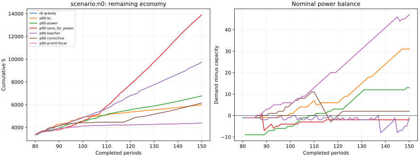

# 经济 RL 建筑偏向因果实验（2026-11-13）

状态：本轮复现及六项等价边界干预已完成，最终结果均到 150 期；这是故障案例研究，没有晋级学习模型。

## 问题与实验边界

用户要求区分网络本身、训练环境与信用分配的责任。以 8102／24×24／换位／150 回合为诊断环境，检查 R6 的建设增加、征兵减少与后期消费崩落。不修改原训练链、游戏规则、奖励口径、原权重或正式晋级标准。

主指标仍为正式账本 `S = recruit + military + administration`；建设不计入 S。所有干预仅用于离线合成局诊断，不能作为新策略或通过验收的模型。

动作记录的 `period` 使用从 0 起的引擎期号；“边界 80”表示已经结算 80 期，终点 150 表示完成 150 期结算。尾段均 S 按 `(S150-S100)/50` 计算。

起点源码为 `ae9a650`；工作树已有其他任务的 long 信用分配改动，本实验保留这些改动。实验入口新增在 `scripts/econ_*_probe.py`，没有修改被测引擎或训练器。

## 身份与复现

| 对象 | SHA256 |
| --- | --- |
| BC20／last，带 family_aux | `2a8e38199f87c838f33c2803483c6c0f717dac0342a93f2a23851013911aec37` |
| PPO R6／candidate | `5c8f2878dd942c6534cf2244dc5d9a5c376fd16d805db4b993be1290e763f3cc` |
| feature_contract | `1dd0b7d6af3dec6ac0fde21cc7309208079bf540847244259476dc029ca252e0` |
| teacher_contract | `fa3654bc2b57eaa2c84a11d50c8c6a544d3d27c5a75c3e8659597781e8ee5060` |

BC 与 R6 都是 width=160、depth=2、heads=4 的项目策略，均启用 family_aux、关闭 hard legal mask。BC 没有 critic，R6 有 critic；critic 不直接参与动作打分。

发现配置差异：BC checkpoint 的 `exec_prior_weight=0`，PPO 入口 `ppo_cycle.configure()` 用 CLI 默认值 `0.5` 覆盖它；R6 保存的实际值为 `0.5`。因此必须把推理先验与参数学习分别检查。

主要原始产物在忽略目录 `archive/previews/econ-causal-20261113/`，Colab 副本在 `/content/econ-causal-20261113/`。临时本地长任务中断的目录保留，完整结果以 `result.json` 为准；从正式边界恢复的对照单独记录，不把中断当作完成。

```bash
PYTHONPATH=. python3 scripts/econ_causal_probe.py \
  --checkpoint /tmp/ppo-t4-mirror/round-000006/candidate.pt \
  --out archive/previews/econ-causal-20261113/new-r6 \
  --swap --turns 150 --save-at 20 40 60 80 100

# 改变一位国家的续行策略；其他国家继续使用原策略并响应市场变化。
PYTHONPATH=. python3 scripts/econ_causal_probe.py \
  --checkpoint /tmp/ppo-t4-mirror/round-000006/candidate.pt \
  --load archive/previews/econ-causal-20261113/new-r6/boundary-080.json \
  --out archive/previews/econ-causal-20261113/new-branch \
  --swap --turns 150 --intervention bc --alternative /tmp/bc20-last.pt
```

## 对照设计与真实性检查

1. 同一初始环境比较 BC20、R6、R6 采样执行，以及只改软先验权重的消融。干预分别与同运行时的未干预续行对照比较；另做本地／Colab 原策略结果逐期对账。
2. 固定 R6 第 80 回合完整边界，只干预 n0：BC 接管、单次提前建电厂、缺电时优先补电且资金不足就结束投资、教师接管，以及保持相同权重但关闭软先验。
3. 固定网络结构，用另一个新世界的学生状态与已记录的教师标签做短暂纠错监督，再到同一第 80 回合边界检验。训练／验证种子为 910072／910080，没有使用 8101／8102 数据训练。
4. 在真实 PPO 轨迹中检查远期回报覆盖、critic 解释方差与局部族梯度；不以损失下降或采样合法率替代对局收益。

真实性检查已通过：

- 新探针与正式 `evaluate.run` 的前两回合，四个学习国家的 S、建设和征兵动作一致。
- 保存第一回合后续跑，第二回合结果一致。
- R6 从第 80 回合正式存档恢复，未经干预跑到第 100 回合：**整个存档完全相等**，含世界模块、客户端状态和宿主状态。世界模块规范 JSON SHA256 同为 `3ceecb8eb07228df126587000718f98cc30d5454cd33ac6774a4860c7d6ff687`。
- 本地 torch 2.6.0+debian CPU 与 Colab torch 2.14.1+cu130 CPU 的 R6 未干预续行，第 81—150 回合四个学习国家的全部所记录国家字段逐期完全相等（仅排除重启后重新计数的 actions）。第 80 回合世界模块 SHA256 同为 `9cda9191d03af65fe6c4252654e499a19ee8f5fd8b83a29c7a422c98d3a267b9`。BC／单次补电／纠错／去先验在 Colab CPU 完成；教师与持续补电最终在本机用户 systemd 持久任务中完成，均与各自同运行时的 R6 续行比较。中断尝试不计入完整结果。
- 本地 BC20 的 0／0.5 先验续行，在同样 70 回合内的全部所记录国家字段完全相等。

## 已完成：融资约束与实际决策

第 40 回合的一份 R6 去先验对照中，n0 供电、兵营和征兵额度都正常；现金 148、装备 0。步兵项目还要求 112 金储备及未来运营物资，需补购粮 3／装备 5／补给 5，正式整单报价为 5／60／26 金，另计交易缓冲。项目融资预检拒绝，便宜建设仍可能可执行。

因此，“没有征兵”必须分开检查：正式设施／电网／额度条件、完整项目融资条件、模型在可行候选中的选择。材料可以由项目采购，不能仅凭库存装备为 0 宣称引擎绝对不能征兵；项目的储备要求也不能等同于引擎硬门槛。

原配置 R6 后期出现另一种明确错误：第 96 回合首个决策时，n0 电力容量 8、需求 13、短缺 5；98 个电厂候选可执行，但总策略概率约 1.57%，贪心动作是再建兵营。供电缺口扩大后，正式规则让次回合征兵停摆。

这些不是非法动作：建设预检允许开工尚无足够电力运行的建筑。模型输入中的项目可执行标记表示结构条件与融资能否通过，不表示这笔投资经济上合理。对本轮已经发生的这类合法误投，无效动作惩罚不会产生直接作用。

电力信息本身没有缺失：`adapter.py` 的全国状态包含容量／需求／预计发电／缺口，建筑目录及建造候选各自包含耗电与发电；`projects.py` 另编码包含在建项目的供电与耗电合计。没有直接输入每个候选执行后的净电力余缺及其长期 S 后果，网络需要学习这些关系。不能把“输入里存在数据”当成已经学会了配套投资判断。

`world_manifest` 的每轮 8 世界已混合 20／24／28 地图与一半换位，其中 24×24 换位有两局。因此不能解释为训练没见过 24×24／换位。世界配置覆盖与异常状态、恢复动作的有效学习是不同的检验项。

## 已完成：同权重推理先验消融

本地 CPU、同初始环境、R6 权重不变，只把 `exec_prior_weight` 改为 0，完整 150 回合结果如下。该项同时改变四个学习席位，不能用它单独证明 n0 自身先验的因果贡献；另有固定世界、只改 n0 的干预。

| 席位 | 累计 S | 尾段 50 回合平均 S | 建设／征兵 | 期末电力容量／需求 |
| --- | ---: | ---: | ---: | ---: |
| n0 | 8075.40 | 71.69 | 177／55 | 14／14 |
| n2 | 3912.28 | 12.36 | 94／35 | 8／3 |
| n4 | 11824.43 | 132.99 | 89／55 | 16／13 |
| n6 | 7224.30 | 45.95 | 69／47 | 8／5 |

BC20 加 0.5 先验的同机完整对照重现了交接记录：n0 建设 99／征兵 80，累计 S=11098.016906，尾段均 S=114.272107；四席累计 S 分别为 11098.016906／4924.425060／8422.145610／4713.881333。该先验对 BC 与训练后的 R6 的影响需要分别判断。

进一步重评分否定了“辅助头把真实可执行电厂压下去”的假设：固定 R6 原轨迹中第 70—149 回合的 80 个 n0 首决策状态，只去掉软先验，**80 个贪心选择均未变化**。所有这些状态里的可执行电厂都没有被辅助头判成低于 0.5；第 96 回合最佳可执行电厂的预测可执行概率为 0.999991，先验项约为 +0.000495，而它与再建兵营的原始 logit 差约为 3.88。

所以全局去先验消融的显著收益差异不能解释为直接修复了这些后期决策。最早观察到的全局动作分化发生在第 35 回合 n2 的一个建设地点／种类选择；后续市场与世界轨迹发生分化。此项说明长局对早期决策敏感，不证明简单去掉先验就是稳定修复。

## 已完成：远期信用不是被截掉了

第 1—9 轮保存的实际配置都是 `credit_mode=turn`、`advantage_mode=mc`、gamma=1；新 project／long 都没有参与这些轮次。

原始 MC 从每个动作开始累加直到完整对局结束，finish 处记账的奖励也会进入前面的建设、征兵动作回报。**奖励落在 finish 不意味着只有 finish 获奖。**

同样，R6 的 `executed_rate=0.477` 不能读成另外 52.3% 都执行失败：实际是 4382 次成功项目、0 次失败项目与 4800 次结束选择。旧二十轮的“74% 废动作”结论不能套在本次新观测契约的训练链上。

第 9 轮 8 世界、32 个国家轨迹、9050 次决策中，前 100 回合里回报为正的成功征兵共有 954 次；其中 891 次包含 40 回合以后才出现的奖励。每次征兵的回报中，“40 回合以后”的占比平均为 **49.30%**、中位 **54.50%**。这只能证明覆盖了远期 S，不能证明知道哪些 S 由这次征兵造成。

critic 的整体解释方差为 0.542，但按前／中／后 50 回合分组后仅为 0.127／0.257／0.118。整体拟合包含了阶段性差异，不能据此宣称已经能辨清同一局面中建设与征兵的边际贡献。

原始奖励也完成正式账本对账：第 9 轮 9050 条决策的奖励和乘 1000 为 202432.30347454856，八个世界正式累计消费和为 202432.3034745486，误差约 `2.91e-11`。没有发现建造被额外计入原始奖励的错误。

第 6 轮抽样记录的共享编码器梯度存在 value／policy 竞争，但仅记录了 3 个微批，不能由此归因为“critic 一定主导了整轮更新”。第 9 轮单世界 256 行重算 logp 最大误差 `1.38e-5`，验证了所用训练轨迹与行为策略的身份。

### 对本地待提交 long 的额外核查

交接中的本地待提交 long 实现会把未来奖励回写到过去征兵，再按新的时间位置计算 reward-to-go；该实现不属于本报告提交。总奖励守恒不足以证明策略梯度保持原目标的估计性质。

一个可完全枚举的例子：先征兵，后选择好／坏建设；好建设产生 10 的 S，坏建设产生 0。原目标在选择好建设概率为 0.5 时，对后一步 logit 的期望梯度为 2.5。把一半建设收益回写到早先征兵后，总回报仍为 10／0，但现实现对后一步的梯度变成 1.25。被搬到“过去”的奖励实际依赖后续动作，不能直接套用原来丢弃过去奖励的因果推导。

这是尚未上链方案的独立问题，不是当前 R6 崩盘的原因，也不表示所有奖励重分配方法均无效。

## 同一边界的完整恢复对照

以下六项干预只改变 n0 的经济决策，其他国家继续使用原 R6／规则策略，并自然响应市场与战局变化。共有的边界 80 中 n0 累计 S 为 **3349.526901**，因此表中终点差异来自之后的续行。

本地与 Colab 的边界 80 世界模块、客户端状态完全相等，宿主唯一差异是审计流 UUID；各干预与其本平台的未干预续行配对，完整基线续行也已跨平台逐期对账。

| n0 续行策略 | S150 | 80 期后新增 S | 尾段均 S | 末电力容量／需求 | 末军队数 |
| --- | ---: | ---: | ---: | ---: | ---: |
| R6 原策略 | 4375.41 | 1025.88 | 5.19 | 10／57 | 2 |
| 仅 n0 关闭软先验 | 4375.41 | 1025.88 | 5.19 | 10／57 | 2 |
| n0 换回 BC20 | 5993.06 | 2643.54 | 21.78 | 10／41 | 5 |
| n0 仅提前建一座电厂 | 6767.77 | 3418.24 | 44.61 | 16／29 | 10 |
| n0 小样本纠错监督 | 6152.61 | 2803.08 | 34.91 | 22／24 | 10 |
| n0 持续补电并保留资金 | 13902.77 | 10553.24 | 187.32 | 18／16 | 43 |
| n0 教师接管 | 9753.60 | 6404.07 | 97.78 | 50／49 | 38 |



图中电力曲线是“需求减装机容量”，正值表示名义容量不足；燃料不足需另查实际发电与正式电网状态。表格和图中的教师／补电控制是可行性诊断，不是学习模型的晋级结果。

这组对照支持以下判断：

- **既有世界可以恢复。** 持续补电与保留资金、教师接管都能从失衡前的同一经济状态重新形成供电与征兵链。没有发现世界规则强迫它必须继续盖耗电建筑。
- **一次补电不足以解决持续决策错误。** 单次干预改善了收益，但原策略随后又扩大用电需求，未保持配套。
- **旧 BC 也没有掌握这类异常状态的稳定恢复。** 它在自己的正常轨迹中表现较好，接手 R6 的状态后仍逐渐失衡。因此不能把问题只解释成 PPO 忘掉了一个 BC 已经完全掌握的技能。
- **软先验不是这些后期错误选择的直接原因。** 从相同边界只关闭 n0 先验，结果与原策略一致；固定状态重评分也没有改变贪心动作。全局从开局去先验的改善属于另一条演化轨迹。

## 推理模式与纠错监督

同一个初始世界、相同 R6 权重，把四个学习席位改为采样执行（随机种子 0），n0 累计 S 为 **8042.25**、尾段均 S 为 **79.96**，期末电力容量／需求为 12／7。贪心版本为 4375.41／5.19、容量／需求 10／57。

这证明至少存在“采样分布会偶尔选到修复动作，而贪心部署没有选到”的差别。只有一个采样种子，而且四个学习国家的行动和后续市场都发生变化，不能据此声称采样策略普遍稳定或已经优于教师。

纠错监督保持 R6 的网络结构与参数形状不变（1037607 个参数），使用世界 910072 的 1006 条已记录教师标签训练，世界 910080 的 1036 条验证；3 epoch、lr=1e-5、batch=4，没有使用 8101／8102 数据训练。按验证分类损失选择 epoch 1：loss 1.07870→0.96153，但总体准确率 72.59%→72.30%，征兵标签准确率 96.97%→87.88%。实局恢复改善有限，仍未持续消除电力缺口。

训练世界有 68 条教师电厂标签，验证世界仅 4 条，主要是开局。这是小规模监督探针，不是网络容量上限测试。它既不能证明“换大模型才行”，也不能证明小样本补课足以修复长局；验证分类损失不能代替异常状态恢复与正式 S。

## 结论的边界与后续测量

**已定位的直接机制是合法但配套失衡的建设：电力缺口扩大后，正式规则阻断征兵，而策略继续选择耗电设施，缺口进一步扩大。** 当前观察中包含电力信息，原始奖励与正式 S 账平，MC 也包含远期回报。

如果“模型问题”指当前权重的投资决策，证据已经充分；如果指网络结构或参数量不足，本轮没有证明。训练环境的硬门槛放大了策略错误，但世界和资金条件存在恢复路径。信用问题也应区分“有没有远期奖励”和“能否从回报中学出动作的边际贡献”：前者已核实，后者仍需受控训练消融。

尚未执行的后续测量：

1. 固定初始化、行为轨迹、更新顺序与预算，比较 MC、逐决策优势、隔离 critic 对共享编码器的梯度。先在关键状态检查补电／继续建设的优势与 logits，再做同一批世界的完整收益比较，区分信用估计与 critic 干扰。
2. 固定数据及训练预算，分别比较异常恢复状态覆盖、显式候选后电力余缺特征、增加网络容量。不能由这次三 epoch 的小样本结果推断容量上限。
3. 用多个独立世界与采样重复确认，检查逐席与尾段保护。8102 的这份故障案例和单个采样种子不足以证明通用能力或局部最优。

上述新增训练对照没有在本轮启动。正式教师 150% 及逐席、尾段保护标准保持不变；没有修改默认客户端，也没有把诊断控制接进原 PPO 链。

## 产物与验证

- 结构化完整结果：[`econ-causal-20261113.json`](econ-causal-20261113.json)，保留每份原始结果的 SHA256。
- 原始状态、决策、轨迹、恢复档、权重及对账：`archive/previews/econ-causal-20261113/`。主导出包 SHA256 为 `68d8b2880766d9a4b529d89816ff443b096c915c223b5c432a31304077acdcf4`，36 个导出文件逐项校验通过。
- 入口：[`econ_causal_probe.py`](../../scripts/econ_causal_probe.py)、[`econ_boundary_audit.py`](../../scripts/econ_boundary_audit.py)、[`econ_credit_probe.py`](../../scripts/econ_credit_probe.py)、[`econ_corrective_probe.py`](../../scripts/econ_corrective_probe.py)、[`econ_policy_prior_probe.py`](../../scripts/econ_policy_prior_probe.py)、[`econ_probe_summary.py`](../../scripts/econ_probe_summary.py)。探针存档使用兼容的 v13plus 状态工厂，续行时显式装回学习权重；这不是正式 GUI 学习客户端存档支持。
- 新脚本字节编译、正式评测器对照、20 期完整存档一致性、跨运行时 280 个国家期记录对账、正式奖励账平、checkpoint 身份与形状、重评分重现、结果算术与图表检查通过。

仓库原有两项 provenance 测试失败在本轮开始前已复现，来自 v3 已改变观测契约而旧测试仍要求兼容；本轮没有放宽契约或修改历史 registry，也不宣称全量 CI 已绿。

Colab 在收尾期间被回收，原训练链配置没有被本轮改动。最新可核验的完整镜像为 R10；R11 及之后未取回，不能认作已经完成。BC20、R6、R10 已复制到持久的 `archive/previews/econ-causal-20261113/inputs/` 并校验 SHA256。中断的恢复尝试单独保留，最终两项由本机 systemd 用户临时任务补完。
