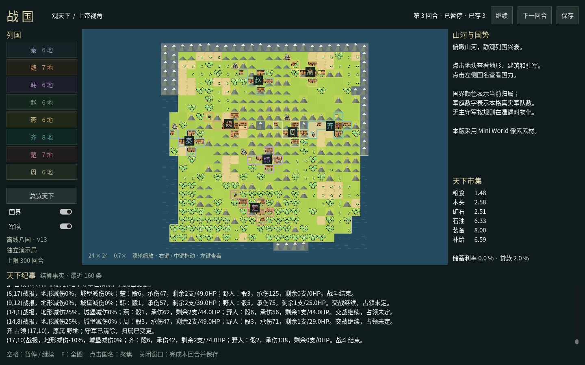

# 自然边界、高山与海洋

日期：2026-10-23。用户要求自然边界覆盖原地图最外缘，新增不可逾越的高山、不可穿越的海洋；
本次明确只做这两种地形，河流与渡口不在范围内。

## 最终行为

- 每个最外圈地块均为高山或海洋，不能抵达并越过原本的直线坐标边缘。
- 连续低频场控制峰脊、海岸与边界厚度；海洋连通外缘，可用陆地保留单个四连通分量。
- 两种屏障不可部署、移动、进攻、撤退、占领或建造，无可采资源与野人。
- 八向移动检查沿途与斜角侧面，骑兵不能跳过屏障；遣返改用按地形代价计算的最短可通行路线。
- 出生锚点遇到屏障时选择最近的合法五格陆地十字，完整校验后再创建国家；不填海、不开山。
- 原山地仍可通行，骑兵森林/山地移动代价和战斗数学保留。几何范围外的请求不消耗行动；范围内盲推沿用原约定。
- 规则 AI 的观察寻路和候选目标、experimental 战斗推演、地形/兵种目录、文字/PNG/SVG地图同步。

原五类地形权重按可用陆地重新分配，各类条件资源档位保留。自然屏障先按约20%预算选择，
极小地图完整封边与孤立地块清理优先。种子20261023的24×24原始地图为461格可用陆地、
53格高山、62格海洋，可用陆地约80.03%；出生首都照旧按平原重算其资源。

## 画面

Godot 默认八国界面已显示海面、海岸和雪峰，移除地图外侧的装饰直线框；点选屏障显示规则。
这是新生成地图，`--sample terrain` 的两个固定3×3比例样板保持原输入。



截图来自 Linux ARM64 / Xvfb / OpenGL llvmpipe，默认离线八国规则 AI 演示推进到第3回合，
576格、21支已物化军队，暂停并保存成功。新地图画面尚未在Windows复测；
先前固定地貌样板的Windows Vulkan成绩见[独立验收](GUI阶段A-Windows-Vulkan验收-20261023.md)。
雪峰和海岸仍为当前展示素材与代码草样，精细自然度继续按阶段A打磨。

## 验证

- 全量864项离线测试通过，包括9项新增自然边界测试；实际C#工程编译零警告、零错误。
- 合并并行的宣战二次确认接口后，同步旧测试的实际宣战参数，附庸、外交、情报与自然边界55项复测通过；未改变其业务规则。
- 8/12/24/60尺寸、4个种子分别核对整圈封闭、陆地连通、海洋外连、资源归零、陆地配额。
- 不同 `PYTHONHASHSEED` 的地形、资源和地名摘要一致。
- 八国24个种子（0–23）布点均通过，每国五格，全部落在可通行陆地。
- 人造带隘口山脉验证绕行、骑兵无法跳山、斜角无法挤过、撤退拒绝与和平遣返绕山。
- 可见屏障上的部署、占领、移动和进攻拒绝保持状态；范围内盲推沿用尝试额度规则，存档恢复拒绝屏障上的军队。
- API参考页同步、文档站链接和 `git diff --check` 通过。

生成与布点证据：[natural-boundaries-generation-20261023.json](natural-boundaries-generation-20261023.json)。
窗口原始产物留在本机 `archive/previews/natural-boundaries-final-20261023/`；
仅新建离线演示档，未读取、迁移或重启正在运行的真实对局。

## 使用与兼容

Windows更新后在仓库根目录运行：

```powershell
git pull
python desktop.py --rendering-method mobile --rendering-driver vulkan
```

默认暂停，按空格继续；点选高山或海洋可查看自然屏障说明。
新规则对应map-generation2.0.0、territory2.5.0、army2.11.0、ui1.6.0、native4.16.0、experimental0.17.0。
现行依赖校验会拒绝旧版本存档直接混载，新生成地图生效；本批不提供旧局迁移。

开发者复核：

```bash
.venv/bin/python -m unittest tests.test_natural_boundaries -v
.venv/bin/python -m unittest discover -s tests -q
python3 scripts/api_doc.py --check
python3 docs/site/build.py
```
