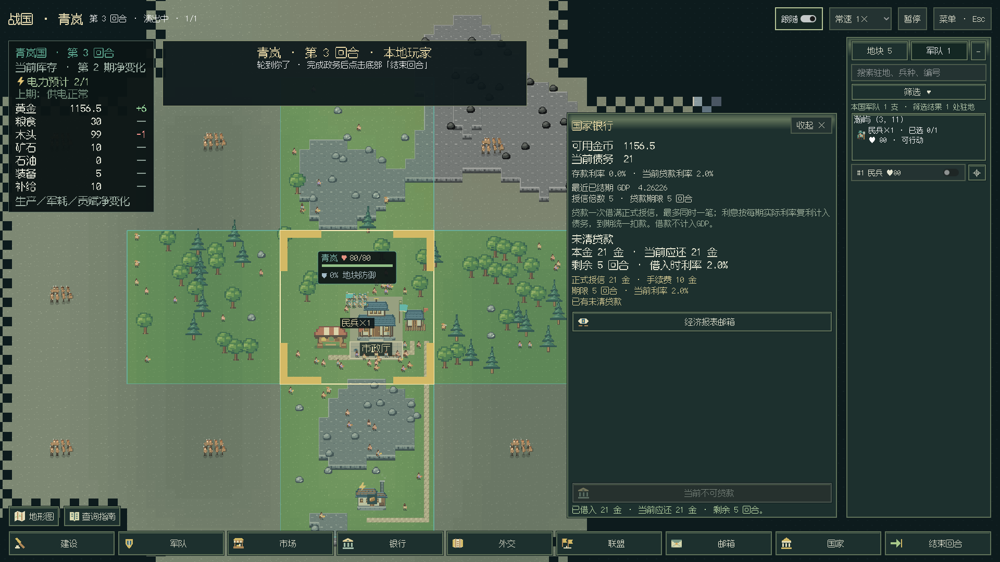
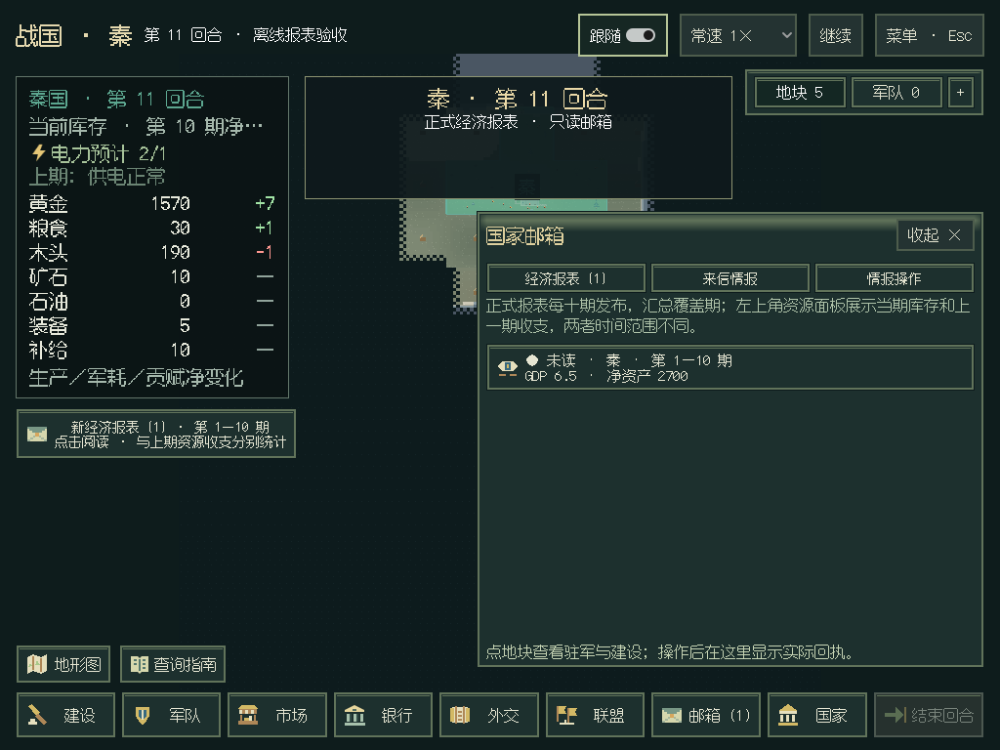
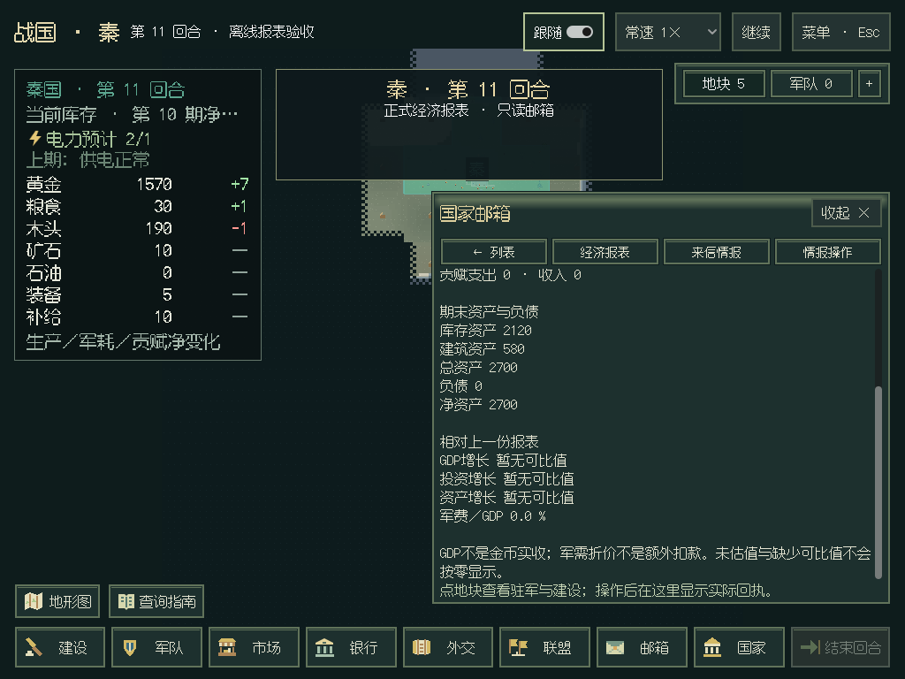

# 银行、报表邮箱与规则复用收尾

2026-10-29，v0.7第二版最后一组。沿用单机一位真人、绑定玩家视野、原18阶段结算与既有报表发布周期。没有调用模型或读写真实对局。

## 银行入口与正式报价

“银行”现在是底部独立入口，国家页也有跳转。显示现金、债务、最近已结期GDP、授信倍数、当前存贷款利率、期限，以及未清贷款本金／应还额／剩余回合。贷款按钮固定在抽屉底部，窄窗无需滚到正文末尾寻找。

原来通用表单的贷款预览错读`limit/credit_limit`，正式报价实际返回`credit`。新界面直接读取`query(panel=quote, action=borrow)`的`credit / fee / cash / can_borrow / loan_rate / loan_term`，按正式结果置灰；确认后使用原`borrow`提交，不在GUI另算授信、手续费、复利或还款。返回确认框不执行借款；已有未清贷款时不可重复借。

## 报表邮箱

- 已发布本国报表免费出现在“邮箱／经济报表”，新增未读数和地图左侧提醒，点击直接打开对应报告。
- 报告展示完整`PeriodReport`：覆盖期、GDP、投资、征兵、军需、进口／出口、贸易比率、贡赋、库存／建筑／总资产、负债、净资产、增长率及军费比率。未估值列已知小计和缺项，缺少可比值不显示为零。
- 正式0起始期号仅在显示时加1：首份0—9期显示“第1—10期”；当前库存、上一期资源收支与十期正式报表分别标明。
- 读取来自`state.reports`，已购他国报告来自本国`bank.purchases`，不查询其他国家的免费私有报表。原来信与地图情报仍可阅读，固定工具栏提供报表、来信、购图／派谍操作和返回列表。
- 已读报告以“国家／报表结束期”为键，存于对应存档旁的`.desktop-mail.json`，读档恢复，其他对局隔离；只记录界面偏好，不增加世界状态或免费重复购买。新报表在结算完成的玩家快照中进入邮箱，不提前发布。

补绘24×24银行、信封SVG，母版与许可随包提供。

## 消除两处重复规则

先核对已有`battle / defense_pct / quote / market / _validate_rule`。正式战斗查询只覆盖交战地，而地图也展示和平驻军；自动交易没有只读参数预验入口。因此复用领域里的纯规则，并保留原玩家API作为实际提交入口：

- 军队域`army/defense.py`统一攻守身份、地形／城堡合成防御；真实战斗、公开战斗面板、玩家／观察者派生投影共享。C#只读`squad_defenses`，不再判断谁是守方或重复公式。未知外国城堡防御保持未确认，战斗分镜更新仍只用已获授权事实。
- 市场域`market/automation.validate_rule`由正式保存、读档和真人只读预验共享。`HumanAPI.auto_trade_options`通过绑定玩家市场核对资源，界面防抖读取其`available / reason`，旧响应不覆盖新输入；删除C#的买卖目标大小判断。设置与实际自动成交时机不变。

本组未修改模块声明、世界状态或存档依赖；v0.7早先队列／军令带来的升级要求保持。名称翻译、HP汇总、筛选和财务数值排版仍属于呈现职责，不能将本次审计收尾扩称为全库不存在任何派生计算。

## 本地验证与交付

1074项全量离线检查通过（247.999秒，2项既有跳过），随后补充实际战斗API与HUD防御对照，6项金融／规则定向检查通过。C#编译0警告／错误，布局检查通过。7项打包／发布与3项手册检查通过，API参考同步、文档站28页链接自检通过。

实际Godot真人演练三期、28次操作通过，新增真实银行借款／返回确认／实付／不可重复借款与共享自动交易校验；原市场、建设、军令、队列、历史地图等门槛保持。另以独立合成局执行20次真实结算，验证第9／10／20期、购报权限、已读恢复与对局隔离；邮箱和固定银行按钮在1920×1080、1440×900、1280×720、1024×768检查范围与返回入口。脱离私人路径的结果见[Linux记录](gui-finance-linux.json)。

Windows流水线新增银行3项门槛及独立finance邮箱组7项门槛，保留真人流程900秒总上限。已下载该轮验证工件核对：三期28次操作、银行3项与邮箱7项均通过，四种尺寸入口可见，脱敏结果见[Windows记录](gui-finance-windows.json)。Windows使用ANGLE／Direct3D11，本机使用Linux llvmpipe；不作为实体Vulkan显卡测试。

## CI与预发布结果

源码`c940304ae4453d256821a2fa0b39a72706126637`的[CI40818268137](https://github.com/northwindlight/zhanguo/actions/runs/40818268137)全部成功：1075项离线检查（228.509秒，2项既有跳过）、示例巡礼、C#／布局、API／文档和构建范围通过。[Windows作业123264477068](https://github.com/northwindlight/zhanguo/actions/runs/40818268137/job/123264477068)在中文路径使用包内运行环境完成九组验收，于`2026-10-29T04:44:06.171Z`输出`WINDOWS_PORTABLE_VERIFIED`。

[自动发布作业123268096687](https://github.com/northwindlight/zhanguo/actions/runs/40818268137/job/123268096687)已成功公开[v0.7.0 Pre-release](https://github.com/northwindlight/zhanguo/releases/tag/v0.7.0)。标签指向上述源码，`draft=false / prerelease=true`，三附件完整；发布器公开前核对文件大小与GitHub SHA-256，公开后再次核对元数据与下载的`SHA256SUMS`。未人工重新上传大包，也未修改旧Release。

| 附件 | SHA-256 |
| --- | --- |
| `zhanguo-0.7.0-windows-x64.zip` | `08ac7b106e7c5e2eece8e39f2839ed28e58ce77d21bcd216ed8082ccf69dea7b` |
| `zhanguo-0.7.0-source.zip` | `975f0783a942a85570409c0416734476c5654d81e2225dfca30adc7105d47578` |

两版计划中的单机项目已完成并预发布，试玩确认后才转正式。动态／并行回合与联机仍留在未来设计。
