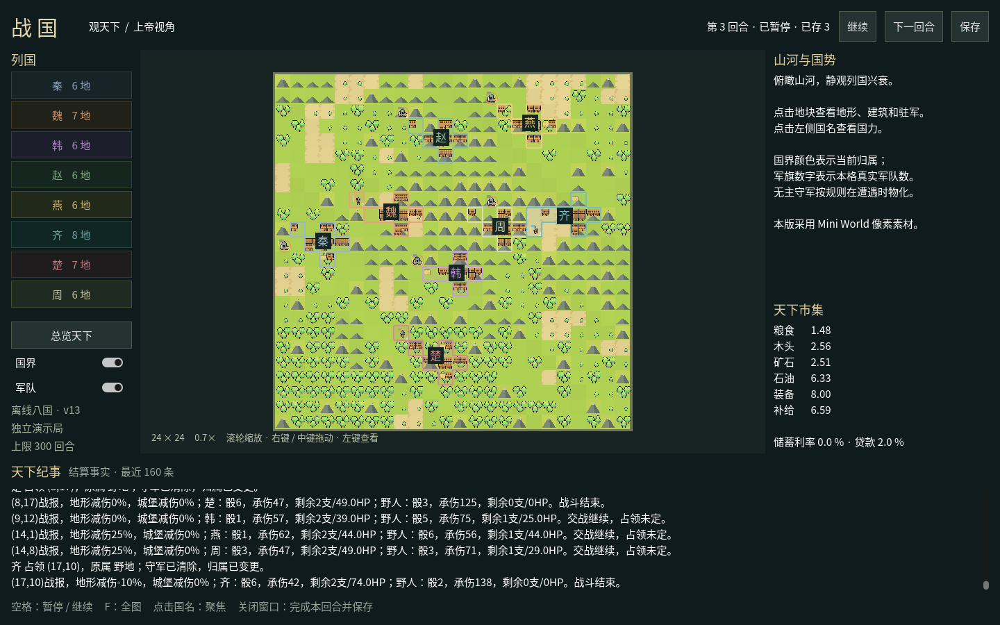

# 战国 · 观天下

Godot 4.7.2 .NET / C# 原生桌面首版，Compatibility 渲染器，Mini World
像素素材。上帝视角观察者专用，Python 继续持有世界、规则、AI 和存档。



## 启动

安装 Godot **4.7.2 .NET**、.NET **8 SDK**、Python **3.11+**，在仓库根目录执行：

```bash
python3 desktop.py --godot /path/to/godot-mono --dotnet /path/to/dotnet
```

工具已在 PATH 中时直接 `python3 desktop.py`。本开发机亦自动发现
`~/tools/zhanguo-desktop/` 内的工具。Windows 使用 `python desktop.py`，
并通过参数指定 `Godot_v4.7.2-stable_mono_win64.exe` 和 `dotnet.exe`。
也可用 Godot .NET 编辑器打开 `project.godot`，构建后运行；宿主默认使用
`python3`（Windows 为 `python`），`ZHANGUO_PYTHON` 可指定解释器。

默认创建**暂停的离线八国 v13 规则 AI 演示局**，不读取 `mp_config.json`、不调用 LLM。
为了展示真实单位，使用观察者补助接口给每国两支骑兵，其余规则沿用原剧本。
上限为第 300 回合。每次启动保存到独立目录：

```text
archive/desktop/<时间>-<随机后缀>/
  config.json
  session.json
  session.json.audit/…
```

从演示档继续（复制到新目录，保留原档）：

```bash
python3 desktop.py --resume archive/desktop/<旧目录>/session.json
```

现役 LLM 对局的接管、远程连接与三平台独立安装包尚未接入。
首版依赖完整源码仓库与 Python；不是已完成的 Steam 发布包。

## 操作

- 左键地块：地形、归属、完整建筑类型/等级、驻军编号与 HP。
- 滚轮：以鼠标为中心缩放；右键 / 中键：拖动。
- 左侧国名：聚焦并查看库存、资产、国土、兵种数量。
- F / 总览天下：适应全图；国界和军队可单独隐藏。
- 继续 / 暂停 / 空格：按完整回合边界暂停并保存。
- 下一回合：推进一次完整周期并保存；保存按钮保存合法边界。
- 关闭窗口：请求完成当前回合、保存，宿主退出后关闭窗口。

Python 执行回合时界面继续响应。命令队列在完整回合边界执行，界面分别显示
“请求排队”和“已经保存”。异常回合不覆盖最近完整存档；宿主或保存错误在
纪事区显示，窗口保留。鼠标悬停状态栏可查看保存路径。

## 实现边界

`ui/desktop.py` 是离线运行控制器，只在一个执行线程访问 Session；输入线程
只排队，不读写世界。stdout 专用于 `zhanguo.desktop/1` NDJSON；其他输出走
stderr。消息携带 generation 与单调 revision，桌面拒绝旧代或旧 revision。
宿主只发送脱离世界的观察者投影，不向玩家 API 提供全图。

`UILayer.desktop_project()` 决定项目入口，`desktop_frame()` 决定展示投影，
替换 UI Mod 时不固定启动标准地图。通用引擎无 Godot、地形或美术依赖。
本版控制器尚未与终端入口合并，后续接 LLM 前应先共用安全运行控制。

场景只绘制当前快照，消息通道上限 64、纪事上限 160，不累积历史场景节点。
环境绘制 12 Hz，镜头输入与界面按渲染帧更新。每支军队均来自观察者事实；
未物化的无主守军不凭空生成。国力按真实兵种数量统计，HP 只在驻军详情列出。
缩小时按国家标名，近看显示逐格归属。

美术使用包内原图，文件与哈希见 [manifest.json](assets/manifest.json)，
来源及许可见 [CREDITS.md](assets/CREDITS.md)。当前建筑为通用视觉代用图标，
种类以地块详情为准；骑兵仅播放待机帧，步兵为静态待机帧。
**尚未实现**行军路径、攻击/受击/阵亡、建筑施工动画、事件回放及声音。
不从“单位已移动”推断权威行军路径，也不在战斗结算前绘制确定伤亡。

## 验证

```bash
python3 -m unittest tests.test_desktop tests.test_observer tests.test_ui_mod -q
python3 desktop.py --build-only
```

Linux 无桌面验收可使用 Xvfb：

```bash
xvfb-run -a -s '-screen 0 1440x900x24' python3 desktop.py --smoke-output /tmp/zhanguo.png
```

窗口验收会推进三回合、请求暂停、验证按国聚焦及鼠标选中地块、截取真正的
渲染画面，并保存退出。截图旁 `.json` 记录回合、地块数、军队数与存档路径。
单测核对 576 地块、八国、16 支初始真实军队、脱离世界与玩家权限、慢回合
期间的暂停排队、完整周期保存读回及异常不覆盖旧档。

2026-10-23 已在树莓派 Linux ARM64 / Xvfb / Mesa llvmpipe 验证；
Windows、macOS 与实际 GPU 性能仍待各平台验收。
