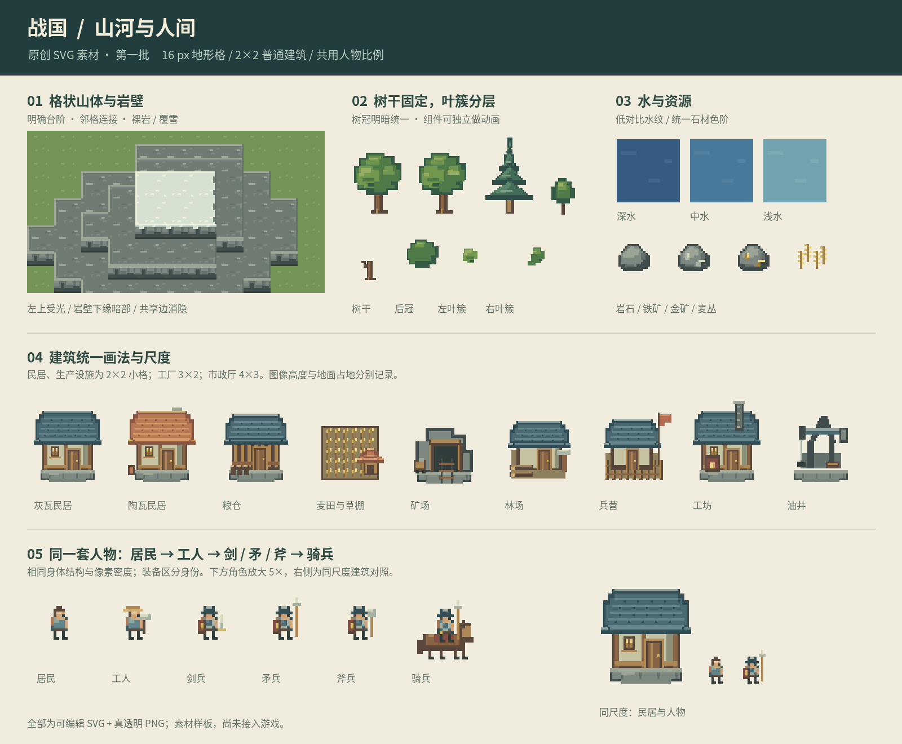

# 战国原创 SVG 素材 · 第一批

2026-10-24。107 个素材条目，SVG 母版、原始分辨率透明 PNG、1024×1024 图集和帧表一起交付。
现已接入默认 Godot 活地图与独立地貌样板。107 个条目共享一张图集，
地形、建筑、树木、资源和人物采用同一世界像素比例；游戏规则与渲染后端保持原有设置。
运行画面与连续演出见[接线验收](../../../../../docs/reviews/GUI统一像素世界与动画-20261024.md)。



## 看图

- [组合场景，2× 最近邻放大](../../../../../docs/design/unified-v1/scene-2x.png)
- [完整图录：12 种建筑、连接块、人物四方向](../../../../../docs/design/unified-v1/catalog.png)
- [叶簇与人物动作 GIF](../../../../../docs/design/unified-v1/motion.gif)
- [本地预览页，可切换场景缩放](../../../../../docs/design/unified-v1/index.html)

预览场景是合成美术组合，没有连接对局。图上的人物数量、房屋和地形不代表游戏状态。

## 本批内容

| 类别 | 条目数 | 内容 |
| --- | ---: | --- |
| 山体连接块 | 32 | 裸岩、覆雪各 16 种邻格组合 |
| 岩壁立面 | 3 | 可叠接的 16×8 岩壁条 |
| 地表 | 15 | 草地、土路、岩地、沙地、雪地各 3 变体 |
| 岸线 | 16 | 四邻格岸线连接组合 |
| 海水 | 6 | 深、中、浅水各一个静态底色和一个 6 帧波纹图集 |
| 建筑与施工 | 12 | 两种民居、农田、矿场、粮仓、兵营、工坊、林场、油井、工厂、市政厅、脚手架 |
| 树木 | 4 | 两种阔叶树、松树、幼树 |
| 阔叶树组件与动画 | 5 | 树干、后冠、左叶簇、右叶簇、8 帧轻摆图集 |
| 岩石、矿石、作物 | 8 | 岩石、铁矿、金矿各 2 变体，青苗与成熟麦丛 |
| 人物图集 | 6 | 居民、工人、剑兵、矛兵、斧兵、骑兵；共 432 个帧格 |

432 是图集中的帧格数，包含为统一布局重复排列的待机和动作帧，不是 432 张独立动作设计。

## 统一规格

- 原创像素画 SVG，整数坐标，左上光源，无模糊、渐变、外部贴图或抗锯齿边缘。
- 地形小格 16×16，高度一档 8 像素。普通建筑地面占地 32×32（2×2），工厂 48×32，市政厅 64×48。
- 图像画布与地面占地分开。例如普通建筑 PNG 是 48×56，地面脚印为 `[8,16,32,32]`，脚底锚点为 `[24,48]`。
- 居民和士兵共用 10 像素身体基准、同一头身结构；帽子、盔甲、武器可以超过身体范围。
- 步行人物帧格 16×16、脚底 `[8,14]`；骑兵 24×24、锚点 `[12,22]`，骑手沿用人物基准。
- 单体 PNG 为 RGBA 真透明；地表不透明。所有像素只使用清单色板，alpha 为 0 或 255。
- 原尺寸导入，最近邻采样。人物、建筑使用同一个世界缩放比例；远景通过细节层级处理，不能各自钳制最小尺寸。
- 运行时仅替换居民服装的三档蓝绿色槽、士兵盾牌与马鞍的三档赭红色槽；
  皮肤、金属、马匹与轮廓不混色。待机、行走、劳动/攻击分别取清单有效帧数，
  树叶 6 fps、水面 4 fps，并按位置错开相位。

## 格状山体拼接

山顶是离散格子。连接块尺寸 16×24，其中顶部 16×16，南侧可见岩壁向下延伸 8 像素。
`lower_neighbor_mask` 的位序为北 1、东 2、南 4、西 8；置位表示该方向邻格更低。
同高度相邻格不画共享边。固定俯视角下南侧有岩壁立面，其他方向处理顶缘与转角。
更大的南侧落差用 `cliff-face-*` 逐档叠接，不能把 8 像素立面直接拉长。

组合场景采用明确的整数高度数组与邻格判断，没有使用连续高度插值或等高线过渡。
当前是 16 个基本四邻格连接状态；内凹角的更多变体、碎裂边、矿脉与山口仍可继续补画。

## 组件与动作

阔叶树 SVG 具有 `trunk`、`canopy-back`、`canopy-left`、`canopy-right` 四个独立组。
动画图集为 8×1 格、每格 32×40，建议 6 fps。叶簇做最多 1 像素的错相位移动；
树干从未参与移动，逐帧验证下半树干像素保持一致。四个组件导出在同样的画布中，共用 `[16,38]` 锚点。

人物各有四方向，图集共 6 列 × 12 行。方向顺序为南、东、北、西：

| 动作 | 行号 | 有效帧数 | 建议帧率 |
| --- | --- | ---: | ---: |
| 待机 | 0–3 | 2 | 2 fps |
| 行走 | 4–7 | 6 | 8 fps |
| 劳动 / 攻击 | 8–11 | 4 | 7 fps |

读取动作时按有效帧数循环，不能把整行 6 格都当成独立攻击帧。
人物 SVG 按帧保留 `head`、`body`、`arms`、`legs`、`equipment` 分组；骑兵另有 `horse`。
屋顶绘制组件在生成脚本中复用，并在建筑 SVG 中保留独立屋顶组。

本批只完成基础动作。受击、阵亡、搬运变体、完整建筑等级、野人外观和完整特效尚未覆盖；
野人暂保留程序绘制，受击与阵亡沿用动作位移、旋转和淡出；完整专用帧仍可后续补画。

## 重建与检查

仓库根目录运行：

```bash
python3 scripts/build_unified_art.py --zip
```

需要 Pillow，以及 CairoSVG 或系统 librsvg/Cairo。脚本不联网、不读取对局、不导入游戏宿主。
源文件为该脚本中的 SVG 组件定义，`svg/` 与 `png/` 是确定性导出；手动调整导出的 SVG 前应同步修改组件定义，避免重建覆盖。
预览中文字体优先使用系统 Noto Sans CJK；游戏素材本身不包含字体依赖。

输出 `manifest.json` 记录画布、锚点、占地、帧表、图集坐标、色板与逐文件 SHA-256。
`validation.json` 记录颜色/透明度、连接块、固定树干、人物帧、占地和图集读回检查。
组合场景另经 SVG 渲染与 PNG 拼接逐像素一致性核验。

ZIP 输出到 `archive/design/zhanguo-unified-art-v1.zip`，包含素材、说明、预览与生成脚本。

## 来源

本批由 Codex 为战国原创绘制 SVG 组件，沿用仓库 MPL-2.0 许可。
仅参考 WorldBox 公开截图的比例、格状山体组织和地形层次，没有拷贝、描摹或解包它的素材。
没有混入 Mini World 图片、此前生成建筑或用户半身立绘。
