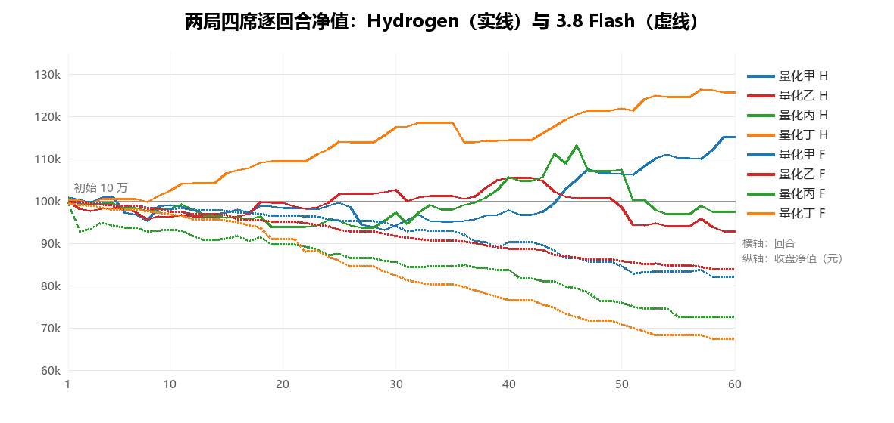
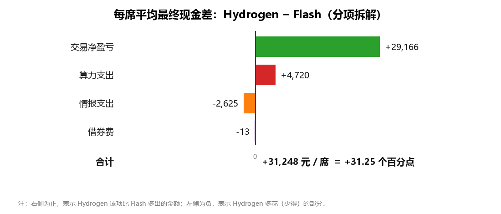
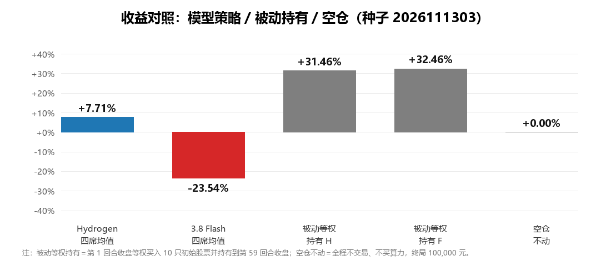

# 股票模拟作为 AI 智能体基准：从题库饱和到「可执行策略」的经济评测

2026-11-16 · 研究文章（非同行评审，证据为公开对局存档与审计）· 设计论证 + 两局真实对局的实证 · 证据与复算见文末

**一句话结论：** 当一个基准的分数由「模型写的可执行策略 + 它愿意为之支付的算力与信息成本」共同决定，而不是由一次文本回答决定时，它既躲开了题库饱和，也把现代智能体最容易被漏掉的三个维度——长程工程、成本理性与对手交互——变成了可测量项。本文以 `zhanguo` 的 stock 发行版为例给出设计论证，并用两局同种子真实对局（四席 Gemini 4 Hydrogen vs 四席 Gemini 3.8 Flash）说明它能区分什么、不能区分什么。

> 阅读边界：本文论证的是**基准设计**。两局数据是单种子、自博弈的单局，**不能**用来给模型排能力名次；所有「Hydrogen 比 Flash 好」的表述都只在「这两局、这套配置」意义上成立，第 8 节逐条列出效度威胁。

---

## 1. 引言：标尺饱和之后，评测缺的不是难度

### 1.1 静态题库的饱和已经被量化，而且不再靠私有测试集兜底

2026 年 ICML 的 *When AI Benchmarks Plateau* 用 60 个语言模型基准、14 个与饱和相关的属性做了系统测量，结论是**近一半基准已饱和，且饱和率随基准年龄上升**；更反直觉的是，**抗饱和的保护来自「专家构建」，而不是公开或私有测试集**（[arXiv:2602.16763](https://arxiv.org/abs/2602.16763)，已核对摘要原文）。这篇文章之所以被广泛转述，是因为它把社区多年抱怨的「榜单失灵」变成了可复算的量：饱和 = 顶级模型之间**失去可靠区分度**且**性能贴近经验天花板**，前者叫停滞，两者兼具才叫饱和。

工业界的动作比论文更直接：OpenAI 在 2026-02-23 宣布**不再用 SWE-bench Verified 衡量前沿编码能力**，理由是该基准既被污染、又有相当比例的测试用例会把功能正确的提交判错，而半年内头部分数只从 74.9% 爬到 80.9%（[OpenAI, 2026-02-23](https://openai.com/index/why-we-no-longer-evaluate-swe-bench-verified/)，本篇为转述，具体数字以原文为准）。

### 1.2 Agent 基准的问题不是「不够难」，而是「可被刷」与「缺维度」

把题出得更难并不能解决第二类失效。BenchJack 对 10 个主流 agent 基准做自动红队，在**不解决任何任务**的情况下刷出接近满分，共报告 219 个缺陷，并让 WebArena 与 OSWorld 在三轮迭代内被打穿（[arXiv:2605.12673](https://arxiv.org/abs/2605.12673)）。NeurIPS 2025 的立场论文则从治理角度指出：数据污染、厂商选择性报告、判分质量控制缺失，让「真进步」与「夸大宣称」无法区分（[Position: Benchmarking is Broken](https://proceedings.neurips.cc/paper_files/paper/2025/hash/693e00827fd44bdfca210801fe1e6439-Abstract-Position_Paper_Track.html)）。

而面向 agent 的评估范式已经显出结构性错配：静态基准、聚合分数、一次性成功判据，与「系统能否在变化和规模下按意图行为」根本不是一回事；同一篇立场/方法论文（[arXiv:2602.18029](https://arxiv.org/abs/2602.18029)）给出两条可直接借用的要求：

- **成本必须进指标**：agent 应该放在「分数 × 金钱/时延」的帕累托前沿上比较，而不是只看终态对不对；
- **可靠性而不是单次能力**：单次 70% 的任务，`Pass^3 ≈ 34.3%`，长程 agent 的方差本身就是评测对象。

### 1.3 我们的主张

现有主流基准可以粗分三代，每一代都补上了一种能力，也都留下了一个洞：

| 代 | 代表 | 补上了什么 | 留下的洞 |
|---|---|---|---|
| 一：静态题库 | MMLU、GAIA、SWE-bench | 可自动判分、可比较 | 会饱和、会被记忆与污染 |
| 二：真实软件 + 一次性任务 | WebArena、OSWorld、Terminal-Bench、τ²-bench | 执行式判分、真实环境 | 可被刷、无经济约束、任务一次性 |
| 三：长程 + 成本感知 | MLE-bench、PaperBench、GAIA2、AStockArena | 长程、部分成本、过程审计 | **没有内生对手与持续市场** |

本文的对象是第四种形态，也是目前公开基准里少见的一种组合：**多席位自博弈 + 程序即动作 + 资源付费 + 持续市场**。`zhanguo` 的 stock 发行版让四名 LLM 在同一份实时订单簿里各自写 Python 策略，交易日沿 20000 个逻辑 tick 自动执行；算力、交易槽、研究、谍报、借贷全部从游戏内现金扣费；终局按清算现金排名。它的评测对象不是一个「答案」，而是一段被市场反复执行、收费、纠正、并最终结算的**程序化行为**。

---

## 2. 相关工作的三条线

### 2.1 基准饱和与评估治理

如 §1 所述，饱和已是可量化的测量学问题（[arXiv:2602.16763](https://arxiv.org/abs/2602.16763)）。它给本文的直接启示是：**不要做「又一个有固定答案的题库」**。饱和的来源是「分布被压缩到无法区分」，而不是「题目不够难」；把难度推到 0 分只能延长寿命，不能改变形态。真正抗饱和的是**专家构建的、难以被针对性优化的任务结构**。

### 2.2 Agent 基准的三代与它们的共同短板

第一代以 AgentBench 为代表，把「LLM 当 agent」第一次制度化，但环境彼此独立、无跨回合经济约束、无对手。第二代以 WebArena / OSWorld / SWE-bench / Terminal-Bench 为代表，把判分从「文本对错」推进到「世界状态是否被改对」，代价是：只要判分只看终态且环境可被 agent 任意操作，就可以绕过任务拿分（BenchJack）；且这些基准都是**一次性任务**，没有资本、没有库存、没有「做完这一步会改变下一步的对手」。

值得注意的是，综合综述（[AI Review 2026](https://link.springer.com/content/pdf/10.1007/s10462-026-11571-0.pdf)，本篇仅读到摘要片段）把 agent 评估的断裂归纳为三条：**任务成功 ≠ 过程质量**、**基准分 ≠ 部署成本效率**、**孤立任务 ≠ 端到端工作流**。这三条恰好是本文设计的三根支柱：过程有审计、成本进账本、动作是端到端策略。

### 2.3 金融/交易类基准：正在「去回测化」，但还没有自博弈 + 代码 + 算力

金融侧的演进线很清楚：

- **FinBen / FinanceBench**：任务全集式与问答式，交易只是很小一块，短程、无对手、无成本；
- **InvestorBench**（ACL 2025）：把「环境」引入金融 agent 评估，但仍是历史数据回放的决策，agent 的行为不改变价格；
- **StockBench → LiveTradeBench → PolyBench → AStockArena**：从「多月连续决策」到「实时数据流」再到「订单簿状态 + 滑点执行」和「过程审计」。StockBench 已经在多月真实行情上报告「多数 LLM agent 跑不赢等权买入持有」（[arXiv:2510.02209](https://arxiv.org/abs/2510.02209)），LiveTradeBench 用实时数据流绕开回测与信息泄漏（[arXiv:2511.03628](https://arxiv.org/abs/2511.03628)）。其中 AStockArena 报告 **72.99% 的交易点存在至少一项审计缺口**——只报收益会系统性高估 agent（[arXiv:2611.00515](https://arxiv.org/abs/2611.00515)）；PolyBench 把执行限制纳入，7 个模型里只有 2 个正收益（[arXiv:2604.14199](https://arxiv.org/abs/2604.14199)）；
- **Agent Trading Arena**（EMNLP 2025 Findings）是离本文最近的先行工作：零和市场、bid-ask 交互、**agent 的交易行为直接推动价格**（[ACL Anthology](https://aclanthology.org/2025.findings-emnlp.294/)）。

但把三件事放在一起——**多席自博弈、动作空间是「写可执行策略代码」、算力/信息按次付费**——在本次检索所及的公开工作里没有对应基准。这不是穷尽结论，而是本文的定位依据（第 8 节会说明这个定位本身的风险）。

---

## 3. 基准设计：把「评测」做成一份商业计划书

stock 的胜负条件只有一句：**最终回合开始时，现金最多的人赢**。最后一回合系统撤掉未成交委托、按最后成交价平掉全部多空、照收佣金，再按结算现金排名。这一个目标函数把所有行为都折算成同一个量，也把所有「隐性成本」变成了显性扣分项。

### 3.1 一个回合：盘前规划 → 锁定策略 → 盘中自动执行 → 收盘结算

| 环节 | 规则 | 为什么这么设计 |
|---|---|---|
| 日历 | 每 5 个交易日休市 2 天；60 回合；第 60 回合只清算 | 休市日仍收租金、仍可研究，制造「什么都没发生但成本在走」的真实压力 |
| 盘前 | 查行情、写/改脚本、买算力/交易槽、买谍报、借贷；**每账户最多 40 次规划动作** | 把「思考」也变成有限资源；模型不能无限试探 |
| 提交 | `end_turn` 必须附一句回合小结 | 让「意图」可被审计，也为终局复盘留证据 |
| 盘中 | 所有玩家锁定后，沿 **20000 个逻辑 tick** 推进；同 tick 的所有回调看到同一公共截面；委托最早下一 tick 生效 | 并行公平、无「插队」；且 20000 tick 让日内策略有真实的时间结构 |
| 收盘 | 计费、风险检查、推进日历、续租归零 | 每回合强制「重新做预算」——不续买就退回免费档 |

### 3.2 环境：种子化的多因子市场 + 实时订单簿 + 动态股票池

市场不是「历史数据回放」，而是一台**由种子确定、但随玩家行为变化的模拟器**：

- **订单簿**：PAMS 0.3.0 撮合，流通盘 20000 股/只，可借券 5000 股，盘口深度 100 股/档；佣金 0.1%、点差 0.2%；市价单有 2% 价格保护，未成交部分到期。背景有有限资金/库存的做市者、只根据已公布消息交易的基本面代理、噪声/动量流——**玩家不是价格接受者**，大单会吃穿盘口，撤单和挂单会改变后续成交。
- **基本面动力学**：市场因子（平静/风暴两态，日切换概率 0.30/0.55，风暴同时放大波动与点差）、行业因子（均值回复，半衰期 2200 tick）、个股特质项（瞬态 OU + 持久漂移），每只股票有独立的波动率、贝塔、消息吸收速度、流动性、点差与财报档期。
- **公开消息**：每交易日一条市场快讯、每只股票错峰一条公司快讯、每股每 5 个交易日一次定期财报；另有 5 类公司事件（立案、技术突破、事故召回、做市扩容、政策调整），**除跳空外会永久改变该股个性**（波动率/贝塔/流动性/点差/敏感度/漂移），效果随新闻披露。
- **动态股票池**：初始 10 只 + 候选 4 只，新股按种子排定的日程挂牌（首个挂牌日第 7 个交易日，之后每 6 个交易日一只）；连续 5 日收盘价 < 发行锚价 35% 触发退市警示，再 5 日复核仍低则以 5% 折价强制回购摘牌，池子不低于 8 只。
- **信息不对称**：因子状态、波动状态和**未公布事件**不公开——玩家只能从价格、盘口和已公布消息推断。这消除了「读预知答案」的取巧路径。

### 3.3 动作空间：程序即动作，而不是按钮

这是 stock 与所有「tool-calling 式」基准最本质的差别：

> **模型工具表里没有买卖按钮。** 唯一的交易通道是写进 Python 脚本，由脚本在盘中调用 `api.call('stock:market','buy'/'sell'|'short'/'cover', ...)` 发出。

模型在盘前能用的工具只有：`script`（write/patch/read/status/run-research）、`script_status`、`script_read`、`portfolio`、`market`、`pool`、`day_report`、`round`、`bank`（借/还）、`compute_status`/`compute`（买/退算力与槽）、`intel_status`/`intel`（买快照/偷源码）、`end_turn`。买卖与休眠是**显式封堵**的隐藏工具，按名字调用只会得到「请写进脚本」的拒绝回执。

脚本侧是一个刻意收窄的 Python 子集：支持 `def/for/while/if`、列表与字典推导、切片、三元；**不支持** f-string、lambda、集合、生成器表达式、try/except、class、import、with；排序要用 `def` 具名函数作 `key=`；内置函数与方法各有一张白名单。每次写入/修订都会自动检查并返回「源码字节数 / 语法树节点数 / 上限」，报错会附一句**可照做的改法**。

调度模型是回调式的：普通脚本在开盘 tick 0 执行一次；定义 `def on_tick():` 则默认每 100 tick 回调一次，可用 `sleep(ticks=N)` 改间隔；`state` 是每槽独立、跨回调跨日持久的 64KB JSON 字典；每个 tick 所有回调读同一公共截面，委托下一 tick 生效。最多 4 个交易槽可并行。

### 3.4 经济约束：每一步都要花钱

| 资源 | 规则 | 价格（每回合） |
|---|---|---|
| 免费档 | 每账户 400 万计算单位 / 4000 次 API / 1 个交易槽 | 0 |
| 算力池 2/3/4 档 | 每档 +400 万单位 / +4000 次 API，并提高单次回调上限与脚本结构上限 | 120 / 240 / 480 |
| 交易槽 2/3/4 个 | 每多一个槽多一份可并行策略 | 80 / 160 / 320 |
| 研究槽 | 只读，按次收费，每回合最多 3 次；单次 100 万步 / 1000 次 API | 200 / 次 |
| 商业谍报 | 对手现金/持仓快照；随机偷 6 行源码片段 | 1000 / 2500 |
| 借贷 | 每回合利息 2%，只从现金扣一次；维持保证金 30%；借券费 0.02%/日 | 按成交量 |

算力池与交易槽**只在本回合有效、次日归零重买**；单次回调上限随档数线性提高（5 万步/200 次 API × 档数），脚本结构上限也随档数提高（语法树节点 2048→8192，源码 16K→64K 字节）。这套设计把「程序效率」直接变成会计问题：写不出轻量脚本，要么花更多钱买档位，要么被限制截断。交易成本同样是真实的：两局合计交了 **24,581 元**手续费（Hydrogen 单局 20,615 元、Flash 3,966 元），相当于每席期初资本的 6%。

### 3.5 审计、重放与「看海」

每一次动作都留有结构化回执并进入审计；存档旁保留完整审计目录；日志里有逐动作播报与每收盘一行摘要。存档 + 审计足以**重放**当时的决策序列——同一 seed 下，市场动力学是种子与回合的纯函数，因子水平、波动状态与未公布事件对玩家不可见。这一点对基准至关重要：**分数可以复核，故事不能事后编**。

---

### 3.6 Agent 编排：把长程模型接进一个回合制的世界

「程序即动作」能成立，靠的是一整套编排：模型只在一个**被压缩过的回合边界**上思考，执行交给确定性解释器。这是本设计里最像「系统」而不是「环境」的部分。

**模型每回合看到什么。** 盘前简报由引擎拼装，包含：回合与日历（还剩几回合、今天开市还是休市）、账户（现金/负债/持仓成本/浮盈亏/净值曲线/强平记录）、行情（每只股票的现价、涨跌、均线、波动率、已公布消息、财报日程）、上一交易日执行回执（委托各状态笔数、成交笔数、买卖股数与金额、手续费）、最近一次脚本输出与报错（带行号、列号和一句可照做的改法）、算力与谍报状态、动态股票池公告。模型不需要（也不能）逐 tick 观察市场。

**为什么把决策频率降到「回合」。** 若让 LLM 在 20000 tick 上逐笔决策，两个硬约束会立刻出现：接口延迟（一次调用数秒到数十秒，一天几百次回调就是数小时）与上下文成本（每次都要带全量盘口）。stock 的解法是：**模型写策略、引擎跑策略**。一次盘前规划最多 40 个动作（查行情、改脚本、买算力/情报、借贷、结束回合），交易日由确定性解释器按回调时间表执行脚本，收盘后把执行回执送回模型。这样既保留了「策略必须可执行」的评测面，又把 LLM 的调用次数压到每回合个位数——两局实测每席每回合约 4–5 次工具调用。

**并发与一致性。** 盘前规划各席互相独立，默认并发发出（三席的接口等待重叠，回合墙钟约等于最慢者）；世界变更（下单、借贷、买谍报、改脚本）全部经会话锁串行入账，回执按轮换顺序归并。**并发的只是等待，不是市场语义**：同一种子的世界状态与严格串行一致。本文两局都配置为串行（`planning_workers=1`），这一点是实验条件，不是模型能力。

**长程上下文。** 两局用 500k 上下文、单次输出上限 16384 token、每回合最多 28 步；旧思考在拼接时被剥离。当窗口逼近上限，把较早的回合折叠成「长期记忆」摘要（有独立的输入/输出预算、最多 10 次重试；压缩失败则退回逐期小结），并保留最近 20 个归档块与 240 条回合小结。这让「跨 60 回合保持一致的目标与策略」成为一个真实可测的能力，而不是靠上下文不限的假想。

**为什么这让评测更干净。** 决策频率被降到回合级，策略执行被交给种子确定、步数计费的解释器，于是「模型有多聪明」与「策略写得对不对」可以在同一份审计里分开看：脚本错误、算力用量、成交回执、账户余额各自独立记录。模型不能靠多轮对话「磨」出正确终态，只能靠写出能在 20000 tick 上活下来的程序。

详见 [mods/stock/README.md](../../../mods/stock/README.md)（发行版说明）与 [mods/stock/python.py](../../../mods/stock/python.py)（调度与沙盒实现）。

---

## 4. 为什么它不容易被刷爆

把 §1 的三类失效逐条对上设计不变量：

| 常见作弊/失效路径 | stock 的设计不变量 |
|---|---|
| 题库记忆、训练集污染 | 没有固定题库：每个 seed 是新的因子路径、事件日历、IPO 顺序；公开只给行情与已公布消息，未公布事件不进观测 |
| 针对性优化测评题 | 评测对象是「在 20000 tick 上被执行的程序」，改一题不等于改一类；分数由成交、费用、风险事件共同决定 |
| 只看终态、绕过任务（BenchJack 式） | 终态就是现金，而现金是每一笔成交、每一笔租金、每一笔手续费累加出来的；无法「不解题拿满分」 |
| 暴力搜索 / 无限循环刷分 | 算力按步计费（自定义 Machine 计量），单次回调有上限，日额度用尽即停；**时间就是钱** |
| 「大力出奇迹」堆 test-time compute | 算力档位明码标价且每回合重置；买满一档就是 480/回合的确定性失血 |
| 只报收益、不报过程 | 审计里有每笔委托/成交/脚本运行/错误；终局还有「结算厅」复盘对话与账本可对照 |
| 单次运气 | 种子化环境让「运气」显式可测：同一模型应跑多种子、多席位，报告分布而不是单点 |
| 静态难度被推到 0 分 | 市场里有对手、有稀缺流动性、有内生成本；难度随策略水平变化（见 §5.6 的 headroom 证据） |

补充两条不显然的：

- **动作是「程序」而非「动作序列」**，这使评测维度从「会不会选对下一步」变成「会不会写出正确、轻量、鲁棒的工程」。真实对局里出现的失败几乎都是工程性的：`Syntax tree size limit exceeded`、`计算量超过本次回调额度`、`old 必须恰好出现一次`、`Unsupported attribute: remove`——这些不是知识错误，而是**把意图翻译成可执行代码**的能力。
- **终局清算把「不作为」也纳入评分**：空仓不动是一种合法策略，最终 100,000 现金；它在某些 seed 上会赢过所有主动策略（见 §5.6）。这让「过度交易」与「过度算力」自动受到惩罚，而不需要额外的行为规约。

---

## 5. 两局实证：一个会计恒等式能解释多少

### 5.1 设置

| 项 | Hydrogen 局 | 3.8 Flash 局 |
|---|---|---|
| 运行日期 | 2026-11-13 | 2026-11-14 |
| 席位 | 四席 `gemini-4-hydrogen-high` | 四席 `gemini-3.8-flash-high` |
| 种子 | 2026111303 | 2026111303 |
| 回合 | 60（59 个已结算回合，第 60 回合清算） | 同 |
| 上下文 / 单次输出 | 500k / 16384 token | 同 |
| 温度 / 最大步数 | 0.3 / 28 | 同 |
| 规划并发 | 串行 | 串行 |
| 模型调用累计耗时 | 7,762.56 秒 | 11,440.98 秒 |
| 记录输出 / 思考 token | 1,033,246 / 233,676 | 1,140,319 / 206,493 |
| 中断 | 无 | 第 48 回合供应商额度耗尽（HTTP 400 `RESOURCE_EXHAUSTED`），从回合边界续跑，未重开 |

两局的初始存档、模块状态与费用/算力配方相同，唯一被替换的变量是模型（据发布说明，两局初始档的全部模块状态已逐字段核对一致）。**这不是混合阵容**：每局四个席位都是同一个模型的自博弈。

### 5.2 结果：一局两席盈利，一局四席全亏

| 名次 | Hydrogen 席 | 最终现金 | 收益 | 最大收盘回撤 | 名次 | Flash 席 | 最终现金 | 收益 | 最大收盘回撤 |
|---:|---|---:|---:|---:|---:|---|---:|---:|---:|
| 1 | 量化丁 | 125,615.61 | +25.62% | 4.01% | 1 | 量化乙 | 83,890.71 | -16.11% | 16.11% |
| 2 | 量化甲 | 115,064.65 | +15.06% | 7.72% | 2 | 量化甲 | 82,070.03 | -17.93% | 17.93% |
| 3 | 量化丙 | 97,355.33 | -2.64% | 14.43% | 3 | 量化丙 | 72,559.83 | -27.44% | 27.44% |
| 4 | 量化乙 | 92,808.80 | -7.19% | 12.03% | 4 | 量化丁 | 67,332.40 | -32.67% | 32.67% |
| — | **均值** | **107,711.10** | **+7.71%** | 9.55% | — | **均值** | **76,463.24** | **-23.54%** | 23.54% |

两局之间平均收益相差 **31.25 个百分点**；而 Hydrogen 局内部四席的极差就有 32.8 个点（Flash 局 16.6 个点）——**席内方差与跨局差距同量级**，这正是不能用单局排名的量化理由（§7、§8）。

一个形态差异值得单独指出：**Flash 四席在第 1—59 回合的每一个收盘净值都低于 100,000**（峰值分别只有 99,783 / 99,800 / 99,800 / 99,400，出现在第 1—3 回合）；Hydrogen 的量化丁只有 2/59 个回合低于 10 万。Flash 的净值曲线是单调衰减，Hydrogen 的曲线有真正的涨落。

### 5.3 归因：交易贡献 29,166，算力贡献 −4,720

把「Hydrogen 每席平均 − Flash 每席平均」按会计恒等式拆开：

| 分项 | 每席平均贡献 | 说明 |
|---|---:|---|
| 交易净盈亏 `realized_pnl` | **+29,165.89** | 两局差异的主项（占 93%） |
| 算力支出 | **−4,720.00** | Flash 每席多花 4,720（17,390 vs 12,670） |
| 情报支出 | +2,625.00 | 这一项 Flash 反而省了钱（Hydrogen 多买） |
| 借券费 | +13.03 | 可忽略 |
| **合计** | **+31,247.86** | ≈ 31.25 个百分点 |

逐局看，恒等式把「亏在哪」说得非常清楚：

| 局 | 期初 | + 交易净盈亏 | − 算力 | − 情报 | − 借券/利息 | = 终局 |
|---|---:|---:|---:|---:|---:|---:|
| Hydrogen（每席均值） | 100,000 | +24,769.13 | 12,670 | 4,375 | 13.03 | 107,711.10 |
| Flash（每席均值） | 100,000 | −4,396.76 | 17,390 | 1,750 | 0 | 76,463.24 |

这条拆解直接推翻了「亏损主要因为行情」的直觉：**Flash 局的交易端只亏了 4,397/席，成本端却烧掉 19,140/席**；也就是说它的亏损有 81% 来自算力与情报账单，而不是选股。反过来，Hydrogen 的交易端赚了 24,769/席，扣掉 17,058 的成本后仍然为正。两局的差距之所以大，是「交易端 29,166 + 成本端 4,720」两件事同向叠加。

### 5.4 行为差异：一个是「写代码交易」，另一个几乎只在做多日内

| 行为指标 | Hydrogen | Flash | 说明 |
|---|---:|---:|---|
| 成交笔数 | 8,625 | 1,796 | 4.8× |
| 成交额（turnover） | 20,614,778 | 3,965,905 | 5.2× |
| 交易手续费 | 20,615.15 | 3,965.77 | 与 0.1% 佣金一致 |
| 每元成交额净盈亏 | **+0.48%** | **−0.44%** | 同一佣金水平下的「手气/手艺」差 |
| 做空成交笔数 | 1,043（四席合计） | **0** | Flash 四席从未使用 short/cover |
| 脚本写入/修订 | 361 次，自动检查失败 40 次 | 164 次，失败 1 次 | Hydrogen 迭代更频繁、也更常犯错后修 |
| 交易槽运行/失败 | 255 / 39（15.3%） | 172 / 25（14.5%） | 执行可靠性相近 |
| 研究槽运行/失败 | 22 / 7 | 22 / 0 | 研究都是只读回测 |
| 模型工具拒绝 | 17 | 0 | — |

按**股票**拆交易现金流（含终局平仓，逐席加总，见 [evidence/per-symbol-cashflow.csv](evidence/per-symbol-cashflow.csv)）：

| 股票 | 区间涨幅（H / F，第 1→59 回合收盘） | Hydrogen 四席合计 | Flash 四席合计 | 差 |
|---|---|---:|---:|---:|
| 云度传媒 yundu | +207.5% / +204.9% | +18,447.75 | −6,163.25 | **+24,611.00** |
| 天河半导体 tianhe | +101.1% / +100.5%（第 9 回合上市） | +24,008.99 | −171.99 | **+24,180.98** |
| 长风电能 changfeng | +28.1% / +28.8% | +19,098.25 | −4,884.86 | **+23,983.11** |
| 北原乳业 beiyuan | +37.4% / +44.3% | +8,587.29 | −2,141.59 | +10,728.88 |
| 青舟生物 qingzhou | −11.2% / −10.7% | +4,289.31 | −5,787.57 | +10,076.88 |
| 中力机械 zhongli | −51.7% / −51.7% | −2,654.08 | −152.16 | −2,501.92 |
| 宏帆银行 hongfan | +9.6% / +13.7% | −2,246.98 | −91.36 | −2,155.62 |

> 口径：逐股现金流 = 该股全部 `stock_fill` 的收支（含手续费）加第 60 回合 `final_liquidations` 的平仓现金流，四席加总；逐席加总与 `realized_pnl` 完全相等（8/8 校验通过）。区间涨幅用 `history` 的逐回合收盘价，IPO 股从其上市回合起算。
>
> 上表「成交额 / 手续费」采用上游 `report-metrics.json` 口径（不含终局平仓；含终局平仓时 Hydrogen 多 15,952 元），见 [evidence/README.md](evidence/README.md) 第 3 条。

差异几乎全部集中在**三只最大趋势股**（云度、天河、长风）上：Hydrogen 在上涨中赚到了钱，Flash 在同一批股票上亏钱。这不是「选股不同」——两局的公开事件与价格路径几乎一致（§5.5），**是同一批机会、不同的执行**。中力机械两局都跌 52%，两局也都没能从下跌中赚钱（Flash 完全没做空，Hydrogen 的空头也没覆盖这只）。

### 5.5 环境可比性：同种子下，公开信息逐条一致

对两局的 `news` 列表做逐条对齐（键：round, tick, symbol, kind）：

- 两局存档各保留 **160 条**公开消息（市场快讯 70、公司快讯 70、财报 14、公司事件 6），覆盖窗口同为**第 53—59 回合**——`market.py` 只保留最近 160 条，更早的新闻两局都未入档；在这一窗口内 **160/160 全部对齐**，`headline`、`cashflow_change_pct`、`effect` 逐字段一致；
- 新股挂牌日程一致：tianhe 第 9、moli 第 17、xinghai 第 25、baiyun 第 33 回合（由 `history` 长度反推，并与审计里的挂牌公告互证）；14 只股票的静态因子参数（锚价/波动/贝塔/吸收速度/流动性/点差）两局逐字段相同；
- 14 只股票逐日收盘收益的跨局相关系数中位数 **0.98**（范围 0.86–0.999）；
- 第 1 回合收盘价 14 只里只有 1 只相同，此后持续分叉；个股区间收益差可达 7 个百分点（北原乳业 +37.4% vs +44.3%、宏帆银行 +9.6% vs +13.7%）。

结论：**同种子提供的是「同一份考卷」，不是「同一个分数」**。玩家的订单流会改变盘口与成交路径，但改变幅度远小于外生因子——这既是可比性的来源，也是 §8 要讨论的设计缺口（对手耦合偏弱）。

### 5.6 基线对照：没有人跑赢「买入并持有」，Flash 甚至输给「什么都不做」

| 策略 | Hydrogen 局 | Flash 局 |
|---|---:|---:|
| 四席平均 | +7.71% | −23.54% |
| 被动等权持有（第 1 回合收盘买入 10 只初始股，持有到第 59 回合收盘） | **+31.46%** | **+32.46%** |
| 空仓不动（全程不交易、不买算力，终局 100,000） | 0.00% | 0.00% |
| 空仓不动的名次 | 第 3 名（在 115k、125.6k 之后） | **第 1 名**（四席最高只有 83,890.71） |

这是本文最反直觉、也最能说明「基准远未饱和」的一条：**在这个种子上，一个几行的买入持有策略击败了所有八个席位；而「什么都不做」在 Flash 局能拿第一。** 原因是双重的——市场是单边上涨（被动基准吃到 β），而 agent 的行为把本金换成了手续费、算力租金与错向交易。

必须说清这条证据的边界：被动基准不承担保证金、不考虑风险，也不是「好策略」；它只是**归一化参照**。它说明的是「绝对收益不是能力指标，超额收益才是」，而不是「模型不行」。

这条也不是孤例：StockBench 在多月真实行情上得到同样形态的结论——**多数 LLM agent 在累计收益与风险调整收益上都跑不赢等权买入持有**（[arXiv:2510.02209](https://arxiv.org/abs/2510.02209)）。差别在于它用离线多月行情，stock 是在种子化、可重放、带算力账单的模拟市场里复现了同一件事，并且能把差距分解到「交易/算力/情报」三项。

### 5.7 自述 vs 账本：模型说得对不对，要查存档

两局终局后都有「结算厅」复盘：每位玩家各发言五次，自报账目。逐条对账的结果：

- **八个席位自报的 `realized_pnl`、`compute_expenses`、`intelligence_expenses`、`borrow_fees`、最终现金与名次，全部与存档一致**（例如 Flash 量化乙自报 +530.71、量化甲 −5,649.97、量化丙 −9,720.17、量化丁 −2,747.60，与账本逐项相等）。
- 逐条核对表（两局 8 席的全部自报数字）：[evidence/claims-check.md](evidence/claims-check.md)。
- **字段语义**上有一处系统性误读：Hydrogen 局第一轮，量化甲与量化丙把账户里的 `liquidations: 1` 说成「盘中风控强平一次」，第二轮才纠正为「第 60 回合的终局平仓笔数」。存档显示这两条记录正是第 60 回合按最后成交价平掉的 moli 持仓，与 `final_liquidations` 内容一致。
- 但**派生说法**并非全都成立。逐字核对发现三条与账本不符：Flash 量化甲自述「仅纯交易手续费累计就达到了 2000 元以上」，账本 `trading_fees = 1,582.34`；Flash 量化丙自述「先后购买了 5 份商业快照」，`intelligence.reports` 实为 7 份（第 13/41/41/48/48/55/55 回合各 1,000 元，总额 7,000 元正确）；Flash 量化甲自述「平均单日 10~14 笔委托成交」，按成交笔数/交易日口径实际约 15 笔（按每回合约 11 笔），属于口径依赖、不能直接采信的说法。

这条对基准设计的意义是：**自述不能当证据**。账户字段级自述大体可信，但派生与叙事级自述会被模型的记忆和口径带偏；评测必须能从审计里重建行为，「结算厅」只能作为理解模型自我模型的材料，不能作为分数来源。

### 5.8 小结：这组数据证明了什么、没证明什么

**证明了：**
1. 一个会计恒等式可以把「两个模型的 31pp 差距」拆成五项，且拆解结果与每席、每局的明细全部自洽；
2. 模型在**动作空间利用**（是否做空、交易频率）、**成本纪律**（算力/情报支出）、**工程迭代**（脚本修订与错误）上有可测的差异；
3. 同种子环境的公开消息在存档保留窗口（第 53—59 回合）内完全对齐，且 14 只股票逐日收盘收益跨局相关 0.98，具备「同一考卷」意义上的可比性；
4. 基准有明显 headroom：八个席位没有一个跑赢被动基准。

**没有证明：**
1. 不能据此给模型能力排名（单种子、四席、接入层声明、温度与步数配置都会影响结果）；
2. 不能把差异归因于「模型智力」而非「策略风格」——Flash 从未做空、换手低 5 倍，这既可能是能力也可能是保守；
3. 不能说明「自博弈」的对抗强度足够（§8 第 2 条）。

---

## 6. 与现有基准的差异

下表只比较「形态」，不比较难度或质量；每格的判断依据见 §2 的引文与本文 §3 的实现。

| 维度 | 静态题库（MMLU/GAIA） | 真实软件一次性任务（WebArena/OSWorld/SWE-bench） | 长程成本感知（MLE-bench/PaperBench/GAIA2） | 金融回测（FinBen/InvestorBench/StockBench） | **stock** |
|---|---|---|---|---|---|
| 判分对象 | 答案 | 终态是否正确 | 产物 + 部分成本 | 收益/决策质量 | **最终现金（含成本与清算）** |
| 可记忆/可污染 | 高 | 中（仓库/网站可背） | 中 | 高（历史行情） | **低（种子生成）** |
| 动作形态 | 文本 | 点击/命令/补丁 | 工具调用 + 文件 | 买卖决策 | **写可执行程序 + 买资源** |
| 经济成本 | 无 | 无 | 部分（时限/算力） | 手续费（多数不含） | **算力/情报/佣金/借券全计费** |
| 对手 | 无 | 无 | 无 | 多数无 | **四席同场 + 背景做市者** |
| 价格内生 | — | — | — | 少数有（Agent Trading Arena） | **有（订单簿撮合）** |
| 时间结构 | 单轮 | 一次性 | 单次运行 | 日频回放 | **20000 tick × 60 回合 + 休市** |
| 长程记忆 | 无 | 弱 | 弱 | 弱 | **跨回合 state + 流式上下文压缩** |
| 过程审计 | 无 | 部分 | 部分 | 部分（AStockArena） | **逐动作回执 + 存档可重放** |
| 饱和风险 | 已饱和 | 高（可被刷） | 中 | 中（回测污染） | **未知，取决于种子与对手设计** |

一句话概括差异：**它测的不是「答得对不对」，而是「给一个会收费、会反击、会清算的环境，你能不能让一段程序活到终局并赚到钱」。**

---

## 7. 怎样把它当基准用：一份可执行的评测协议

单局分数没有能力含义。若要把 stock 当严肃基准，建议的最小协议：

1. **种子集**：固定 N≥8 个种子（含至少 2 个风暴态偏多的种子、2 个趋势单边种子），预注册；种子集与模型调参隔离。
2. **阵容**：每格 4 席，做**混合阵容**（2 模型 × 2 席）与**同模型自博弈**两种；席位轮换以消除位置效应。
3. **指标**（全部预注册，截图式事后挑选禁止）：
   - 原始收益 `final_cash / 100000 − 1`；
   - **超额收益**：相对「第 1 回合收盘等权买入初始 10 只并持有到第 59 回合」与「空仓不动」；
   - **成本率**：`(compute + intelligence + fees) / 期初资本`；
   - **风险**：最大收盘回撤、强平次数、破产率；
   - **行为**：成交笔数/换手、脚本错误率、研究次数、执行槽失败率；
   - **可靠性**：跨种子正收益比例、跨种子收益的标准差（对标 `Pass^k` 的稳定性思想）。
4. **报告**：报分布（中位数 + 极差 + 每席散点），不报单局冠军；做「种子 / 席位 / 模型」三因素方差分解，明确「模型效应」是否大于「种子效应」。
5. **防自欺**：保留原始存档与审计；发布复算脚本；任何「某模型更强」的表述必须给出 N、种子集、阵容与显著性。

本文的两局数据按上述协议只是**两个格子**，差距（31.25 个百分点）远大于我们目前能分离的噪声——但它依然不能支撑排名，原因见下一节。

---

## 8. 效度威胁：这份设计还差什么

诚实列在最前面：**我们只跑了两局、同一个种子、同一种自博弈配置**。以下每条都会实质影响结论。

1. **样本量**：4 席 × 1 种子 = 4 个观测/模型。模型效应与种子效应、席位效应混在一起；31 个百分点的跨局差距，与两局各自的四席极差（Flash 16.6 点、Hydrogen 32.8 点）几乎同量级。
2. **「自博弈」是弱耦合的**：两局存档保留的公开消息（第 53—59 回合）160/160 逐条一致、逐股日收益相关系数中位数 0.98（范围 0.86–0.99），说明**外生因子主导了价格路径**，玩家的订单流只是二阶扰动。这意味着「对手交互」这一维度在本配置下没有被充分激活——四人更像是在同一张行情图上各跑各的策略，而不是在抢流动性。**这是设计上最值得改的一点**：要真正测「对手」，需要下调流通盘/盘口深度、增加大单冲击，或引入更直接的对抗机制（抢筹、逼空、操纵）。
3. **非零和**：两局的市场都是单边上涨（被动等权持有 +31.5%/+32.5%），四席的交易盈亏可以同时为正（Hydrogen 四席全部为正）。因此「自博弈」不等于「零和对抗」，排名更多反映「相对环境的超额能力」，而不是「互相收割」。
4. **接入层不可控**：模型名是接入侧声明的 `gemini-4-hydrogen-high` / `gemini-3.8-flash-high`，未锁定权重修订号；温度 0.3、`max_steps=28`、500k 上下文、串行规划等配置会显著影响行为；Flash 局在第 48 回合因供应商额度（HTTP 400 RESOURCE_EXHAUSTED）中断后续跑，虽从回合边界继续、未重开，但中断点附近的上下文与节奏不可完全复原。
5. **终局规则的影响**：终局清算按最后成交价平仓并收佣金，因此「提前空仓」有系统性优势；这会奖励防守型策略，可能压缩「承担风险换收益」的空间。这是规则选择，不是能力差异。
6. **复盘的表演性**：结算厅是模型自述，不是账本。两局里模型的自报数字大多正确（§5.7），但 Hydrogen 局第一轮有两位玩家把「终局平仓笔数」误读成「风控强平次数」，第二轮才纠正——说明**自述不能当证据，必须对账本**。
7. **单种子不可外推**：本种子的市场是单边上涨，收益符号很大程度上由 seed 决定；不能从「Flash 四席全亏」推出「Flash 不会交易」。
8. **定位风险**：§2.3 的「没有同类公开基准」是检索所及判断，2026 年下半年可能有新工作；本设计也尚未做对抗性红队（BenchJack 式），不能宣称「不可刷」，只能说「刷的成本被结构化地抬高了」。

---

## 9. 结论

评测的第二次危机不是「题不够难」，而是**题的形式不再对应被评测对象的形式**。现代 agent 的行为是长程的、有成本的、被环境反制的；而主流基准仍在测「一次性、免费、无对手」的终态。stock 的价值不在于它比谁更难，而在于它把 agent 的行为直接换算成了一个会计恒等式：

> 最终现金 = 初始资本 + 交易净盈亏 − 算力支出 − 情报支出 − 借券费 − 利息

所有策略、所有工程、所有自欺，最后都落在这六项里的某一项上。两局实证给出的最刺眼的一条证据是：**在这个种子上，四名前排模型没有一个跑赢「买入并持有」，Flash 四席甚至输给了「什么都不做」**；而两局的差距可以被这六项精确分解到个位数（§5.3）。一个能被这样分解的基准，才谈得上「测量」而不是「排行榜」。

下一步值得做的三件事：(1) 把种子集扩到 8–16 个并做方差分解；(2) 下调流通盘/盘口深度，让对手交互从二阶扰动变成一阶变量；(3) 做一次 BenchJack 式红队，检验「写程序 + 买资源」的动作空间是否还有未封堵的绕路。

---

## 附录 A：关键参数

| 项 | 值 |
|---|---|
| 初始现金 / 席位 | 100,000 |
| 回合 | 60（第 60 回合只清算）；5 交易日 + 2 休市日 |
| 每日 tick | 20,000；回调默认每 100 tick |
| 规划动作 | 40 次/回合/账户 |
| 免费算力 | 400 万步 / 4000 次 API / 1 槽 |
| 算力池价格 | 第 2/3/4 档 120/240/480 每回合 |
| 交易槽价格 | 第 2/3/4 个 80/160/320 每回合 |
| 研究槽 | 200/次，3 次/回合，100 万步/1000 次 API |
| 谍报 | 快照 1000；源码片段 2500 |
| 佣金 / 点差 | 0.1% / 0.2% |
| 流通盘 / 可借券 / 盘口深度 | 20,000 / 5,000 / 100 股 |
| 现金贷利息 / 维持保证金 / 借券费 | 2%/回合 / 30% / 0.02%/日 |
| 沙盒 | 单次回调 5 万步 × 档数、200 次 API × 档数；源码 16K→64K；语法树 2048→8192；state 64KB/槽；print 4096 字节/槽/日 |
| 上下文 | 500k 窗口；压缩上限 8192 token；旧思考剥离 |

## 附录 B：复算

两局原始存档取自公开对局记录目录：

- [3.8 Flash 局](../../game-records/stock-gemini38-flash-20261114/README.md)、[Hydrogen 局](../../game-records/stock-gemini-hydrogen-20261113/README.md)
- 复算脚本与中间数据：[evidence/](evidence/README.md)；图：[figures/equity-curves.png](figures/equity-curves.png)、[figures/attribution.png](figures/attribution.png)、[figures/baseline.png](figures/baseline.png)
- 文献调研笔记：[notes/literature.md](notes/literature.md)（含每条文献的核实程度标记）

`evidence/extract.py` 只读取存档与审计，不推进游戏、不调用模型。会计恒等式逐席校验通过；两局公开消息 160 条逐条对齐一致。

## 参考文献

1. Akhtar, Reuel, et al. *When AI Benchmarks Plateau: A Systematic Study of Benchmark Saturation.* ICML 2026. <https://arxiv.org/abs/2602.16763>
2. OpenAI. *Why SWE-bench Verified no longer measures frontier coding capabilities.* 2026-02-23. <https://openai.com/index/why-we-no-longer-evaluate-swe-bench-verified/>
3. El Filali, Bedar. *Towards More Standardized AI Evaluation: From Models to Agents.* 2026. <https://arxiv.org/abs/2602.18029>
4. Wang, Li, Mang, Cheung, Sen, Song. *Do Androids Dream of Breaking the Game? Systematically Auditing AI Agent Benchmarks with BenchJack.* 2026. <https://arxiv.org/abs/2605.12673>
5. Cheng, Wohnig, et al. *Position: Benchmarking is Broken — Don't Let AI be Its Own Judge.* NeurIPS 2025 (Position Paper Track). <https://proceedings.neurips.cc/paper_files/paper/2025/hash/693e00827fd44bdfca210801fe1e6439-Abstract-Position_Paper_Track.html>
6. *From benchmarks to deployment: a comprehensive review of agentic AI evaluation.* Artificial Intelligence Review, 2026. <https://link.springer.com/content/pdf/10.1007/s10462-026-11571-0.pdf>
7. Li et al. *InvestorBench.* ACL 2025. <https://aclanthology.org/2025.acl-long.126/>
8. Ma et al. *Agent Trading Arena.* EMNLP 2025 Findings. <https://aclanthology.org/2025.findings-emnlp.294/>
9. *AStockArena.* 2026-10. <https://arxiv.org/abs/2611.00515>
10. *PolyBench.* 2026-04. <https://arxiv.org/abs/2604.14199>
11. Chen et al. *StockBench: Can LLM Agents Trade Stocks Profitably In Real-world Markets?* 2025. <https://arxiv.org/abs/2510.02209>
12. Yu et al. *LiveTradeBench: Seeking Real-World Alpha with Large Language Models.* 2025. <https://arxiv.org/abs/2511.03628>
